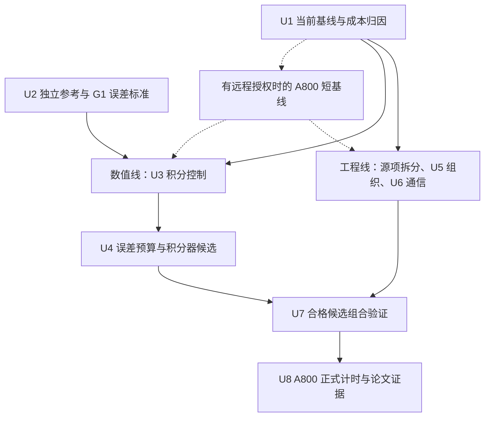

# 面向双温反应流的 GPU 化学计算与多 GPU 阶段协同优化 - Plan

## Goal Capsule

- **Objective:** 在相同实际误差和物理约束下，缩短双温反应流完整耦合时间步，并改善单节点多 GPU 扩展效率，形成具有可检验方法贡献的论文。
- **Means:** 基线测量后，独立推进保持算法不变的工程优化与化学积分控制研究，再组合验证完整步收益。
- **Product authority:** 本方案定义已确认的研究范围；现有化学移植、输出重启和性能计划继续约束各自接口，不因本方案自动修改生产默认值。
- **Status:** G0 已启动。U1 完整步基线、逐 rank 归因与真实状态回放已建立。U5/U6 三个工程候选为纯源项、32线程化学块和报告降频，默认值不变。2026-10-13 批准 G1 后，11状态三档固定容差筛选通过，U3 已接入默认关闭的全场历史及检查点生命周期；CPU/GPU NP1/NP2 x/y/z 精确续算、工程交互及受影响内存检查通过。同状态历史工作增加约1.86%，不作整步收益主张。U4/U7 完整流动参考与误差—成本矩阵、G2/U8 尚待推进。G2 本地范围已起草，未批准或执行。结果及提案见[实施记录第9至11节](../../documents/ASTR_AIR5_STAGE_COORDINATION_LOCAL_RESULTS_20261013.md)。
- **Execution authority:** 执行启动后，在批准范围和资源预算内自主完成可逆本地实验，不逐个候选重复审批。需人工确认的事项集中列于 Decision Gates；Git 和远程任务操作另行授权，默认单代理、当前工作区。

---

## Product Contract

### Summary

以现有 ASTR FP64 AIR5 双温反应流为基础，研究局部化学误差控制与 GPU 执行组织的联合优化。
保持整体反应输运耦合不变，以完整时间步的等误差性能和单节点 1/2/4 GPU 扩展为主要结果。

### Problem Frame

化学积分的代价既来自局部刚性，也来自热力学反演、候选状态检查和重试。
相同网格点数不意味着相同阶段耗时，单个核函数加速也不保证完整时间步加速。

现有代码已经实现解析受约束 Jacobian、ROS-2 小矩阵求解及阶段内 LU 复用。
因此，论文不能以“将反应速率搬到 GPU”或“加入解析 Jacobian”作为新贡献。
具体实现证据见 Sources / Research。

历史本地反应流记录中，化学阶段两 rank 耗时约为 0.174/0.176 s，而界面处理和物性恢复存在更明显差异。
这些数据说明需要区分化学局部工作量、阶段到达偏差和通信本身的代价，不支持预设化学跨 rank 不均衡是主要瓶颈。
该记录来自旧版本和本地 Ada GPU，不是当前版本或 A800 的性能结论，来源为[既有性能计划](../../documents/ASTR_GPU_PERFORMANCE_OPTIMIZATION_PLAN.md)。

### Key Decisions

- **形成方法论文，而不只汇报工程加速。** 要解释数值选择如何影响工作量和阶段关键路径。 Governs R14, R15. (session-settled: user-directed; chosen over engineering-only speedup: 用户要求形成方法论文。)
- **允许研究化学积分算法及误差控制。** 不将现有 ROS-2 和容差设为不可变化的研究边界。 Governs R4, R5. (session-settled: user-directed; chosen over immutable ROS-2 and tolerances: 用户选择包含数值算法与误差控制研究。)
- **保留整体耦合框架。** 不同时开展全局分裂方式重设计。 Governs R2. (session-settled: user-directed; chosen over changing global coupling: 用户选择保持 Strang 分裂与输运 RK3。)
- **动态容差服从统一实际误差标准。** 不能把参数相同当作精度相同。 Governs R5, R6. (session-settled: user-directed; chosen over fixed local tolerances: 用户允许状态相关误差预算，但要求独立参考验收。)
- **固定空间分区，先研究卡内组织。** 排除跨 GPU 化学任务迁移。 Governs R8. (session-settled: user-directed; chosen over cross-GPU task offload: 首篇聚焦局部任务组织和阶段协同。)
- **以单节点 A800 为必需硬件范围。** 跨节点扩展不是首篇必需结果。 Governs R13. (session-settled: user-directed; chosen over mandatory multinode scaling: 用户选择本地双卡开发及 A800 1/2/4 卡验证。)

<!-- ce-section: work-relationships -->
### How This Work Fits Together

本方案只覆盖双温反应流的数值与并行协同研究，不替代整个 ASTR 移植路线。
以下关系用于界定依赖，不承诺额外开发事项。

- **Depends on:** [化学移植计划](../../documents/ASTR_GPU_CHEMISTRY_PORTING_PLAN.md)提供模型、物性、状态约束和已有验证基础。
- **Shares:** [性能优化计划](../../documents/ASTR_GPU_PERFORMANCE_OPTIMIZATION_PLAN.md)提供计时与归因经验，但历史结果不能充当本研究的新基线。
- **Shares:** [输出重启重设计计划](../../documents/ASTR_OUTPUT_RESTART_REDESIGN_PLAN.md)约束权威状态和精确续算。
- **Can proceed independently of:** [原位后处理计划](../../documents/ASTR_INSITU_POSTPROCESSING_PLAN.md)的渲染和产品扩展，不纳入本研究的主要计时窗口。
- **Enables:** 后续更大规模或其他后端的反应流优化，但其验证不由本方案自动覆盖。

### Requirements

**Physical and coupling invariants**

- R1. 保持 FP64 和现有固定 AIR5 双温模型，包括组分、反应、热力学、输运及 V-T 模型，不以简化物理换取加速。
- R2. 保持化学半步、输运 RK3 整步、化学半步的 Strang 框架，局部积分阶数提升不自动视为整体耦合阶数提升。
- R3. 保持现有组分保正、质量与元素守恒、组分闭合及双温可容许域约束，不通过截断、额外归一化或放宽物理检查掩盖积分失败。

**Numerical research**

- R4. 以现有 ROS-2 为基线，允许比较局部积分器、初始步长及步长控制方法，按独立参考下的实际误差选择候选。
- R5. 允许局部容差随状态或误差预算变化，但 GPU 负载高本身不能成为降低精度的理由。
- R6. 改变积分器、容差或初始步长的数值候选，在等误差性能排序前冻结统一实际误差标准，明确各组分、温度、振动能及近零状态的尺度处理。保持算法与误差控制不变的工程候选先沿用已有数值合同，不等待新参考研究完成。
- R7. 对误差预算与外层分裂、输运误差的关系提供推导和收敛证据，不直接把容差设为某个时间步幂次并宣称已控制全局误差。

**Execution and lifecycle**

- R8. 保持 CFD 空间分区固定，只在当前 GPU 内组织化学任务，不迁移网格或跨 GPU 借用算力执行局部化学。
- R9. 阶段协同只能重叠无数据依赖的工作，保持状态、物性缓存、边界、共享节点处理和 halo 所属阶段一致。
- R10. 若引入会改变后续积分选择的控制历史或任务状态，其初始化、拒绝回滚、边界及精确重启生命周期必须与现有化学补偿状态一起验收。
- R11. 新调度不得使失败 rank 的部分更新状态进入边界或通信，收窄同步须单独证明依赖和错误传播正确。

**Evidence and performance**

- R12. 按改动影响分别验收参考精度、CPU/GPU 一致性、重启、内存安全、物理量和性能；复用有效的不可变证据，不在基线归因前要求完成全套矩阵。各类证据不能互相替代。
- R13. 本地双 RTX 4000 Ada 用于开发，首篇论文必须具有单节点 A800 1/2/4 GPU 的反应流结果，不外推跨节点能力。
- R14. 主要性能指标采用完整耦合步的墙钟时间，包含任务整理、物性恢复、边界、通信、必要检查及统计成本，排除启动和大文件 I/O。
- R15. 通过分项消融和等误差比较，区分积分控制、卡内组织及阶段协同的独立收益和联合收益。
- R16. 首个科学或数值门槛失败即停止相关运行及该候选的下游性能与物理结论，允许在原授权内继续定位和修复。独立且不受该故障影响的工作包不因此停工；模型疑点或 CPU 数值缺陷先提交人工判断。
- R17. 保留可复现的当前实现基线，任何生产默认值、外部任务或新增物理范围的改变另行审批。

### Research Hypotheses

以下均为待检验假设，不是已完成能力或已确认创新。

| 研究假设 | 需要建立的因果证据 | 否定或收缩条件 |
| --- | --- | --- |
| 状态相关误差预算减少不必要化学工作 | 相对已调优的固定容差，在同一实际误差标准下减少工作量和完整步成本 | 只优于精度过剩的生产基线，或成本被预算计算抵消 |
| 控制历史可预测下一个化学半步工作量 | 预测误差和初始拒绝次数降低，且输运或滤波后仍可靠 | 状态突变导致重试增加，或历史存储成本超过收益 |
| GPU 内工作组织可减少长尾 | 工作量分布、有效执行时间和整理开销共同解释净收益 | 工作量接近均匀，或排序与数据搬运抵消收益 |
| 阶段协同可缩短多 GPU 关键路径 | 时间线显示实际重叠增加，最慢 rank 完整步缩短 | 依赖不允许重叠，或收益仅来自遗漏检查与通信 |
| 联合设计优于独立优化拼接 | 相同组成机制下，联合决策优于关闭联合决策的独立拼接对照，并解释交互作用 | 没有可区分的联合决策，或收益仅为各项独立优化的组合 |

两条线独立筛选；U5/U6 可直接使用现有合格 ROS-2 基线。组合时才验收机制交互，未进入最终方案的机制不扩展完整矩阵。

### Key Flows

- F1. **建立当前基线。** 固定程序、模型、输入和计时边界，通过来源/状态/计时短检查后即归因，不等待无关数值研究。历史数据用于确定测量重点。
- F2. **并行筛选。** 工程线保留原算法及误差控制，数值线依 U2/G1 比较实际误差；分别计入新增存储、诊断和调度开销。
- F3. **组合验收。** 合格候选按影响范围完成 U7，检查控制历史、补偿、边界和通信交互。只组合有明确用途的机制。
- F4. **形成论文证据。** 早期目标硬件短测用于修正热点判断，最终按 U8 完成正式对照；两者使用不同证据标签。

### Experiment Design

**Validation hierarchy**

| 层次 | 对象 | 主要用途 | 不能据此宣称 |
| --- | --- | --- | --- |
| 零维 | 冷态、热态、近均衡、解离及痕量组分状态，覆盖化学与 V-T 耦合 | 独立参考、容差和局部积分可靠性 | 完整 CFD 或 SBLI 物理已通过 |
| 状态批次 | 来自真实算例同相位的不同刚性状态 | 工作量分布、预测、卡内组织与寄存器代价 | 多 GPU 扩展已经改善 |
| 短窗 ASTR | 已有非均匀 AIR5 平板或捕获型激波夹具 | 同相位场、阶段依赖、重启及多拓扑 | 长时统计已收敛 |
| 代表性 ASTR 反应流 | 已有模型适用域内的反应边界层或 SBLI | 完整步净收益与关键物理量保持 | 新物理模型或任意数据库严格复现 |
| 单节点 A800 | R13 的配置 | 最终硬件上的整步性能与强扩展 | 跨节点能力 |

零维优先复用已有独立 Radau 参考。
完整流动参考仍由 ASTR 产生，不新增 Python 完整 CFD 推进器。误差研究采用受控变化，不把单一时间加密试验解释为各项误差已分离：

| 检查对象 | 固定条件 | 改变量及可支持的结论 |
| --- | --- | --- |
| 化学积分敏感性 | 外层 dt、空间网格、分裂、滤波序列与物理观察窗 | 收紧化学容差，结合独立零维参考判断局部积分误差及其流动响应 |
| 耦合时间误差 | 空间网格和已证明足够小的化学误差 | 加密外层 dt，检查分裂与输运共同构成的时间误差；不据此单独分离二者 |
| 空间误差 | 物理问题和已控制的时间/化学误差 | 单独加密网格，另列空间收敛，不混入前两项结论 |

只有论文主张需要时才追加单算子或分裂误差隔离试验，不默认展开 dt、容差和网格的全因子矩阵。
空间离散、边界、滤波、入口样本与比较时刻在每组对照中保持一致。

时间加密前必须界定滤波语义：当前 AIR5 在每个输运 RK 阶段调用空间滤波，减小外层时间步会增加相同物理时长内的滤波次数。
无滤波诊断夹具可用于分离时间误差；有滤波的候选先在相同外层时间步和滤波序列下比较化学误差。
未建立滤波作用可比较的参考前，不把有滤波的时间加密结果称为固定半离散系统的阶数验证，也不为通过验证擅自改变生产滤波频率。

**Ablation structure**

至少区分：当前 ROS-2 基线、只改变积分控制、只改变任务组织、只改变阶段协同，以及最终联合候选。
若最终候选包含替代积分器，需增加“替代积分器但不改变组织”的对照。

- **动态预算的额外对照：** 保留生产基线，同时建立同一 ROS-2、同一组织方式下的固定容差工作量-精度曲线，比较满足冻结门槛的最低成本合格点。仅优于原固定容差，不能证明动态预算有独立收益。
- **联合决策的额外对照：** 若保留“优于独立拼接”的主张，比较相同组成机制的独立拼接与联合决策，不必展开全因子矩阵。若没有实质不同的联合决策，只报告组合净收益。

以上是 R15 的比较结构，不要求没有证据的机制也必须实现。

**Exploration budget**

- 首轮工程线最多筛选三个独立候选：报告诊断降频、纯 source 拆分、一个由归因支持的组织/通信候选；不自动展开所有线程块或后端组合。
- 数值线先研究一个控制机制，固定容差首轮最多三档；具体数值和参考门槛由 G1 冻结。这是探索数量上限，不是新的精度要求。
- 每项先完成最小正确性检查，再做一次短计时；最多追加一轮有证据的定点修订。继续定位数值缺陷不计为扩大候选，但缺陷未解决时不进入下游计时。
- 首轮结束即汇总收益、负结果和剩余假设。只有明确成本来源或新增证据才扩展候选，不为追求正收益无限扫描；平台不可用时本地工作继续。
- 重复计时、主机/设备/磁盘预算优先沿用覆盖当前范围的已批准配置，缺失项集中一次确认。本段不授权计算或新增平台任务。

**Candidate retention**

沿用[性能计划的最新保留规则](../../documents/ASTR_GPU_PERFORMANCE_OPTIMIZATION_PLAN.md)：无固定最小收益比例。通过对应数值、内存及资源检查，且能明确说明减少何种计算、传输或等待的候选可保留为默认关闭的可选项，同时记录新增成本。
区分“已测净收益”“机制合理但本地无净收益/尚待目标硬件验证”和“数值不合格，仅保留诊断记录”。本地变慢不自动删除合格候选；主要加速结论和默认推荐仍须相应完整步证据支持。

**Timing and scaling**

按 R14 对稳定完整步计时，每个窗口以最慢 rank 的墙钟时间为准。
主要口径为每轮测量窗口的各 rank 累计耗时取最大值，再除以完整步数；逐步最慢 rank 分布作为补充，不能混同为同一个窗口统计量。
正式计时不启用 profiler；profiler 用于解释时间线，不作为最终加速比分子或分母。
预热规则、样本窗口、重复次数和离散性报告在候选排序前固定，不逐候选挑选最有利时间。

- 同卡数优化收益：`S_opt(P) = T_baseline(P) / T_candidate(P)`。
- 同一实现的强扩展：`S_strong(P) = T(1) / T(P)`，`E_strong(P) = S_strong(P) / P`。
- 若补充弱扩展，需另外冻结全局问题构造和刚性分布，不能仅固定每卡网格点数就认定每卡化学工作量一致。

阶段时间用于定位关键路径，重叠区间不重复累加。
MPI 阻塞时长包含到达偏差，CUDA 同步 API 时长可能覆盖核函数执行，均不能直接解释成可全部消除的通信或同步成本。
GPU 数、MPI 拓扑、通信后端和 CPU 配额是独立实验因素，不将改变它们得到的收益全部归因于数值方法。

**Required evidence**

- 各组分绝对误差与合理归一化误差、T/Tv、振动能、守恒与闭合残差，以及误差随外层时间步变化。
- 化学接受/拒绝步、RHS/Jacobian 次数、热力学反演工作量的分布和长尾，而不只记录全域最大值。积分器逻辑计数与实际例程调用分开记录，不用一个计数代表全部实现成本。
- 各 rank 的化学、输运、物性恢复、边界和通信阶段时间，以及完整步的最慢 rank。
- 任务整理与额外存储成本、寄存器和局部内存证据；不把低 occupancy 自动等同于瓶颈。
- 代表性流场中的温度、组分与适用的壁面或激波诊断；物理量门槛按 R6、R12 单独确定。

### Success Criteria

研究验收以 R1-R17 为前提，至少交付以下证据：

1. 明确误差预算或执行组织方法，并说明与已有批处理、动态容差和负载组织方法的差异。
2. 在冻结的参考标准下建立实际误差与计算代价曲线，给出痕量组分和双温能量的分项结果。
3. 完成 R15 的消融，证明净收益超过实测计时波动；只加快化学核而整步无收益的结果不作为主要性能成功。
4. 完成 R13 的反应流强扩展，分别报告优化收益与扩展效率；不要求未经基线支持的预设百分比。
5. 明确有效范围和失败条件，支撑方法可复现而非仅展示某个算例能运行。

研究流程可以得到否定结果。
若没有可区分于已有方法的机制或没有可靠整步净收益，应收缩论文主张或重新选题，不把工程组合包装成已成立的新方法。
论文录用不属于可承诺的验收条件。

### Scope Boundaries

物理、耦合、状态和失败传播的硬约束统一以 R1-R17 为准，工作包不重复设立另一套限制。
本研究不增加湍流模型、AMR、跨节点、混合精度、FP32 滤波或渲染任务；全节点 CPU 矩阵、完整数据库复现和无关长时生产模拟不是必交付项。
已有积分器、解析 Jacobian、小矩阵求解、通用分组及 CUDA-aware MPI 是比较基础，方法贡献由研究假设及消融确定。

### Dependencies / Assumptions

本研究依赖当前模型在所选状态和算例中有效，以及至少存在可供收敛比较的时间窗口。
若真实状态没有明显工作量长尾，卡内分组可能不值得采用，应按 Research Hypotheses 收缩候选。

新控制历史的收益取决于相邻化学半步之间状态变化的可预测性。
旧 `suggested_step` 是下一次积分的试探初值，不是可跨阶段直接使用的物性或已接受状态。有限且为正的历史可在限制到当前半步长度后试用，保留原候选物理检查、误差估计和拒绝重试。
输运、滤波和边界更新不自动导致历史清空；是否增加状态突变回退规则由实测拒绝代价决定。首次初始化且尚无历史时采用基线初值，已标为有效却非有限或非正的历史直接报错。精确重启按 R10 恢复所需历史，缺失或损坏时不得静默回退。

A800 测试依赖可用资源及已验证编译、MPI 与通信环境。
在资源尚不可用时只能报告本地结论，不能用 Ada 结果替代 A800 必需验收。

### Outstanding Questions

2026-10-13 用户批准 G1 首轮：11个零维参考、逐分量实际误差标准、三档固定容差和一个初始步长历史机制，具体尺度见实施记录第6节。未决项为 G2 的正式代表算例、完整流动参考及物理门槛、物理窗、强扩展网格和资源/重复计时配置。G1 不授权平台任务或改变生产默认。
已有合同可覆盖的工程检查不因 G1 未冻结停工。热点、分组必要性、初始步长策略和是否值得加入替代积分器，由有界实验回答，不逐项作为审批问题。
弱扩展仍是可选扩展，不纳入首轮矩阵。

### Sources / Research

**Repository evidence**

原始审查依据为 `b2162e8d51ae82a181bb123966b0df7ad68e8f17` 所在工作区，日期 2026-10-09。
2026-10-12 在 HEAD `308b5f7df3a834abee11aafa0d6ccdac7ed28cee` 复核化学半步、ROS-2 源项调用与拒绝路径及反应流主循环；其余入口沿用原审查记录，实施时按影响检查。以下是源码事实，不是新增性能结果。

| 来源 | 已核对的事实或用途 |
| --- | --- |
| [chemistry_kinetics_gpu.cuf](../../src_gpu/chemistry_kinetics_gpu.cuf) | `chemistry_ros2_gpu` 已有解析受约束 Jacobian、一次 LU 与两次阶段回代；`air5_instantaneous_source_gpu` 调用 source/Jacobian 联合例程，编译后未用求导成本须另测；初始步长不跳过候选检查和拒绝 |
| [chemistry_coupling_gpu.cuf](../../src_gpu/chemistry_coupling_gpu.cuf) | 半步核当前 `rtol=1e-9`、`atol_factor=1e-13`；每次以半步时长初始化子步，建议步长未持久化；极值/计数每半步归约，但当前只用于指定步报告，失败 status 有独立放行用途 |
| [mainloop_gpu.cuf](../../src_gpu/mainloop_gpu.cuf) | `time_integration_rk_gpu` 的反应分支确认 R2；该分支在通用 overlap 设置前返回，不能由通用开关推定 AIR5 重叠已支持 |
| [air5_radau_reference.py](../../tests/gpu_validation/air5_radau_reference.py) | 已有基于机制数据和 SciPy Radau 的独立零维参考，不是完整流动推进器 |
| [run_air5_performance_diagnosis.py](../../tests/gpu_validation/run_air5_performance_diagnosis.py) / [计时解析测试](../../tests/gpu_validation/test_air5_complete_step_timing.py) | 可复用逐 rank 完整步记录校验；旧驱动依赖 `flowfield.h5`，且案例仅到 NP=2，不能直接作为新输出体系的四卡入口 |
| [run_output_air5_restart_validation.py](../../tests/gpu_validation/run_output_air5_restart_validation.py) | 已有新输出体系下 AIR5 连续/重启测试和输出配置生成，可复用而不恢复旧检查点兼容 |
| [chemistry_solver_gpu.cuf](../../src_gpu/chemistry_solver_gpu.cuf) / [halo_exchange_gpu.cuf](../../src_gpu/halo_exchange_gpu.cuf) | RK 阶段滤波、物性复用范围，以及共享节点协调后再次刷新 halo 的依赖 |
| [benchmark_runtime.F90](../../src/benchmark_runtime.F90) / [mainloop.F90](../../src/mainloop.F90) | 通用逐 rank 完整步计时；当前结束点早于步后原位采样和 AIR5 `writemon`，需先核对 R14 的完整统计边界 |
| [ROS-2 ADR](../adr/0028-use-cell-local-ros2-for-the-first-production-chemistry-integrator.md) / [Jacobian ADR](../adr/0029-use-an-analytic-constrained-jacobian-for-production-ros2.md) | 初始方法和约束的设计依据；早期进度文字不代替当前源码事实 |
| [性能优化计划](../../documents/ASTR_GPU_PERFORMANCE_OPTIMIZATION_PLAN.md) | 2026-09-25 历史 Nsys/NCU 记录，包含阶段差异、FP64 管线及寄存器证据 |
| [软件方向 ideation](../ideation/2026-10-09-astr-gpu-software-directions-ideation.html) | 本选题来自反应流阶段优化与 FP64 化学计算两个候选方向 |

固定容差和初始子步是基线选择。诊断频率、重复求导、初始子步预测和寄存器压力列为待测成本，不按源码调用数直接预报加速幅度。

**Literature boundaries**

- [Tekgül et al., DLBFoam, CPC 267 (2021), 108073](https://arxiv.org/abs/2011.07978)已研究分裂反应流中的动态化学负载平衡；不能仅以“化学计算与负载平衡结合”主张新颖性。
- [Balos et al., SUNDIALS time integrators for exascale applications with many independent systems of ordinary differential equations, IJHPCA 39 (2025)](https://journals.sagepub.com/doi/10.1177/10943420241280060)讨论批处理、数据组织、动态容差和工作量估计；本研究必须进一步说明双温约束、误差预算与阶段关键路径的具体联系。
- [Stone, Alferman and Niemeyer, Accelerating finite-rate chemical kinetics with coprocessors](https://arxiv.org/abs/1608.05794)比较化学积分的并行组织，提示线程映射应按工作负载评估，而非预设统一最优粒度。
- [KPP Rosenbrock methods 官方文档](https://kpp.readthedocs.io/en/stable/num_methods/rosenbrock-methods.html)给出 ROS-2 与 RODAS-3 等现有方法；采用它们属于基线或候选实现，不是新积分格式的证明。

这些来源用于确定比较对象和方法差异。

---

## Planning Contract

### Current Implementation Constraints

本节记录本轮源码审查结果，限定候选如何接入，不将其直接判定为缺陷或性能瓶颈。

| 当前实现 | 对实施方案的约束 |
| --- | --- |
| 单元六维状态包含五组分部分密度和振动能，化学内固定密度、动量与完整总能量 | 实际误差须分别检查组分、振动能、T/Tv 和重构残差；总能量重构正确不代表振动能积分准确 |
| 正式半步核以半步长度初始化子步，并传递补偿状态；批处理探针支持逐单元初始步长和 atol，但不传递补偿状态 | 可复用探针筛选控制方法，不能将其直接替换正式补偿路径；建议步长未持久化不是已确认 Bug |
| 单元成功后会原位更新 q、carry 和物性，其他单元仍可能失败 | 保留全 rank 化学状态放行条件；未全局成功前不得让部分更新进入边界、halo 或输运 |
| 动态顶面有独立化学核，两个化学半步的边界收尾不同 | 索引、诊断和历史状态都覆盖独立顶面区间；不假设两半步可用同一个收尾模板 |
| solution halo 交换包含共享节点协调、补偿处理及后续纯 halo 刷新 | 不能当作单纯复制重排；物性复用排除局部面，接口物性须在对应状态协调后恢复 |
| 现有通用 overlap 分支不覆盖当前反应分支；`pinned-pipeline` 有周期 TGV 和非补偿准入限制 | AIR5 阶段协同需要单独设计接口与依赖，不能只切换现有环境变量宣称支持 |
| `air5_instantaneous_source_gpu` 当前调用 source/Jacobian 联合例程 | ROS-2 的逻辑 Jacobian 计数不等于全部实际求导工作；先测量，再决定是否拆分纯 source 计算 |

### Technical Decisions

- **先归因，两线独立。** U1 后工程线 U5/U6 可沿用当前合格 ROS-2，数值线 U2/U3/U4 单独推进。单项对照先于组合，不将一条线的探索结果设为另一条线的前置条件。
- **先消除无用工作，再考虑重叠。** 优先核对仅用于报告的归约/原子诊断频率、纯 source 的实际求导成本；保留每半步全 rank 失败放行检查。重叠候选以依赖表和时间线为依据。
- **复用既有基础设施。** 使用根 CMake、现有探针、新检查点和计时接口；GPU 文件仍由 `src/CMakeLists.txt` 登记。重型诊断只在归因运行开启，记录扰动，正式计时使用相同必需统计配置。
- **统一实际误差，允许不同控制参数。** 数值线按 `abs(candidate-reference) / (A_j + R_j*abs(reference))` 检查，其中 `A_j > 0`，具体尺度和参考余量由 G1 冻结。工程线使用对应已有等价合同。
- **历史作为建议而非已接受状态。** 不像守恒量一样平均步长历史，保留候选检查和拒绝；影响未来积分选择的历史按 R10 纳入精确重启。状态突变回退策略在 U3 中按代价筛选。
- **以目标硬件修正筛选，而非阻塞开发。** 经授权可在 U1 后做 A800 短基线，正式验收仍在 U8。卡内组织只缓解当前 GPU 的长尾，不承担跨 rank 任务迁移。

### Decision Gates

| 决策 | 必须提供的材料 | 适用范围 |
| --- | --- | --- |
| G0 执行范围记录 | 实施启动请求、选定工作包及本地资源范围 | 2026-10-12 已获启动请求，先执行 U1 本地短测；沿用现有 16³ AIR5 夹具及每测试目录/受控输出缓冲 64 MiB，不扩大物理范围。其余本地包按既有预算推进，缺失预算集中确认 |
| G1 数值与参考冻结 | 2026-10-13 已批准首轮11个零维状态、分量尺度与参考余量、三档固定容差和一个初始步长历史机制；见实施记录第6节 | 允许该范围数值研究；完整流动参考/物理门槛另冻结，不阻止既有合同工程线 |
| G2 正式实验与资源冻结 | 代表算例、网格/物理窗/拓扑、CPU 配额、主机/设备/磁盘预算、预热/重复及不确定性方法 | 正式矩阵前集中确认；小型开发测试优先复用已有批准预算。远程提交还需具体任务授权 |

G0 之后，候选先后顺序、预算内的块尺寸/索引实现、短测窗口调整及依据负结果退出，由执行者按探索预算决定，不再设置人工 G3。
R16/R17 涉及的 CPU 数值缺陷、物理/数值范围、生产默认值及外部任务变更才重新提问。G1/G2 已批准部分只在实质改变时重开，不因某候选较慢重新审批。

## Implementation Units

以下为完整工作包范围；阶段状态以顶部 Status 和末尾执行记录为准，保留 U1-U8 编号以便追踪：

- 工程线：`U1 -> U5/U6 -> U7`，直接使用当前合格 ROS-2，不依赖 U3/U4。
- 数值线：`U2 -> G1`，随后与 U1 一起支持 `U3 -> U4 -> U7`。
- U7 可分批交付单项与组合证据；U8 正式矩阵依赖所选候选的 U7 和 G2。
- 经具体远程授权，U1 后可先做 U8 的目标硬件短基线；它不是正式验收，也不阻塞本地工作。

### U1 Baseline And Measurement

**Covers:** R9, R11-R14, R17. **Depends on:** G0.

- 入口：`run_air5_performance_diagnosis.py`、`run_output_air5_restart_validation.py`、`benchmark_runtime.F90`；确需 AIR5 阶段标签时在相关 GPU 调用处最小接入。
- 适配新检查点批次、可参数化的算例/窗口/NP/拓扑。保留旧数据来源，不把修改后的驱动描述成历史结果的原始生成器。
- 以通用 `ASTR_COMPLETE_STEP_TIMING` 为基础统一 CPU/GPU 窗口，核对必需小统计和设备完成点。2026-10-12 已将完整步 `writemon` 纳入该窗口并补解析检查；根 rank/RK 内部计时只作补充。主指标为各 rank 在整个测量窗内累计耗时的最大值除以步数，不逐步取最大值后相加。
- 新输出配置关闭 checkpoint、volume、slices，原位渲染和大验证快照关闭；初始网格/检查点读入在计时外。AIR5 不使用仅准入周期 TGV/Shu-Osher 的 `ASTR_GPU_BENCHMARK_NO_FIELD_IO`。
- 诊断运行记录两次化学半步、输运/滤波、物性、边界、共享节点/halo、失败检查及报告归约的时间线，分离 logical RHS/Jacobian/LU 计数与实际例程/反演工作量。已有 TGV 专用 phase timer 不能未经扩展直接用于 AIR5。
- 首轮选一个已验证反应流短回放，完成必要状态检查后即测 NP=1/2，不等待 U2-U4；将报告专用归约/原子操作与强制失败检查分别计数，核对其实际消费者。
- 有 A800 任务授权时，以同一模型和短窗补目标硬件热点/容量基线；工具权限或排队不允许时记录缺项，不转化为本地实施阻塞。
- 交付：不可变基线清单、完整计时窗口说明、工作量分布、各 rank 关键路径；诊断开/关不改变权威状态且扰动已报告。更新计时解析测试，缺 rank/重复/非有限记录即报错。

### U2 Reference And Error Contract

**Covers:** R1-R7, R12, R16. **Depends on:** G0; 交付后申请 G1.

- 入口：`test_air5_radau_reference.py`、`check_ros2_compensation_radau.py`、ROS-2/Radau/补偿探针，以及当前 ASTR 短窗驱动。
- 选模型域内冷/热/近均衡/解离/精确零与痕量状态，分别覆盖 chemical-only、V-T-only 和 coupled；真实状态批次保留来源步、半步/阶段及状态，不只挑选快速状态。
- 每一参考状态报告更紧 Radau 解之间的逐分量差及参考误差余量。独立 RHS/热力学检查与积分收敛分开；仅“tight 比 medium 好”不足以界定参考误差。
- 单列振动能误差、T/Tv、各组分、质量/元素/闭合残差与总能量重构残差；实际误差标准覆盖最大局部偏差和必要的整体量。
- 依 Experiment Design 分别改变容差和外层 dt：固定 dt 收紧化学误差，化学敏感性足够小后检查耦合时间误差，空间误差另测。相同物理时刻及入口样本对齐，不由单次时间加密声称已分离分裂和输运误差。
- 交付：参考集合与收敛表、实际误差验收器及 G1 决策材料。失败状态和参考不确定状态不得进入候选性能排序。

### U3 Local Control And Lifecycle

**Covers:** R3-R6, R10-R12. **Depends on:** U1, G1.

- 入口：`src/chemistry_kinetics.F90`、`src_gpu/chemistry_kinetics_gpu.cuf`、`chemistry_coupling_gpu.cuf`，以及 CPU/GPU 补偿与新检查点状态接口。
- 先扫描 ROS-2 固定容差并建立合格成本曲线，再独立比较初始步长或控制历史，不同时改变线程映射、积分格式及阶段依赖。
- 历史只作下一次积分的建议，有效历史须有限且正并限制到当前半步长度；首次初始化使用基线初值，非法有效历史或精确重启历史缺失直接报错。输运/滤波后先试用，不默认清空；再依据拒绝成本决定是否加入状态突变回退，覆盖动态顶面和共享节点索引。
- 子步拒绝不提交试探历史/补偿；整个半步失败不向下游消费部分更新。新状态若影响后续决策，同步定义 CPU/GPU 初始化、提交/回滚和检查点字段。
- 精确续算测试的恢复点必须有非默认历史，并逐值核对历史与权威状态。仅最终流场偶合一致不能证明历史被保存；同后端、同算法、同拓扑精确门槛与跨后端容差门槛分开。
- 2026-10-13 已接入 CPU/GPU 全场可选控制：`ASTR_AIR5_CHEMISTRY_TOLERANCE=baseline|loose|tight`，默认 baseline；`ASTR_AIR5_STEP_HISTORY=off|previous`，默认 off。历史不参与节点平均、halo 通信或滤波，物理边界未推进节点保留首次标记，动态顶面按实际化学索引更新。既有 `state.h5` 可选增加 q0035，并由 rank_extras 保存共享副本；`air5_config.bin` 可选追加两个 int64，不新增文件。初步检查见实施记录第9节，完整流动实际误差尚未准入。
- 冻结场的逐任务归因显示，4338个任务中37个计数改变，均使用较短历史初值；其中25个原本只需一次成功尝试。rank1 内部的逐 warp 最大尝试次数之和增加约13.7%，仅为 SIMT 循环成本代理，不是实测耗时。保持历史默认关闭，不因此增加控制机制；证据见实施记录第9节。
- 交付：控制候选与固定容差对照、生命周期测试及开关关闭时回到基线的证据。新的历史状态存储与内存成本计入比较。

### U4 Error Budget And Integrator Selection

**Covers:** R2, R4-R7, R15-R16. **Depends on:** U2, U3.

- 先检验外层固定步下的状态相关预算，再评估外层步长变化；推导误差估计到观测误差的联系，并用独立参考检验，不宣称局部 rtol 给出严格全局上界。
- 与 U3 调优后的固定容差比较；预算更新、观测与拒绝成本均纳入。校准状态与留出的未调参状态/流动窗口分开，防止只对一批状态过拟合。
- 只有工作量-精度曲线表明 ROS-2 的阶数/稳定性或重试成本限制收益时，才增加 RODAS3 等替代积分器；沿用相同物理约束、参考门槛及补偿事务，不改变整体 Strang/RK3。
- 纯 source 拆分归 U5 工程线，不再作为本包的后置任务。局部求值优化与积分控制收益独立计量。
- 交付：预算/积分器的等实际误差曲线、适用范围和失败条件；没有独立收益时以固定容差作为推荐对照，其余合格候选按 Candidate retention 分类保留。

### U5 GPU Compute And Local Task Organization

**Covers:** R1-R3, R8-R12, R14-R15. **Depends on:** U1；默认使用当前合格 ROS-2 基线，与 U3/U4 独立。

- 首个计算候选为纯 source 求值拆分：先核对编译器是否消除了未使用的 Jacobian，再按实测决定最小改动。保留同状态 RHS、物性检查，不改变 ROS-2 系数、容差、第一阶段 Jacobian/LU 或补偿。2026-10-12 用户批准唯一失败合同差异：第二阶段不再计算或检查未使用的 Jacobian，仍检查实际源项、T/Tv、压力及可容许域；第一阶段和全局失败放行不变。
- 候选为默认关闭的 `ASTR_AIR5_SOURCE_EVALUATION=source-only`，默认 `joint`。已获批准将模式追加到现有 `air5_config.bin`，精确续算要求一致；没有该追加字段的既有新式批次仅按 `joint` 恢复，不增加文件或改变权威场格式。
- 2026-10-13 首轮唯一组织候选选为 `ASTR_AIR5_CHEMISTRY_BLOCK_SIZE=32`，默认128。当前小夹具的块数低于本地 SM 数，先只改变发射配置，不引入排序/桶/持久核；体内与动态顶面核共用此配置。保持节点索引和运算顺序，无新持久数组，合法状态的块尺寸切换可精确续算，不加入数值检查点合同。三项工程机制已用满首轮预算。
- 全场控制接入后的冻结二进制已补编译资源检查：化学核仍为255寄存器、3872字节栈/线程，pure source 仍无导数例程调用。静态资源不证明耗时不变；旧工程二进制收益只对应原冻结版本，不用于新版本或数值控制排名。
- 后续优化轮次若仍有明显长尾，再评估简单索引分组/步长桶等组织候选，本轮不实施；先保留逐单元独立接受/拒绝，不默认引入持久核或 warp 统一拒绝。新积分控制合格后才增加其与组织方式的组合。
- 固定 CFD 数组与 rank 所有权，复用设备工作缓冲；记录构建索引、预测、整理及散射成本，不只测分组后的化学核。只在当前 GPU 调度，不跨卡转移化学任务。
- 验证体内、共享面及独立动态顶面任务不遗漏、不重复；保持全局化学状态检查之后才放行边界/通信。纯组织候选优先维持单元运算顺序及同状态结果。
- 交付：同状态求值/任务覆盖、补偿与索引一致性、内存安全及完整步成本；本地无收益但机制明确的合格实现按 Candidate retention 保留，不无限扩展调度框架。

### U6 Stage Coordination

**Covers:** R9-R12, R14-R15. **Depends on:** U1；默认使用当前合格 ROS-2 基线，不等待 U3/U4 或 U5。

- 建立两次化学半步各自的读写/失败/通信依赖表：核完成、状态复制、全 rank 成功、边界覆盖、内部物性、共享节点处理、halo 刷新、面物性和消费阶段。
- 最小候选先评估报告诊断降频：确认极值/工作计数没有控制器或可容许性消费者后，只在报告步计算相应原子诊断并归约，诊断模式可按需保持逐步统计。每半步失败 status 及参与数值决策的检查保持原频率。
- 各 rank 从相同调度确定报告步，避免集体调用不一致；报告步的采样身份、极值和计数须与原基线相同，非报告步不得消费未生成的诊断值。
- 降频后仍有显著暴露成本时，再测试全局成功之后的剩余报告归约与独立工作的重叠；验证 MPI 进展和请求/缓冲生命周期。
- 仅在时间线支持时扩展 halo 与独立内点工作重叠；先证明读取同阶段状态且共享节点协调完成，不能用旧 halo 或旧缓存换取重叠。
- 仅在已证明依赖覆盖的局部位置收窄同步，保留全局失败放行与异步错误检查。性能计时终点必须等设备完成，不用计时标签产生额外逐阶段同步掩盖重叠。
- 交付：归约/诊断次数、报告一致性、失败传播、请求/缓冲生命周期和同相位场；重叠候选另给 Nsight 时间线，按 Candidate retention 分类，不重复累加重叠时长。

### U7 Integrated Numerical Acceptance

**Covers:** R1-R12, R15-R17. **Depends on:** 待验收的 U3-U6 单项或组合，不要求另一条线全部完成。

- 按 Verification Contract 的改动分类复用现有 AIR5、补偿、失败注入及新输出重启检查；来源、代码和环境未变化的 CPU/历史参考不重复运行。受影响探针必须真实构建，skip 单列。
- 改变分区接口或通信时覆盖 NP=1、NP=2 x/y/z；只改报告诊断时先做 NP=1/2 的状态、报告及集体一致性检查，不无条件展开所有拓扑。
- 连续/重启按同后端同算法同拓扑逐值检查 q、carry、必要缓存和控制历史；改变积分控制的候选对旧轨迹按 G1 检查实际误差，不要求逐位相同。
- 精确零/痕量、滤波、动态顶面、物性复用及限制器只扩展实际受影响组合；组合候选另补交互短测。失败处理统一按 R16，不把零来流夹具当作物理 HBL/SBLI 验收。
- 交付：单项/组合的通过、失败、未测和复用证据表；数值精度、内存安全及物理趋势分列，必要组合才扩展代表性流动。

### U8 A800 And Paper Evidence

**Covers:** R6, R12-R17. **Depends on:** 正式矩阵需所选候选 U7、G2 和具体远程任务授权；早期短基线只需 U1、受影响短检查、覆盖该范围的资源预算和远程任务授权。

- 早期短基线：优先复用适用的已有目标硬件证据，缺失时才申请短测，核对当前模型的热点、FP64/访存成本和容量。若包含候选，只作开发筛选，不代替正式等误差与强扩展验收。
- 固定可在单张 A800 容纳的全局反应流问题，完成同一实现 1/2/4 卡强扩展；拓扑与通信后端先有界筛选再冻结，基线/候选使用一致配置。拓扑优化收益另列，不混入算法收益。
- 最小矩阵保留工程基线、调优固定容差、各个确实进入最终方案的单项及最终组合；动态预算或联合决策主张分别补上述必要对照，不对已否定机制展开全矩阵。
- 在相同权威初始状态、外层 dt、物理窗和输入条件下，报告未 profile 的完整步耗时、离散性、优化收益和强扩展效率；profiler 单独短窗只用于解释。
- 代表性反应 HBL/SBLI 保持模型适用域和冻结物理量，生产级长时统计不是本方法论文的自动必需项。弱扩展另行决定，不以 TGV 历史或 Ada 数据补齐反应流缺项。
- 交付：方法与对照的误差-成本曲线、阶段关键路径、强扩展图、资源成本、消融和结论证据表。若没有可靠净收益或新方法差异，报告否定结果并收缩论文主张。

## Verification Contract

先按改动类别选最小检查，再对拟推荐组合补交互验收；下表不是每个候选都必须重跑的全套矩阵。

| 改动类别 | 首轮必要检查 | 扩大范围的条件 |
| --- | --- | --- |
| 报告诊断降频/归约整理 | NP=1/2 权威场与 carry 不变，报告步身份/值一致，集体顺序和故障传播正确 | 实际改变 halo、边界或历史状态时才追加对应矩阵 |
| 同算法纯 source/局部求值 | 同状态源项与失败语义，已有零/痕量及双温约束，反应流短回放和受影响内存检查 | 求值差异影响轨迹时用已有容差检查；超出原合同则转数值线 |
| 卡内调度/halo/同步 | 任务不漏不重、补偿索引、依赖/请求生命周期、相关 NP=1/2 x/y/z 及内存检查 | 新边界/滤波交互或最终组合按受影响路径追加 |
| 积分器/容差/步长历史 | G1 独立参考和实际误差，接受/拒绝及补偿事务，新历史连续/重启 | 合格后进入代表性流动与正式等误差性能比较 |

| 验收层 | 主要复用入口 | 必须回答的问题 |
| --- | --- | --- |
| 构建与探针 | 根 `CMakeLists.txt`、`src/CMakeLists.txt` 中已有 AIR5 探针目标 | CPU/GPU 实际编译运行，必需测试没有被 skip；不把链接成功视为数值通过 |
| 独立零维参考 | `test_air5_radau_reference.py`、`check_ros2_compensation_radau.py` | 参考有误差余量，振动能/痕量/温度各自满足 G1，而不只满足总能量重构 |
| 单元算法与事务 | `test_chemistry_ros2.py`、`test_chemistry_ros2_gpu.py`、补偿探针 | 同算法一致、拒绝回滚正确、工作计数语义明确、关闭候选恢复基线 |
| 调度与放行 | `test_air5_chemistry_performance.py`、现有失败注入检查 | 任务覆盖准确，失败 rank 不使部分状态进入下游；非阻塞请求和设备缓冲有效 |
| CFD 与重启 | `run_output_air5_restart_validation.py`、已有阶段快照检查 | 同相位场与新历史生命周期通过；参考精度、CPU/GPU 容差和同后端精确续算分开 |
| 计时 | `test_air5_complete_step_timing.py`、适配后的性能驱动 | NP=4/新输出受支持，统计与设备完成点一致，无大文件事件，窗口和重复固定 |
| 内存与时间线 | Compute Sanitizer、Nsight Systems/Compute | 无越界/非法访问；归因有时间线及硬件证据，不用 profiler 时间替代正式性能 |

工程线保持已有合同；数值线在 G1 后显式绑定实际误差阈值，不能用候选失败反向决定门槛。参考、代码或环境发生实质变化时才重新检查相应不可变证据的适用性。

## Definition Of Done

- [ ] 执行范围、G1/G2 决策及探索预算有记录；未实施的研究机制明确关闭，R1-R17 保持不变。
- [ ] 当前新输出体系下的工程基线与计时口径可复现，历史计数和测试入口的限制已消除或明确保留。
- [ ] 两条线独立交付；候选注明已测收益、合格可选/待目标硬件验证或数值失败，未因本地无收益删除有明确机制的合格候选。
- [ ] 参考误差余量、痕量组分、振动能及全局耦合误差分别有证据，滤波没有混淆时间收敛结论。
- [ ] 保留候选均通过数值、补偿/历史、重启、失败放行和内存安全验收；未采用机制及否定结果有记录。
- [ ] 动态预算具有调优固定容差对照；若主张联合决策优于拼接，具有同组成机制的独立拼接对照。
- [ ] 单节点 A800 1/2/4 卡反应流整步结果与消融齐备，净收益和不确定性分开报告，不外推跨节点或其他硬件。
- [ ] 方法假设被支持或被否定的范围明确。完成研究不等于承诺性能提升或论文录用，也不自动更改生产默认值。

## Review Record

### 2026-10-09 Initial Review

当次经用户许可在 Codex CLI 内使用三个子代理审查数值一致性、GPU/MPI 可执行性和实验范围，主代理核查后整合。
补齐调优固定容差与独立拼接对照，以及计时、滤波时间语义、工作计数、控制历史续算和失败放行要求。当次仅规划，临时多代理授权已结束。

### 2026-10-12 Execution Simplification

本次单代理复审后经用户确认修订文档：解除 U5/U6 对 U3/U4 的串行依赖，报告诊断先降频后重叠，纯 source 拆分前移，增加早期目标硬件短测与候选保留分类。
将化学容差、耦合时间及空间误差改为独立受控检查；步长历史不因输运/滤波自动清空；合并审批入口、移除重复验收示例，并加入首轮探索预算与按改动分类的最小检查。
本次没有实施源码、运行测试算例、操作 Git 暂存/提交或平台任务，U1-U8 状态仍为待执行。

### 2026-10-13 Local Engineering Evidence

本记录接续上述文档修订，不覆盖当时“未实施”的历史事实。

| 工作包 | 当前证据 | 尚未完成 |
| --- | --- | --- |
| U1 | 16³ AIR5、NP1/2 完整步基线，含小统计；逐 rank 阶段归因；体内/动态顶面真实输入回放 | 更具代表性的流动窗和目标硬件归因；一次半步回放不代表全程工作量分布 |
| U2 | 冷/热、零/痕量、近均衡、chemical/V-T/coupled 及 rank 工作量极值共11状态，三档独立 Radau 解；默认 ROS-2 的 q/q-carry 实际误差已收齐；2026-10-13 用户批准首轮 G1，检查器现执行明确的失败门槛 | 耦合流动参考与物理门槛；相邻参考差不是严格全局误差上界，历史审批前 JSON 不回写为已批准 |
| U3/U4 | 三档固定容差均通过11状态 G1；全场初始步长历史默认关闭，CPU/GPU NP1/NP2 x/y/z 的 12 vs 5+7 精确续算、非默认历史、滤波及工程组合检查通过；完整 CFD/带历史输入探针 memcheck 为0错误。该真实冻结场上历史逻辑工作增加约1.86%，无整步收益主张 | 完整流动实际误差参考与预算、控制的误差—成本对照及留出窗口；动态预算和替代积分器未实施。G2 本地提案见实施记录第11节 |
| U5 | FP64 纯源项拆分默认关闭；21 状态×4模式源项差为零；8466 真实状态的结果、carry 和工作计数一致；源项模式有精确续算校验；32线程块为第三个首轮候选，NP1/NP2 x/y/z 同拓扑与跨块尺寸续算逐值一致 | 更大代表窗及目标硬件验收；小网格 SM 覆盖线索不代表生产收益，不宣称完整 U5 结束 |
| U6 | 报告降频默认关闭，强制失败归约不降频；两半步依赖表已记录；组合检查保持报告/统计与同拓扑续算一致，非报告步失败阻止边界/输运/发布 | 进一步重叠尚未实施，报告专用成本暂不支持增加第四项机制；不能把 rank 到达不均衡全部解释为 MPI 带宽成本 |
| U7 | 当前工程候选的有界单项、三项组合及 packed 兼容证据；24步与17+7续算共5组，覆盖scalar/full、动态特征/规定状态顶面、NP1/2，各组38个状态/48个累计统计数据集逐值一致；完整 CFD 两 rank x-slab scalar memcheck 为0错误。随后补齐全场历史生命周期、工程组合交互与 NP2 y/full/历史组合 memcheck，见实施记录第9节 | 控制候选的完整流动实际误差、代表性流动与物理量及最终矩阵；零来流HBL仅工程夹具，局部memcheck不代替全部拓扑 |
| U8 | 未提交本目标的 A800 测试 | G2 和具体任务授权；既有平台作业不属于本目标的验收 |

当前同二进制、三轮小夹具初筛：纯源项使完整步中位耗时 NP1 从 239.724 ms 降至 213.340 ms，NP2 从 234.041 ms 降至 210.298 ms；源项+报告降频为 212.367/209.516 ms。不是生产 SBLI 或 A800 的加速比。报告降频单独收益在旧同二进制对照中仅约 0.03%，不作可靠整步收益结论。默认值、显式同步、Strang/RK3、空间分区和现有远程作业均未改变。

增加块尺寸选项后另建同二进制四组对照，SHA256 和冻结可执行文件见实施记录。默认128线程为239.183/233.651 ms，单独32线程为225.827/220.215 ms，纯源项+报告降频128线程为213.263/209.497 ms，三项组合32线程为203.333/199.092 ms；相对本轮默认耗时减少14.99%/14.79%。不跨两轮二进制计算候选收益，不叠加单项百分比；两卡效率仍约51.1%，本轮不宣称扩展性已改善。

随后补齐同一冻结二进制的两个单项对照，不新增机制：纯源项为213.901/209.875 ms，报告降频为239.823/234.045 ms。前者相对默认耗时减少10.57%/10.18%，后者无可靠收益；报告降频NP2第三轮461.075 ms长尾原样保留，不剔除或按最快时间报告。局部首轮单项/组合成本与后续窗口已记录，不以继续重复短测代替G1/G2决策。
