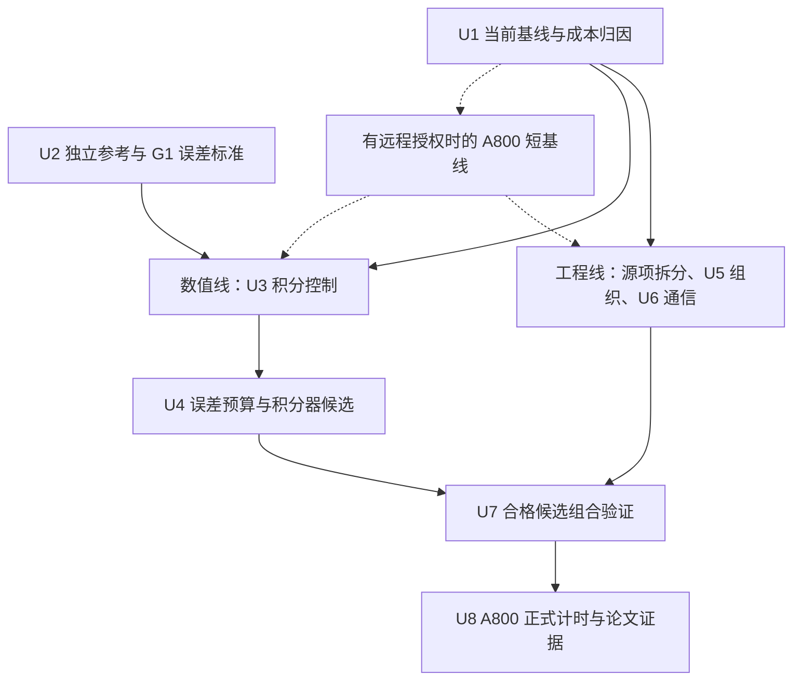

# 面向双温反应流的 GPU 化学计算与多 GPU 阶段协同优化 - Plan

## Goal Capsule

- **Objective:** 在相同实际误差和物理约束下，缩短双温反应流完整耦合时间步，并改善单节点多 GPU 扩展效率，形成具有可检验方法贡献的论文。
- **Means:** 基线测量后，独立推进保持算法不变的工程优化与化学积分控制研究，再组合验证完整步收益。
- **Product authority:** 本方案定义已确认的研究范围；现有化学移植、输出重启和性能计划继续约束各自接口，不因本方案自动修改生产默认值。
- **Status:** U1完整步基线、逐rank归因及真实状态回放已建立；U5/U6的三个工程选项默认关闭。G1及原全场历史/精确续算已有证据；旧legacy参考失败保留，不作新真值。T3-P1的126组、T3-P3公共投影回归、16³四拓扑耦合/续算及整步memcheck通过。2026-10-16新保守滤波参考余量、15项完整场误差、五控制及工程单项/组合五轮成本全部完成。三项工程组合单/双卡中位耗时减少9.68%/9.31%，但单卡保留一个明显慢样本；报告降频无可辨别收益，previous仍增加开销。新滤波/历史/工程组合的续算、NP2 memcheck及非测试构建烟测通过。当前完成本地G2范围，不等于代表工况物理验收或U8完成；结果见实施记录第38至48节。
- **Execution authority:** 执行启动后，在批准范围和资源预算内自主完成可逆本地实验，不逐个候选重复审批。需人工确认的事项集中列于 Decision Gates；Git 和远程任务操作另行授权，默认单代理、当前工作区。
- **Boundary update (2026-10-15):** T3-P1的126组及对应内存检查保持原冻结证据。T3-P3首次16³耦合暴露的公共投影缩放复核问题已获准CPU/GPU同步修复，原成功路径、容差及物理约束不变。33项局部回归通过；16³ CPU/GPU、NP1及NP2 x/y/z的12步连续/5+7续算、scalar/full、模式身份、失败事务及默认legacy检查通过，最大同相位场差7.28e-11。8项整步memcheck的14个MPI计算进程均0错误。小网格接入门槛已通过，未重做G2参考，不作新性能或生产SBLI物理主张。生产默认仍为legacy。原失败见第37节，修复及后续证据见第38节。
- **G2 local error gate (2026-10-16):** 两档CPU-only参考及候选已冻结。整组磁盘由32 GiB获准提高至40 GiB，其余预算与数值门槛不变。新参考余量及全部15项完整场控制误差通过，覆盖274625个物理节点的14个观测量、q和q-carry，组分闭合越界数为0。历史关闭时三档容差的34个物理场/缓存数据集逐字节一致。五控制成本、工程单项/组合和必要交互已补齐；新增五配置的初末态38/39数据集、报告序列和标量统计保持对应基线一致，可沿用同控制的实际误差证据。旧legacy误差与性能不转作新模式证据。
- **Local cost (2026-10-16):** 同一冻结程序、64³、24步、4步预热/20步测量、每配置每拓扑5轮。新基线单/双卡中位数2.717953/1.691518 s/步，双卡效率80.34%。纯源项拆分为2.478122/1.555256 s/步，耗时减少8.82%/8.06%；三项组合为2.454920/1.534054 s/步，减少9.68%/9.31%，双卡效率80.01%。组合单卡第三轮2.771142 s/步原样保留，不剔除或重跑。32线程块单项减少1.58%/1.71%，报告降频无可辨别收益；previous使工程组合再慢0.83%/0.63%，三档容差也无可靠收益。选项默认值不变。独立阶段诊断不作加速比分母；化学求值、对流保正/顶面、滤波和空间状态准备合计约占80%至82%，不能把rank等待直接解释为MPI带宽成本。来源见第43至48节。
- **Capacity (2026-10-16):** 已批准整组40 GiB（42949672960字节），五配置及只读图表整理后为41138201097字节，约38.31 GiB，剩1811471863字节，约1.69 GiB。旧失败及不可变证据全部保留。其他预算不变，所有本轮运行已结束，未操作Git或平台任务。见实施记录第48至49节。
- **Local closeout (2026-10-17):** 用户已明确暂缓U8/A800，继续本地交付收口。复用有效的G1/G2参考/五轮证据，只补当前代码、新输出和精确续算接口的受影响检查；同步化学总计划、实施记录、当前状态和使用说明。用户已批准第51节的Mach4热壁平板窗口：NP2 x-slab、64×128×16节点、dt=0.25 ns、两配置各24000完整步至6 us，先各100步预跑，CFL≤0.5；整组预算提高至48 GiB，单次墙钟24小时，最多2 GPU/4 CPU及256 MiB/rank受控输出缓冲不变。预跑逐步报告CFL，长窗每100步报告并另检查终态上界。该goal不宣告完整U1-U8或长时HBL/SBLI物理验收完成，不增加第四工程机制、动态预算或替代积分器，不改变生产默认或操作Git/远程任务。执行记录见第52节。
- **Local delivery complete (2026-10-17):** 当前接口、数值/续算/失败事务及必要安全检查已收口，G1/G2和五轮证据复用。两配置各24000步/6 us完成，初末各38数据集、稀疏监测和分窗JSON逐值一致；终态q/q-carry及采样/终态CFL门槛通过。完整耦合步单次观察0.8325185→0.8114454秒/步，耗时减少2.53%，不替代原五轮9.68%/9.31%结论。可选初场资源及驱动硬链接问题已修复，原失败现场保留；最终整组约44.45/48 GiB，所有本轮进程结束。三个观察窗仍明显漂移，物理门槛不关闭，U8/A800延期而非完成。交付及复现见实施记录第53节，未改变生产默认或操作Git/远程任务。

---

## Product Contract

### Summary

以现有 ASTR FP64 AIR5 双温反应流为基础，研究局部化学误差控制与 GPU 执行组织的联合优化。
保持整体反应输运耦合不变，以完整时间步的等误差性能和单节点 1/2/4 GPU 扩展为主要结果。

### Problem Frame

化学积分的代价既来自局部刚性，也来自热力学反演、候选状态检查和重试。
相同网格点数不意味着相同阶段耗时，单个核函数加速也不保证完整时间步加速。

现有代码已经实现解析受约束 Jacobian、ROS-2 小矩阵求解及阶段内 LU 复用。
因此，论文不能以“将反应速率搬到 GPU”或“加入解析 Jacobian”作为新贡献。
具体实现证据见 Sources / Research。

历史本地反应流记录中，化学阶段两 rank 耗时约为 0.174/0.176 s，而界面处理和物性恢复存在更明显差异。
这些数据说明需要区分化学局部工作量、阶段到达偏差和通信本身的代价，不支持预设化学跨 rank 不均衡是主要瓶颈。
该记录来自旧版本和本地 Ada GPU，不是当前版本或 A800 的性能结论，来源为[既有性能计划](../../documents/ASTR_GPU_PERFORMANCE_OPTIMIZATION_PLAN.md)。

### Key Decisions

- **形成方法论文，而不只汇报工程加速。** 要解释数值选择如何影响工作量和阶段关键路径。 Governs R14, R15. (session-settled: user-directed; chosen over engineering-only speedup: 用户要求形成方法论文。)
- **允许研究化学积分算法及误差控制。** 不将现有 ROS-2 和容差设为不可变化的研究边界。 Governs R4, R5. (session-settled: user-directed; chosen over immutable ROS-2 and tolerances: 用户选择包含数值算法与误差控制研究。)
- **保留整体耦合框架。** 不同时开展全局分裂方式重设计。 Governs R2. (session-settled: user-directed; chosen over changing global coupling: 用户选择保持 Strang 分裂与输运 RK3。)
- **动态容差服从统一实际误差标准。** 不能把参数相同当作精度相同。 Governs R5, R6. (session-settled: user-directed; chosen over fixed local tolerances: 用户允许状态相关误差预算，但要求独立参考验收。)
- **固定空间分区，先研究卡内组织。** 排除跨 GPU 化学任务迁移。 Governs R8. (session-settled: user-directed; chosen over cross-GPU task offload: 首篇聚焦局部任务组织和阶段协同。)
- **以单节点 A800 为必需硬件范围。** 跨节点扩展不是首篇必需结果。 Governs R13. (session-settled: user-directed; chosen over mandatory multinode scaling: 用户选择本地双卡开发及 A800 1/2/4 卡验证。)

<!-- ce-section: work-relationships -->
### How This Work Fits Together

本方案只覆盖双温反应流的数值与并行协同研究，不替代整个 ASTR 移植路线。
以下关系用于界定依赖，不承诺额外开发事项。

- **Depends on:** [化学移植计划](../../documents/ASTR_GPU_CHEMISTRY_PORTING_PLAN.md)提供模型、物性、状态约束和已有验证基础。
- **Shares:** [性能优化计划](../../documents/ASTR_GPU_PERFORMANCE_OPTIMIZATION_PLAN.md)提供计时与归因经验，但历史结果不能充当本研究的新基线。
- **Shares:** [输出重启重设计计划](../../documents/ASTR_OUTPUT_RESTART_REDESIGN_PLAN.md)约束权威状态和精确续算。
- **Can proceed independently of:** [原位后处理计划](../../documents/ASTR_INSITU_POSTPROCESSING_PLAN.md)的渲染和产品扩展，不纳入本研究的主要计时窗口。
- **Enables:** 后续更大规模或其他后端的反应流优化，但其验证不由本方案自动覆盖。

### Requirements

**Physical and coupling invariants**

- R1. 保持 FP64 和现有固定 AIR5 双温模型，包括组分、反应、热力学、输运及 V-T 模型，不以简化物理换取加速。
- R2. 保持化学半步、输运 RK3 整步、化学半步的 Strang 框架，局部积分阶数提升不自动视为整体耦合阶数提升。
- R3. 保持现有组分保正、质量与元素守恒、组分闭合及双温可容许域约束，不通过截断、额外归一化或放宽物理检查掩盖积分失败。

**Numerical research**

- R4. 以现有 ROS-2 为基线，允许比较局部积分器、初始步长及步长控制方法，按独立参考下的实际误差选择候选。
- R5. 允许局部容差随状态或误差预算变化，但 GPU 负载高本身不能成为降低精度的理由。
- R6. 改变积分器、容差或初始步长的数值候选，在等误差性能排序前冻结统一实际误差标准，明确各组分、温度、振动能及近零状态的尺度处理。保持算法与误差控制不变的工程候选先沿用已有数值合同，不等待新参考研究完成。
- R7. 对误差预算与外层分裂、输运误差的关系提供推导和收敛证据，不直接把容差设为某个时间步幂次并宣称已控制全局误差。

**Execution and lifecycle**

- R8. 保持 CFD 空间分区固定，只在当前 GPU 内组织化学任务，不迁移网格或跨 GPU 借用算力执行局部化学。
- R9. 阶段协同只能重叠无数据依赖的工作，保持状态、物性缓存、边界、共享节点处理和 halo 所属阶段一致。
- R10. 若引入会改变后续积分选择的控制历史或任务状态，其初始化、拒绝回滚、边界及精确重启生命周期必须与现有化学补偿状态一起验收。
- R11. 新调度不得使失败 rank 的部分更新状态进入边界或通信，收窄同步须单独证明依赖和错误传播正确。

**Evidence and performance**

- R12. 按改动影响分别验收参考精度、CPU/GPU 一致性、重启、内存安全、物理量和性能；复用有效的不可变证据，不在基线归因前要求完成全套矩阵。各类证据不能互相替代。
- R13. 本地双 RTX 4000 Ada 用于开发，首篇论文必须具有单节点 A800 1/2/4 GPU 的反应流结果，不外推跨节点能力。
- R14. 主要性能指标采用完整耦合步的墙钟时间，包含任务整理、物性恢复、边界、通信、必要检查及统计成本，排除启动和大文件 I/O。
- R15. 通过分项消融和等误差比较，区分积分控制、卡内组织及阶段协同的独立收益和联合收益。
- R16. 首个科学或数值门槛失败即停止相关运行及该候选的下游性能与物理结论，允许在原授权内继续定位和修复。独立且不受该故障影响的工作包不因此停工；模型疑点或 CPU 数值缺陷先提交人工判断。
- R17. 保留可复现的当前实现基线，任何生产默认值、外部任务或新增物理范围的改变另行审批。

### Research Hypotheses

以下均为待检验假设，不是已完成能力或已确认创新。

| 研究假设 | 需要建立的因果证据 | 否定或收缩条件 |
| --- | --- | --- |
| 状态相关误差预算减少不必要化学工作 | 相对已调优的固定容差，在同一实际误差标准下减少工作量和完整步成本 | 只优于精度过剩的生产基线，或成本被预算计算抵消 |
| 控制历史可预测下一个化学半步工作量 | 预测误差和初始拒绝次数降低，且输运或滤波后仍可靠 | 状态突变导致重试增加，或历史存储成本超过收益 |
| GPU 内工作组织可减少长尾 | 工作量分布、有效执行时间和整理开销共同解释净收益 | 工作量接近均匀，或排序与数据搬运抵消收益 |
| 阶段协同可缩短多 GPU 关键路径 | 时间线显示实际重叠增加，最慢 rank 完整步缩短 | 依赖不允许重叠，或收益仅来自遗漏检查与通信 |
| 联合设计优于独立优化拼接 | 相同组成机制下，联合决策优于关闭联合决策的独立拼接对照，并解释交互作用 | 没有可区分的联合决策，或收益仅为各项独立优化的组合 |

两条线独立筛选；U5/U6 可直接使用现有合格 ROS-2 基线。组合时才验收机制交互，未进入最终方案的机制不扩展完整矩阵。

### Key Flows

- F1. **建立当前基线。** 固定程序、模型、输入和计时边界，通过来源/状态/计时短检查后即归因，不等待无关数值研究。历史数据用于确定测量重点。
- F2. **并行筛选。** 工程线保留原算法及误差控制，数值线依 U2/G1 比较实际误差；分别计入新增存储、诊断和调度开销。
- F3. **组合验收。** 合格候选按影响范围完成 U7，检查控制历史、补偿、边界和通信交互。只组合有明确用途的机制。
- F4. **形成论文证据。** 早期目标硬件短测用于修正热点判断，最终按 U8 完成正式对照；两者使用不同证据标签。

### Experiment Design

**Validation hierarchy**

| 层次 | 对象 | 主要用途 | 不能据此宣称 |
| --- | --- | --- | --- |
| 零维 | 冷态、热态、近均衡、解离及痕量组分状态，覆盖化学与 V-T 耦合 | 独立参考、容差和局部积分可靠性 | 完整 CFD 或 SBLI 物理已通过 |
| 状态批次 | 来自真实算例同相位的不同刚性状态 | 工作量分布、预测、卡内组织与寄存器代价 | 多 GPU 扩展已经改善 |
| 短窗 ASTR | 已有非均匀 AIR5 平板或捕获型激波夹具 | 同相位场、阶段依赖、重启及多拓扑 | 长时统计已收敛 |
| 代表性 ASTR 反应流 | 已有模型适用域内的反应边界层或 SBLI | 完整步净收益与关键物理量保持 | 新物理模型或任意数据库严格复现 |
| 单节点 A800 | R13 的配置 | 最终硬件上的整步性能与强扩展 | 跨节点能力 |

零维优先复用已有独立 Radau 参考。
完整流动参考仍由 ASTR 产生，不新增 Python 完整 CFD 推进器。误差研究采用受控变化，不把单一时间加密试验解释为各项误差已分离：

| 检查对象 | 固定条件 | 改变量及可支持的结论 |
| --- | --- | --- |
| 化学积分敏感性 | 外层 dt、空间网格、分裂、滤波序列与物理观察窗 | 收紧化学容差，结合独立零维参考判断局部积分误差及其流动响应 |
| 耦合时间误差 | 空间网格和已证明足够小的化学误差 | 加密外层 dt，检查分裂与输运共同构成的时间误差；不据此单独分离二者 |
| 空间误差 | 物理问题和已控制的时间/化学误差 | 单独加密网格，另列空间收敛，不混入前两项结论 |

只有论文主张需要时才追加单算子或分裂误差隔离试验，不默认展开 dt、容差和网格的全因子矩阵。
空间离散、边界、滤波、入口样本与比较时刻在每组对照中保持一致。

时间加密前必须界定滤波语义：当前 AIR5 在每个输运 RK 阶段调用空间滤波，减小外层时间步会增加相同物理时长内的滤波次数。
无滤波诊断夹具可用于分离时间误差；有滤波的候选先在相同外层时间步和滤波序列下比较化学误差。
未建立滤波作用可比较的参考前，不把有滤波的时间加密结果称为固定半离散系统的阶数验证，也不为通过验证擅自改变生产滤波频率。

**Ablation structure**

至少区分：当前 ROS-2 基线、只改变积分控制、只改变任务组织、只改变阶段协同，以及最终联合候选。
若最终候选包含替代积分器，需增加“替代积分器但不改变组织”的对照。

- **动态预算的额外对照：** 保留生产基线，同时建立同一 ROS-2、同一组织方式下的固定容差工作量-精度曲线，比较满足冻结门槛的最低成本合格点。仅优于原固定容差，不能证明动态预算有独立收益。
- **联合决策的额外对照：** 若保留“优于独立拼接”的主张，比较相同组成机制的独立拼接与联合决策，不必展开全因子矩阵。若没有实质不同的联合决策，只报告组合净收益。

以上是 R15 的比较结构，不要求没有证据的机制也必须实现。

**Exploration budget**

- 首轮工程线最多筛选三个独立候选：报告诊断降频、纯 source 拆分、一个由归因支持的组织/通信候选；不自动展开所有线程块或后端组合。
- 数值线先研究一个控制机制，固定容差首轮最多三档；具体数值和参考门槛由 G1 冻结。这是探索数量上限，不是新的精度要求。
- 每项先完成最小正确性检查，再做一次短计时；最多追加一轮有证据的定点修订。继续定位数值缺陷不计为扩大候选，但缺陷未解决时不进入下游计时。
- 首轮结束即汇总收益、负结果和剩余假设。只有明确成本来源或新增证据才扩展候选，不为追求正收益无限扫描；平台不可用时本地工作继续。
- 重复计时、主机/设备/磁盘预算优先沿用覆盖当前范围的已批准配置，缺失项集中一次确认。本段不授权计算或新增平台任务。

**Candidate retention**

沿用[性能计划的最新保留规则](../../documents/ASTR_GPU_PERFORMANCE_OPTIMIZATION_PLAN.md)：无固定最小收益比例。通过对应数值、内存及资源检查，且能明确说明减少何种计算、传输或等待的候选可保留为默认关闭的可选项，同时记录新增成本。
区分“已测净收益”“机制合理但本地无净收益/尚待目标硬件验证”和“数值不合格，仅保留诊断记录”。本地变慢不自动删除合格候选；主要加速结论和默认推荐仍须相应完整步证据支持。

**Timing and scaling**

按 R14 对稳定完整步计时，每个窗口以最慢 rank 的墙钟时间为准。
主要口径为每轮测量窗口的各 rank 累计耗时取最大值，再除以完整步数；逐步最慢 rank 分布作为补充，不能混同为同一个窗口统计量。
正式计时不启用 profiler；profiler 用于解释时间线，不作为最终加速比分子或分母。
预热规则、样本窗口、重复次数和离散性报告在候选排序前固定，不逐候选挑选最有利时间。

- 同卡数优化收益：`S_opt(P) = T_baseline(P) / T_candidate(P)`。
- 同一实现的强扩展：`S_strong(P) = T(1) / T(P)`，`E_strong(P) = S_strong(P) / P`。
- 若补充弱扩展，需另外冻结全局问题构造和刚性分布，不能仅固定每卡网格点数就认定每卡化学工作量一致。

阶段时间用于定位关键路径，重叠区间不重复累加。
MPI 阻塞时长包含到达偏差，CUDA 同步 API 时长可能覆盖核函数执行，均不能直接解释成可全部消除的通信或同步成本。
GPU 数、MPI 拓扑、通信后端和 CPU 配额是独立实验因素，不将改变它们得到的收益全部归因于数值方法。

**Required evidence**

- 各组分绝对误差与合理归一化误差、T/Tv、振动能、守恒与闭合残差，以及误差随外层时间步变化。
- 化学接受/拒绝步、RHS/Jacobian 次数、热力学反演工作量的分布和长尾，而不只记录全域最大值。积分器逻辑计数与实际例程调用分开记录，不用一个计数代表全部实现成本。
- 各 rank 的化学、输运、物性恢复、边界和通信阶段时间，以及完整步的最慢 rank。
- 任务整理与额外存储成本、寄存器和局部内存证据；不把低 occupancy 自动等同于瓶颈。
- 代表性流场中的温度、组分与适用的壁面或激波诊断；物理量门槛按 R6、R12 单独确定。

### Success Criteria

研究验收以 R1-R17 为前提，至少交付以下证据：

1. 明确误差预算或执行组织方法，并说明与已有批处理、动态容差和负载组织方法的差异。
2. 在冻结的参考标准下建立实际误差与计算代价曲线，给出痕量组分和双温能量的分项结果。
3. 完成 R15 的消融，证明净收益超过实测计时波动；只加快化学核而整步无收益的结果不作为主要性能成功。
4. 完成 R13 的反应流强扩展，分别报告优化收益与扩展效率；不要求未经基线支持的预设百分比。
5. 明确有效范围和失败条件，支撑方法可复现而非仅展示某个算例能运行。

研究流程可以得到否定结果。
若没有可区分于已有方法的机制或没有可靠整步净收益，应收缩论文主张或重新选题，不把工程组合包装成已成立的新方法。
论文录用不属于可承诺的验收条件。

### Scope Boundaries

物理、耦合、状态和失败传播的硬约束统一以 R1-R17 为准，工作包不重复设立另一套限制。
本研究不增加湍流模型、AMR、跨节点、混合精度、FP32 滤波或渲染任务；全节点 CPU 矩阵、完整数据库复现和无关长时生产模拟不是必交付项。
已有积分器、解析 Jacobian、小矩阵求解、通用分组及 CUDA-aware MPI 是比较基础，方法贡献由研究假设及消融确定。

### Dependencies / Assumptions

本研究依赖当前模型在所选状态和算例中有效，以及至少存在可供收敛比较的时间窗口。
若真实状态没有明显工作量长尾，卡内分组可能不值得采用，应按 Research Hypotheses 收缩候选。

新控制历史的收益取决于相邻化学半步之间状态变化的可预测性。
旧 `suggested_step` 是下一次积分的试探初值，不是可跨阶段直接使用的物性或已接受状态。有限且为正的历史可在限制到当前半步长度后试用，保留原候选物理检查、误差估计和拒绝重试。
输运、滤波和边界更新不自动导致历史清空；是否增加状态突变回退规则由实测拒绝代价决定。首次初始化且尚无历史时采用基线初值，已标为有效却非有限或非正的历史直接报错。精确重启按 R10 恢复所需历史，缺失或损坏时不得静默回退。

A800 测试依赖可用资源及已验证编译、MPI 与通信环境。
在资源尚不可用时只能报告本地结论，不能用 Ada 结果替代 A800 必需验收。

### Outstanding Questions

2026-10-13用户批准G1首轮：11个零维参考、逐分量实际误差标准、三档固定容差和一个初始步长历史机制，具体尺度见实施记录第6节。本地G2的64³/24步、参考/实际误差、资源和五轮计时已获批准并完成，见第41至49节，不重复提请这些决策。2026-10-17用户明确暂缓U8，并批准实施记录第51节的Mach4平板观察窗及48 GiB/24小时本地资源；这两项不再等待审批。正式A800网格/拓扑、后端和重复计时留待U8恢复时冻结。G1/G2及本地窗口批准不改变生产默认。
上述本地窗口及交付已完成，当前本地目标没有待审批项。后续独立物理
验证、更长发展和U8恢复属于新范围，不因本次本地收口自动启动。
已有合同可覆盖的工程检查不因 G1 未冻结停工。热点、分组必要性、初始步长策略和是否值得加入替代积分器，由有界实验回答，不逐项作为审批问题。
弱扩展仍是可选扩展，不纳入首轮矩阵。

### Sources / Research

**Repository evidence**

原始审查依据为 `b2162e8d51ae82a181bb123966b0df7ad68e8f17` 所在工作区，日期 2026-10-09。
2026-10-12 在 HEAD `308b5f7df3a834abee11aafa0d6ccdac7ed28cee` 复核化学半步、ROS-2 源项调用与拒绝路径及反应流主循环；其余入口沿用原审查记录，实施时按影响检查。以下是源码事实，不是新增性能结果。

| 来源 | 已核对的事实或用途 |
| --- | --- |
| [chemistry_kinetics_gpu.cuf](../../src_gpu/chemistry_kinetics_gpu.cuf) | `chemistry_ros2_gpu` 已有解析受约束 Jacobian、一次 LU 与两次阶段回代；`air5_instantaneous_source_gpu` 调用 source/Jacobian 联合例程，编译后未用求导成本须另测；初始步长不跳过候选检查和拒绝 |
| [chemistry_coupling_gpu.cuf](../../src_gpu/chemistry_coupling_gpu.cuf) | 半步核当前 `rtol=1e-9`、`atol_factor=1e-13`；每次以半步时长初始化子步，建议步长未持久化；极值/计数每半步归约，但当前只用于指定步报告，失败 status 有独立放行用途 |
| [mainloop_gpu.cuf](../../src_gpu/mainloop_gpu.cuf) | `time_integration_rk_gpu` 的反应分支确认 R2；该分支在通用 overlap 设置前返回，不能由通用开关推定 AIR5 重叠已支持 |
| [air5_radau_reference.py](../../tests/gpu_validation/air5_radau_reference.py) | 已有基于机制数据和 SciPy Radau 的独立零维参考，不是完整流动推进器 |
| [run_air5_performance_diagnosis.py](../../tests/gpu_validation/run_air5_performance_diagnosis.py) / [计时解析测试](../../tests/gpu_validation/test_air5_complete_step_timing.py) | 可复用逐 rank 完整步记录校验；旧驱动依赖 `flowfield.h5`，且案例仅到 NP=2，不能直接作为新输出体系的四卡入口 |
| [run_output_air5_restart_validation.py](../../tests/gpu_validation/run_output_air5_restart_validation.py) | 已有新输出体系下 AIR5 连续/重启测试和输出配置生成，可复用而不恢复旧检查点兼容 |
| [chemistry_solver_gpu.cuf](../../src_gpu/chemistry_solver_gpu.cuf) / [halo_exchange_gpu.cuf](../../src_gpu/halo_exchange_gpu.cuf) | RK 阶段滤波、物性复用范围，以及共享节点协调后再次刷新 halo 的依赖 |
| [benchmark_runtime.F90](../../src/benchmark_runtime.F90) / [mainloop.F90](../../src/mainloop.F90) | 通用逐 rank 完整步计时；当前结束点早于步后原位采样和 AIR5 `writemon`，需先核对 R14 的完整统计边界 |
| [ROS-2 ADR](../adr/0028-use-cell-local-ros2-for-the-first-production-chemistry-integrator.md) / [Jacobian ADR](../adr/0029-use-an-analytic-constrained-jacobian-for-production-ros2.md) | 初始方法和约束的设计依据；早期进度文字不代替当前源码事实 |
| [性能优化计划](../../documents/ASTR_GPU_PERFORMANCE_OPTIMIZATION_PLAN.md) | 2026-09-25 历史 Nsys/NCU 记录，包含阶段差异、FP64 管线及寄存器证据 |
| [软件方向 ideation](../ideation/2026-10-09-astr-gpu-software-directions-ideation.html) | 本选题来自反应流阶段优化与 FP64 化学计算两个候选方向 |

固定容差和初始子步是基线选择。诊断频率、重复求导、初始子步预测和寄存器压力列为待测成本，不按源码调用数直接预报加速幅度。

**Literature boundaries**

- [Tekgül et al., DLBFoam, CPC 267 (2021), 108073](https://arxiv.org/abs/2011.07978)已研究分裂反应流中的动态化学负载平衡；不能仅以“化学计算与负载平衡结合”主张新颖性。
- [Balos et al., SUNDIALS time integrators for exascale applications with many independent systems of ordinary differential equations, IJHPCA 39 (2025)](https://journals.sagepub.com/doi/10.1177/10943420241280060)讨论批处理、数据组织、动态容差和工作量估计；本研究必须进一步说明双温约束、误差预算与阶段关键路径的具体联系。
- [Stone, Alferman and Niemeyer, Accelerating finite-rate chemical kinetics with coprocessors](https://arxiv.org/abs/1608.05794)比较化学积分的并行组织，提示线程映射应按工作负载评估，而非预设统一最优粒度。
- [KPP Rosenbrock methods 官方文档](https://kpp.readthedocs.io/en/stable/num_methods/rosenbrock-methods.html)给出 ROS-2 与 RODAS-3 等现有方法；采用它们属于基线或候选实现，不是新积分格式的证明。

这些来源用于确定比较对象和方法差异。

---

## Planning Contract

### Current Implementation Constraints

本节记录本轮源码审查结果，限定候选如何接入，不将其直接判定为缺陷或性能瓶颈。

| 当前实现 | 对实施方案的约束 |
| --- | --- |
| 单元六维状态包含五组分部分密度和振动能，化学内固定密度、动量与完整总能量 | 实际误差须分别检查组分、振动能、T/Tv 和重构残差；总能量重构正确不代表振动能积分准确 |
| 正式半步核以半步长度初始化子步，并传递补偿状态；批处理探针支持逐单元初始步长和 atol，但不传递补偿状态 | 可复用探针筛选控制方法，不能将其直接替换正式补偿路径；建议步长未持久化不是已确认 Bug |
| 单元成功后会原位更新 q、carry 和物性，其他单元仍可能失败 | 保留全 rank 化学状态放行条件；未全局成功前不得让部分更新进入边界、halo 或输运 |
| 动态顶面有独立化学核，两个化学半步的边界收尾不同 | 索引、诊断和历史状态都覆盖独立顶面区间；不假设两半步可用同一个收尾模板 |
| solution halo 交换包含共享节点协调、补偿处理及后续纯 halo 刷新 | 不能当作单纯复制重排；物性复用排除局部面，接口物性须在对应状态协调后恢复 |
| 现有通用 overlap 分支不覆盖当前反应分支；`pinned-pipeline` 有周期 TGV 和非补偿准入限制 | AIR5 阶段协同需要单独设计接口与依赖，不能只切换现有环境变量宣称支持 |
| `joint` 基线的 `air5_instantaneous_source_gpu` 调用 source/Jacobian 联合例程，已有可选 `source-only` | ROS-2 的逻辑 Jacobian 计数不等于全部实际求导工作；纯源项收益以第48节消融为准 |

### Technical Decisions

- **先归因，两线独立。** U1 后工程线 U5/U6 可沿用当前合格 ROS-2，数值线 U2/U3/U4 单独推进。单项对照先于组合，不将一条线的探索结果设为另一条线的前置条件。
- **先消除无用工作，再考虑重叠。** 优先核对仅用于报告的归约/原子诊断频率、纯 source 的实际求导成本；保留每半步全 rank 失败放行检查。重叠候选以依赖表和时间线为依据。
- **复用既有基础设施。** 使用根 CMake、现有探针、新检查点和计时接口；GPU 文件仍由 `src/CMakeLists.txt` 登记。重型诊断只在归因运行开启，记录扰动，正式计时使用相同必需统计配置。
- **统一实际误差，允许不同控制参数。** 数值线按 `abs(candidate-reference) / (A_j + R_j*abs(reference))` 检查，其中 `A_j > 0`，具体尺度和参考余量由 G1 冻结。工程线使用对应已有等价合同。
- **历史作为建议而非已接受状态。** 不像守恒量一样平均步长历史，保留候选检查和拒绝；影响未来积分选择的历史按 R10 纳入精确重启。状态突变回退策略在 U3 中按代价筛选。
- **以目标硬件修正筛选，而非阻塞开发。** 经授权可在 U1 后做 A800 短基线，正式验收仍在 U8。卡内组织只缓解当前 GPU 的长尾，不承担跨 rank 任务迁移。

### Decision Gates

| 决策 | 必须提供的材料 | 适用范围 |
| --- | --- | --- |
| G0 执行范围记录 | 实施启动请求、选定工作包及本地资源范围 | 2026-10-12 已获启动请求，先执行 U1 本地短测；沿用现有 16³ AIR5 夹具及每测试目录/受控输出缓冲 64 MiB，不扩大物理范围。其余本地包按既有预算推进，缺失预算集中确认 |
| G1 数值与参考冻结 | 2026-10-13 已批准首轮11个零维状态、分量尺度与参考余量、三档固定容差和一个初始步长历史机制；见实施记录第6节 | 允许该范围数值研究；完整流动参考/物理门槛另冻结，不阻止既有合同工程线 |
| G2 正式实验与资源冻结 | 代表算例、网格/物理窗/拓扑、CPU 配额、主机/设备/磁盘预算、预热/重复及不确定性方法 | 2026-10-13 用户确认本地64³/24步、最多4 CPU核/2 GPU，受控输出缓冲各256 MiB/rank、1 GiB/目录、16 GiB/整组；两档 CPU 参考及普通 CPU 控制对照上限均为4小时，GPU仍为1800秒，允许同配置完整步续接。其余参考、误差及计时条件见实施记录第11节。U8平台矩阵暂缓，未授权远程提交 |

G0 之后，候选先后顺序、预算内的块尺寸/索引实现、短测窗口调整及依据负结果退出，由执行者按探索预算决定，不再设置人工 G3。
R16/R17 涉及的 CPU 数值缺陷、物理/数值范围、生产默认值及外部任务变更才重新提问。G1/G2 已批准部分只在实质改变时重开，不因某候选较慢重新审批。

2026-10-13 用户另批准开展 U4 的痕量化学/滤波联合数值修订设计，随后批准 T1/T3 有界探针，但未批准具体替代生产算法。设计比较、已批准 CPU 预算接入和原算法工程结果整理可继续；任何新生产误差尺度、滤波方法或精确续算配置变更仍先提交具体方案。提高 CPU 时间上限不解除失败的参考余量门槛，U8暂缓也不等于主目标已经完成。

2026-10-15用户已批准T3测试专用双温能量下界舍入判定修复，以及保留旧证据时将T3整组磁盘上限从16 GiB提高至24 GiB。仅修复判定的残差算术，CPU/GPU同步，不增加负值接受容差、不改生产滤波。T3-P1数值矩阵、单目录及主机/设备预算不变，不重复审批；具体依据见U4和实施记录第29至31节。

2026-10-15用户已批准仅在T3探针验证模型导出的凸充分压力保护 `Etr >= max_s(cv_tr,s/R_s)*pmin = 2500 J/m³`。该条件比精确压力下界保守，改变候选可容许域；保持原温度、组分、守恒及模型上下界门槛，接入原局部面对偶能量二分，不修改生产滤波、默认值或检查点。先复核精确符号、排除域和原密度失败，再继续原T3-P1矩阵；批准不覆盖T3-P3生产接入。具体推导和失败来源见U4及实施记录第32至33节。

2026-10-15用户随后批准仅在T3测试候选补齐面对偶构造及节点提交的有限精度向内余量。采用分量级舍入区间及最不利压力状态，不以单一能量残差gamma替代密度/动量的非线性误差传播。余量只收紧面交换，近界节点的所有相邻面无可证明安全交换时保留原主值/carry；不接受负残差、不截零、不调整物理门槛或生产算法。carry压力约束另作实际表示值的精确符号检查。实施前失败来源见记录第34节，推导见U4下文。

2026-10-15用户已明确批准T3-P3实际接入：候选默认关闭，数值身份写入现有 `air5_config.bin`。先以现有16³ AIR5夹具、dt=1e-10 s、CPU/GPU及NP1/NP2 x/y/z检查12步连续/5+7续算、scalar/full及失败事务；同后端同拓扑逐值一致，CPU/GPU同相位场差≤2e-10，严格保正、闭合和完整模型域不变。通过后重新生成原64³/24步G2两档参考，只有参考余量≤0.01后才恢复五种控制的实际误差/成本矩阵。没有跨模式精确续算、Git或超算操作授权。

**公共投影缩放后复核修复已批准。** 16³首轮已捕获合法界面输入，原 `air5_close_species_flux` 及GPU镜像均返回6。二分归一化残差3.3666158207550314e-35已经低于原容差3.3740910924821383e-35，但重新缩放后的原生复核为3.385423730368188e-35，于是返回不收敛；二分区间仍约512个ULP宽，且同一原函数接受独立构造的有界FP64闭合见证。2026-10-15用户批准CPU/GPU同步修复：只在这一真实失败分支继续细化原二分区间，以实际重新缩放后的通量通过原闭合门槛才放行，保留旧成功分支、容差、物理模型、保正预算及能量约束。已完成捕获输入的先失败后通过和原生探针回归，后续按原顺序继续完整耦合；不因批准直接放行G2参考或性能测试。原失败来源见第37节，修复与后续结果见第38节。

**G2磁盘预算已批准（2026-10-16）。** T3-P3小网格门槛通过后，预检发现24 GiB不足以保留现有证据并完成原G2两参考及五种控制的CPU NP1/GPU NP1/GPU NP2矩阵。按旧冷启动/工程运行实测，17次新运行约需5006389947字节，另计已完成的新参考构建；不能用旧续接参考166 MB代表全新参考的容量。用户已批准仅将整组上限提高至32 GiB（34359738368字节），单目录1 GiB、主机/设备256 MiB/rank、CPU配额、dt/步数及时间预算均不变，不删除旧证据或新增平台任务。新参考使用第39节冻结程序和conservative-flux，必须重新通过0.01参考余量门槛，不能复用旧legacy参考为新真值。见实施记录第41节。

**剩余工程消融磁盘预算已批准（2026-10-16）。** 新参考、15项误差、五控制成本及32线程块单项已完成；非测试构建与两步烟测也已补齐。用户批准仅提高整组上限至40 GiB，完成报告降频单项、纯源项单项、源项+报告、三项工程组合及该组合+previous共五配置的GPU NP1/NP2五轮对照。保持64³/24步、4+20计时窗、冻结计时程序、FP64及原阈值，单目录最高1 GiB和受控主机/设备256 MiB/rank等不变，不增加研究机制、Git或平台范围。按完整旧工程目录和新数据复用实测，预计新增6.5至7 GiB；未用旧部分运行约732 MB替代完整冷启动约1.63 GB估算。旧失败及不可变证据不删除，逐次检查累计容量并保留单运行预留，见实施记录第46至48节。

## Implementation Units

以下为完整工作包范围；阶段状态以顶部 Status 和末尾执行记录为准，保留 U1-U8 编号以便追踪：

- 工程线：`U1 -> U5/U6 -> U7`，直接使用当前合格 ROS-2，不依赖 U3/U4。
- 数值线：`U2 -> G1`，随后与 U1 一起支持 `U3 -> U4 -> U7`。
- U7 可分批交付单项与组合证据；U8 正式矩阵依赖所选候选的 U7 和 G2。
- 经具体远程授权，U1 后可先做 U8 的目标硬件短基线；它不是正式验收，也不阻塞本地工作。

### U1 Baseline And Measurement

**Covers:** R9, R11-R14, R17. **Depends on:** G0.

- 入口：`run_air5_performance_diagnosis.py`、`run_output_air5_restart_validation.py`、`benchmark_runtime.F90`；确需 AIR5 阶段标签时在相关 GPU 调用处最小接入。
- 适配新检查点批次、可参数化的算例/窗口/NP/拓扑。保留旧数据来源，不把修改后的驱动描述成历史结果的原始生成器。
- 以通用 `ASTR_COMPLETE_STEP_TIMING` 为基础统一 CPU/GPU 窗口，核对必需小统计和设备完成点。2026-10-12 已将完整步 `writemon` 纳入该窗口并补解析检查；根 rank/RK 内部计时只作补充。主指标为各 rank 在整个测量窗内累计耗时的最大值除以步数，不逐步取最大值后相加。
- 新输出配置关闭 checkpoint、volume、slices，原位渲染和大验证快照关闭；初始网格/检查点读入在计时外。AIR5 不使用仅准入周期 TGV/Shu-Osher 的 `ASTR_GPU_BENCHMARK_NO_FIELD_IO`。
- 诊断运行记录两次化学半步、输运/滤波、物性、边界、共享节点/halo、失败检查及报告归约的时间线，分离 logical RHS/Jacobian/LU 计数与实际例程/反演工作量。已有 TGV 专用 phase timer 不能未经扩展直接用于 AIR5。
- 首轮选一个已验证反应流短回放，完成必要状态检查后即测 NP=1/2，不等待 U2-U4；将报告专用归约/原子操作与强制失败检查分别计数，核对其实际消费者。
- 有 A800 任务授权时，以同一模型和短窗补目标硬件热点/容量基线；工具权限或排队不允许时记录缺项，不转化为本地实施阻塞。
- 交付：不可变基线清单、完整计时窗口说明、工作量分布、各 rank 关键路径；诊断开/关不改变权威状态且扰动已报告。更新计时解析测试，缺 rank/重复/非有限记录即报错。

### U2 Reference And Error Contract

**Covers:** R1-R7, R12, R16. **Depends on:** G0; 交付后申请 G1.

- 入口：`test_air5_radau_reference.py`、`check_ros2_compensation_radau.py`、ROS-2/Radau/补偿探针，以及当前 ASTR 短窗驱动。
- 选模型域内冷/热/近均衡/解离/精确零与痕量状态，分别覆盖 chemical-only、V-T-only 和 coupled；真实状态批次保留来源步、半步/阶段及状态，不只挑选快速状态。
- 每一参考状态报告更紧 Radau 解之间的逐分量差及参考误差余量。独立 RHS/热力学检查与积分收敛分开；仅“tight 比 medium 好”不足以界定参考误差。
- 单列振动能误差、T/Tv、各组分、质量/元素/闭合残差与总能量重构残差；实际误差标准覆盖最大局部偏差和必要的整体量。
- 依 Experiment Design 分别改变容差和外层 dt：固定 dt 收紧化学误差，化学敏感性足够小后检查耦合时间误差，空间误差另测。相同物理时刻及入口样本对齐，不由单次时间加密声称已分离分裂和输运误差。
- 交付：参考集合与收敛表、实际误差验收器及 G1 决策材料。失败状态和参考不确定状态不得进入候选性能排序。

### U3 Local Control And Lifecycle

**Covers:** R3-R6, R10-R12. **Depends on:** U1, G1.

- 入口：`src/chemistry_kinetics.F90`、`src_gpu/chemistry_kinetics_gpu.cuf`、`chemistry_coupling_gpu.cuf`，以及 CPU/GPU 补偿与新检查点状态接口。
- 先扫描 ROS-2 固定容差并建立合格成本曲线，再独立比较初始步长或控制历史，不同时改变线程映射、积分格式及阶段依赖。
- 历史只作下一次积分的建议，有效历史须有限且正并限制到当前半步长度；首次初始化使用基线初值，非法有效历史或精确重启历史缺失直接报错。输运/滤波后先试用，不默认清空；再依据拒绝成本决定是否加入状态突变回退，覆盖动态顶面和共享节点索引。
- 子步拒绝不提交试探历史/补偿；整个半步失败不向下游消费部分更新。新状态若影响后续决策，同步定义 CPU/GPU 初始化、提交/回滚和检查点字段。
- 精确续算测试的恢复点必须有非默认历史，并逐值核对历史与权威状态。仅最终流场偶合一致不能证明历史被保存；同后端、同算法、同拓扑精确门槛与跨后端容差门槛分开。
- 2026-10-13 已接入 CPU/GPU 全场可选控制：`ASTR_AIR5_CHEMISTRY_TOLERANCE=baseline|loose|tight`，默认 baseline；`ASTR_AIR5_STEP_HISTORY=off|previous`，默认 off。历史不参与节点平均、halo 通信或滤波，物理边界未推进节点保留首次标记，动态顶面按实际化学索引更新。既有 `state.h5` 可选增加 q0035，并由 rank_extras 保存共享副本；`air5_config.bin` 可选追加两个 int64，不新增文件。初步检查见实施记录第9节；2026-10-16新保守滤波下的15项完整场实际误差及五控制成本已通过，见第42至43节，不能继续将初期未准入描述作为当前状态。
- 冻结场的逐任务归因显示，4338个任务中37个计数改变，均使用较短历史初值；其中25个原本只需一次成功尝试。rank1 内部的逐 warp 最大尝试次数之和增加约13.7%，仅为 SIMT 循环成本代理，不是实测耗时。保持历史默认关闭，不因此增加控制机制；证据见实施记录第9节。
- 交付：控制候选与固定容差对照、生命周期测试及开关关闭时回到基线的证据。新的历史状态存储与内存成本计入比较。

### U4 Error Budget And Integrator Selection

**Covers:** R2, R4-R7, R15-R16. **Depends on:** U2, U3.

- 先检验外层固定步下的状态相关预算，再评估外层步长变化；推导误差估计到观测误差的联系，并用独立参考检验，不宣称局部 rtol 给出严格全局上界。
- 与 U3 调优后的固定容差比较；预算更新、观测与拒绝成本均纳入。校准状态与留出的未调参状态/流动窗口分开，防止只对一批状态过拟合。
- 只有工作量-精度曲线表明 ROS-2 的阶数/稳定性或重试成本限制收益时，才增加 RODAS3 等替代积分器；沿用相同物理约束、参考门槛及补偿事务，不改变整体 Strang/RK3。
- 纯 source 拆分归 U5 工程线，不再作为本包的后置任务。局部求值优化与积分控制收益独立计量。
- 交付：预算/积分器的等实际误差曲线、适用范围和失败条件；没有独立收益时以固定容差作为推荐对照，其余合格候选按 Candidate retention 分类保留。
- 2026-10-13 的64³旧legacy参考余量失败已定位到第一次 RK 滤波的组分共限：痕量 N 改变共同 theta，将原始滤波后的 O 参考差从约1.79e-22放大至1.08e-12。独立单点 Radau 还表明，上游 N 差异并非全部是舍入噪声。当时数值控制排名停止；后续获批的默认关闭conservative-flux候选已通过新G2参考、误差及成本矩阵，见第41至48节。旧legacy失败保留，不放宽G1/G2或将新候选结论套到旧算法。原生失败证据见第17节。

#### Trace Chemistry And Filter Revision Design

**设计权限与目标。** 本节是 U4 在 R3、R6、R7、R16 下的设计补充，不增加第四个工程候选，不更换 AIR5 模型、ROS-2 系数、Strang/RK3 或生产默认值。目标是区分“化学未解析新生物种”和“滤波非线性放大”，以最小改动恢复可解释的参考收敛。以下 T1/T2/T3 是备选路径，均未据此获准实施生产算法。

**现行行为。** `src/chemistry_solver.F90` 和 `src_gpu/chemistry_coupling_gpu.cuf` 对五个组分使用相同绝对容差 `a_s=alpha*rho`，振动能另取能量尺度。`src/chemistry_kinetics.F90` 与 `src_gpu/chemistry_kinetics_gpu.cuf` 使用六分量加权 RMS 误差范数。容差控制局部估计，不保证每个痕量物种的相对精度。

设 `z_s=rho_s`，`z_s^H` 为三方向线性滤波后的候选，`z_s^L=rho^H*z_s^0/sum(z^0)` 为现行低端状态。现行投影为

$$
z_s^{new}=z_s^L+\theta(z_s^H-z_s^L),\qquad
\theta=\min\left(1,\min_{z_s^H<z_s^L}\frac{z_s^L}{z_s^L-z_s^H}\right),
$$

只在候选有负组分时启用限制，另以基态最大组分承担闭合舍入余量。CPU/GPU 的实现证据分别为 `air5_limit_filter_species` 与 `air5_limit_filtered_state_kernel`；公式中的比值还按已有有限精度规则向可行域内部取值。

该点两档 N 基态约 `6.019e-36/1.528e-20 kg/m^3`，共同系数约 `1.583e-15/1`。独立 Radau 的 N 终值约 `1.678e-20 kg/m^3`，而两档 ROS-2 参考绝对容差约 `5e-17/5e-18 kg/m^3`。这是现行尺度允许未解析的生成量，不构成“应忽略该物种”的依据。

**守恒合同必须分开。** 保持 `sum(z)=rho` 只保证组分闭合。对 AIR5，元素质量为

$$
B_N=z_{N_2}+z_N+\frac{14}{30}z_{NO},\qquad
B_O=z_{O_2}+z_O+\frac{16}{30}z_{NO}.
$$

共同投影满足 `B_new=B_L+theta*(B_H-B_L)`，因此闭合不能推出逐点元素候选保持不变，也不能推出无反应滤波时每个组分全域积分不变。这里是代数性质，不是已测得的全域守恒失败；相应收支须单独测量。对非周期边界还必须区分物理边界通量、滤波边界修正及组分投影增量，不能将开域积分变化一律当作误差或一律归给边界。

| 路径 | 改动与用途 | 主要局限 | 建议 |
| --- | --- | --- | --- |
| T1 分量误差尺度 | 仅改变化学积分的绝对容差向量，保持现行滤波；先用已有 CPU/GPU ROS-2 探针检查真实痕量生成量与成本 | 更严格积分会增加子步；即使单点 N 已解析，也不证明含负权重的滤波一般保正或完整场参考收敛 | 第一优先、先做探针，不直接推广全场 |
| T2 单元内约束投影 | 在非负、闭合、N/O 元素及双温能量可行域内，寻找接近线性候选的组成；替代共同 theta | 可以保留某些未违规组分，但通常改变无反应滤波的各组分全域积分；目标元素或热力学约束也可能不可行 | 作为诊断备选，不推荐未经守恒证明直接上线 |
| T3 保守通量式滤波限制 | 将滤波增量写成共享界面的成对交换，采用各组分预算与质量一致性约束，只在能量确实越界时施加额外联动限制 | 需要重推物理边界闭合、MPI共享节点及补偿收支；比现行逐点投影复杂，不能只换 theta 公式 | T1不足时的首选滤波修订方向，具体算法另审 |

**T1 首轮规格，已获批准并执行。** 对第17节已经冻结的9个真实同状态输入，复用 `chemistry_ros2_compensation_gpu_probe.cuf` 的 CPU/GPU批量推进与结果格式。现已最小增加测试专用的显式6×状态数容差数组输入，原17/18列默认批次保持不变，不修改生产积分器或新增生产运行选项。已存在的单点 Radau 只读复用，其余8状态按既有三档方法补齐独立源项参考，不写 Python CFD。

令半步时长为 `Delta`、初值为 `z^0`，按同一双温源项计算 `f^0=f(z^0)` 与 `f^1=f(z^0+Delta*f^0)`，参考现有 `run_air5_reference_convergence.py` 的两次 RHS 生成量估计，拟比较

$$
S_s=\max\bigl(|z_s^0|,\Delta|f_s^0|,\Delta|f_s^1|\bigr),\qquad
a_s^{trial}=\alpha\min(\rho,S_s)\quad(S_s>0).
$$

若该分量 `S_s=0`，首轮仍使用原 `alpha*rho`，不添加人为正组分。若预测状态无法按现有可容许域求源项，或尺度乘法下溢为零，报告该候选不适用，不截断预测状态或静默换公式。该尺度不是生成量上界，极端刚性或多步诱导反应可能不适用；三档实际结果而非估计式决定是否继续。

尺度在每次探针化学调用开始时冻结；ROS-2 的 rtol、六分量 RMS、接受/拒绝、回滚及 `Ev` 绝对尺度均保持不变。首轮沿用已批准的 baseline/loose/tight 三档系数，各做原尺度/候选尺度对照，不同时加入无限范数、P/D分解、替代积分器或第二个历史机制。逐物种报告原值、绝对和相对差、拒绝/接受、RHS/Jacobian次数及成本，保持既有 G1 门槛，不另立所有痕量物种必须满足统一相对误差的门槛。

T1 实测已给出负结果：baseline 新生量尺度 CPU/GPU 都接受526736个子步、拒绝60次，原尺度均为9/0；loose为166576/52。tight的 CPU 前3个初始状态各耗尽200000次尝试，返回原生状态11，后续 GPU tight 未运行。单点 N 的相对误差从约100%降至约7.8e-14，但该尺度过度解析痕量，不能直接推广全场或通过提高尝试上限放行。记录见实施记录第20节。T1探针保留用于诊断，不加入生产选项；后续已转向并完成获批 T3 周期探针，不自动再扫描容差系数。

**T2 的双温约束。** 固定过滤后的 `rho`、动量、完整总能量 `E` 和振动能密度 `Ev`，组分改变后仍须满足

$$
\sum_s z_s e_{v,s}(T_{min})\le E_v\le\sum_s z_s e_{v,s}(T_{max}),
$$

$$
\sum_s z_s(e_s^0+c_{v,tr,s}T_{min})\le
E-\frac{|m|^2}{2\rho}-E_v\le
\sum_s z_s(e_s^0+c_{v,tr,s}T_{max}).
$$

这些式子来自当前 AIR5 物性定义，温度范围为300至8000 K；还须检查压力等完整模型域。仅检查 `rho_s>=0` 不足以保证热力学相容。约束投影落在零边界不等于允许独立截零，但其全域组分守恒问题仍存在，不能因“是优化解”而忽略。

**T3 的保守结构。** 首先只对均匀周期笛卡尔线推导现行十阶滤波的等价通量。设 `c_m` 为 `src/filter.F90` 的非中心系数，则

$$
\widehat z_i-z_i=H_{i+1/2}-H_{i-1/2},\qquad
H_{i+1/2}=\sum_{m=1}^{5}c_m\sum_{r=0}^{m-1}(z_{i+1+r}-z_{i-r}).
$$

未滤波可容许状态可作为恒等低端；受限交换在界面两侧必须使用同一数值并成对累加，周期端点只计一次。组分允许独立候选，但受限组分面增量之和必须与受限总密度面增量一致。不能将所有 `theta_s` 分别相乘后依靠最大的组分事后补差，也不能无条件保留一个可能使组分预算不可行的密度增量。密度、组成、完整总能量、振动能的联合可行性须有推导，不能直接套用单温理想气体压力证明。

物理边界的0-6-6-6-8-10闭合、非均匀几何权重以及现行三方向后才投影的时序不由该周期恒等式覆盖。扩展到 G2 的开放边界夹具前，必须明确边界数值收支和是否改变逐轴限制时序；不承诺限制关闭时自动复现这些边界的原轨迹。CPU/GPU共用数学规格而分别实现，滤波存储仍需同时覆盖 scalar/full；设计阶段不预先要求新增完整11分量工作数组。

**T3 首轮规格，已获批准并执行。** 用户明确批准本节32节点周期探针，范围仍限于均匀周期的一维滤波、11分量 FP64、无化学推进和完整 CFD。以朝左节点为正的界面增量 `C_f` 表示交换，节点更新为 `U_i+C_{i+1/2}-C_{i-1/2}`。令界面两侧状态为 `U_i/U_j`，先对五个组分增量构造

$$
L_s=-z_{i,s}/2,\quad U_s=z_{j,s}/2,\qquad
L_s\le C_{f,s}\le U_s,\quad \sum_s C_{f,s}=C_{f,\rho}.
$$

这里的二分预算对应节点两面的凸分解，不从现行三维限制器机械照搬六面系数。总密度候选先投影到 `[sum(L),sum(U)]` 的可行区间，严格正密度需有限精度向内预算，不以经验密度下限替代。五组分采用同单位的最小欧氏改变量问题

$$
\min_C\ \frac12\sum_s(C_{f,s}-H_{f,s})^2
\quad\text{subject to the bounds and mass equality above}.
$$

该问题的解具有 `C_s=min(U_s,max(L_s,H_s-lambda))` 的形式。原设计建议按最多10个断点排序求 lambda；首轮实际复用已有 `air5_close_species_flux` 与 GPU 对应函数的缩放标量二分，最多106次迭代，没有新增断点求解器或修改生产 helper。两者针对同一盒约束与质量等式，CPU/GPU采用相同组分顺序，不引入经验权重或以微小物种密度作除数。该表达式限制的是成对界面交换，不是将状态负值截零。有限精度质量余量必须留在面预算内，不恢复为任意最大组分的无约束补差；首轮逐面检查预算及质量闭合，尚未给出任意状态下的完整舍入证明。

组分预算完成后，保留原高阶动量/完整总能量/振动能面增量作为候选；仅当两侧的双温能量裕量失败时，对整条面增量施加额外公共系数。以 `U_i+2*C_f` 和 `U_j-2*C_f` 的非负组分、正密度、振动最低温裕量及平动最低温裕量构造下限可行性。前述下限集合为凸集，节点为两个面试探态的平均，给出一维充分条件。300至8000 K的上限及压力模型域仍在最终节点严格检查，不能把下限证明扩称为全部物性域证明。

该设计使痕量物种首先仅约束自己的面预算；质量一致性会向其他可调组分分配所需的小余量，而非因一项痕量负值撤销其他组分整段高阶修正。热力学确需联动时仍允许联动，不承诺所有组分始终完全独立。首轮带 O 阶跃的痕量夹具已观察到该机制：O 原线性修正最大1.244e-11，受限状态偏离线性结果仅3.468e-19，未激活能量联动。该证据不替代真实 G2 流场的参考收敛。

首轮验收只检查：正/精确零/痕量组成，限制未激活时与原十阶线性滤波的数学等价及舍入差，限制激活时的严格非负与闭合，无源周期全部11个守恒分量及N/O元素收支，以及完整物性可恢复。沿用现有 CPU/GPU 场差不超过2e-10、闭合不超过128ε、相对守恒漂移不超过1e-14；精确零全域组分必须仍为零，零总量动量等分量则记录绝对收支及浮点误差界，不添加经验分母。首轮不含MPI、开放边界、CURVE、生产开关或检查点改动，资源沿用64 MiB本地探针范围。

已完成9类 CPU/GPU 夹具：常量、光滑场、非平凡零总动量、全域零组分、光滑/阶跃 O 的痕量 N、平动能限制、振动能限制及密度跳变。最大 CPU/GPU 差2.953e-29、闭合差2.220e-16、非零总量相对漂移1.577e-16、元素相对漂移1.836e-16；精确零组分及零总动量检查通过。两类能量夹具分别限制4/8个面，其余夹具未触发能量公共系数。痕量和能量限制的 memcheck 均为0错误。原生探针、输入/输出、逐夹具指标及命令见实施记录第21节；本轮完成不解除 G2 参考余量失败。

**最小执行顺序。**

1. T1：已经获批执行9状态对照；tight触及既有尝试上限后停止，保留失败和未测项。既有参考和捕获场只读复用，没有重跑完整 CFD。
2. T3：上述32节点周期规格已获批准，9类 CPU/GPU 夹具和受影响 memcheck 已通过；仅测试专用实现。T2仍仅作为局部修正对照，不替换生产滤波。
3. 下一项先设计并审阅生产扩展：明确多方向限制顺序、物理边界闭合收支、MPI共享面/共享节点权重以及化学补偿的过滤规则，不能将一维两面预算直接套入三维。获批后才修改 `chemistry_core.F90`、`chemistry_solver.F90`、`chemistry_compensation.F90` 及对应 `src_gpu/`，覆盖 scalar/full、零/痕量、未激活时原算子、各组分/元素/能量收支、回滚与 NP2 x/y/z。
4. 生产扩展合同通过并获准后，冻结修订算法的全场参考与检查点数值身份，再按已批准64³/24步、CPU4小时/GPU1800秒重建参考。旧参考不被覆盖，也不跨不同滤波方法比较化学容差余量。只有参考差占原实际误差预算不超过1%后，恢复五种数值控制误差矩阵和相应性能排名。

首轮只增加少量探针输入/结果，沿用整组16 GiB，不新增大场快照。当前工程证据整组约14.56 GiB，不在剩余空间不足时自动删旧证据或提高预算。若最终需要新生产模式或持久状态，实施前同步定义 `air5_config.bin` 的算法身份及精确续算校验；不为设计稿提前修改检查点格式。

**文献对设计的作用。** SUNDIALS 的[容差与非物理解建议](https://sundials.readthedocs.io/en/latest/cvode/Usage/index.html#general-advice-on-choice-of-tolerances)支持按分量设置绝对误差尺度，并提醒局部容差需要收敛实验检验；这不等于改用 CVODE，也不替代 ASTR 的严格非负合同。[Hu、Adams、Shu](https://arxiv.org/abs/1203.1540)用高低阶通量组合维持 Euler 保正性，[Zalesak](https://doi.org/10.1016/0021-9991(79)90051-2)给出保守 FCT 框架，支持优先研究 T3 的成对交换结构；二者并未证明本文 AIR5 双温滤波的完整可行性，所需多组分和能量约束仍由本项目推导。

#### T3 Production Extension Contract Draft

本节是32节点探针之后的设计，不是新增实施授权。目标仍是解决原 G2 开边界参考失败，周期扩展只是必要的接口检查，不能成为用较容易通过的新算例替换 G2 的理由。没有新增生产开关、MPI消息、检查点字段或测试运行。

**源码时序审查。**

| 接口 | 当前行为 | T3扩展需要改变或证明的内容 |
| --- | --- | --- |
| `src/mainloop.F90` 的 RK 滤波段、`src/comsolver.F90::filterq_explicit10` | 各RK阶段先滤补偿量，再滤主值；每次线性滤波依次x/y/z，三轴结束后才限制组分及恢复物性 | 非线性限制不能按原独立分量循环直接搬入，逐轴提交属于新的数值顺序 |
| `src_gpu/solver_gpu.cuf::apply_explicit_filter_gpu` | full按轴切换工作区；scalar按分量完成三轴并回写，后续分量可能看到先前分量的新值 | 新限制器要读取同一轴开始时的全部11分量，不能复用会混用阶段的scalar外循环 |
| `src/parallel.F90::array4d_sendrecv`、GPU滤波halo接口 | 滤波只交换halo；`qswap`/`exchange_solution_halo_gpu`另有共享节点平均 | 面增量、节点副本及补偿的所有权须明确；平均不能代替共享同一受限面增量 |
| `src/filter.F90::spafilter10exp` | 物理面节点保留，近壁使用0-6-6-6-8-10闭合 | 保常量不推出加权守恒，见下述精确系数审查 |
| `src/chemistry_compensation.F90`、GPU对应模块 | 表示值为 `q-carry`；当前分别线性过滤两部分，再执行局部组分投影 | 新非线性面限制须作用于同一表示状态，不能分别限制有符号carry，不能清空全部单元carry |
| `src/output_runtime.F90::air5_contract_file` | 既有文件校验源项模式、容差及历史等数值身份 | 滤波算法及顺序将改变轨迹，须加入同一文件的版本化合同；不能以原模式恢复后声称精确续算 |

**物理边界闭合的守恒选择，用户已选择A。** 设一条均匀线有足够节点使两端闭合不重叠，`F` 为当前双物理端显式滤波矩阵，`w=(1/2,1,...,1,1/2)` 为该线梯形积分权重。由 `coef6be/coef6e/coef8e/coef10e`，第一内点列的加权残量为

$$
\bigl(w^T(F-I)\bigr)_1=
\frac{29}{32}+\frac{3}{32}-\frac{3}{32}+\frac{1}{32}
-\frac{5}{512}+\frac{1}{1024}-1=-\frac{73}{1024}.
$$

即使两个物理面保持不变，对常量场叠加内点扰动 `epsilon*e_1`，滤波后的积分仍变化 `-73*epsilon*Delta_x/1024`。每行系数和为1，故常量保持与这一结果不矛盾。该结论来自当前闭合的代数性质，不是本轮新测得的 CFD 崩溃，也不据此擅自修复 CPU。现有边界滤波允许这种人工收支时，它不自动构成实现错误。

因此，新候选不能同时承诺：无限制时复现该物理闭合、物理节点不变、滤波子阶段闭域加权总量严格守恒。两条可能路径为：

- **建议A：只对默认关闭的T3候选重新设计物理边界闭合。** 保留旧算法和默认值，允许新系数不复现旧0-6-6-6-8-10轨迹；先推导常量/多项式矩、加权守恒及稳定性，再冻结边界精度与局部验证。不得未经推导宣称仍具有旧闭合的阶数。
- **备选B：保留旧物理闭合并显式记录人工滤波收支。** 它能维持无限制旧算子，但必须把该收支与物理边界通量分别报告，不能再宣称该子阶段闭域严格守恒。采用B将改变本候选的R3验收解释，不能静默选用。

用户已选择A，允许仅对默认关闭的T3候选重设计物理边界闭合，旧路径及默认值保留。这只解除设计约束；具体边界公式、阶数和有界实现范围仍须给出，不自动修改任何CPU/GPU路径。2026-10-14的设计分析及下一项阶数决策见下文。

**多方向、存储与MPI的建议合同。** 以下为待冻结候选，不提前实施：

1. 顺序固定为x→y→z，每一轴读取上一轴已经成功提交的完整表示状态，在轴内先生成所有面增量，再更新节点。两面预算只用于当前这一轴，不套入同时六面更新。未触发限制的周期场在实数运算上回到原三轴线性算子；只要求已有浮点容差，不承诺旧运算次序逐位复现。
2. 以全局节点身份区分唯一节点和MPI/周期别名，受限数值面增量由唯一所有者生成。跨rank节点采用两侧完全相同的面值，更新后显式复制节点别名，不用再次平均修复通量不一致。每轴结束刷新下一轴所需halo，包括横向共享节点及边角。唯一积分中不能重复计算共享节点或周期末端。
3. `q_d`在面核完成前保持只读。拟复用滤波发生后即清零的 `qrhs_d` 存储当前轴的11分量面增量，新增工作仅限接口平面和必要状态；先审查RHS快照/消费者的活跃区间，不能覆盖仍被使用的数据。scalar/full均走同一耦合算法，保留两种存储选项，不为scalar静默分配完整 `qwork_d`。成本和内存按实际新增量记录。
4. 仅交换当前轴所需状态halo、共享面增量和节点别名。先使用同步、固定消息顺序及私有通信域，保持原固定空间分区；不把新滤波接口与通信重叠、CUDA-aware后端或跨卡调度同时修改。现有HaloTransport的消息形状需先审查，不能仅凭旧流场halo通过就宣称新面消息通过。

**补偿与提交。** 面高阶候选同时读取主值和carry对面差分的贡献，限制器按 `q-carry` 的同状态组成和双温能量作判断。新carry只是表示值的一部分，没有独立物理保正域，不再对它单独执行非线性限制。两端对同一接受面增量取相反符号，按固定顺序调用已有补偿加法，保留单元低位；不以最大组分无约束补差或清空carry恢复闭合。有限精度面闭合和实际提交后的物性仍须检查，不把一维实数凸分解当作补偿浮点证明。

面生成/约束失败时，不开始节点提交或发布物性。提交后的科学检查失败则终止本候选，不让部分状态进入下一轴、EOS、RK或输出；不承诺在致命MPI失败后继续运行。无CFD推进的探针单独检查事务性，完整步精确续算只在后续实际接入后验收。滤波不修改已批准的初始步长历史策略；新的模式、轴顺序与边界闭合身份需进入现有 `air5_config.bin`，同拓扑续算恢复q/carry/缓存/历史，旧模式检查点不能切换到新模式后仍称精确续算。

**实施顺序，各阶段按对应批准范围推进。**

| 阶段 | 目的与最小范围 | 放行条件 |
| --- | --- | --- |
| T3-P1 | 2026-10-15已完成获批32³周期纯滤波范围：保留末端别名，单次x/y/z及x→y→z；CPU/GPU、scalar/full、carry off/on，NP1及NP2 x/y/z。零/痕量、未限制线性等价、能量边界、共享面和别名逐值检查 | 126组通过，q场差最大7.28e-12、闭合最大1.11e-15、非零总量相对漂移最大1.58e-16。存储/拓扑各后端六类产品逐值一致；受影响memcheck通过。受控主机/设备及单目录均≤64 MiB，整组约21.67 GiB/24 GiB。只是纯周期滤波门槛，不代表完整CFD或物理SBLI验证 |
| T3-P2 | 已批准五阶因子化物理滤波闭合；33节点CPU/GPU短线检查多项式矩、收支、保正及双温域，不改变物理边界条件或AIR5模型 | 原20项通过；加入获批压力保护后同20项回归通过。这里只覆盖一维短线，不替代多轴物理边界、完整CFD或P3生产准入 |
| T3-P3 | 默认关闭候选已接入ASTR，公共投影修复后16³同相位/失败/精确重启及受影响memcheck通过；新64³/24步G2两档参考、15项误差与五轮成本也已完成 | 新数值身份、scalar/full、CPU/GPU及NP2 x/y/z有短测证据，新参考余量2.19345e-5≤0.01；长时物理和目标硬件未关闭。来源见第38至51节 |

CURVE、非均匀网格权重、新边界类型和远程任务不在首轮扩展中。G2的均匀笛卡尔网格须在实施时核对实际网格生成器与检查点，不凭“非CURVE”推定等距。新增工作使用剩余预算，不自动删除不可变证据或提高整组上限。

#### T3 Boundary Design: Accuracy And Contractivity

**2026-10-14的设计范围。** 用户选择A后，只对32/64/128区间的小型线性矩阵作整数矩和FP64谱诊断。`tests/gpu_validation/analyze_air5_filter_boundary_design.py` 不是CFD推进器，不调用化学、MPI或GPU；输出明确标为设计分析，不作生产准入。来源及结果见实施记录第23节。

**两个构造的取舍。**

1. 保留旧边界精度的局部守恒修正：左侧列和残量为 `r_L=(13,-73,164,-180,86,2,-12,-4,5,-1)/1024`，右侧为镜像。在每侧第一至第十内点均匀分配残量，令 `s_L/s_R` 对应十个节点各取1/10，构造 `F_c=F-s_L*r_L^T-s_R*r_R^T`。`r_L` 的0至5次矩严格为0，故该局部改动保留六阶边界矩、物理节点及十阶内部算子，并使加权列和严格为1。它未满足单次滤波的梯形范数收缩条件，不能只凭守恒和接近1的特征值判作稳定。
2. 因子化自由内点构造：保留两个物理端点不变，只在自由内点 `v=(U_1,...,U_{N-1})` 上施加下面的显式算子。它有参数无关的线性收缩证明，内部仍为原十阶系数；边界只有五阶。进入原生探针前必须明确批准这项阶数变化。

令 `D_5` 是自由内点上的五阶未除尺度的前向差分，每行系数为 `(-1,5,-10,10,-5,1)`，则

$$
F_b=I-\frac{1}{1024}D_5^T D_5.
$$

这是稀疏矩阵乘法，不是矩阵求逆，不需要紧致格式、三/五对角求解或新增强度参数。内部行的中心系数为193/256，距离1至5的成对系数仍为105/512、-15/128、45/1024、-5/512、1/1024。物理端点为恒等映射，且不进入自由内点差分。

**线性性质的独立推导。** `D_5*1=0` 给出常量保持和自由内点总量守恒；两个物理端点固定，因此包括端点半权重的梯形积分也守恒。由各阶前向差分的二范数不超过2，`||D_5||_2<=32`，故

$$
0\preceq\frac{1}{1024}D_5^T D_5\preceq I,
\qquad 0\preceq F_b\preceq I.
$$

因此该背景线性滤波在梯形内积下收缩，结论不依赖32/64/128这几个矩阵的浮点谱。这里没有证明完整ASTR离散或后续非线性组分/能量面限制具有同一能量估计。采用因子化与相容离散内积的思路参考 [Lundquist与Nordström, 2020](https://doi.org/10.1007/s10915-019-01116-9)；本项目对固定物理端点、现有梯形权重及具体D5的上述推导单独列出，不直接套用SBP整套PDE稳定性结论。

对光滑函数的一个滤波调用，首个内点满足

$$
(F_bU-U)_1=\frac{h^5}{1024}U^{(5)}(0)+O(h^6).
$$

例如 `U(x)=x^5`，其修正恰为 `120*h^5/1024=15*h^5/128`。这明确是五阶边界，不得称作六阶。内部修正为 `O(h^10)`；整个CFD长窗的收敛阶还受滤波调用频率、dt及边界传播影响，不能由该单次阶数直接断言。

**与T3面预算的接口。** 因子化构造仍可局部写成成对面交换。令 `D_1` 作用于自由节点、`D_4` 作用于自由节点之间的一阶差分，`D_5=D_4*D_1`，则

$$
g=\frac{1}{1024}D_4^TD_5v,\qquad F_bv-v=-D_1^Tg.
$$

因此物理端点与第一自由节点之间的滤波面增量为0，内部面增量由最多五个D5行局部组合；同一面仍由相邻节点取相反符号，可接已有T3逐组分预算、质量一致性和按需双温能量限制，不增加边界人工源项。端点没有滤波交换，不等于关闭原物理边界条件或整步边界通量。面限制后的保正、闭合和模型域仍需实际检查，线性收缩证明不能替代。

**当前设计证据。** 三种矩阵在32/64/128区间的常量矩均精确满足。两种新构造的加权质量残量均为整数0；局部质量修正为六阶边界，因子化为五阶，中心均十阶。局部质量修正的齐次物理端点子矩阵最大奇异值约1.053036；因子化为1加数个浮点ULP，与上述证明一致。非正规矩阵的近单位特征值易受舍入影响，不将略大于1的数值当作解析失稳证明，也不以1024次幂有界代替任意长时间的稳定性证明。

**六阶局部闭合与单步收缩的条件性冲突。** 后续审查给出一个代数约束，而不只是尚未搜到系数。假设：

- 均匀一维线使用当前梯形正定权重 `W`，要求背景线性滤波对所有向量满足 `F^T*W*F<=W`。
- 每端只改固定有限宽度的局部闭合，左右支持不相交，足够远的内部保留当前十阶系数。
- 闭合精确保持0至5次多项式，即通常固定系数六阶闭合的矩条件；物理端点不变。

令 `K=F-I`、`p` 为其中任一多项式节点向量。由 `Fp=p` 及 `M=W-F^T*W*F` 半正定，`p^T*M*p=0` 蕴含 `Mp=0`，因此同时必须有

$$
Kp=0,\qquad K^TWp=0.
$$

以左端为例，令原十阶内部从行 `b>=6` 开始，未知闭合行为 `R`，其最远局部列为 `s>=b+4`。右端闭合不进入这些列。原、伴随多项式矩要求 `RV=0` 与 `V_R^TR=-V_C^TK_{C,L}`，于是两者的相容性要求

$$
T_{pq}=\sum_{i=b}^{s+5}\sum_{j=0}^{s}i^p(K_{C,L})_{ij}j^q=0,
\qquad 0\le p,q\le5.
$$

然而，将原内部增量系数 `(-252,210,-120,45,-10,1)/1024` 按中心及成对距离代入，利用其0至9次矩消去完整内部行，可得

$$
T_{4,5}=-\frac{4!5!}{1024}=-\frac{45}{16}\ne0,
\qquad T_{5,4}=\frac{45}{16}.
$$

该有限和与截断位置无关，其余0至5次相容矩为0；未知闭合系数无法消去上述矛盾。分析脚本以Python整数独立核对5/10/15/20个边界内点的完整6×6相容矩，结果存于 `t3_boundary_design_r2`，见实施记录第24节。

因此，在上述明确条件内，扩大固定局部模板或继续优化系数也不能兼得六阶边界矩与全向量梯形范数单步收缩。这不排除仅在齐次物理边界扰动子空间收缩、另一范数下稳定、耦合步稳定、非局部或网格相关闭合，不证明旧六阶ASTR实现一定失稳。单步收缩是本设计采用的强充分准则，不是此前已批准的G1/G2物理合同；不能为推动候选而将该准则静默升级为所有方法的必要验收。

若坚持至少六阶边界，必须先另定允许放开的条件。例如 `I-D6^T*D6/4096` 可给出同类收缩及六阶边界，但内部变为十二阶、直接模板半宽为6，与当前 `src/commvar.F90` 的 `hm=5` 不同，不在本次授权内。其他六阶闭合需要新的稳定性及实际耦合证据；当前不实施这些替代范围。

**具体六阶质量修正的进一步核查。** 不能仅凭不收缩就否定一般稳定性，故另用SymPy整数域消元及精确实根计数核查32区间的齐次端点子矩阵。对当前六阶质量修正，`rank(K)=rank(K^2)=27`，单位根没有Jordan链；但除去四个单位根后的整数特征多项式有两个严格正的增量根。因此该具体候选的滤波特征值约为 `1.0000000003660074` 和 `1.0000000020895774`，不是单纯瞬时非正规放大或浮点单位根误判。其增长很弱，不能据此估计完整CFD的实际失效时间，但不满足反复应用滤波的幂有界条件，不再将该具体构造作为已证稳定的候选推进。

这里仅否定已经构造的 `F_c`，不否定所有六阶边界方法。原六阶滤波同一33节点矩阵的非单位根均在单位圆内且单位根半单，不把新候选的弱增长归到未修改的CPU/GPU原路径，也不将它混为旧G2参考余量失败原因。因子化五阶候选仍有前述与网格尺寸无关的背景线性收缩证明。精确特征多项式、正根有理区间及来源保存于 `t3_boundary_design_r3`，见实施记录第25节。

**33节点探针，已批准并通过。** 用户明确批准五阶边界，仅以测试目标实现33节点（32区间）、双物理端的一维CPU/GPU探针。沿用严格非负、闭合128ε、场差2e-10、非零总量相对漂移1e-14和64 MiB探针预算；零总量使用实际运算数的浮点界。检查端点不变、未限制线性等价、零/痕量及边界能量夹具，不运行CFD/MPI、改检查点或生产默认值。

`air5_filter_boundary_probe` 与原32节点周期目标共用测试源码，由目标私有宏选择33节点因子化面增量；不提供生产开关。首轮11项多项式及constant/smooth/cancellation/zero通过，trace在CPU第6面返回状态6，后续4夹具未执行。同输入GPU诊断也返回状态6。投影输入有限且质量约束可行，现有 `air5_close_species_flux` 的固定106次二分未达到其原有残差容差，见实施记录第26节。

后续独立检查完成：原周期目标重建后9项回归通过；33节点常量夹具memcheck为0错误。捕获痕量输入memcheck未检出内存访问错误，但业务仍返回状态6，不记为数值通过；未继续剩余物理夹具或修改共享投影函数。

**共享投影修复，已批准并完成。** 2026-10-15用户确认CPU/GPU同步修复。保留前106次的运算与原退出路径；仅在次数耗尽、残差仍超标时继续收缩，达到原容差或浮点停滞后退出，停滞仍超标继续报错。投影目标、组分预算、容差和后续重缩放检查不变。

最终边界20项、周期9项通过。修复前通过的15个边界及9个周期夹具，两后端共48份产品逐值一致；边界CPU/GPU场差为0，最大闭合误差2.220446049250313e-16，非零加权总量及N/O元素相对漂移按测试归约为0。共享投影、边界trace/energy/vibration的4项memcheck为0错误，主程序构建通过。该修复不自动修复原G2滤波共限放大，也不使测试专用五阶滤波进入生产；旧冻结二进制的工程计时不套用于新主程序。结果及来源见实施记录第27节。

**T3-P1已批准并启动，2026-10-15。** 用户确认32³区间周期、多轴、scalar/full及carry off/on，先NP1再NP2 x/y/z的纯滤波探针；沿用场差2e-10、严格非负、闭合128ε、非零总量漂移1e-14、主机/设备各64 MiB/rank及64 MiB/运行目录预算。零总量按运算数误差界检查。不接入完整CFD、修改检查点或生产默认值；不操作Git或远程任务。此次批准不覆盖后续生产候选及G2恢复。

**T3-P1接口核查，2026-10-15，仅设计。** 等待上述范围确认时，只读检查了现有补偿和滤波接口，未实施或运行新探针：

- `chemistry_compensation::compensated_add` 与GPU对应纯算术可作为提交的依据，表示值为 `high-carry`。高阶面增量须分别保留主值和carry的差分贡献，不能先将整场 `high-carry` 舍入为单个FP64数组再过滤。例如 `high=1, carry=2^-54` 的两数表示不等于1，但一次FP64相减会舍入为1；后续carry夹具应包含能检出这种丢失的非零空间变化。
- `compensation_exchange_faces` 以两侧high/carry计算平均后的carry；GPU的 `compensation_gpu_axis` 将边界面回读到主机后调用它。该接口配合旧共享节点平均，不是新候选所需的halo复制、唯一受限面发布或所有者别名复制，不能把它直接改名后复用。此差异不构成对旧路径的缺陷判断。
- `parallel::array4d_sendrecv` 只更新halo，不平均0及im/jm/km的共享节点；其发送区排除了共享端点。因此新候选必须另外发布节点别名，不能只做该halo交换就宣称所有者同步完成。
- `apply_explicit_filter_gpu` 的scalar分支位于component外循环，按x/y/z完成后回写该分量。新耦合组分/能量约束不能沿用这个提交顺序：当前轴全部面约束完成之前，11分量及carry都保持只读，之后才提交节点；scalar/full应比较同一算法，不能以完整qwork的隐藏分配假装scalar。
- 旧 `compensated_filter_projection` 在部分组分改变时清零对应carry，这是旧逐点投影的处理，不能接在新成对提交后充当补偿闭合修复。新候选按已有面预算和质量一致性处理，不额外调用该旧投影。

建议周期所有权约定为每个方向local区间 `[0,nlocal)` 的节点唯一，末端 `nlocal` 为下一分区0节点的别名；数值面由其左节点所有者生成。每轴先同步主值/carry别名和halo，再计算唯一面并向需要它的相邻rank发布同一受限增量，提交唯一节点后复制别名。轴顺序固定x→y→z，归约仅统计全局唯一节点。该具体布局是上述既有唯一所有者原则的实施建议，不改旧qswap或补偿通信，也尚未获得新探针运行授权。

**T3-P1首轮结果，2026-10-15。** 上述布局已在测试专用 `air5_filter_multidim_probe` 实施。主值和carry的面差分分别读取，全部面约束完成之后才按分量提交；scalar只分配一个分量的工作区，full分配11分量。MPI使用测试私有笛卡尔通信域及固定tag10–12，当前测试允许主机暂存通信，不作GPU常驻或性能结论。

NP1的constant/smooth/zero/trace-step/energy各四种storage/carry组合共20组CPU/GPU对照通过，最大场差3.469446951953614e-18、闭合误差7.771561172376096e-16、非零总量相对漂移1.4210854715202004e-16。后续vibration/full/carry-off在第三轴节点检查失败，立即停止；其余NP1夹具、NP2及新memcheck未开展。

诊断不是化学刚性或共享投影二分失败：纯滤波探针没有化学推进。失败快照的8个被判负节点，其振动能残差在精确有理数重算下均为正，最小约2.197186443924636e-17；顺序FP64乘减却得到-1.1102230246251565e-16。CPU/GPU六组快照数组逐值一致，面差分独立检查最大差4.547473508864641e-13，提交重算差为0。定位为测试专用 `lower_admissible` 在下界处的舍入误拒绝，不据此认定生产EOS或现有CPU求解器有同一缺陷。

上述最小修复已获批准并实施：测试专用双温能量下界采用误差自由乘积/求和的残差符号判定，CPU/GPU同步；保留原不等式、严格非负和全部门槛，不增加接受容差、不截断、不改生产滤波。73状态符号探针、一维30项和捕获三轴vibration复现通过。新矩阵前24组通过后停止，后续质量目标舍入及压力域问题见下文；第29节的停止来源保留，修复和新结果另见实施记录第31至32节。

**后续生产接入的工作区约束，2026-10-15，只读审查。** 不据此启动T3-P3或修复上述判定：

- AIR5 GPU走 `chemistry_solver_gpu.cuf::air5_transport_rk3_step_gpu`，不是通用五变量主循环。候选应接在该专用阶段和CPU对应阶段；不能只改通用 `apply_explicit_filter_gpu` 就宣称双温路径已接入。
- `air5_save_filter_species_base_kernel` 已用 `qrhs_d` 保存旧滤波的rho和五组分，`air5_limit_filtered_state_kernel` 随后读取。旧模式继续保留这一活跃期；只有新候选完整绕过旧save/逐点投影之后，才可复用该槽存当前轴的最终受限面值。
- `qrhs_d` 分配范围是物理节点 `0:im,0:jm,0:km`，没有halo。左侧输入面必须用单独界面平面传入，不能照抄探针的 `flux(-1,...)` 下标；不为复用RHS而扩大整个生产数组到全halo。
- `air5_carry_d` 同样只有物理节点，现有补偿交换/滤波依赖旧路径，并非五层carry halo复制。新候选每轴需要配对的主值/carry边界条带和所有者别名复制，优先使用五层界面缓冲，不新增完整halo版carry场。探针的完整carry halo只是有界验证布局，不作为生产内存承诺。
- `qsave_d`、`air5_origin_d`、`air5_origin_carry_d` 被后续RK子步读取，不能充当三轴滤波的临时工作区。新面提交完毕并通过检查后，仍须走物性重建；`air5_zero_rhs_kernel` 必须在任何对流、黏性及动态顶面RHS消费者之前清除面工作值。
- P1的周期 `[0,nlocal)` 所有权不能直接推广到物理端点。后续物理端点是实际节点而非周期别名，须保留端点及其权重，只消除MPI副本的重复贡献。scalar/full继续采用相同数学提交顺序，不因生产缓冲布局改变数值合同。

资源复核时G2整组证据为16606452006字节，原16 GiB上限仅余573417178字节。完整126组纯滤波矩阵预计约5 GiB，用户已批准仅为T3后续有界验收将整组磁盘上限提高至24 GiB；单运行目录64 MiB及主机/设备预算不变，旧失败来源不删除，不扩展CFD或平台范围。测试使用 `ASTR_AIR5_FILTER_CAMPAIGN_ROOT` 显式指向现有G2整组目录，每组前预留64 MiB并检查实际累计字节。源码活跃期证据见实施记录第30节。

**密度夹具及压力域，2026-10-15。** 测试调用方原先取 `mass=min(sum(upper),raw_mass)`，五项求和向外舍入，捕获面目标超过精确上限约1.89735e-19；共享投影返回13是正确拒绝，不是新的CPU缺陷。测试专用 `filter_feasible_mass` 以精确展开检查原始及归一化预算，必要时将质量目标逐ULP向内选取。预算、共享投影及容差不改，零始终可行，未给负状态添加截断。

该修正后第二轴面预算与闭合通过，但节点压力最低118.2156524232255 Pa，512节点低于固定模型的1000 Pa下界；T为300.00000000004354至3781.7161265802324 K，首个失败节点Tv约1713.57 K。CPU/GPU同样失败，不能作为舍入误拒绝处理。原温度下界约束没有蕴含非零压力下界，矩阵及后续性能结论停止。

已批准测试设计：令 `Etr=E-Ev-sum(z_s*e_s^0)-|m|²/(2*rho)`，模型给出 `p=Etr*sum(z_s*R_s)/sum(z_s*cv_tr,s)`。对非负组成，取 `kappa=max_s(cv_tr,s/R_s)=2.5`，则 `Etr>=kappa*pmin=2500 J/m³` 是 `p>=1000 Pa` 的凸充分条件。Etr是守恒状态的凹函数，满足此条件的两面对偶状态取平均仍满足条件，可保持现有逐轴成对交换及局部能量二分的结构。

该条件并非精确压力域：对富原子组成可能更保守，纯原子极限相当于要求压力至少约1666.7 Pa。模型内某些原本合法的近下界状态不属于这个候选的准入域。当前9类夹具初始态的Etr最小约11156.78 J/m³，均满足该条件；不因此宣称其他工况适用。2026-10-15用户已批准测试专用候选实施。它只针对本次压力下界缺口，模型上界仍须按EOS检查，不声称任意输入的整个模型域均保持不变。先验证该充分条件、未限制结果及原失败夹具，再继续原T3-P1矩阵；生产接入仍需单独批准。

精确压力域的凸性已用当前模型反例核查：零速度、Tv=1000 K的分子态及富原子态均有p约1100 Pa，完整守恒量取平均后p约943.4234 Pa，而T/Tv和组分仍合法。这排除了“只对面对偶状态增加精确压力比较，就沿用节点凸分解证明”的做法。反例只使用热力学构造，无化学/CFD推进，见实施记录第33节。用户已选择先在原有有界夹具验证固定kappa凸内域。

压力保护的初始测试实现与停止点：`air5_filter_predicate.cuf` 对残差 `2*rho*(E-Ev-sum(z*e0)-2500)-sum(m²)` 使用与原温度下界相同的误差界分支及精确展开，最多32项；误差界只选求值分支，不是接受负数的容差。原73状态及新增70状态符号检查都与独立有理数一致，压力符号memcheck为0。密度夹具通过原第二轴，第三轴曾停止在24个微小负凸残差上，最小约-1.51e-12 J/m³，实际压力最低1163.69 Pa。直接对已经舍入的 `U±2F` 作精确符号检查不等于对原主值与面增量的精确组合检查；节点的两次加减还会引入额外误差。现有乘法式比例内缩不足以覆盖基态已接近下界、比例极小的情形。随后获批的分量级舍入区间修订已完成，推导见下文、完整P1证据见实施记录第35节；第34节保留修订前失败来源。

#### T3 Finite-Precision Pressure Boxes

**2026-10-15已批准的最小修订。** 只改变T3测试候选面对有限精度的内缩，不修改原物理温度、压力、组分或守恒门槛。以下推导适用于当前有界、无溢出及误差自由变换不发生下溢的探针，舍入单位为 `u=2^-53`，`gamma_n=n*u/(1-n*u)`。CPU/GPU共享实现，关键求值继续在测试源私有禁融合设置下执行。

令节点的精确表示值为 `U=h-c`，最终已舍入并由面所有者发布的面增量为 `Fr/Fl`。源主值与carry绝对值之和记为分量向量 `B=|h|+|c|`；carry关闭时为 `|h|`。普通两次加减相对精确目标 `U+Fr-Fl` 的分量绝对误差不超过

$$
\gamma_2\left(B+|F_r|+|F_l|\right).
$$

carry路径不能直接套用此界。对已有一次 `compensated_add`，记四次舍入误差为e1至e4，对应 `a=fl(f-c)`、`h'=fl(h+a)`、`b=fl(h'-h)`、`c'=fl(b-a)`，则精确表示值满足

$$
h'-c'=(h-c)+f+e_1-e_3-e_4.
$$

以 `S=|h|+|c|+|f|`，逐运算相对误差界给出 `|e1-e3-e4|<=5u*S`，且 `|h'|+|c'|<=K*S`，其中 `K=(1+u)^2*(1+u*(3+u))`。两次调用的表示误差因此不超过 `5u*(1+K)*(B+|Fr|+|Fl|)`，在固定FP64的u下小于gamma11乘同一尺度。最终用于物性检查的 `fl(h'-c')` 再引入一次舍入，合并后用gamma13覆盖。这里11/13来自实际加法图的保守整数上界，不是经验强度系数；不以“补偿”断言其误差为零。

面对偶中心使用 `Ahat_r=fl(fl(h-c)+2Fr)` 及 `Ahat_l=fl(fl(h-c)-2Fl)`。乘2在当前有界范围内精确，源表示折叠及对偶加法误差的分量界：carry关闭时为 `u*(B+2|F|)`，carry开启时以 `gamma3*(B+2|F|)` 覆盖。为每个对偶中心建立盒半径

$$
r_{r/l}=(\gamma_{n_c}+\gamma_{n_p})(B+2|F_{r/l}|),
$$

普通路径取 `gamma_nc=gamma2`、`gamma_np=u`；carry路径取gamma13、gamma3。两个盒的半径平均覆盖节点提交误差与对偶构造误差之和，因此实际提交节点及carry折叠状态均位于两个盒的Minkowski平均中。只要每个盒都包含于凸压力内域，平均仍在内域。半径计算及区间端点逐运算向外舍入，不能用未经方向控制的FP64近似半径当上界。

对于中心A及半径r，先要求 `A_rho-r_rho>0`。压力能量残差在盒内的下界为

$$
\begin{aligned}
\Phi_{\mathrm{box}}={}&A_E-r_E-(A_{E_v}+r_{E_v})
 -\sum_s\left(A_{z_s}e_s^0+r_{z_s}|e_s^0|\right)\\
 &-\frac{\sum_j(|A_{m_j}|+r_{m_j})^2}{2(A_\rho-r_\rho)}-2500.
\end{aligned}
$$

实现不直接用普通FP64评价这个下界后比较零，而是按生成能符号选择最不利组分端点，对密度、总能量取下端，对振动能及动量模取上端，再调用原精确压力符号函数；端点向外舍入。组分非负、温度与完整EOS域仍由原有条件独立检查，不把压力盒证明扩大成整个物理域不变性证明。

若源节点在零面增量时也不能满足盒安全界，先确认其原状态合法，再令所有相邻面都取零增量；同一只读源节点在各面计算得到相同冻结判定。节点两侧增量均为零时直接复制h/c，不执行不必要的零补偿加法。不能仅对一个失败面绕过盒检查、另一面继续交换，否则两个盒的平均证明不成立。共享面仍由唯一所有者发布，不新增全域共同系数或事后截断。

carry实际表示值的压力符号另外检查 `2*(h_rho-c_rho)*(E-Ev-sum(z*e0)-2500)-sum((h_m-c_m)^2)`，不先丢掉carry。歧义分支最多118项，独立128项工作区，原单状态32项区不扩容；快速误差界仍只选择符号求值分支。原73能量状态、70压力状态和新增79个carry符号状态均按独立有理数检查。

既有失败快照的可复现设计诊断已接入 `analyze_air5_filter_multidim_failure.py --pressure-node 14 1 3 --carry off`。它只读已有数据，输出精确面构造、节点提交及盒下界，不执行流动或化学推进，也不能代替新原生矩阵。

**实施结果。** 原126组矩阵已全部通过，含45组NP1、三种NP2分解各27组；另将两后端各自的全部六类产品与同轴序/同carry的NP1来源逐值比较，24组身份、252次后端比较全部一致。原有73/70状态及新增79个carry压力状态符号与独立有理数一致，一维33项通过。原密度第三轴失败已关闭；普通/carry两种提交的精确误差界另以已有节点只读核查，不运行新的Python推进器。受影响memcheck的1个算术进程和6个MPI计算进程均0错误，MPI检查仅为主机缓冲探针显式关闭未使用的CUDA缓冲识别。生产接入未开始，G2参考余量失败仍未关闭，来源见实施记录第35节。

#### T3-P3 Integration Map — Approved, Integration In Progress

2026-10-15用户明确批准接入T3-P3。以下接入前审查范围现已授权，先完成默认关闭实现和16³门槛，再重做原64³/24步两档参考。T3-P1证据按实际受影响部分复用，不以本次批准表示门槛已通过。

| 文件/接口 | 拟议变更及依赖 | 最小验证 |
| --- | --- | --- |
| `src/chemistry_runtime.F90`，`chemistry_flow_runtime` | 新数值模式默认仍为原滤波；只在显式选择候选时激活。各rank一致配置，`lfilter`仍是执行总开关；不把模式字符串当作已执行滤波的证据。候选准入按实际数值/网格合同，不用新flowtype白名单替代 | 默认/显式原模式等价，非法值或rank不一致拒绝；未执行模式不分配候选工作区 |
| `src/chemistry_filter_math.F90`、`src/chemistry_filter_operator.F90` | 分别承载精确残差/压力盒及局部预算/面算子，CUDA属性条件编译；仅这两个新源禁融合，CPU构建不依赖cudafor，探针使用同一数学。嵌套模式参数使用只读引用，二分检查已舍入面通量本身 | 当前CUDA构建、CPU-only完整构建及33项局部回归通过；CPU-only以测试参考级别11编译，没有运行新G2参考。不修改整个`chemistry_core.F90`的融合策略 |
| `src/mainloop.F90`、`src/chemistry_solver.F90` | 新分支整体替代本次调用的“滤carry→滤q→逐点投影”，不能先执行旧carry滤波再执行候选。`qrhs`在此阶段存面，原RHS清零保持在空间算子前 | 16³完整耦合、首阶段滤波收支、CPU/GPU同相位、失败面阶段q/c不提交 |
| `src_gpu/chemistry_solver_gpu.cuf` | 在`air5_transport_rk3_step_gpu`的`lfilter`分支调用设备候选；保留现有`transport_filter`计时和随后`air5_prepare_spatial_state_gpu`。沿用方向线程块约定及显式同步 | 不调用CPU滤波或整场回读；三轴覆盖、scalar/full、NP1及NP2 x/y/z |
| `src_gpu/commarray_gpu.cuf`及CPU候选私有工作区 | 面复用`qrhs_d(0:im,0:jm,0:km,11)`；入站面另置平面，不能写`qrhs_d(-1,...)`。GPU复用既有scalar/full主值工作区，carry分量可在面阶段结束后独立更新，不隐藏分配完整11分量第二工作数组 | 工作区活跃区间、显式分配字节、scalar/full逐值结果；`qsave/air5_origin/air5_origin_carry`不得借用 |
| CPU/GPU候选私有MPI协议 | 复用原邻居身份，不直接调用带共享节点平均的qswap完成候选面提交。私有通信域、固定tag，交换q/c五层条带、唯一面及别名，按轴复用缓冲；首版主机暂存，不叠加CUDA-aware或重叠优化 | 物理末端零面与MPI接口区分、共享面逐值、q/c别名逐值、失败全局放行前不提交 |
| `src/output_runtime.F90::air5_contract_file` | 在现有`air5_config.bin`记录滤波数值身份，不新增附属文件，不改权威场格式。缺少新身份只能表示原模式，不能恢复成候选并称精确续算 | CPU/GPU 12与5+7同拓扑逐值一致，模式不匹配/损坏拒绝；原模式默认字节布局不变 |
| `tests/gpu_validation/run_air5_flow_control_gate.py`等驱动 | 显式传递候选模式、参考身份和批准的整组预算；保留初值、24步/dt、参考余量及计时合同，不复用旧模式参考作新模式真值 | 参数/失败报告主机检查先行；两档新参考余量≤0.01才恢复排名 |

**数组布局与生命周期。** 探针的分量在首维，ASTR正式数组的分量在末维。设备端须显式收集固定11分量局部向量，不把非连续`q_d(i,j,k,:)`或表达式实参传给要求临时数组的device过程。`qrhs_d`只含物理节点，没有hm层；入站面、carry条带应按当前轴单独索引。每轴必须先完成所有面约束和全局失败判定，再提交q/c及复制别名。之后才允许刷新物性、应用原边界流程和清空RHS。`air5_prepare_spatial_state_gpu`仍会执行原物理边界、物性、solution halo和面缓存；候选别名在进入它之前须逐值一致，不能依靠后续平均修复不一致。

物理高端节点不能套用周期唯一节点`[0,n)`直接丢弃。因子化闭合的物理端点与相邻滤波面保持不变/零交换；零物理面在读取不存在的邻居或未初始化物理halo之前处理。MPI共享节点仍按唯一身份提交，非周期端点半权重与周期末端去重分别处理。首轮仍限均匀静态笛卡尔及已批准显式格式，不据P1开放CURVE或任意边界工况。

**检查点尾段依赖。** 当前布局为固定头/模式/顶面/资源CRC，随后128字节source evaluator，再接可选16字节积分控制。拟议最小布局：原模式保持现有写法；候选先写积分控制（baseline/off也显式写零），再写8字节版本标记和5个int64身份，记录候选、轴序、物理闭合、压力保护及舍入盒版本。读取顺序沿已有尾段扩展，不静默忽略未知/残缺扩展。确切编码随批准实现冻结，不输出启动SHA。

不能遗漏以下直接依赖：`run_air5_flow_control_gate.collect_references`及`test_air5_integration_control_restart.py`使用`config[-16:]`，新尾段后不再是积分控制；`run_output_air5_restart_validation.py`硬检SBLI长度1768和`contract[1640:]`；source-evaluation故障测试也有固定切片。应让测试驱动按实际结构读取字段或修改指定字段，保留各故障测试的原语义，不保留“短假尾段也成功”的兼容旁路。默认原模式的旧检查仍可复用，新增候选的模式匹配、缺字段和部分字段须单独检查。

**新缓冲估算，非完整内存预测。** 令A为三个方向中最大的物理节点面数，hm=5，首版四个可复用q/c消息槽各为`22*hm*A`个FP64；另计两侧carry条带`2*11*hm*A`及11分量入站面。因此host暂存上界为3520A字节，新增device平面上界为4488A字节，GPU主值工作复用原分配。CPU若使用额外主值标量/全量工作区，再分别加`8*N`或`88*N`；CPU的最终实现应明示实际选择，不能把GPU既有分配误算为CPU已存在。

| 网格/局部资源 | 16³ NP1 | 64³ NP1 |
| --- | ---: | ---: |
| 最大面节点A | 289 | 4225 |
| host消息槽，字节 | 1017280 | 14872000 |
| 新增device平面上界，字节 | 1297032 | 18961800 |
| CPU另配标量主值工作时总上界，字节 | 1336336 | 21158800 |
| CPU另配全量主值工作时总上界，字节 | 1729376 | 43128800 |

NP2 slab最大横截面不变，消息/条带上界不因rank数自动减半；CPU体工作区随本地体积减小。这些数仅为当前设计的可控数组预算，不含编译器局部变量、CUDA上下文、MPI/HDF5内存，不当成RSS/显存峰值。来源为 `t3_p3_readonly_preflight_20261015_r1/resource_estimate.json`。

**磁盘与实验门槛。** 当前同根整组约21.67 GiB，24 GiB内剩余约2.33 GiB。旧两参考目录合计约449 MB，但reference11是续接目录、缺少独立step0，不能直接用该合计预测两次全新冷启动；还须预留新参考构建、种子和小网格验收。原G2驱动仍将`args.output.parent`计入硬编码16 GiB，必须在获批范围内改成显式root/预算并记录，保留原默认值，不能另建目录绕过整组统计。开始长CPU参考前先检查预留和实际增长，不在跑完后才发现预算口径冲突。

**已批准执行顺序。** 先实施上述默认关闭分支及16³完整步/精确续算，随后在已批准预算内重做原64³/24步两档参考。首个科学门槛失败即停止相关下游运行；没有证据不写成已续算或G2已关闭。本次不操作Git及远程任务。

实际实现模式为 `ASTR_AIR5_FILTER_MODE=legacy|conservative-flux`，默认legacy。候选检查点尾段为 `ASTRF001` 与五个int64 `[1,123,5,1,1]`。按轴复用四个q/c消息槽，各为`22*(hm+1)*A`个FP64，额外一层用于唯一高端节点别名；host和device各为`4224*A`字节（hm=5），不另配全域carry工作数组或CPU主值工作数组。16³/64³ NP1分别为1220736/17846400字节，各在已批准短测资源范围内。GPU复用scalar/full主值缓冲，面固定后可在同线程提交对应节点的分量。此处是可控数组字节，不是总RSS/显存峰值。

另有十个共享物性下界常数，host/device各80字节；GPU从主机一次配置，以免重复计算下界引入后端舍入差。每轴提交并复制别名后，另检查实际q/c表示值压力及完整EOS模型域；提交后失败是终止，不宣称回滚。仅测试构建的失败注入会显式快照q/c、检查面阶段逐值未变，再在指定rank注入失败；只有该明确测试开启时有整场设备回读，正常候选只传条带及平面。该失败注入门槛尚未运行。

### U5 GPU Compute And Local Task Organization

**Covers:** R1-R3, R8-R12, R14-R15. **Depends on:** U1；默认使用当前合格 ROS-2 基线，与 U3/U4 独立。

- 首个计算候选为纯 source 求值拆分：先核对编译器是否消除了未使用的 Jacobian，再按实测决定最小改动。保留同状态 RHS、物性检查，不改变 ROS-2 系数、容差、第一阶段 Jacobian/LU 或补偿。2026-10-12 用户批准唯一失败合同差异：第二阶段不再计算或检查未使用的 Jacobian，仍检查实际源项、T/Tv、压力及可容许域；第一阶段和全局失败放行不变。
- 候选为默认关闭的 `ASTR_AIR5_SOURCE_EVALUATION=source-only`，默认 `joint`。已获批准将模式追加到现有 `air5_config.bin`，精确续算要求一致；没有该追加字段的既有新式批次仅按 `joint` 恢复，不增加文件或改变权威场格式。
- 2026-10-13 首轮唯一组织候选选为 `ASTR_AIR5_CHEMISTRY_BLOCK_SIZE=32`，默认128。当前小夹具的块数低于本地 SM 数，先只改变发射配置，不引入排序/桶/持久核；体内与动态顶面核共用此配置。保持节点索引和运算顺序，无新持久数组，合法状态的块尺寸切换可精确续算，不加入数值检查点合同。三项工程机制已用满首轮预算。
- 全场控制接入后的冻结二进制已补编译资源检查：化学核仍为255寄存器、3872字节栈/线程，pure source 仍无导数例程调用。静态资源不证明耗时不变；旧工程二进制收益只对应原冻结版本，不用于新版本或数值控制排名。
- 后续优化轮次若仍有明显长尾，再评估简单索引分组/步长桶等组织候选，本轮不实施；先保留逐单元独立接受/拒绝，不默认引入持久核或 warp 统一拒绝。新积分控制合格后才增加其与组织方式的组合。
- 固定 CFD 数组与 rank 所有权，复用设备工作缓冲；记录构建索引、预测、整理及散射成本，不只测分组后的化学核。只在当前 GPU 调度，不跨卡转移化学任务。
- 验证体内、共享面及独立动态顶面任务不遗漏、不重复；保持全局化学状态检查之后才放行边界/通信。纯组织候选优先维持单元运算顺序及同状态结果。
- 交付：同状态求值/任务覆盖、补偿与索引一致性、内存安全及完整步成本；本地无收益但机制明确的合格实现按 Candidate retention 保留，不无限扩展调度框架。

### U6 Stage Coordination

**Covers:** R9-R12, R14-R15. **Depends on:** U1；默认使用当前合格 ROS-2 基线，不等待 U3/U4 或 U5。

- 建立两次化学半步各自的读写/失败/通信依赖表：核完成、状态复制、全 rank 成功、边界覆盖、内部物性、共享节点处理、halo 刷新、面物性和消费阶段。
- 最小候选先评估报告诊断降频：确认极值/工作计数没有控制器或可容许性消费者后，只在报告步计算相应原子诊断并归约，诊断模式可按需保持逐步统计。每半步失败 status 及参与数值决策的检查保持原频率。
- 各 rank 从相同调度确定报告步，避免集体调用不一致；报告步的采样身份、极值和计数须与原基线相同，非报告步不得消费未生成的诊断值。
- 降频后仍有显著暴露成本时，再测试全局成功之后的剩余报告归约与独立工作的重叠；验证 MPI 进展和请求/缓冲生命周期。
- 仅在时间线支持时扩展 halo 与独立内点工作重叠；先证明读取同阶段状态且共享节点协调完成，不能用旧 halo 或旧缓存换取重叠。
- 仅在已证明依赖覆盖的局部位置收窄同步，保留全局失败放行与异步错误检查。性能计时终点必须等设备完成，不用计时标签产生额外逐阶段同步掩盖重叠。
- 交付：归约/诊断次数、报告一致性、失败传播、请求/缓冲生命周期和同相位场；重叠候选另给 Nsight 时间线，按 Candidate retention 分类，不重复累加重叠时长。

### U7 Integrated Numerical Acceptance

**Covers:** R1-R12, R15-R17. **Depends on:** 待验收的 U3-U6 单项或组合，不要求另一条线全部完成。

- 按 Verification Contract 的改动分类复用现有 AIR5、补偿、失败注入及新输出重启检查；来源、代码和环境未变化的 CPU/历史参考不重复运行。受影响探针必须真实构建，skip 单列。
- 改变分区接口或通信时覆盖 NP=1、NP=2 x/y/z；只改报告诊断时先做 NP=1/2 的状态、报告及集体一致性检查，不无条件展开所有拓扑。
- 连续/重启按同后端同算法同拓扑逐值检查 q、carry、必要缓存和控制历史；改变积分控制的候选对旧轨迹按 G1 检查实际误差，不要求逐位相同。
- 精确零/痕量、滤波、动态顶面、物性复用及限制器只扩展实际受影响组合；组合候选另补交互短测。失败处理统一按 R16，不把零来流夹具当作物理 HBL/SBLI 验收。
- 交付：单项/组合的通过、失败、未测和复用证据表；数值精度、内存安全及物理趋势分列，必要组合才扩展代表性流动。

### U8 A800 And Paper Evidence

**Covers:** R6, R12-R17. **Depends on:** 正式矩阵需所选候选 U7、G2 和具体远程任务授权；早期短基线只需 U1、受影响短检查、覆盖该范围的资源预算和远程任务授权。

- 早期短基线：优先复用适用的已有目标硬件证据，缺失时才申请短测，核对当前模型的热点、FP64/访存成本和容量。若包含候选，只作开发筛选，不代替正式等误差与强扩展验收。
- 固定可在单张 A800 容纳的全局反应流问题，完成同一实现 1/2/4 卡强扩展；拓扑与通信后端先有界筛选再冻结，基线/候选使用一致配置。拓扑优化收益另列，不混入算法收益。
- 最小矩阵保留工程基线、调优固定容差、各个确实进入最终方案的单项及最终组合；动态预算或联合决策主张分别补上述必要对照，不对已否定机制展开全矩阵。
- 在相同权威初始状态、外层 dt、物理窗和输入条件下，报告未 profile 的完整步耗时、离散性、优化收益和强扩展效率；profiler 单独短窗只用于解释。
- 代表性反应 HBL/SBLI 保持模型适用域和冻结物理量，生产级长时统计不是本方法论文的自动必需项。弱扩展另行决定，不以 TGV 历史或 Ada 数据补齐反应流缺项。
- 交付：方法与对照的误差-成本曲线、阶段关键路径、强扩展图、资源成本、消融和结论证据表。若没有可靠净收益或新方法差异，报告否定结果并收缩论文主张。

#### U8 首轮接入提案（待批准，不是正式强扩展矩阵）

2026-10-17：用户暂缓U8。本提案保留为后续恢复入口，不要求当前审批，
不阻塞第51节的本地收口或代表性窗口设计。

本地三项工程候选、一个历史机制及三档容差的首轮范围已完成；不为等待平台重复这些运行。当前缺少恢复U8及具体远程任务授权，以下提案不授权连接、上传、编译、提交或操作已有作业。

| 项目 | 建议首轮配置 |
| --- | --- |
| 目的 | 检查当前代码的A800四卡接入、同状态工程等价和阶段成本；不据6次短运行发布正式强扩展收益 |
| 工况 | 沿用G2有界AIR5入射激波夹具，64³区间，域0.08×0.01×0.002 m；rho∞=0.05 kg/m³、T∞=3000 K、Tv∞=1500 K、Ma=4、Y_N2/Y_O2=0.767/0.233，25°冻结入射激波；原入口、壁温3000 K、特征顶面和scalar/conservative-flux不变 |
| 窗口 | dt=1e-10 s，24完整步，原4步预热/20步观察；仅少量标量监测，不累计均值，不渲染，不输出整场序列 |
| 卡数/分解 | 单节点1/2/4 MPI rank，各绑定不同GPU；拓扑1×1×1、2×1×1、4×1×1；每一对基线/候选拓扑相同，不在首轮筛选其他拓扑或通信后端 |
| 对照 | baseline容差、history off；joint/every-step/128与source-only/report-steps/32，各卡数一次完整场门槛，共6次ASTR运行；不运行新的CPU参考或完整CPU矩阵 |
| 归因 | 使用已有内部阶段计时；首末完整场只用于门槛运行，结果标为诊断而非正式性能样本。不在该短任务申请Nsight权限或启动五轮正式消融 |
| 数值放行 | 核对相同初始22个q/carry数据集、14观测量的既定G1/G2误差、严格有限/非负/闭合及模型域；同卡数工程前后38个状态/缓存数据集和报告/标量统计逐值一致。任一科学门槛失败停止相关下游；不提高容差 |
| 资源提案 | 单节点4 A800、4 rank×4 CPU核；受控主机/设备输出缓冲256 MiB/rank、1 GiB/运行目录、16 GiB/新远程整组；每原生运行1800秒、作业墙钟4小时。均为待批准配置，不复用本地40 GiB作为远程授权 |
| 构建及环境 | 根CMake、Release -O2、ASTR_WITH_CUDA/AIR5开启、ASTR_CUDA_ARCHITECTURES=80、参考级别off；保留共享数学的IEEE/nofma策略。登陆节点最多4路并行构建，使用与NVHPC匹配的并行HDF5；入队前检查动态链接，计算节点确认4卡映射及MPI版本 |
| 存储及作业边界 | 全部远程新文件仅在`/data/user/hd56000/weiph`的新独立目录；不删除、改写、取消或复用现有作业。源码/构建输入/程序/初值和模型单独冻结哈希，不把未提交修改声称为某个Git提交；Git操作仍须另获授权 |

该64³短窗不是统计定常SBLI或最终规模的替代。通过后仍须冻结代表工况、物理诊断/观察窗、能在单卡容纳且有足够负载的正式网格，以及1/2/4卡五轮矩阵和资源预算；正式阶段保留所选单项及组合对照，不用这6次诊断代替它。

**现有入口边界。** `run_air5_flow_control_gate.py`已补齐显式`gpu_np4`选择及实际选中拓扑记录，默认仍为原15项CPU NP1/GPU NP1/NP2矩阵。42项主机检查通过，未运行NP4原生算例。NP4单独选择仍标记为selected范围，不伪装成完整矩阵；现有`--flow-control`复用接口要求完整G2报告，不能将selected报告篡改为完整状态绕过。平台门槛可用原生新输出批次独立检查，不依赖这一复用优化。

旧`run_zhongke_a800_air5_sbli.sbatch`/`run_a800_air5_campaign.py`是历史31c01ae/P0-P3入口，使用旧`flowfield.h5`/`bakup`、固定旧seed哈希及逐步最大值的旧统计；本轮不修改或复用它们提交U8。获准后另接当前新输出及窗口累计计时入口，不能只更换旧脚本中的程序路径。`ASTR_AIR5_FILTER_VALIDATION`和`ASTR_AIR5_TOP_GPU_VALIDATION`经源码检查仅作初始化准入，不开启逐步整场回读；首轮保持已验收取值。

## Verification Contract

先按改动类别选最小检查，再对拟推荐组合补交互验收；下表不是每个候选都必须重跑的全套矩阵。

| 改动类别 | 首轮必要检查 | 扩大范围的条件 |
| --- | --- | --- |
| 报告诊断降频/归约整理 | NP=1/2 权威场与 carry 不变，报告步身份/值一致，集体顺序和故障传播正确 | 实际改变 halo、边界或历史状态时才追加对应矩阵 |
| 同算法纯 source/局部求值 | 同状态源项与失败语义，已有零/痕量及双温约束，反应流短回放和受影响内存检查 | 求值差异影响轨迹时用已有容差检查；超出原合同则转数值线 |
| 卡内调度/halo/同步 | 任务不漏不重、补偿索引、依赖/请求生命周期、相关 NP=1/2 x/y/z 及内存检查 | 新边界/滤波交互或最终组合按受影响路径追加 |
| 积分器/容差/步长历史 | G1 独立参考和实际误差，接受/拒绝及补偿事务，新历史连续/重启 | 合格后进入代表性流动与正式等误差性能比较 |

| 验收层 | 主要复用入口 | 必须回答的问题 |
| --- | --- | --- |
| 构建与探针 | 根 `CMakeLists.txt`、`src/CMakeLists.txt` 中已有 AIR5 探针目标 | CPU/GPU 实际编译运行，必需测试没有被 skip；不把链接成功视为数值通过 |
| 独立零维参考 | `test_air5_radau_reference.py`、`check_ros2_compensation_radau.py` | 参考有误差余量，振动能/痕量/温度各自满足 G1，而不只满足总能量重构 |
| 单元算法与事务 | `test_chemistry_ros2.py`、`test_chemistry_ros2_gpu.py`、补偿探针 | 同算法一致、拒绝回滚正确、工作计数语义明确、关闭候选恢复基线 |
| 调度与放行 | `test_air5_chemistry_performance.py`、现有失败注入检查 | 任务覆盖准确，失败 rank 不使部分状态进入下游；非阻塞请求和设备缓冲有效 |
| CFD 与重启 | `run_output_air5_restart_validation.py`、已有阶段快照检查 | 同相位场与新历史生命周期通过；参考精度、CPU/GPU 容差和同后端精确续算分开 |
| 计时 | `test_air5_complete_step_timing.py`、适配后的性能驱动 | NP=4/新输出受支持，统计与设备完成点一致，无大文件事件，窗口和重复固定 |
| 内存与时间线 | Compute Sanitizer、Nsight Systems/Compute | 无越界/非法访问；归因有时间线及硬件证据，不用 profiler 时间替代正式性能 |

工程线保持已有合同；数值线在 G1 后显式绑定实际误差阈值，不能用候选失败反向决定门槛。参考、代码或环境发生实质变化时才重新检查相应不可变证据的适用性。

## Definition Of Done

- [ ] 执行范围、G1/G2 决策及探索预算有记录；未实施的研究机制明确关闭，R1-R17 保持不变。
- [ ] 当前新输出体系下的工程基线与计时口径可复现，历史计数和测试入口的限制已消除或明确保留。
- [ ] 两条线独立交付；候选注明已测收益、合格可选/待目标硬件验证或数值失败，未因本地无收益删除有明确机制的合格候选。
- [ ] 参考误差余量、痕量组分、振动能及全局耦合误差分别有证据，滤波没有混淆时间收敛结论。
- [ ] 保留候选均通过数值、补偿/历史、重启、失败放行和内存安全验收；未采用机制及否定结果有记录。
- [ ] 动态预算具有调优固定容差对照；若主张联合决策优于拼接，具有同组成机制的独立拼接对照。
- [ ] 单节点 A800 1/2/4 卡反应流整步结果与消融齐备，净收益和不确定性分开报告，不外推跨节点或其他硬件。
- [ ] 方法假设被支持或被否定的范围明确。完成研究不等于承诺性能提升或论文录用，也不自动更改生产默认值。

## Review Record

### 2026-10-09 Initial Review

当次经用户许可在 Codex CLI 内使用三个子代理审查数值一致性、GPU/MPI 可执行性和实验范围，主代理核查后整合。
补齐调优固定容差与独立拼接对照，以及计时、滤波时间语义、工作计数、控制历史续算和失败放行要求。当次仅规划，临时多代理授权已结束。

### 2026-10-12 Execution Simplification

本次单代理复审后经用户确认修订文档：解除 U5/U6 对 U3/U4 的串行依赖，报告诊断先降频后重叠，纯 source 拆分前移，增加早期目标硬件短测与候选保留分类。
将化学容差、耦合时间及空间误差改为独立受控检查；步长历史不因输运/滤波自动清空；合并审批入口、移除重复验收示例，并加入首轮探索预算与按改动分类的最小检查。
本次没有实施源码、运行测试算例、操作 Git 暂存/提交或平台任务，U1-U8 状态仍为待执行。

### 2026-10-13 Local Engineering Evidence

本记录接续上述文档修订，不覆盖当时“未实施”的历史事实。

| 工作包 | 当前证据 | 尚未完成 |
| --- | --- | --- |
| U1 | 原16³基线、逐rank归因及真实状态回放；新保守滤波64³单/双卡五轮完整步基线，以及off/previous的逐rank阶段诊断，见第43至45节 | 更具代表性的流动窗和目标硬件归因；内部阶段时间不等于逐kernel设备忙碌时间 |
| U2 | 冷/热、零/痕量、近均衡、chemical/V-T/coupled及rank工作量极值共11状态，三档独立Radau解；G1实际误差门槛已冻结。2026-10-16新增保守滤波的固定外层离散耦合参考，余量通过 | 代表性物理工况门槛；相邻参考差不是严格全局误差上界，历史审批前JSON不回写为已批准 |
| U3/U4 | 新参考及15项误差、五控制单/双卡五轮成本通过。三档固定容差无可靠收益，历史控制约慢0.64%至1.12%；工程组合增加previous后再慢0.83%/0.63%。新历史/保守滤波/工程组合的16³精确续算及NP2 memcheck通过，64³组合交互成本补齐 | 未证明积分控制带来净收益；不增加第二控制机制，历史默认关闭。代表工况/目标硬件仍待授权；未实施动态预算或替代积分器，见第43至48节 |
| U5 | 纯源项同状态/真实状态及续算证据保留；32线程块有三向生命周期证据。新保守滤波64³单项/组合完整场与统计一致：纯源项单/双卡耗时减少8.82%/8.06%，32线程块单项减少1.58%/1.71%，三项工程组合减少9.68%/9.31%，见第48节 | 更具代表性的流动窗和目标硬件验收仍缺；组合单卡一个明显慢样本保留，不将本地中位收益外推A800或称为普遍加速 |
| U6 | 报告降频默认关闭，强制失败归约不降频；两半步依赖表、报告一致性及失败传播已有证据。64³五轮单项耗时变化为NP1减少0.13%、NP2增加0.02%，与纯源项组合也无可辨别附加收益 | 进一步重叠尚未实施，本轮不增加第四工程机制；不能把rank到达不均衡全部解释为MPI带宽成本 |
| U7 | 新保守滤波15项实际误差、五控制成本及工程单项/组合成本完成。新增五配置共76次ASTR运行，其中50次正式计时、10次完整窗口验证；初末态38/39数据集、报告及标量统计一致，无大场计时输出。previous组合16³续算39状态/48累计统计一致，NP2 memcheck为0错误；非测试构建及两步烟测通过 | 代表性物理量与目标硬件尚缺；旧10.49%不替代新结果，生产烟测和局部memcheck不外推其他规模/拓扑/通信后端 |
| U8 | 本地图表与来源入口已补。NP4误差驱动的CLI/报告已准备，42项相关主机检查通过，未作NP4原生运行。已识别旧A800 AIR5入口不适用当前输出/计时，新增6次原生运行的首轮接入提案，见第49至50节。未连接或提交平台任务 | 恢复U8及具体资源/任务批准；代表工况和最终矩阵仍须冻结。现有图表、主机检查及接入提案均不是A800验收证据 |

当前同二进制、三轮小夹具初筛：纯源项使完整步中位耗时 NP1 从 239.724 ms 降至 213.340 ms，NP2 从 234.041 ms 降至 210.298 ms；源项+报告降频为 212.367/209.516 ms。不是生产 SBLI 或 A800 的加速比。报告降频单独收益在旧同二进制对照中仅约 0.03%，不作可靠整步收益结论。默认值、显式同步、Strang/RK3、空间分区和现有远程作业均未改变。

增加块尺寸选项后另建同二进制四组对照，SHA256 和冻结可执行文件见实施记录。默认128线程为239.183/233.651 ms，单独32线程为225.827/220.215 ms，纯源项+报告降频128线程为213.263/209.497 ms，三项组合32线程为203.333/199.092 ms；相对本轮默认耗时减少14.99%/14.79%。不跨两轮二进制计算候选收益，不叠加单项百分比；两卡效率仍约51.1%，本轮不宣称扩展性已改善。

随后补齐同一冻结二进制的两个单项对照，不新增机制：纯源项为213.901/209.875 ms，报告降频为239.823/234.045 ms。前者相对默认耗时减少10.57%/10.18%，后者无可靠收益；报告降频NP2第三轮461.075 ms长尾原样保留，不剔除或按最快时间报告。局部首轮单项/组合成本与后续窗口已记录，不以继续重复短测代替G1/G2决策。

### 2026-10-17 Local Delivery Closeout

本地goal的最终通过/失败/未测/延期矩阵见实施记录第53节，覆盖当前
输出和精确续算接口、受影响的CPU/GPU与scalar/full检查、补偿/历史、
失败事务、零错误memcheck、冻结G1/G2及五轮证据和已批准的6 us窗。
U8仍延期，独立物理参考、网格/时间敏感性及真实反应SBLI仍未关闭。
该收口不把上述2026-10-13至16日的旧初筛收益改写成新算法或A800结论。
