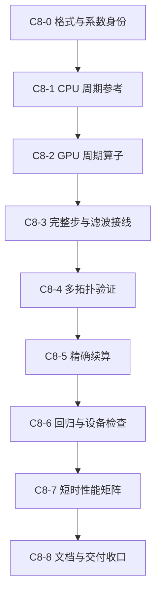

# ASTR 八阶三对角紧致导数需求与实施计划

创建日期：2026-10-24。更新日期：2026-10-25。
状态：需求访谈已完成，分步实施计划待审阅；未授权启动实现。

本文件记录八阶三对角紧致一阶导数的需求、候选设计及后续分步计划。
现有六阶实现及验收记录继续以
[紧致格式主计划](ASTR_GPU_COMPACT_SCHEME_PLAN.md)和
[结果记录](ASTR_GPU_COMPACT_SCHEME_RESULTS.md)为准；不因本文新增而改写既有能力。

## 1. 本轮授权与边界

- 用户要求使用 `grill-with-docs` 厘清需求并编写计划，暂不推进实现。
- 本轮不修改求解器、构建或测试代码，不编译、不运行数值或性能测试。
- 不创建执行 goal，不操作 Git，不操作平台任务。
- 逐项确认影响数值方法、交付范围及验收含义的选择；建议不等于批准。
- 已存在的用户修改及运行证据不属于本轮修改范围。

## 2. 已核实的实现基础

以下为本轮只读源码核查结果，不代表八阶路径已经实现。

| 位置 | 当前行为 | 八阶接入所需工作 |
| --- | --- | --- |
| `src/compact_operator.F90` | 六阶导数矩阵取两侧系数 `1/3`，内点 RHS 使用正负一、二节点差 | 同时定义新矩阵系数和半径三的 RHS，不能仅增加远点项 |
| `src_gpu/compact_derivative_gpu.cuf` | GPU 全局 RHS 与上述六阶关系对应，调用已有分布式线求解器 | 与 CPU 采用同一数学算子，复用求解器而非复制一套求解框架 |
| `src/compact_runtime.F90` | 全局紧致路径按 `643c` 和特定算例组合选择 | 格式命名、选择范围和允许组合须确认后统一接线 |
| `src/derivative.F90` | 旧初始化包含格式解析与系数准备 | 不得只放宽主程序格式字符串而遗漏初始化 |
| `src/mainloop.F90`、`src_gpu/mainloop_gpu.cuf` | 主循环包含按格式选择的调用和滤波后变量刷新 | 新格式须覆盖实际推进与刷新时序 |
| `src/output_runtime.F90` | 新式续算保存紧致身份及格式设置 | 八阶身份与精确续算规则须明确，不能冒充原六阶算子 |

当前全局两层 PCR 保留 MPI 接口耦合。候选八阶仍为三对角系统，可沿用相同的接口未知量结构。
这只说明求解框架可复用，不等于无需重新验证系数预处理、周期修正和计算结果。

## 3. 拟实现的数学算子

设均匀节点间距为 $h$，$d_i$ 为一阶导数近似，候选关系为

$$
\frac{3}{8}d_{i-1}+d_i+\frac{3}{8}d_{i+1}
=\frac{25}{32h}(f_{i+1}-f_{i-1})
+\frac{1}{20h}(f_{i+2}-f_{i-2})
-\frac{1}{480h}(f_{i+3}-f_{i-3}).
$$

该关系为均匀计算坐标下的八阶中心紧致一阶导数，系数来源为
[Persson 的紧致有限差分讲义](https://persson.berkeley.edu/math228b/html/compactfd_slides.html)。
它不是二阶导数公式，也不是新增滤波公式。

“三对角”描述未知导数的耦合结构；“七点”描述右端原函数值模板的宽度，中心项系数为零。
周期方向须保留首尾循环耦合，周期重复节点不新增独立未知量。
物理边界闭合、拉伸网格及曲线度量的处理尚未在本计划中批准。

上式中的 $h$ 用于说明均匀物理网格上的导数。现有主程序先求计算坐标导数，
再按已有度量关系转换；实现时须沿用这一归一化，不能在 RHS 和度量转换中重复乘以 $1/h$。
首轮不改变 TGV 几何初始化，不将坐标的仿射周期关系当作普通周期标量处理。

## 4. 需求决策

| 编号 | 待确认问题 | 当前状态 |
| --- | --- | --- |
| D1 | 首轮仅周期 FP64 TGV，还是同时纳入非周期平板 | 已确认 A：先周期 TGV，见 §4.1 |
| D2 | 新格式的用户输入命名、与 `643c` 并存及默认值策略 | 已确认 A：独立选项 `800c`，见 §4.2、§4.11 |
| D3 | 导数应用范围及滤波组合，如何隔离导数与滤波的比较 | 已确认 A：推进导数统一八阶，复用十阶紧致滤波及关闭选项，见 §4.3、§4.4 |
| D4 | CPU/GPU、MPI 拓扑及后续 FP32 扩展范围 | 已确认 A：小网格代表性 MPI 矩阵，见 §4.5；首轮保持 FP64 |
| D5 | 算子、短时流动、守恒量、续算及精度验收口径 | 已确认 A：分层数值门槛及精确续算，见 §4.6、§4.7；拟用短测参数见 §6 |
| D6 | 性能比较矩阵、物理时间及输出需求 | 已确认 A：短时矩阵及三轮计时口径，见 §4.8、§4.9 |
| D7 | 后续物理边界、NSCBC、曲线网格、AIR5 及 FP32 的优先级 | 已确认 A：先扩展拉伸平板与边界组合，见 §4.10 |

问题可由现有源码和资料直接确定时，不转交用户重复判断。
本节记录用户已确认的需求；§5—§8是据此整理、待审阅的执行规格，不代表已经实现或验收通过。

### 4.1. D1：首轮交付范围

状态：2026-10-24 用户选择 A。

- 首轮限定为三方向周期、笛卡尔网格、非反应五变量、FP64 的 TGV。
- 覆盖 CPU/GPU 同一数学算子及多 MPI rank 的全局耦合两层 PCR。
- 先验证解析导数及线性系统，再进行完整流动接入；数值门槛见 §4.6，拟用矩阵见 §6。
- 拉伸平板与物理边界闭合放入后续阶段，不纳入首轮交付。
- 不因首轮范围确认而准入 FP32、NSCBC、一般 CURVE 或 AIR5。
- 此决定仅冻结计划范围，不授权启动代码实现或测试。

### 4.2. D2：与六阶格式并存

状态：2026-10-24 用户选择 A。

- 八阶通过独立的空间格式选项选择，不把 `643c` 的含义改为八阶。
- 保留已有六阶选项及现有默认值，不新增独立的紧致阶数参数。
- 六阶和八阶共用全局两层 PCR 求解框架，各自准备对应矩阵及 RHS 系数。
- 新格式名称已由后续 §4.11 冻结为 `800c`；当前代码尚不支持该值。
- 主程序调用、初始化、格式能力判断和续算身份须按最终格式选择同步接通，步骤见 §5。
- 本项只确认选项设计，不授权实现或变更现有算例输入。

### 4.3. D3：导数应用范围

状态：2026-10-24 用户选择 A；滤波组合的后续决定见 §4.4。

- 首轮 TGV 推进中的空间一阶导数统一采用八阶紧致算子。
- 覆盖对流通量求导、速度与温度梯度、黏性通量求导，不交付对流六阶与黏性八阶的混合组合。
- CPU 与 GPU 使用相同数学算子；不改变原有 RK 时间格式。
- 此选择不将滤波改为八阶，也不自动改变既有滤波公式或参数。
- 不据此自动更改后处理诊断量的定义。首轮只复用既有短测统计；后续长时精度比较的共同诊断口径须单独确定。

### 4.4. D3：滤波支持范围

状态：2026-10-24 用户选择 A。

- 首轮复用现有十阶紧致滤波，并保留关闭滤波的选项。
- 六阶与八阶的受控对比使用相同滤波公式、参数、调用频率及方向顺序，只切换导数算子。
- 不因导数升至八阶而自动调整滤波强度，不改变既有滤波默认值和存储选项。
- 本轮不新增八阶导数与十阶显式滤波的组合，不将滤波选择与空间格式后缀解耦。
- 拟用滤波参数及开/关短测安排见 §6，滤波强度不为八阶单独调优。

### 4.5. D4：多 MPI rank 验证范围

状态：2026-10-24 用户选择 A。

- 首轮使用小网格代表性矩阵：NP=1，NP=2 的 x/y/z 分解，NP=3 非等长分区，NP=4 二维分解及 NP=8 三维分解。
- NP=3 同时覆盖非二次幂方向 rank 数与不等长分区，不为适配 PCR 改成等长分区。
- CPU/GPU 采用相同全局算子；拟用网格与步数见 §6，误差门槛见 §4.6。
- 不照搬全部历史拓扑矩阵；上述代表项用于检查新增八阶算子的接口和跨方向接线。
- 本地 NP>2 共享两张 GPU，仅作为正确性证据，不作为一 rank 一卡的扩展性能证据。
- 本地性能比较限定为一 rank 一卡的 NP=1/2；本轮不操作 A800 或其他平台任务。
- FP32 不纳入首轮；后续扩展须单独定义验证，不从 FP64 通过推断 FP32 通过。

### 4.6. D5：分层数值验收

状态：2026-10-24 用户选择 A。

沿用[紧致格式主计划 §17](ASTR_GPU_COMPACT_SCHEME_PLAN.md#17-d14分层数值验收门槛)的归一化定义，
将以下层次分开判断：

| 层次 | 已批准的验收要求 |
| --- | --- |
| 线性求解 | 包含周期首尾耦合的原始矩阵归一化残差不超过 `1e-12`，不使用消元后系统的残差代替 |
| 实现与分区一致性 | 同一八阶算子的 CPU/GPU 及不同拓扑短测，逐分量归一化最大差不超过 `2e-10`，同时报告最大绝对差 |
| 空间离散 | 解析周期函数的一阶导数应呈八阶收敛趋势，区分截断误差区间和舍入误差平台 |

原矩阵残差定义为

$$
\eta_\infty=\frac{\lVert Ax-b\rVert_\infty}
{\lVert A\rVert_\infty\lVert x\rVert_\infty+\lVert b\rVert_\infty}.
$$

分母为零时，仅在残差也为零时记为零。场差对各分量分别计算
`max(abs(candidate-reference))/max(1,max(abs(reference)))`，不以大分量掩盖小分量。
比较相同输入及完整步相位；不同消元顺序不要求逐位一致。

以上门槛不适用于六阶与八阶之间的离散差异，也不将采用 RK3 的完整计算称为八阶时间精度。
这些检查属于测试与验收，不在每次生产求解后新增整场残差回读或全局校验。
短时流动只复用既有诊断，记录守恒漂移，不额外设定六阶/八阶物理偏差门槛；
精确续算范围由后续 §4.7 决定，拟用执行参数见 §6。

### 4.7. D5：精确续算验证

状态：2026-10-24 用户选择 A。

- 首轮纳入八阶路径的精确续算，不仅验证新初态启动。
- 使用小型周期 TGV，CPU/GPU 分别覆盖 NP=1/2，比较连续 12 个完整步与 5 步保存后恢复再推进 7 步。
- 同后端、同 MPI 拓扑、相同格式和设置的权威状态及必要续算状态要求逐值一致。
- CPU/GPU 之间仍使用 §4.6 的场差门槛，不将后端之间的比较改为逐位一致。
- 复用现有新式检查点和精确续算配置，不改变生产默认值，不为本项另设一套续算文件协议。
- 六阶切换为八阶不属于精确续算；首轮不新增跨格式迁移功能。
- 拟用小网格、时间步及输出配置见 §6，不启动长时计算来代替该短测。

### 4.8. D6：首轮性能与精度交付范围

状态：2026-10-24 用户选择 A。

- 首轮先完成小网格正确性验证，再进行 `256³` TGV 的短时性能比较。
- 性能矩阵为六阶/八阶紧致导数、滤波关/开及一 rank 一卡的 NP=1/2。
- 两种导数格式使用相同物理输入、滤波设置及运行选项，比较固定网格的实际计算成本。
- 计时关闭流场序列输出、检查点及可视化，只统计 RK 推进耗时；初始化不计入该指标。
- 不把八阶必须快于六阶作为验收条件，不以固定网格耗时直接推断等物理误差下的效率。
- 长时 `t≈10` 的 TGV 能量、拟涡能、能谱与指定时刻完整场比较放入后续阶段，不作为首轮完成条件。
- 预热、采样步数、重复次数及跨 rank 时间归并方式见后续 §4.9。

### 4.9. D6：正式性能计时口径

状态：2026-10-24 用户选择 A。

- 每次运行预热 10 个完整步，再采样 30 个完整步。
- 两种导数、两种滤波开关及 NP=1/2 共 8 种配置，每种交错重复 3 次，共 24 次短运行。
- 每轮对各 rank 的 30 步累计 RK 时间取最大值，再除以 30，作为该轮每步时间。
- 各配置报告三轮每步时间的中位数及最小至最大范围，保留原始计时，不只选择最快一轮。
- RK 计时包含推进必需的 MPI 通信和同步，不扣除这些成本，也不使用仅主机 kernel 发射耗时冒充完成时间。
- 初始化、流场输出、检查点及可视化不计入上述 RK 指标；测量时的完成边界须明确。
- 按相同配置分别报告八阶/六阶时间比，以及各格式的 NP=1 至 NP=2 加速比和双卡并行效率。
- 本项是后续获准实施时的测试规格，本轮仍不启动计时任务。

### 4.10. D7：首轮之后的扩展优先级

状态：2026-10-24 用户选择 A。

- 周期 FP64 TGV 首轮完成后，优先扩展非反应拉伸平板。
- 先设计并验证物理边界附近的闭合，再验证与现有 MP7-LD 对流及 NSCBC 边界的组合。
- 不把现有六阶端点及近边界行原样套入后就宣称全域八阶；闭合的实际阶数、稳定性和完整流动表现须分别说明。
- CURVE、AIR5 及原生 FP32 均作为后续独立扩展，不由本项自动准入，也不在此冻结三者之间的具体顺序。
- 长时精度比较仍按 §4.8 留待后续单独安排，本项不自动增加长时测试任务。
- 上述顺序不改变首轮完成条件，也不授权开展平板代码实现或测试。

### 4.11. D2：周期首版输入名称

状态：2026-10-25 用户选择 A。

- 周期首版采用独立四字符格式码 `800c`，与 `643c` 并存。
- 在该新命名约定中，`8` 表示八阶内点，`00` 表示本阶段尚未定义物理边界闭合，`c` 表示紧致格式。
- 首轮 TGV 使用 `conschm=800c,difschm=800c`，不支持六阶/八阶混合选择。
- `00` 不表示零阶边界，也不授权按已有六阶边界闭合执行非周期算例。
- 未来物理边界版的输入标识及闭合含义，在平板阶段单独确认，不提前承诺 `843c` 等名称。
- 本项冻结输入设计，不表示当前可运行 `800c`；现有默认格式不变。

## 5. 分步实施计划

本计划使用 `C8-0` 至 `C8-8` 编号，与既有紧致计划中的 `CP8` 等步骤不同。
下列步骤均未启动，须用户另行授权后执行。

### 5.1. C8-0：格式身份与系数选择

- 在现有紧致模块内增加最小必要的格式描述，区分 `643c` 的矩阵系数 `1/3` 与 `800c` 的 `3/8`、对应 RHS 系数及模板半径。
- 在初始化时确定格式，不让每个网格点反复解析字符串；固定系数用 `real_kind` 参数或初始化预计算，避免常系数的逐点运行时除法。
- 检查 `src/derivative.F90` 的前三位数字解析及旧初始化。`800c` 必须被明确识别，不能伪装成 `643c` 后静默执行六阶。
- 核对 `src/comsolver.F90` 的中央格式分类、`src/solver.F90` 的通用对流入口及 `src/readwrite.F90` 的格式显示；不得将 `00` 打印成已经存在的零阶边界闭合。
- 本轮八阶只准入 FP64 周期 TGV。保留六阶原有能力，不顺带扩大平板、FP32 或 AIR5 的范围。
- 构建仍从根 `CMakeLists.txt` 进入，不为本功能增加 Catalyst、CUDA C++ 或外部线求解库依赖。

完成条件：格式选择、初始化和系数身份明确；CPU-only 及 GPU 构建通过；既有 `643c` 默认含义不变。

### 5.2. C8-1：CPU 全局周期参考

- 扩展 `src/compact_operator.F90` 的导数矩阵及 RHS 构造，保留 MPI 接口和周期首尾耦合。
- 将 `src/compact_runtime.F90` 的 CPU 计划准备及调用接到选定格式，更新所有实际使用的导数系数，不只修改 RHS。
- 保留 CPU 独立求解实现，不以 GPU 自己的结果作为参考。
- 用常数及周期正弦/余弦函数检查导数、原矩阵残差和网格收敛；不把非周期多项式直接当作周期解析参考。
- 核对计算坐标、物理坐标及度量的缩放关系，防止漏乘或重复乘网格尺度。

完成条件：CPU 周期算子满足 §4.6，解析导数在截断误差区间呈八阶趋势，六阶组件回归通过。

### 5.3. C8-2：GPU 算子与两层 PCR 复用

- 在 `src_gpu/compact_derivative_gpu.cuf` 增加半径三的全局周期 RHS；仍以成对差值计算，保持常数导数为零。
- 复用当前设备分块、局部缩减、跨 rank 端点 PCR 和周期修正，不复制一套八阶专用线求解器。
- `src_gpu/compact_operator_gpu.cuf` 的同状态 CPU 参考与原矩阵残差也必须按选定格式构造，不能残留导数 `alpha=1/3` 的假设。
- 私有工作区、批处理和通信缓冲继续复用；不增加完整权威流场副本。
- 现有 `compact_derivative_probe.F90` 主要验证旧局部闭合，不能直接把其通过解释为八阶全局周期通过；扩展已有全局/分布式探针覆盖新矩阵。

完成条件：GPU RHS、解及原矩阵残差满足 §4.6；覆盖非二次幂线长和设备分块交界，周期重复节点未被计成额外未知量。

### 5.4. C8-3：TGV 完整步接入

- 接通八阶对流通量求导、速度/温度梯度及黏性通量求导；不将其中任一路径留在六阶。
- 更新格式能力选择、CPU/GPU 主循环分派及私有工作区分配条件。
- 保留十阶紧致滤波的公式和方向顺序，检查滤波后原始量/物性刷新及下一阶段 halo 状态；不能只放宽格式字符串。
- 流动对照在相同完整步相位比较，同时保留首个及末个选定 RHS 相位的同状态检查，防止同阶段缓存混用。
- 不把第三个 RK 子步尚未完成滤波/刷新时的快照标为完整步结果。

完成条件：小型 TGV 的滤波关/开 CPU/GPU 短测通过，状态有限且密度、压力、温度为正，既有统计及 EOS 检查正常。

### 5.5. C8-4：多 MPI 拓扑

- 按 §6.2 使用同一全局网格检查方向分解、非二次幂 rank 数、不等长分区及二维/三维分解。
- 先比较每种拓扑的 CPU/GPU，再分别与同后端 NP=1 的完整步参考比较，采用唯一节点所有权组装全局场。
- 记录周期重复节点与共享节点处理，不把重复平面计入体积平均或守恒量。
- 保留现有固定 halo 层数和私有端点通信协议；不在新增格式的同时开展通信后端重设计。

完成条件：代表矩阵满足 §4.6；NP>2 明确标为两张 GPU 上的正确性测试，不产生硬件扩展效率结论。

### 5.6. C8-5：精确续算

- 按 §4.7 比较连续 12 步与 5+7 步，显式使用 `exact_restart=t`，不改变非精确续算的现有默认值。
- 复用 `control.bin` 中现有紧致记录及 `schemes` 字段，以 `800c/800c` 区分新算子；固定系数由格式身份唯一确定。
- 不无故修改既有 `643c` 的算子身份而使其精确续算失效，不新增紧致专用附属文件。
- 检查精确恢复时格式不匹配不能被当成相同算子；这不是新增跨格式迁移功能。
- 同拓扑连续/恢复状态按逐值一致检查，不将不同后端间的舍入差异纳入该要求。

完成条件：CPU/GPU 各 NP=1/2 的续算对照通过，保存与恢复都发生在完整步边界。

### 5.7. C8-6：受影响回归与设备检查

- 对 `643c` 与显式 `643e` 各保留最小完整步回归，确认默认值、滤波刷新、输出和既有紧致身份未受破坏。
- CPU-only 构建不依赖 GPU/原位组件；FP32 构建不因新增共享源码而编译失败，但不因此准入八阶 FP32 运行。
- 对小型八阶 GPU 用例做 Compute Sanitizer memcheck，重点覆盖新 RHS 的正负三点访问和多 rank 端部；不自动重跑全部历史 sanitizer 矩阵。
- 若实际修改共享内存或同步算法，再补相应的 racecheck/synccheck；保持现有显式同步合同。
- 已有用户修改须保留；测试工具只增加本功能所需参数，不顺带重写已有框架。

完成条件：受影响回归及最小设备内存检查通过，无新增数据越界、格式串线或构建依赖。

### 5.8. C8-7：中等规模短时性能

- 小网格门槛通过后，按 §4.8—§4.9 和 §6.4 运行 24 次正式短测。
- 先做匹配输入的短预跑，确认 `800c` 实际被选择、输出已关闭及计算正常；不重新运行全部正确性矩阵作为每次计时的前置条件。
- 正式计时关闭同状态 CPU/GPU 比较、诊断快照和 profiler，避免验证回读或插桩污染 RK 时间。
- 冻结相同可执行程序、运行选项、输入与计时定义，不在结果中混合不同通信/同步模式后只选最快值。
- 报告时间比和双卡扩展，八阶较慢也保留并解释，不因收益不够而更改数值算子。

完成条件：8 种配置各 3 轮数据齐全，输出明细与汇总，性能结果不替代正确性或长时物理精度验证。

### 5.9. C8-8：交付收口

- 将实际通过范围、运行参数、源码版本及证据目录写入独立的八阶结果记录，并更新用户指南的格式选择说明。
- 清楚区分周期 FP64 TGV 已通过、非周期/AIR5/FP32 未准入，以及尚未开展的长时精度比较。
- 原六阶结果不改写成八阶结果，不将短测残差或耗时当作物理精度提升的证据。
- 本计划不包含 Git add/commit/push；需用户另行授权。

完成条件：上述各步有对应证据，文档与真实能力一致，无未报告的数值失败。

## 6. 拟用最小测试矩阵

下列数值参数复用现有 TGV 工具和基准设置，作为待审阅的执行规格，不是已测结果。
运行前记录实际输入；计数以完成的完整步为准，不能直接假定遗留 `maxstep` 等于完整步数。

### 6.1. 公共设置与诊断

| 项目 | 拟用设置 |
| --- | --- |
| 模型 | 既有三维周期 TGV，非反应五变量，FP64，RK3，黏性项开启 |
| 物理参数 | 复用 `examples/Taylor_Green_Vortex` 的 Re=1600、Ma=0.1、参考温度 273.15 及原物性模型，不为八阶改模型 |
| 空间格式 | 正确性主路径 `800c/800c`；六阶回归及性能参考 `643c/643c` |
| 滤波 | 十阶紧致滤波关/开；开启时 `alfa_filter=0.49`，两种导数保持相同调用方式 |
| halo | 复用 `hm=5`，不因 RHS 半径由二变三而增加交换层数 |
| 基础运行模式 | 保持外层显式同步，沿用已验证的 pinned 通信及现有工作区配置；六阶/八阶在同一组对照中完全一致 |
| 短测诊断 | 沿用原有 CFL、守恒量、统计及 EOS 检查，报告质量/总能漂移和最小 rho/p/T，不新增物理偏差阈值 |
| 参数边界 | 不新增任意目录大小硬限或自动超时，不为通过验收静默调时间步、滤波强度或误差门槛 |

首轮的原统计量保留定义，并记录其实际导数口径。不用各自不同的导数诊断值直接证明八阶比六阶更准确。
长时能谱和拟涡能的共同后处理导数口径留待后续精度比较阶段，不在首轮新增全场 FFT 诊断。

### 6.2. 算子与流动

| 检查 | 网格/线长 | 运行方式 | 比较内容 |
| --- | --- | --- | --- |
| 周期解析导数 | 唯一节点数 16/32/64/128；常数及周期正弦/余弦组合 | CPU/GPU 组件 | 八阶收敛趋势、原矩阵残差、同算子差值 |
| 非规则线长 | 含 33/35/37 及设备分块边界附近的 127/128/129 | 复用全局/分布式探针 | 周期修正、尾块及实际所有权，不增加未知重复节点 |
| TGV 全局参考 | 33×35×37 区间，NP=1 | CPU/GPU，10 完整步，dt=1e-3，滤波关/开 | 同后端拓扑参考与 CPU/GPU 完整步场 |
| 方向分解 | 同网格，NP=2：2×1×1、1×2×1、1×1×2 | 同上 | 三方向接线及不等长分区 |
| 非二次幂 rank 数 | 同网格，NP=3：1×3×1 | 同上；35 区间不能均分给三个方向 rank | 非二次幂接口 PCR 和商余数分区 |
| 二维分解 | 同网格，NP=4：2×2×1 | 同上，两卡共享 | 多方向组合正确性 |
| 三维分解 | 同网格，NP=8：2×2×2 | 同上，两卡共享 | 三方向耦合正确性 |

不要把已有局部探针中的物理端点闭合测试换一个格式标签，就称为新周期算子验收。
具体组件长度若受既有分块定义影响，应记录实际唯一未知量数及局部所有权，而非改变物理网格去凑二次幂。

### 6.3. 续算与回归

- 精确续算拟用 32³ 区间、dt=1e-3，CPU/GPU 各 NP=1/2，按既有参数化覆盖滤波关/开，完成 12 步对 5+7 步。
- 小网格正确性测试可以写出必要的场或检查点用于离线比较；这与性能矩阵关闭场输出是两种独立配置。
- 六阶紧致及显式回归各选现有小型周期 TGV，保留一次滤波开启的 NP=2 完整步及必要初始化检查，不复制整套历史矩阵。
- 设备检查采用代表性小网格多 rank 八阶算例，避免将大规模计时放到 sanitizer 下运行。

### 6.4. 性能输入与输出配置

| 项目 | 拟用设置 |
| --- | --- |
| 网格与时间步 | 256³ 区间，dt=2.5e-4，沿用已有中等网格 TGV 计时输入 |
| 配置 | `643c/643c` 与 `800c/800c`；滤波关/开；NP=1 与 NP=2、2×1×1 |
| 正式采样 | 每轮 10 步预热、30 步采样，3 轮交错，共 24 次运行 |
| 输出 | 每个算例都生成有效的 `datin/input.output`，显式关闭检查点、整场和切片；不靠缺省、删除文件或仅关闭遗留输出频率来关闭新输出 |
| 原位与验证 | 关闭原位产品、验证场快照、`ASTR_GPU_COMPACT_COMPARE` 和 profiler；保留相同的既有推进必要检查及少量计时日志 |
| 工作区与运行参数 | 六阶/八阶一致，正式运行前写入记录；本阶段不额外寻优通信、同步或 batch 参数 |

开启完整场/检查点的正确性运行不能混入性能统计。初始化和进程启动可以另行记录，但不计入 RK 每步时间。
不以关闭必需通信或省略某个导数调用换取性能改善。

## 7. 受影响文件与复用边界

以下是实现时的检查清单，不要求无差别修改全部文件。

| 文件或模块 | 责任与预期变化 |
| --- | --- |
| `src/compact_operator.F90`、`src/compact_runtime.F90` | 八阶矩阵/RHS、格式选择、CPU 参考及运行期计划 |
| `src/derivative.F90`、必要时 `src/constdef.F90` | 四字符格式初始化与固定系数；不借机改旧边界闭合 |
| `src/comsolver.F90`、`src/solver.F90`、`src/readwrite.F90` | 初始中央格式对象、通用对流分派及新格式的准确日志描述；已通用的路径只核对、不重复实现 |
| `src_gpu/compact_derivative_gpu.cuf` | 半径三的 GPU 全局 RHS 与选定矩阵 |
| `src_gpu/compact_operator_gpu.cuf` | 三类推进导数接线、系数选择及独立同状态检查 |
| `src/mainloop.F90`、`src_gpu/mainloop_gpu.cuf` | 完整步分派、滤波后刷新及原统计调用相位 |
| `src_gpu/commarray_gpu.cuf`、`src_gpu/case_capability_gpu.cuf` | 工作区条件和八阶周期能力选择；保留原六阶平板支持 |
| `src/output_runtime.F90` | 核对新格式被现有紧致身份正确记录，优先复用协议，不增加附属文件 |
| `src/commcal.F90`、`src/bc.F90`、`src/test.F90` | 审计剩余 `643c` 特定判断；平板/激波专属分支本轮不机械扩成 `800c` |
| `src/statistic.F90`、`src_gpu/statistic_gpu.cuf` | 检查是否通过通用梯度入口获得正确算子；未受影响时不修改统计定义 |
| `src/filter.F90`、`src_gpu/compact_filter_gpu.cuf` | 复用公式、计划及存储选项；本轮不重设计滤波 |
| `src/compact_line_solver.F90`、GPU 线求解/分布式/传输模块 | 复用可接受矩阵系数的求解器、端点协议及预分配工作区；没有实际依赖时不改核心算法 |
| `tests/gpu_validation/compact_derivative_probe.F90`、`compact_distributed_probe.cuf` | 区分旧局部闭合与新全局周期，增加八阶解析及原矩阵检查 |
| `tests/gpu_validation/run_compact_derivative_tgv.py` | 扩展格式选择、同相位场比较及代表拓扑 |
| `tests/gpu_validation/test_compact_restart_runtime.py` | 复用既有续算测试，参数化新格式与格式身份检查 |
| `tests/gpu_validation/run_compact_execution.py`、`run_compact_performance.py` 及对应工具测试 | 允许六阶/八阶对照，确保输出配置、计时和汇总身份一致；不破坏原显式/紧致比较能力 |
| `tests/gpu_validation/prepare_tgv_case.py` | 复用输入准备及新式输出文件生成，需要时仅补八阶相关参数传递 |
| 根 `CMakeLists.txt`、`src/CMakeLists.txt` | 根构建入口不变，只在受影响探针或源码依赖确有需要时调整目标 |
| `USER_GUIDE.md`、本计划及未来八阶结果记录 | 交付时同步真实支持范围和证据，不提前宣称实现完成 |

现有测试脚本还包含 `choices=(643c,643e)` 和固定八配置汇总等假设，必须与新比较目标一起更新。
文档中的函数调用或字符串匹配清单只作检查入口，不能代替实际调用链检查。

## 8. 完成条件与人工决策边界

首轮完成须同时满足：

1. `800c/800c` 在 FP64 周期 TGV 的 CPU/GPU 主程序中实际使用标准八阶全局算子。
2. 解析导数、原矩阵残差、完整步场差及代表 MPI 拓扑达到已批准门槛。
3. 滤波关/开及精确续算通过，原 `643c` 和显式受影响路径未回归。
4. 最小设备内存检查通过，24 次正式计时及原始记录齐全。
5. 结果文档如实区分实现正确性、形式阶数、性能与未验证的长期物理精度。

数值门槛失败时停止后续流动/性能结论并先定位原因，不以调松容差、改滤波强度或开启修复来掩盖问题。
发现新的 CPU 数值或物理缺陷、需要改变模型/边界/数值方法或扩大已批准范围时，提交证据供人工决策。
普通接线、测试工具或初始化缺陷在后续获准实现范围内局部处理，不为每个可逆修订重复请求确认。

本轮完成的是计划文档。当前没有八阶实现、测试结果或执行 goal，也不授权 Git 或平台操作。
