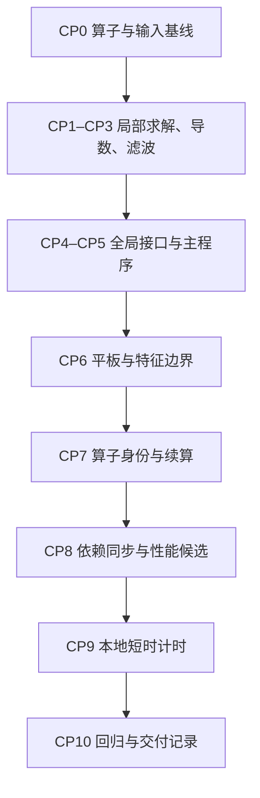

# ASTR GPU 紧致格式需求与实施计划

日期：2026-10-19。
状态：D1—D22需求与范围已确认；CP0—CP8已通过。
CP5全周期TGV及默认全局接线见结果记录§15；CP6最终验收见本计划§27.5及结果记录§20。
CP6覆盖96×48×32区间拉伸平板、743e/643c、常规及22/52 incoming_only边界、
scalar/full紧致滤波、原随机吹吸、必要MPI拓扑及代表pinned/device-aware端点传输。
第1至第7项具体CPU/GPU修订均经用户批准，数值、统计、设备检查及最小显式回归通过。
既有显式默认格式不变，不运行平台任务，不授权Git写操作。
CP3已完成获批的CPU/GPU滤波后原始量刷新修复，scalar/full、周期TGV完整步及集成设备检查通过。
CP4通过15种拓扑、两种通信及设备检查。CP5完成32³及33×35×37区间、滤波关/开、十完整步、
多拓扑及同相位检查，旧局部流动路径不再由主程序选择。
TGV几何初始化不变；CP6获批的笛卡尔挤出平板几何已接入全局耦合及仿射周期处理。
CP7周期32³ TGV的新式精确/非精确续算已通过，身份和设置追加到现有control.bin，见§27.6。
CP8模块内部依赖同步、重复复制移除及RHS分批已通过V6，短窗诊断见§27.7。
CP9/V7已完成：TGV冻结基线与统一lcracon=t的平板各24次正式运行，并有独立阶段、初始化/接口及资源观测，见§27.8和结果§24。CP10/V8的55项受影响检查及交付同步完成，见§27.9和结果§25。平板仍只准入已验证组合的新初态，未验收其紧致续算；
本轮不交付一般CURVE、AIR5、紧致迎风或生产规模性能结论。
本地UCX IPC映射残留及明确无IPC的设备感知检查分开记录，不声称IPC资源清理已通过。
实施证据见[组件结果记录](ASTR_GPU_COMPACT_SCHEME_RESULTS.md)。

执行阅读入口：§26接口与文件范围、§27实施步骤、§28验收矩阵、§29性能口径、§30完成与停止条件。
§4—§25保留需求决策记录；表中未选方案不是额外交付要求。

## 1. 已确认方向

- 不使用PDD，也不以忽略小耦合项作为默认求解步骤。
- 不依赖现成三对角/五对角求解库，自行实现所需算法。
- 采用分块CR/PCR，避免将整条长线的顺序Thomas递推作为优先实现。
- D1已确认A并补充：先保留MPI局部闭合作开发对照，再推进局部子系统与跨MPI接口系统的两层PCR；最终生产路径统一为全局两层PCR。
- D2已确认A：纳入643c中央导数及现有紧致滤波，先导数、后滤波、最后联测；紧致迎风和新增五对角格式暂缓。
- D3已修订：CPU实际算法是参考而非不可更改的约束；明确的效率缺陷或数值/物理错误纳入改进，修正依据、参考与验证须同步更新，不要求复现旧缺陷。
- D4已确认A：首轮交付先完成非反应五变量的两阶段路径，接口不写死5分量；AIR5仅作后续独立扩展。
- D5已确认A：组件测试后依次接入周期TGV与拉伸网格非反应平板；平板保留显式MP7-LD对流，紧致梯度/黏性及滤波分步接入。
- D6已确认B：首版线求解/RHS采用CUDA Fortran，公共调用接口保持后端中性；HIP/DCU设备实现后续另写，本轮不新增C++/CUDA依赖。
- D7已确认A：保持q_d等权威数组布局，仅在私有RHS/工作区内做分组布局与融合，整理成本计入完整算子时间。
- D8已确认A：先用逐kernel显式同步建立基线，通过验证后增加模块内部依赖同步性能路径，保留全同步诊断模式，不自动改变外层主循环同步合同。
- D9已确认A：第二阶段周期方向采用真正的首尾耦合循环系统，周期重复端点不增加独立未知量，MPI内部接口采用相同内点关系，并建立CPU全局参考。
- D10已确认：完成验收后，选择紧致格式即默认使用统一全局两层PCR；不要求永久保留局部闭合生产选项，现有显式格式默认值不变。
- D11已确认A：缩减接口系统同时支持pinned主机暂存与设备感知MPI，明确选择、分别验证；先建立主机暂存基准，不预设设备直接通信必然最快。
- D12已确认A：支持满足模板及分区要求的任意线长、非二次幂方向rank数和现有商余数不等长分区，不修改物理网格以适配PCR。
- D13已确认A：私有工作区按方向复用、按独立网格线分批，预分配循环使用，相同矩阵共享预处理系数；保留滤波scalar/full能力及scalar默认值。
- D14已确认A：线系统归一化残差≤1e-12，同算子CPU/GPU及拓扑短测逐分量归一化最大差≤2e-10并报告绝对差；解析离散误差与线求解误差分开验收。
- D15已确认B：首轮平板除11/prof、21、41、50和z周期外，同时覆盖22特征出口及52特征远场，纳入紧致算子与特征RHS、边界导数及滤波的组合检查。
- D16已确认B：首轮紧致bc52显式选择incoming_only，以全局常数rho/u/v/w/T作为传入特征的松弛目标；nonreflecting及入射激波目标不纳入本轮。
- D17已确认A：小网格数值验证后完成本地256³ TGV及450×130×96区间平板短时性能测试；性能只比较一rank一卡的NP=1/2，不涉及A800或生产长时演化。
- D18已确认A：平板跨拓扑基线与计时关闭吹吸；另用固定拓扑、相同原随机序列做10步CPU/GPU联测，不改原随机算法或原算例。
- D19已确认A：平板沿用M12物性、入口及初态，Ma12/Re1e4、Tw/T∞=10，bc52目标rho/u/v/w/T=(1,1,0,0,1)；先用dt=0.005，短测CFL≤0.5并独立检查黏性限制。
- D20已确认A：已有新式检查点缺少紧致算子身份时仅允许非精确读取权威场并重建派生数据；精确恢复须有明确且匹配的算子身份，不恢复已停用旧格式。
- D21已确认A：本计划覆盖的CPU/GPU五变量紧致主路径统一全局数值算子；CPU采用独立求解实现，usegpu只切换执行后端，显式CPU路径不变。
- D22已确认A：启动前按实际可用资源核对容量并记录用量，不新增任意目录硬限或自动超时；真实资源不足、运行错误及数值门槛失败仍停止报告。
- 借鉴DistD2的数据分组布局、访存组织和RHS融合，不采用其PDD式接口简化。
- 面向平板边界层类网格及未来大规模多卡，同时考虑后续CUDA以外的设备后端。
- 现有显式生产路径保持不变；设计方向获批不等于紧致格式已准入生产。

## 2. 当前实现依据

CPU紧致导数、紧致滤波及紧致通量分别位于`src/derivative.F90`、
`src/filter.F90`、`src/flux.F90`，主要三对角递推位于`src/commfunc.F90`。
系数预处理与RHS求解已有分离，GPU设计应保留固定算子的系数复用。

CP0源码基线中的紧致导数在MPI子域接口使用显式闭合，再进行局部线求解。
因此，保持CPU局部矩阵的并行移植与构建跨MPI全局耦合紧致算子是不同任务。
不能在同一个MPI接口既消除未知量耦合，又称第二层PCR保留了该耦合。
CP5的全周期643c/643c流动分派已改为全局耦合；旧局部模块仅供几何初始化及独立组件对照，
不再通过`ASTR_GPU_COMPACT_DEVELOPMENT=local`选择流动算子。

只读核查`origin/archive/tgvsolver_gpu_compact`确认miniapp含整线Thomas
前消元/回代实现。用户已报告该路线效率不理想；本计划不将继续该路线作为优先项，
也不在没有profiler证据时把具体低效原因确定为寄存器溢出或某一种访存问题。

## 3. 术语与层级

| 名称 | 本计划含义 |
| --- | --- |
| GPU内分块 | 将一个rank内的长线分为多个设备计算块，不自动代表MPI分区 |
| 子域局部紧致算子 | MPI接口已通过闭合解耦，halo进入已知RHS；各rank独立解局部矩阵 |
| 全局耦合紧致算子 | 分区接口未知量仍保留在同一全局线性系统中，须求解跨rank接口问题 |
| 全局算子的局部子系统求解 | 计算本地响应并保留对接口未知量的依赖，不等于通过MPI局部闭合得到独立解 |
| 物理边界闭合 | 真实入口、出口、壁面等边界的离散行；不同于人为MPI分区接口 |
| 两层PCR | 第二阶段的局部子系统PCR与跨MPI缩减接口系统PCR；不同于第一阶段单rank内部的设备分块 |

## 4. D1：两层PCR与局部闭合的关系

状态：2026-10-19用户选择A，随后确认最终统一全局两层PCR并默认使用。

| 选项 | 范围 | 影响 |
| --- | --- | --- |
| A，已选 | 分两阶段开发：先保留当前MPI局部闭合并实现GPU内分块CR/PCR作对照；再建立全局两层PCR生产路径 | 两阶段的离散身份、参考及验收分开；最终不要求提供局部/全局两个生产选项 |
| B | 本轮只实现rank内部两级PCR；MPI接口始终保留当前局部闭合 | 不开发跨MPI线性系统，不能声称已实现全局紧致求解 |
| C | 本轮直接实现局部子系统与跨MPI接口系统的两层PCR | MPI接口不再用局部闭合切断未知量耦合；真实物理边界另行确认 |

第一阶段主要替换局部求解实现；明确缺陷的修订按D3处理。GPU计算块内部的人工分块不新增数值闭合，不能通过切断块间耦合得到速度收益。
第二阶段保留跨MPI接口未知量耦合，须单独定义全局算子、参考和验收；第一阶段通过不自动放行第二阶段。
全局路径验收后，局部闭合仅保留为开发/验证对照，不作为默认实现或不可用时的静默替代。
某方向没有跨rank分区时，全局系统在本rank内完成求解，仍保持相同的全局算子及真实物理/周期边界定义。

## 5. D2：算子覆盖范围

状态：2026-10-19用户选择A，已确认。

CPU主路径的`643c`中央导数、现有紧致滤波及`543c`紧致迎风分别有独立入口，
这里均以现有三对角系统为起点。不能把增加五对角格式当作已有算子的必要移植工作。

| 选项 | 范围 | 实施顺序 |
| --- | --- | --- |
| A，已选 | 纳入643c中央导数及现有紧致滤波；紧致迎风和新增五对角格式暂缓 | 先验收导数，再验收滤波，最后联测 |
| B | 只纳入643c中央导数；本计划不移植紧致滤波和紧致迎风 | 先完成导数的两阶段路径，滤波保持既有显式能力 |
| C | 同时纳入643c中央导数、现有紧致滤波及543c紧致迎风；新增五对角格式仍另议 | 分算子验收，并增加通量重构和限制器耦合范围 |

第一阶段的导数、滤波分别建立同算子参考，再进行组合检查；第二阶段另建全局耦合参考。
这不授权增加五对角数值格式，也不改变既有显式路径或当前运行输入组合。

## 6. D3：第一阶段数值基准

状态：2026-10-19用户最初选择保留CPU实际离散，随后明确修订为允许改进有依据的效率及物理缺陷。

源码核对：`643c`内点的两侧导数系数均为1/3，物理边界及MPI接口另有闭合；
紧致滤波使用输入`alfa_filter`及已有边界/接口系数，按x、y、z次序处理，
方向间先更新下一方向所需halo。`filterq`根据空间格式后缀选择紧致或显式路径。
这些属于当前实际离散，而不是仅由“六阶导数、十阶滤波”名称唯一确定的行为。

| 类型 | 当前决定 | 参考及验证 |
| --- | --- | --- |
| 数学等价的效率改进 | 允许纳入，包括分块并行、布局/融合、系数复用和无效工作删除；不因CPU原来如此而保留低效实现 | 同算子残差与结果比较，消元顺序产生的FP64舍入差异另行判定 |
| 明确的算法或物理缺陷 | 原则同意改进，不把完整保留原CPU算法作为硬约束 | 记录错误证据、修正依据与影响，按既有CPU缺陷决策流程确认具体修订；共同问题同步修正CPU/GPU，更新独立参考与验证 |
| 存在多种合理选择的新格式/边界/物理模型 | 不把偏好性重设计包装成确定缺陷 | 单独决策，不以旧CPU一致性或仅能运行作为唯一依据 |

没有缺陷修订时仍以实际CPU离散和调用时序为起点；不为优化无关内容扩大修改范围。
发生数学算子修订时，不再要求新GPU复现有缺陷旧CPU的结果，改用已确认的修正参考，
并将性能实现变化与数值修订的影响分别报告。具体验收误差门槛见已确认的D14。

## 7. D4：首轮物理集成范围

状态：2026-10-19用户选择A，已确认。

通用线求解器可处理多组RHS，但这不等于AIR5已通过紧致格式的物理准入。
AIR5还涉及组分/能量的可容许域、滤波修正及化学补偿与缓存时序，不能仅因
求解器能接收11分量就放行其耦合计算。

| 选项 | 首轮交付范围 | AIR5关系 |
| --- | --- | --- |
| A，已选 | 先完成非反应五变量的两阶段路径，线求解接口不把分量数写死为5 | AIR5仅保留后续扩展目标，需另行审阅，不作为本轮交付门槛 |
| B | 本轮同时包含非反应五变量和AIR5的紧致格式耦合 | 增加组分保正、质量闭合、双温能量相容性及补偿/缓存生命周期的独立验收 |

## 8. D5：首轮算例与调用组合

状态：2026-10-19用户选择A，已确认。此处确定覆盖路径；网格、步数、物理参数与资源口径分别见D17—D19及D22。

| 选项 | 路径 | 能力范围 |
| --- | --- | --- |
| A，已选 | 通用线求解组件，再做周期TGV，最后做拉伸网格非反应平板 | TGV覆盖643c中央通量求导与梯度/黏性；平板保持已有显式MP7-LD对流，接入紧致梯度/黏性；紧致滤波分别验收后再联测 |
| B | 组件后只集成周期TGV，平板另议 | 首轮不交付拉伸网格与平板物理边界组合 |
| C | 组件后直接集成拉伸平板，中央紧致对流另议 | 保留显式MP7-LD对流，集中验证紧致梯度/黏性及滤波 |

源码依据：中央对流当前要求`conschm==difschm`；显式迎风与紧致导数在CPU初始化中是不同组合。
新增GPU组合必须逐一接通调用，不能只修改格式字符串准入后称为已完成。

## 9. D6：设备实现语言与后端边界

状态：2026-10-19用户选择B，已确认。

当前主求解器以Fortran/CUDA Fortran为主，已有原位设备产品使用C++/CUDA。
根CMake中的CUDA C++设备编译路径目前位于原位功能相关条件内。
新紧致求解器不得因此依赖Catalyst、ParaView或原位后处理，也不得让纯CPU构建要求CUDA工具链。

| 选项 | 首个设备实现 | 多后端代价 |
| --- | --- | --- |
| A，未选 | 仅线求解/RHS设备模块采用自写C++/CUDA核，通过C ABI与Fortran交互；其余CFD主体不改语言 | 公共算法与数据描述尽量共享，设备运行时/同步/子组操作隔离，为后续HIP/DCU适配留边界；不承诺两后端原样同源 |
| B，已选 | 线求解与RHS继续用CUDA Fortran，公共调用接口保持后端中性 | 首版沿用现有工具链，但未来HIP/DCU设备实现通常需要另写，不把算法可移植等同于源码可直接编译 |

首版只要求当前NVIDIA设备上的实现与验证，不自动要求新增HIP/DCU硬件验收。
新增CUDA Fortran核沿用`src_gpu/`及根CMake构建入口，不为本模块要求C++设备编译或新的目录体系。
不引入现成线求解库或新的第三方并行框架。公共接口表达算子、分区、数组布局及依赖，不把CUDA专有类型作为CPU侧公共契约。
设备数组驻留、借用生命周期及执行依赖须显式定义；未来替换设备实现不应要求改写CPU编排。

## 10. D7：分组布局与权威数组的边界

状态：2026-10-19用户选择A，已确认。

当前设备权威守恒量为`commarray_gpu::q_d(:,:,:,:)`，边界、halo、RK、
检查点及后处理均消费其现有索引语义。借鉴DistD2的布局可以局限于算子私有存储，
也可以扩大到求解器的持久存储，二者改动范围与性能代价不同。

| 选项 | 布局范围 | 代价与收益 |
| --- | --- | --- |
| A，已选 | 保持q_d等权威数组布局；仅私有RHS/工作区按方向和线批次分组，融合RHS形成及写回，工作区复用 | 改动集中在线算子；布局整理成本必须计入完整算子时间，不宣称零转换 |
| B | 将权威流场及主要派生数组的持久存储也改为分组布局 | 有机会减少后续反复转换，但需连同相关核、MPI打包、边界、输出等一起调整 |

布局转换在设备内完成，不通过整场主机回读，不改变字段物理含义。
私有工作区按D13方向复用、按独立线分批；不因分组布局复制一份长期权威状态，容量按D22核对。

## 11. D8：模块内部同步策略

状态：2026-10-19用户选择A，已确认。

现有`gpu_check`默认逐kernel显式同步，其`selective/dependency`模式有既有算例范围。
本节只决定新紧致模块内部的同步，不自动删除或扩大主循环同步模式的准入。

| 选项 | 新模块内部 | 公共边界 |
| --- | --- | --- |
| A，已选 | 先建立逐kernel同步的诊断基线；验证通过后允许同执行流依赖及必要事件驱动的性能路径，保留诊断模式 | 公共算子返回/后续消费、跨流、MPI、主机结果及工作区复用处满足外部同步和生命周期合同 |
| B | 始终逐kernel主机显式同步，不实现内部依赖同步性能路径 | 沿用现有定位方式，但每个跨kernel消元阶段都可能增加主机等待 |

块内CR/PCR需要的线程屏障始终保留。跨block依赖不能以块内屏障代替，
应采用有正确执行依赖的分阶段kernel或另行证明安全的实现，不使用无保护的跨block读写。
两条路径均保留必要的CUDA启动/执行错误处理；减少主机等待不等于取消算法依赖。
模块内部配置与默认选择见§26.3，不改变既有外层同步模式的能力范围。

## 12. D9：第二阶段的周期全局算子

状态：2026-10-19用户选择A，已确认。

当前CPU的周期方向也按局部系统处理：`parallel`将相应`npdc`置为3，
导数初始化及RHS在局部求解端部采用接口闭合，而非在左端矩阵中直接建立全局首尾角元。
第一阶段以该实际算子为起点；第二阶段的全局参考不能未经定义就直接等同于旧CPU单rank结果。

| 选项 | 第二阶段周期方向 | 参考与影响 |
| --- | --- | --- |
| A，已选 | 周期方向建立真正的首尾耦合循环系统，周期重复端点不作为第二个独立未知量；内部MPI接口恢复相同内点紧致关系 | 单独建立CPU全局参考与拓扑一致性检查，区分新全局算子与第一阶段局部算子 |
| B | 保留旧CPU单rank的周期端部闭合，只移除内部MPI分区闭合 | 以兼容旧单rank周期算子为目标，不称为标准首尾耦合循环矩阵 |

物理入口/出口/壁面与MPI分区界面分别处理，第二阶段不因采用全局矩阵自动重设计物理边界。
接口共享节点的唯一未知量映射及副本恢复见§26.1，全局参考接线见CP1/CP4/CP5，不改变q_d的既有存储布局。
两选项的差异属于算子定义，不因彼此不一致就认定某个旧实现存在明确BUG。

## 13. D10：运行时选择、默认值与续算身份

状态：2026-10-19用户确认统一全局两层PCR且默认使用。

完成两阶段验收后，紧致格式统一采用全局两层PCR作为生产实现及默认值。
局部闭合只用于第一阶段开发与对照，不要求增加或永久保留局部/全局运行时选择开关。
该决定会改变旧紧致输入的默认算子含义，须同步说明输入语义并建立相应CPU全局参考；
不改变现有显式格式默认值，也不代表当前GPU已支持紧致生产计算。

某个方向没有MPI分区时，沿用全局算子、仅省去跨rank通信，不切回旧局部闭合。
全局路径不可用时不得静默回退到另一数值算子，也不以编译不同算例或探测硬件决定数值定义。

检查点记录紧致算子身份/版本及影响数值结果的求解设置，不仅依靠`643c`字符串区分。
精确续算不得静默改变数值算子；更换算子须按非精确续算或新算例处理，具体接口另行细化。
只改变吞吐而不影响数值运算的配置不应无理由阻止续算。
不新增独立附属文件或逐步全场校验；已有新式检查点缺少新算子身份时按D20处理，已停用旧格式不恢复兼容。

## 14. D11：缩减接口系统的通信后端

状态：2026-10-19用户选择A，已确认。

现有GPU通信已有主机暂存与设备感知MPI路径，但流场halo交换包含自己的节点与缓冲语义。
全局PCR的跨rank接口求解不能直接照搬`qswap`共享节点平均或仅邻居halo交换的轮次。
可以复用底层通信选择、缓冲生命周期和设备就绪管理，线性系统协议须独立定义。

| 选项 | 首轮通信范围 | 实施与取舍 |
| --- | --- | --- |
| A，已选 | 同时提供可明确选择的pinned主机暂存与设备感知MPI后端 | 先建立主机暂存基准，再验证设备感知路径；在相应平台比较完整算子成本，不预设设备感知必然最快 |
| B | 首轮只实现pinned主机暂存，设备感知MPI后续另议 | 缩小首轮实现范围，但暂不消除缩减接口缓冲的主机往返 |

生产PCR通信仅传缩减接口数据，不聚集或转置完整流场/全线；形成RHS所需的已知场halo仍按其独立需求处理。
线性系统使用与流场halo隔离的通信协议，明确选择设备感知后端时不静默切回主机路径。
本轮不引入NCCL或新的外部通信库，具体配置名、通信域及tag分配在接口细化时确定。

## 15. D12：非二次幂长度与不等长分区

状态：2026-10-19用户选择A，已确认。

`src/parallel.F90::parapp`已按整数商及余数划分各方向区间，允许相邻rank的区间数相差1。
不能因新增PCR就把原本合法的网格及分区限制为二次幂或整除组合。
线系统长度以唯一未知量计，不直接等同于带共享节点/周期副本的数组长度。

| 选项 | 首轮支持范围 | 取舍 |
| --- | --- | --- |
| A，已选 | 支持满足算子模板及分区要求的任意线长，包括奇数、非二次幂；支持各方向非二次幂rank数及现有商余数不等长分区 | 不要求用户改变物理网格以适配PCR，组件及拓扑测试覆盖这些组合 |
| B | 先仅交付二次幂线长、二次幂rank数和等长分区，通用长度后续补齐 | 首轮实现较小，但不能作为一般平板网格的完整交付 |

实现可以屏蔽无效线程或采用经证明等价的代数处理，不向物理网格添加节点、截去未知量或改变边界闭合。
周期首尾耦合始终按真实唯一未知量定义，不把计算填充长度当作新的周期长度。
极短局部区间是否满足导数/滤波RHS模板及halo需求须另行核对，不把“任意长度”解释为取消必要的模板条件。

## 16. D13：工作区容量与批处理策略

状态：2026-10-19用户选择A，已确认。

现有GPU滤波支持`ASTR_GPU_FILTER_WORKSPACE=scalar/full`，默认`scalar`。
这决定滤波状态工作数组的存储方式，不等于PCR必须为所有方向、网格线和分量同时保存一套消元中间量。
CPU已有固定左端系数预处理；相同线矩阵的系数可复用，不必随每个RHS重复存储或计算。

| 选项 | PCR私有工作区 | 取舍 |
| --- | --- | --- |
| A，已选 | 按方向复用、按独立网格线批次处理，初始化时预分配并循环复用；相同矩阵共享预处理系数 | 避免工作区必然随全域分量数成倍增加，批次大小需兼顾设备并行度与通信轮次 |
| B | 首版为单方向全域、全部参与分量分配RHS及消元工作区，方向之间复用，后续再分批 | 编排较简单，但峰值显存随线数及RHS数增加 |

紧致滤波保留单分量/全分量存储能力及单分量默认值，不改变权威数组布局。
CP3中两种模式分别采用逐分量/全分量打包RHS，当前批次输入和RHS形成后才覆盖q。
因此紧致路径不再额外申请场数组qwork ping-pong；RHS、PCR及解缓冲仍须保留，不能边读旧q边覆盖。
既有显式滤波的scalar工作数组及full ping-pong实现不变。此项为等价存储编排，不修改滤波算子。
批处理按独立网格线组织，不以切断线内耦合减少内存；同一方向通信组使用一致的全局线标识及批次顺序。
不同算子、线长和边界矩阵不能误共用系数；矩阵设置变化后在明确的重建阶段更新预处理数据。
批次容量及具体显存预算在本地验收设计中确定，不在每个kernel或每步反复分配/释放。
CP8按独立线/分量列分批，方向内固定缓冲循环复用；目前各方向仍持有各自的批次缓冲，
未实现跨方向共用一个设备内存arena，不将此项描述为已完成。
布局、RHS形成、所有批次、通信及写回均计入完整算子性能，不只报告PCR核时间。

## 17. D14：分层数值验收门槛

状态：2026-10-19用户选择A，已确认。下列数字为验收门槛，不是已测结果。

PCR求解误差、紧致离散的截断误差以及完整RK推进的场差分开检查。
第二阶段建立与GPU采用不同消元实现的CPU全局参考，不把旧局部闭合结果作为新全局算子的等价判据。

| 选项 | 首轮门槛 | 取舍 |
| --- | --- | --- |
| A，已选 | 线系统归一化残差不超过1e-12；同算子CPU/GPU与不同拓扑的短测逐分量归一化最大差不超过2e-10；解析误差按内点及实际边界闭合分别检查收敛 | 先冻结分层门槛，再实现及验收；失败时定位原因，不按实测结果静默放宽 |
| B | 先做有界组件定标，报告上述残差及误差，得到用户确认后再冻结数字并进入完整步集成 | 允许先观察矩阵条件与浮点误差，但组件能运行不代表已完成数值验收 |

定义如下，其中A为包含真实边界/周期耦合的原始矩阵，而非PCR消元后的矩阵：

$$
\eta_\infty=\frac{\lVert Ax-b\rVert_\infty}{\lVert A\rVert_\infty\lVert x\rVert_\infty+\lVert b\rVert_\infty}.
$$

分母为零时，仅在残差也为零时记为零。CPU/GPU及拓扑比较对每一分量分别使用
`max(abs(candidate-reference))/max(1,max(abs(reference)))`，同时报告未经归一化的最大绝对差，不能用大分量掩盖小分量。
比较相同完整步相位、相同输入及同一离散算子；不要求不同消元顺序逐位一致。
组件另检查常数保持、解析导数及周期滤波响应；不把内部六阶自动写成含低阶物理边界的全域六阶。
完整步覆盖TGV与已确认的非反应平板路径，但不以数值一致替代物理验证。
上述检查用于测试/验收，不在每次生产求解后增加整场残差回读或全局校验。

## 18. D15：首轮平板边界组合

状态：2026-10-19用户选择B，已确认；不是新格式已准入声明。

现有MP7-LD平板能力检查包含`11/prof,21,41,50,1,1`组合，以及受既有策略条件限制的
`11/prof,22,41,52,1,1`组合，但当前要求`difschm=643e`且关闭滤波。
新增`643c`梯度/黏性和紧致滤波须实际接入，不能把已有显式格式的通过记录直接用于新组合。

| 选项 | 首轮平板范围 | 取舍 |
| --- | --- | --- |
| A，未选 | 先用11/prof入口、21常规出口、41等温底壁、50顶部外推和z周期，完成紧致梯度/黏性、滤波及两者联测；NSCBC列为后续独立扩展 | 先区分线系统、物理端点闭合与滤波时序的问题，不将特征边界耦合同时作为首轮门槛 |
| B，已选 | 首轮在A基础上同时加入22特征出口和52特征远场组合 | 增加NSCBC特征RHS、边界专用导数、按策略实际启用的横向滤波及同阶段缓存联测，并须明确所选bc52策略 |

这决定紧致格式的首轮准入范围，不改变既有显式算例的边界默认值或能力。
首轮均保留显式MP7-LD对流；不因内部改用紧致梯度而自动替换边界专用导数或重设计物理边界。
实际平板网格、入口与壁温参数、步长和资源预算在测试矩阵中另行冻结。

## 19. D16：首轮bc52特征远场策略

状态：2026-10-19用户选择B，已确认；只决定本轮紧致组合的验收策略，不修改既有边界默认值。

`src/bc.F90::configure_nscbc_farfield`当前默认`compatibility`，可显式选择
`incoming_only`、`nonreflecting`或用于入射激波目标的`sbli_shock`。
这些选项改变边界RHS，不能视作仅影响速度的通信/执行后端。
既有MP7-LD平板能力检查只接受其中的compatibility组合；其他策略有自己的格式与物理范围，
故当前已存在某策略的GPU核不等于其已与MP7-LD、643c及紧致滤波联合准入。

| 选项 | 首轮bc52策略 | 取舍 |
| --- | --- | --- |
| A，未选 | 显式选择nonreflecting | 使用现有传入特征与横向/黏性源项平衡的路径，不增加目标状态松弛参数的标定；不据此保证严格零反射或长期平均态不漂移 |
| B，已选 | 显式选择incoming_only | 对传入特征施加全局常数rho/u/v/w/T目标态松弛；目标态及其松弛规则须在测试配置中明确 |
| C | 首轮同时覆盖nonreflecting及incoming_only | 分别验证两种边界定义，增加测试范围，不把两种模式的结果要求为同一物理解 |

首轮不加入`nonreflecting`及入射激波目标`sbli_shock`；compatibility保留既有路径，不自动作为新紧致组合的物理验收基准。
保留所选策略实际需要的边界专用导数和源项编排，分别界定全域紧致滤波与边界内部横向滤波，
不对原本没有内部横向滤波的策略强行增加该操作，也不重复滤波。
模式在测试中显式指定，不借本轮工作静默更改既有显式算例、全局默认值或续算的边界定义。

## 20. D17：本地验证与性能规模

状态：2026-10-19用户选择A，已确认；下列为计划范围，不授权立即启动算例。

正确性与扩展性能使用不同规模和rank配置，不把多rank共享两张GPU的结果称为多卡扩展效率。
所有完整CFD推进均由ASTR执行；复用现有输入生成和结果比较工具，不另写Python完整推进器。

| 选项 | 本轮本地范围 | 取舍 |
| --- | --- | --- |
| A，已选 | 组件与小网格正确性通过后，继续256³ TGV和450×130×96区间平板的短时性能测试 | 在同一计划内同时检查数值、长线并行度、工作区与真实整步成本，不跑生产长时演化 |
| B | 本轮只完成组件和小网格正确性，较大规模性能测试后续单独批准 | 更快得到可核查数值基线，但不能据此形成中等规模性能结论 |

小网格范围为：TGV的32³及33×35×37区间、拉伸平板96×48×32区间，
各做10个完整步，按导数、滤波、联合路径逐级验证，不穷举所有不相关选项的笛卡尔积。
组件与小网格用NP=1/2/3/4/6/8中的必要子集，覆盖三个分解方向、
商余数分区及3×2×1、2×2×2等代表拓扑；超过两rank时仅作共享设备正确性检查。
周期方向的区间数对应唯一周期节点数，物理端点和共享节点不额外计作独立未知量。

性能测试仅用NP=1/2且每rank独占一张GPU，
每组预热10步、计时30步、重复3次，统计完整算子及纯RK推进，另列初始化预处理成本。
关闭可视化和中间大文件输出，保留必要的少量统计；数值场比较与计时运行分开。
平板的物理参数、目标远场状态及步长仍需在配置冻结时明确，不直接套用旧显式算例的稳定步长结论。
记录设备/主机峰值、工作区字节数及通信量；具体内存可行性在启动前核对，不照搬其他任务的小测试内存上限。
本节不涉及A800部署、平台任务或完整DNS物理验收。

## 21. D18：平板扰动与拓扑对照

状态：2026-10-19用户选择A，已确认；不修改原M12算例或既有吹吸默认值。

现有M12原随机吹吸的种子、局部节点抽样映射及调用序列依赖MPI分区。
不同拓扑直接使用原随机吹吸，会得到不同的边界驱动，不能把所得场差全部归为PCR误差，
也不能据此要求完整场满足D14的同输入拓扑一致性门槛。

| 选项 | 首轮扰动安排 | 取舍 |
| --- | --- | --- |
| A，已选 | 平板跨拓扑数值基线和性能计时关闭吹吸；另在固定拓扑、相同原随机供给下做CPU/GPU短步联测 | 分开验证全局算子拓扑一致性及真实壁面驱动耦合，不改原随机算法 |
| B | 首轮平板测试全部关闭吹吸，原随机吹吸联测留后续 | 本轮减少驱动组合，但不交付新紧致路径与随机吹吸的联合验收 |

只修改新测试目录的配置，不覆盖只读原算例。中等网格沿用M12已有网格子集、
入口与初态资源，物性及海绵配置在测试输入中记录；不因新增线求解器改写随机数算法。
吹吸联测在既有10步短测范围内进行，核对CPU/GPU同拓扑、同随机序列及同壁面调用次数。
不同拓扑的原随机吹吸结果不宣称逐场等价，性能关闭吹吸的结果也不称为原生产湍流算例的完整性能。
具体目标远场状态与步长仍在配置冻结时明确。

## 22. D19：平板配置与候选时间步

状态：2026-10-19用户选择A，已确认；下表为冻结的测试配置，不是已完成的稳定性结论。

只读核对原M12输入和入口剖面后，沿用以下参数，不另造一套物理工况：

| 项目 | 测试配置 |
| --- | --- |
| 物性 | 非反应单组分理想气体，gamma=1.4，Sutherland黏度；不加入AIR5 |
| 参考参数 | Ma=12、Re=1e4、参考温度594.3 K，沿用原无量纲定义 |
| 壁温 | Tw/T∞=10，对应bc41输入10，不解释为10 K |
| 入口及初态 | 复用原入口剖面和二维初始场的网格子集，沿z挤出；原目录只读 |
| bc52目标态 | 显式记录无量纲rho/u/v/w/T=(1,1,0,0,1)，与原入口剖面远场一致；采用已确认的incoming_only |
| 对流与时间推进 | 743e、MP-LD、特征分解及原传感器参数，RK3；导数/滤波按本计划逐项切换 |
| 海绵区 | 沿用原x出口及y顶部范围0,50,0,20,0,0，并核对其在各测试网格上的实际索引覆盖 |
| 扰动 | 按D18分开安排无吹吸基线与固定拓扑原随机吹吸联测 |

| 选项 | 初始时间步候选 | 取舍 |
| --- | --- | --- |
| A，已选 | 新紧致平板测试先用dt=0.005 | 较原dt=0.02留出时间步余量；仍须独立检查紧致空间算子下的声学/对流与黏性限制 |
| B | 以原dt=0.02为候选，先通过新算子的稳定性预检后才用于完整步对照与计时 | 保留旧物理步长，但不能用旧显式算例能运行替代紧致算子的预检 |

先做短预检，再用同一个冻结的步长进行CPU/GPU、拓扑及性能对照。
短测要求声学/对流CFL≤0.5并单独报告黏性时间尺度；CFL不是黏性稳定性的充分条件。
若失败，先区分线求解、空间闭合和时间步限制，不能通过静默缩步掩盖求解错误或绕过D14。
这套Ma12理想气体设置用于已有数值路径的验证与性能测试，不据此宣称已验证真实高焓空气物性。

## 23. D20：紧致算子身份与已有检查点读取

状态：2026-10-19用户选择A，已确认；仅针对现有新式输出格式，不恢复已停止支持的旧checkpoint格式。

现有新输出默认`exact_restart=f`，显式设置`t`才要求精确恢复。
本计划D10已确认保存紧致算子身份；缺少该身份的已有新式检查点按下述非精确规则读取。
`643c`名称不能证明其使用旧局部闭合还是本计划全局耦合算子。

| 选项 | 缺少紧致算子身份的已有新式检查点 | 取舍 |
| --- | --- | --- |
| A，已选 | 不允许按精确模式恢复；允许在选择新紧致输入并采用非精确模式时读取权威场、重建派生数据，明确记录算子身份未知及本次非精确切换 | 复用已有非精确恢复路径，不把迁移初场称为精确续算 |
| B | 首轮紧致路径一律不接收这种源，即使选择非精确模式；仅接收包含本计划算子身份的新检查点 | 首轮兼容范围较小，旧源迁移后续处理 |

不改变显式路径和`exact_restart=f`默认值，不绕过已有几何、物理模型、字段或RNG合同。
新紧致检查点记录算子身份/版本；精确恢复要求同一数值算子及既有精确恢复条件。
PCR系数、接口计划和私有工作区按确定的算子与分区重新建立，不把可重建工作区额外写入检查点。
首轮用32³周期TGV、CPU/GPU各NP=1/2检查连续12步与5+7步同后端同拓扑权威状态逐值一致；
这与D14的跨后端/跨拓扑归一化场差门槛分别判断，不要求CPU/GPU逐位一致。
检查限于配置兼容及测试对照，不增加生产写盘后的全场回读、CRC或新的附属文件。

## 24. D21：CPU主路径的算子语义

状态：2026-10-19用户选择A，已确认；这是CPU修改范围与运行时usegpu语义的决定。

现有CPU`comsolver::solvrinit`初始化局部紧致矩阵，`derivative::df_compact`调用局部Thomas。
D9及D14要求的CPU全局参考接入本计划覆盖算例的CPU主推进路径。
不能只修改GPU默认算子，使同一`643c`输入切换usegpu时同时改变执行设备和离散算子。

| 选项 | CPU交付范围 | 影响 |
| --- | --- | --- |
| A，已选 | 本计划覆盖的非反应五变量紧致路径，CPU/GPU主程序都采用同一全局数值算子；CPU使用独立求解实现，不强制照搬GPU两层PCR | usegpu只切换执行后端，CPU需接通全局导数/滤波及MPI调度；可以直接做相同输入的完整步对照 |
| B | CPU保留旧局部闭合生产路径，只增加测试专用CPU全局参考 | 减少CPU主路径改动，但默认CPU/GPU的643c不再是同一个离散算子，必须明确区分其身份与对照范围 |

保留现有显式CPU数值路径，CPU构建不要求CUDA；旧局部实现仍可作开发对照。
统一数值算子不等于要求CPU与GPU采用相同消元顺序或逐位一致，仍按D14分别验收。
具体修改集中于紧致初始化、导数/滤波及必要MPI接口，不顺带重构无关src模块或扩展AIR5范围。

## 25. D22：本地资源与测试终止口径

状态：2026-10-19用户选择A，已确认；只决定本地测试编排，不扩大已确认的网格、步数或平台范围。

| 选项 | 资源管理 | 取舍 |
| --- | --- | --- |
| A，已选 | 启动前估算并核对实际可用显存、主机内存及磁盘；预分配复用并记录资源用量，不另加任意的目录容量硬停或自动超时 | 按已冻结的有限步数与重复次数执行，避免非必要脚本限制中断测试；硬件不足或数值失败仍停止报告 |
| B | 先另行冻结每卡显存、主机内存、磁盘及单任务时限硬上限 | 资源边界更固定，但需要额外决定具体数字，可能因保守上限而中断可运行的测试 |

不占满资源后继续盲目尝试，不修改或停止其他进程，不操作平台任务。
装不下时先按已选分批工作区评估可行批次；仍无法满足时报告，不静默改网格、精度、离散算子或物理设置。
停止条件保留真实分配/运行错误、非有限或非物理状态，以及D14/D19等已批准数值门槛失败；不将它们降格为警告。
容量核对放在初始化/测试编排边界，不为此在每个kernel后查询资源或增加整场校验。

## 26. 接口与文件范围

### 26.1 算子及生命周期

统一的是全局离散矩阵及RHS，不要求CPU/GPU采用相同消元算法。
CPU可采用局部直接消元及缩减接口直接求解；GPU采用局部分块CR/PCR及分布式接口PCR。
组件还用小型完整矩阵的独立直接消元复核，避免两个实现共享接口消元错误却互相通过。
不通过PDD截断、独立块闭合或全场聚集替代GPU全局求解。

| 阶段 | 调用职责 | 返回/所有权约定 |
| --- | --- | --- |
| 初始化 | 按算子、方向、全局长度、分区及真实边界建立矩阵族、系数预处理、批次和方向通信组 | 固定数据及缓冲只建立一次；CPU公共描述不包含CUDA专有类型 |
| 导数 | 接收已有场及有效halo，形成相应方向RHS，求解后写入调用者指定的导数数组 | 不在内部更换权威场布局或回读完整场；度量投影保持在相应物理梯度/通量调用层 |
| 滤波 | 按既有x→y→z次序形成RHS、求解并提交本方向结果 | 保留scalar/full；本方向全部批次提交后，才刷新下一方向所需halo，不混用滤波前后状态 |
| 完成 | 等待本次MPI完成及必要设备写回，恢复共享/周期副本 | 首版公共算子返回时结果可供现有调用者消费；内部依赖模式减少中间同步，不放宽外层完成要求 |
| 重建/释放 | 算子、分区或矩阵参数改变时明确重建，结束时释放通信请求、缓冲及系数 | 未完成请求不能复用/释放缓冲；不把私有工作区加入权威检查点 |

唯一未知量采用明确所有权：沿求解方向，rank拥有半开区间内的节点，非周期全域右端点额外归最后一个rank；
周期末端副本映射到全域首点。解后向共享及周期副本复制，不把同一未知量重复加入矩阵或再次平均其求解结果。
这不改写整个ASTR的qswap规则，也不把已知场halo与线性系统接口未知量混为一类通信。

相同方向通信组按全局线标识形成一致批次。PCR各轮的通信对象、距离和缩减系数在初始化阶段确定，
运行时只更新需要传输的接口RHS/响应。使用与流场halo隔离的通信域及明确tag，不占用其已有协议。
不按每条线、每轮或每步反复创建通信域和分配pinned缓冲。

### 26.2 文件清单

下列新文件名为实施落点，不表示文件已创建；实现时不为占位而创建空模块。

| 文件 | 变更范围 |
| --- | --- |
| `CMakeLists.txt`、`src/CMakeLists.txt` | 根构建入口不变；实际源码列表和可选probe接线位于src构建文件；CPU-only不引入CUDA/Catalyst依赖 |
| `src/compact_operator.F90`，CP4起 | 唯一未知量/方向组、周期及物理端点矩阵/RHS、CPU内部直接消元及缩减接口直接求解；完整矩阵LU仍作独立组件参考 |
| `src/compact_runtime.F90`，CP5起 | ASTR实际分区、CPU全局导数/滤波及分派；CP6平板增加独立几何相位和仿射周期增量，TGV几何仍不变 |
| `src/compact_line_solver.F90`，CP1起 | CPU小型带主元LU参考、固定系数预处理与局部端点响应；CPU主路径只对缩减接口矩阵使用直接LU，不解稠密全线 |
| `src/commtype.F90`、`src/mainloop.F90` | 紧致描述符新增方向编号；推进入口配置全局算子，结束时释放私有计划；CP6扩展获批的混合格式滤波后缓存刷新 |
| `src/geom.F90`，CP6 | 仅在已选平板的gridgeom前后开启/关闭紧致几何相位，保留原保守度量构造；不扩展一般CURVE |
| `src/commcal.F90`、`src/parallel.F90`、`src/solver.F90`，CP6 | 获批的743e/643c五变量路径交换一层已膨胀标记，计算界面取相邻两点OR，物理边界保持单侧 |
| `src/bc.F90`、`src_gpu/mainloop_gpu.cuf`，CP6 | 获批的右x bc22局部声波策略、R5归一、滤波后halo刷新及交点阶段准备；吹吸供给一次并复用，不扩展其他格式或AIR5 |
| `src_gpu/shock_sensor_gpu.cuf`、`src_gpu/solver_gpu.cuf`，CP6 | 同步的标记面打包/通信与界面OR；预分配一组面缓冲，释放时回收，不回读全域传感器 |
| `src/derivative.F90`、`src/filter.F90`、`src/comsolver.F90` | 接入新全局CPU路径；局部实现保留作开发对照；显式分派不变 |
| `src/parallel.F90`、`src/commfunc.F90` | 先复用已有分区信息与可用基础函数；仅按实际缺口补接口，不改全局halo语义或进行无关重构 |
| `src_gpu/compact_line_solver_gpu.cuf`，CP1起 | rank内分块PCR及固定系数设备数据，作为全局求解的局部子系统 |
| `src_gpu/compact_distributed_gpu.cuf`，CP4组件 | 端点响应、分布式缩减接口PCR、精确循环校正及共享副本复制 |
| `src_gpu/compact_operator_gpu.cuf`，CP2起 | CP5主路径使用全局RHS和CP4求解，覆盖中央通量、梯度、黏性及scalar/full滤波；局部组件只供独立probe |
| `src_gpu/compact_transport_gpu.cuf`，CP4组件 | 私有pinned/device-aware预分配缓冲、通信域及MPI生命周期，不复制qswap平均规则 |
| `src_gpu/gradcal_gpu.cuf`、`src_gpu/solver_gpu.cuf`、`src_gpu/mainloop_gpu.cuf` | 接通中央对流、梯度、黏性通量求导和紧致滤波；不只放开格式字符串 |
| `src_gpu/gpu_runtime.cuf`、`src_gpu/commarray_gpu.cuf`、`src_gpu/gpu_check.cuf` | 最小初始化/释放及同步接线；权威数组布局、既有显式工作区与外层同步范围不变 |
| `src_gpu/sponge_gpu.cuf`，CP6 | 紧致滤波不分配旧qwork时，为海绵层预分配并复用最大方向层的打包暂存；既有qwork存在时继续复用，海绵离散和通信次序不变 |
| `src/bc.F90`、`src_gpu/boundary_gpu.cuf`、`src_gpu/case_capability_gpu.cuf` | 接入已选bc22/bc52组合，复核边界专用导数、横向滤波、阶段缓存及RHS；顶面Mach归约使用不带隐式形状描述符的线性输出形参，准入仅覆盖实际实现的组合 |
| `src/output_runtime.F90`、`src/output_input_resources.F90`及现有GPU检查点接口 | 添加算子身份/版本，按D20区分精确与非精确恢复；不增CRC、写后整场回读或独立附属文件 |
| `tests/gpu_validation/prepare_tgv_case.py`、`prepare_m12_local_case.py` | 已补96×48×32确定性原节点子集，保留域端点、原场值及原64×32×24选择；原M12目录只读 |
| `tests/gpu_validation/run_compact_flatplate.py`、`test_compact_flatplate_tools.py`、`compact_wall_calls.gdb`，CP6 | 完整ASTR短测、独立稠密几何参考、同相位场/EOS/统计/拓扑比较及夹具检查；可选GDB观察原吹吸函数调用数，不修改求解器或RNG，不写Python CFD推进器 |
| `tests/gpu_validation/compact_line_solver_probe.F90`及设备probe，拟新增 | 组件矩阵、CPU/GPU残差、长度/分区及循环系统检查；CPU probe可独立构建 |
| `tests/gpu_validation/compact_distributed_probe.cuf`、`run_compact_distributed.py`，CP4 | 独立CPU全矩阵参考、原矩阵分布式残差、共享副本及跨分区对照；测试离线整理输出不进入设备求解路径 |
| `tests/gpu_validation/run_compact_scheme_validation.py`，拟新增 | 复用已有结果读取工具编排组件、完整ASTR、续算和短时计时；不写另一套CFD推进器 |
| 本计划、ADR0052、验证矩阵、用户说明与结果记录 | 只依据已完成证据更新能力，不将规划表述为已支持 |

`src/flux.F90`仅作现有格式调用核查，本轮不移植紧致迎风重构。
`chem/`、外部M12数据、构建产物及profiler原始文件不纳入Git。

### 26.3 最小配置与内存安排

实现采用以下接口细化，不增加局部/全局生产算子切换项：

| 设置 | 约定 |
| --- | --- |
| `usegpu` | 继续从输入读取；同一新紧致输入在CPU/GPU上定义相同全局算子 |
| `conschm/difschm` | TGV采用643c/643c；平板采用743e/643c。lfilter=f先验收导数，t再验收紧致滤波联测 |
| 紧致滤波单项检查 | 在组件层独立检查；不为测试增加“显式导数＋紧致滤波”的新输入开关 |
| `ASTR_GPU_FILTER_WORKSPACE` | 沿用scalar/full，默认scalar；新求解器不得暗中强制申请全q工作数组 |
| `ASTR_GPU_COMPACT_TRANSPORT`，CP4/CP5入口 | pinned/device-aware，默认pinned；独立于流场halo传输选择，显式请求device-aware但不可用时报告，不静默替换；全周期TGV已接主程序 |
| `ASTR_GPU_COMPACT_SYNC`，CP8 | explicit/dependency，默认explicit；dependency仅在紧致模块内部按同默认流排序，保留公共返回及MPI/主机完成等待，不扩大外层主循环准入 |
| `ASTR_GPU_COMPACT_BATCH_RHS`，CP8 | 每批独立线/分量列数，默认65535，允许1:65535；上界来自CUDA grid.y限制，不切断线内耦合。较小值节省工作区但增加批次/通信轮次 |
| 批次容量 | 初始化时确定，设备/主机工作区复用；先由probe与容量估算选取，不先增加自动调参框架或大量运行开关 |
| 程序启动信息 | 简要报告算子身份和所选执行模式；源码与环境标识写入测试报告，不要求程序打印sha256 |

工作区估算按实际缓存数记录：`8 × 批次线数 × 本地线长 × 同时处理RHS数 × 工作缓冲数`，
再加矩阵族系数、接口缓冲及pinned暂存。系数不因每条线/每个分量复制一套，
同时报告基准求解器内存与紧致模块增量，不把私有RHS字节数当成总显存。
固定有理系数复用`constdef`已有常数；固定矩阵的倒数/消元系数在预处理中复用，避免核内重复固定参数除法。
不增加每kernel资源查询、逐步矩阵残差或生产全场校验。

### 26.4 CP4组件的精确接口消元

每个rank的非循环局部矩阵记为A_p，外侧两个系数另传，不将其混入局部矩阵的角元素。
初始化用PCR预处理计算左右端点响应v_p、w_p；运行时先求y_p=A_p^{-1}b_p，
端点向量z_p满足`z_p + L_p z_(p-1) + U_p z_(p+1) = endpoints(y_p)`。
第二层对2×2块三对角系统做分布式PCR，距离依次为1、2、4……，缺少的rank不建立虚假节点。
每轮仅传输每条RHS的两个端点值，最终再交换相邻端点并回代本地完整解。
系数与2×2消元逆在初始化形成，运行时不丢弃小耦合，也不执行主机整线求解。

真正循环矩阵写为非循环全局基矩阵A0加首尾两项的秩二更新。
初始化用同一全局分布式求解器计算两个固定响应及2×2校正矩阵，
运行时只广播全域首尾的缩减端点值，执行精确Woodbury校正。
这里的“精确”指未近似截断耦合的代数方法，不表示浮点结果逐位等于CPU直接消元。
P=1/2时不把同一邻居重复当作独立的循环PCR邻居；统一保留上述秩二校正定义。

线通信域从笛卡尔方向组按坐标排序后建立，求解器再复制一次作为私有通信域。
私有固定tag为24001/24002（运行端点），24011/24012（初始化固定系数）。
每次请求完成后才复用缓冲；pinned分配失败和设备感知能力缺失均显式报告，不静默换后端。
共享及周期副本用最终解复制恢复，不平均。CP4交付时组件仅在独立probe中构建，
没有改变CPU或GPU主程序分派；CP5随后已将其接入全周期TGV，见§27及结果记录§15。

CP4验收数值覆盖pinned及带IPC的device-aware配置；后者在本机UCX中观察到结束时的512字节映射残留。
明确选择`UCX_TLS=self,sm,cuda_copy`的设备感知配置另通过NP=2/3完整矩阵memcheck，未静默切回应用主机暂存。
这一区分及完整失败/通过证据见结果记录§14.2—§14.3；带IPC的无泄漏验收仍待工具链层排查。

## 27. 实施步骤

当前CP0—CP5已完成；线系统及局部/全局导数与滤波、同状态检查、两卡TGV短测、设备检查和最小显式回归通过，
详见实施结果记录。CP3包含人工批准的643c/643c滤波后内部原始量刷新修复；
CP4新增全局缩减接口PCR与V2组件验证；CP5完成全周期TGV主程序全局分派及V3。
CP6已通过本地V4数值验收；CP7通过周期TGV的V5，CP8通过V6，CP9通过V7，CP10通过V8。
显式默认格式不变，受支持的643c/643c输入默认采用全局算子；CP6仅扩展已选平板开发范围，
不扩展为一般物理边界、CURVE、AIR5、续算或性能验收。
先完成局部闭合开发对照，再切换全局生产定义；
依赖满足后持续推进可逆局部工作，只有§30列出的需人工决定条件才暂停询问。

| Step | 依赖 | 实施内容 | 通过条件 |
| --- | --- | --- | --- |
| CP0 算子基线 | 无 | 记录实际源码、工具链及输入；列清643c/滤波的LHS、RHS、物理闭合、周期及MPI行；冻结源数据子集和完整步计数 | CPU-only及CUDA构建入口明确；参考矩阵和调用相位可复核；明确CPU缺陷按D3报人工决定 |
| CP1 线求解组件 | CP0 | 自写CPU独立参考及CUDA Fortran分块CR/PCR；非二次幂长度、矩阵族、RHS批次及工作区生命周期 | V0通过，组件内存安全检查通过；GPU计算块不形成新的数值闭合 |
| CP2 局部导数对照 | CP1 | 按旧局部算子接入GPU643c导数；覆盖中央对流、梯度及黏性通量求导，先关闭滤波 | 同算子参考、解析导数与局部TGV短步检查通过；不据此宣称全局算子已通过 |
| CP3 局部滤波对照 | CP2 | 移植紧致滤波RHS与闭合；scalar/full、x/y/z次序及滤波后原始量/物性刷新 | V1及局部联测通过；组件单项后再做完整步，不混用滤波前后缓存 |
| CP4 全局两层求解 | CP3 | 唯一未知量、局部响应、缩减接口PCR及回代修正；循环系统、任意合法长度/分区，两种传输后端 | 原全局矩阵残差、独立CPU参考及V2通过；P=1/2/3含循环接口退化情况，无PDD或全线GPU聚集 |
| CP5 全局主程序 | CP4 | CPU/GPU接通同一全局导数/滤波，周期TGV完整步；开发局部路径退出生产分派 | V3及必要拓扑检查通过；同一输入切换usegpu不改算子；未实现组合不静默回退 |
| CP6 平板与NSCBC | CP5 | 已通过；两组边界各12种无滤波布局、代表scalar/full滤波、原随机吹吸、两种端点传输及交点阶段准备均有证据 | V4通过；原门槛未放宽，CFL和黏性估计已报告，代表memcheck/initcheck及显式回归通过；见§27.5 |
| CP7 检查点与续算 | CP6 | 已通过周期TGV；现有control.bin新增240字节算子身份/设置，派生工作区重建、缺身份源非精确读取及拒绝伪精确恢复 | V5通过；CPU/GPU各NP=1/2，滤波关/开、12步与5+7逐值一致，代表scalar→full精确续算及memcheck通过；见§27.6 |
| CP8 同步与性能候选 | CP7 | 已完成；私有依赖同步、两次整批复制移除、初始化RHS缩为两列、合法RHS批次；两种传输及定点Nsight归因 | V6通过，28项运行、39项工具检查；代表TGV/特征平板、设备检查、精确续算通过。其余候选取舍及本地短窗见§27.7 |
| CP9 中等规模计时 | CP8 | 256³ TGV、450×130×96平板，GPU NP=1/2，预热10＋计时30步，3轮；关闭可视化及中间大文件 | V7完成，完整算子/RK、通信、初始化、用量及各轮原始时间可复核；无固定百分比门槛 |
| CP10 回归与交付 | CP9 | 最小受影响显式CPU/GPU回归，更新调用、输入、能力和结果说明，明确未来AIR5/CURVE扩展边界 | V8通过，各CP有证据和结论；不把短时数值一致当成湍流物理定常或A800验证 |

生产默认的全局分派只在相应验证完成后交付；CP2/CP3使用私有测试入口或明确开发身份，
不增加长期局部/全局生产选项，也不让未完成实现冒充默认全局路径。

### 27.1 CP6前置结果与获批修订

2026-10-19已建立本段goal，证据见结果记录§16及
`testout/compact_cp6_20261019/`。通过根CMake选择原M12网格UDF后，
96×48×32区间、dt=0.005、常规边界、无滤波/无吹吸的CPU/GPU十完整步通过。
CPU/GPU同相位最大归一化差为4.375e-15，最大线系统残差2.738e-15，最大CFL为0.0257929。

以下两个具体修订已于2026-10-19由用户明确批准（“1,2均批准”），继续本段goal：

1. 将CP3的滤波后原始量刷新从643c/643c扩展到本轮非反应五变量743e/643c。
   CPU及GPU相关入口在滤波后、边界/halo和导数通量前由当前q重建原始量。
   不修改滤波系数、物理端点投影、EOS、RK或容差；先检查修订及实际滤波接线，再启用平板滤波。
2. 统一本轮平板的几何算子。旧几何阶段仍调用MPI局部闭合的坐标导数，
   NP=1与x向NP=2的dxi11最大差3.70024e-4，Jacobian最大差4.94239，
   十步场差最大归一化值9.16945e-7，不能按D14放行。
   建议将已选笛卡尔挤出平板的坐标导数及度量生成接入分区无关的全局耦合，
   保留物理端点闭合，并正确处理周期z坐标的全域增量。
   先验证同坐标NP=1/2/3的几何与原矩阵残差，再恢复CPU/GPU流动矩阵。
   这改变几何阶段的离散耦合，已获单独批准；不静默改用周期标量坐标、不放宽场差门槛。

当前仅确认几何阶段已先产生分区差异，不把全部演化场差排他归因于此。
获批后已实施接线，几何隔离及常规无滤波NP=1/2 x向通过，见结果记录§17。
其中还修正了新矩阵构造未保留MPI接口系数的实现错误，不将此前演化差排他归因于旧几何。
滤波后的混合格式缓存刷新已接线；独立常规单rank scalar/full完整步及full路径memcheck已通过，
第3/4/5及第6项随后均获批。两组边界的无滤波12布局和常规边界的代表滤波/吹吸已通过，
第7项交点stage相位修订及其复核见§27.4、§27.5；完整CP6现已通过。

### 27.2 CP6新发现的已批准修订

证据见结果记录§17及`testout/compact_cp6_20261019/`的三份`nscbc_*_audit.json`。
用户后续明确“均批准”，下列第3/4/5项现已获批，实施范围不扩大：

3. MPI界面传感器规则。现有CPU及GPU在本地数组外侧界面只取本侧已膨胀标记，
   内部界面则取相邻两节点OR。CPU NP=1和1×3×1在全域y界面31/32分别选择1 OR 0和仅0，
   首stage y向RHS在同一点相差0.0416535。
   建议仅对本轮743e/643c MP7-LD同步交换一层已膨胀标记，MPI界面也取两侧OR；
   物理边界单侧规则、Ducros定义、膨胀范围、阈值及重构公式不变，不扩展AIR5或其他格式。
4. CPU右x bc22声波定义。现有CPU即使法向Ma=11.7573仍无条件覆盖LODi(5)，
   并使用全边界最大法向Mach平方143.973，松弛系数为负；GPU已有局部流向判断和R5归一修正。
   该差异预测与实测RHS差仅差2.024e-13，不是紧致线求解误差。
   建议限定本轮五变量右x出口，CPU采用GPU已有定义：超声速外流保留全部出射波，
   亚声速仅松弛传入声波，统一局部法向Mach、3.75系数及R5归一，倒流继续报告而不构造入口。
   不让GPU回到已知有问题的无条件覆盖以追求CPU一致。
5. bc22横向滤波后的halo。CPU在出口物理面滤波后直接求横向导数，未刷新相邻rank的旧halo。
   全域(96,16,0)处RHS差8.09328e-4可由该旧halo预测到1.302e-17。
   建议在本轮右x出口的物理面滤波后，CPU/GPU同步刷新当前halo及物性，再计算切向RHS；
   保留原专用导数与滤波公式，不改变bc52或其他方向出口。

第3项已单独提问，第4/5项合并为CPU bc22修订提问，现均获批准。
先修复并复核原失败位置，再恢复相应多rank/NSCBC验收，
不降低D14门槛，不修改网格、dt、物理目标或滤波系数。

### 27.3 第3/4/5项实施后的已批准修订：出口与壁面的交点

第3/4/5项已接线，首次CPU NSCBC运行在新倒流检查处停止。
出口横向显式滤波把原零壁速改为-8.357398998820964e-4，位置为(96,0,0)，
此时尚未执行随后bc41的壁面重施加。这不是实际内部流场倒流的证据。
独立按原五点闭合滤波rho与rho*u能逐值预测该速度。
GPU既有出口面滤波已保留底壁输入，CPU尚无对应保留规则。

6. 用户明确“确认允许”：仅当前五变量743e/643c、右x bc22与底壁bc41交点，
   CPU出口横向滤波保留该交点输入状态，与GPU已有行为一致。
   其余滤波系数、物理输入、倒流检查、壁面调用次数及随机数序列不变。
   不以关闭倒流检查或缩小dt绕过该矛盾。获批后先复核该交点，再恢复NSCBC依赖矩阵。

### 27.4 滤波联测获批修订：交点的stage状态相位

第6项修订后，无滤波NSCBC的12种布局均通过。常规边界的7组scalar/full及代表端点传输滤波联测也通过。
NSCBC scalar滤波单rank在下一步的边界准备中仍触发交点倒流，速度-2.4397453457161455e-9。
首步快照显示壁速在每个pre-RHS相位都为零，但RK更新后的交点速度为约5.3e-8至1.1e-7，
底壁其他节点亦有约1e-7暂态分量。下一stage先滤波、后出口、再壁面，
因此保留“滤波输入”不等于已经施加“本stage壁面目标”。这不是许可放宽倒流阈值的依据。

7. 用户明确“批准”：限定当前743e/643c、bc22/bc41平板，将该交点准备显式分阶段：
   先供给本stage唯一一次壁面目标与原吹吸样本，在出口/底壁交点施加该状态，
   再做出口滤波及特征判断；随后原壁面处理复用同一供给，不重复抽样。
   该项调整交点的边界施加时序，不关闭倒流检查或放宽门槛，不扩展其他格式、AIR5或算例。
   现已获批实施并通过原失败工况、NSCBC滤波、拓扑及吹吸验收。

独立的原随机供给动态核查已补齐：10步RK3，常规边界、原吹吸与紧致滤波，
2×1×1的CPU/GPU每rank均为30次调用，1×2×1仅底壁rank为30次、另一rank为0次。
观察器前后物理q快照逐值一致。该证据不替代第7项修订后NSCBC组合的同样检查。

### 27.5 CP6/V4最终验收

汇总为`testout/compact_cp6_20261019/cp6_v4_final_summary.json`，
最终源码/二进制身份为`cp6_final_source_manifest.json`，详细结果见结果记录§20。
共54组紧致CPU/GPU十步对照，包含复核及设备工具重跑，不是54个不同物理工况。
常规边界沿用已验证的未变数学路径，并补充最新二进制的代表回归；
NSCBC的第7项修改后重新完成12种无滤波布局及代表滤波/吹吸矩阵。
内存修订前后两后端各24份同相位场逐值一致，证据版本分开保留。

| 原门槛 | 实测最大值/结果 |
| --- | --- |
| CPU/GPU逐分量归一化场差≤2e-10 | 6.422676793622846e-14；最大绝对差6.88338275267597e-14 |
| 同后端跨拓扑归一化场差≤2e-10 | 3.564217228351231e-14 |
| 原矩阵残差≤1e-12 | 导数5.157764716794102e-16；滤波1.589108526556323e-15 |
| 缓存EOS及已有统计量对照≤2e-10 | 2.1089597830531383e-14及1.759703494030873e-13 |
| CFL≤0.5 | 0.0365582 |
| scalar/full及抽样次数 | 代表同后端场逐值一致；每底壁rank十步30次原随机供给，非底壁rank为0 |
| 设备检查 | 当前二进制NP=2 full/pinned memcheck零错误、零泄漏；NP=6 full/device-aware initcheck各rank零错误 |

3888份已保存的首末步pre-RHS/post-update物理q快照严格有限，rho/压力/T均为正。
不将这些快照说成保存了所有中间stage。黏性局部尺度估计的最大
`dt*max(diffusivity)*sum(1/h²)`为0.009697913272268356，不替代离散谱稳定性证明。
CPU-only/CUDA根构建、38项工具/接口检查及两项最新显式回归通过。
超过两rank只作共享本地双卡的正确性验证，不作为扩展性能结果。
CP6不等于真实高焓物理定常、A800或原生产大网格验收，CP7以后的工作不自动启动。

### 27.6 CP7/V5续算验收

本地证据为`testout/compact_cp7_20261019_v5_final/`及`testout/compact_cp7_v5_final.xml`。
`test_compact_restart_runtime.py`的18项真实ASTR测试通过：

- 32³周期TGV、dt=1e-3、643c/643c，CPU/GPU各NP=1/2 x分解、滤波关/开，共8组连续12步与5+7步对照。
  同后端同拓扑的完整state.h5数据集逐值一致，包括权威q、六个物性缓存及rank_extras；最终完整步号12，t=0.012。
- 缺少身份、不同算子版本或不同滤波系数的6组CPU/GPU源，精确模式均拒绝，非精确模式均完成恢复并明确报告身份未知/变更。
  缺身份源通过移除独立副本的身份尾部构造，保留现有新式格式，不恢复停用的旧输出格式。
- GPU NP=2 scalar→full的精确续算仍逐值一致；该存储选择不是数值算子身份，不再仅因其不同拒绝紧致续算。
- CPU/GPU NP=2原643e/643e显式路径仍不写紧致身份，12步与5+7步各逐值一致；GPU NP=2 full恢复的memcheck每rank零错误。

身份尾部为`ASTRCM01`、`astr-global-compact-v1`及格式、halo宽度、维度/分量、重构、黏性/滤波/特征开关、
均匀方向、边界编号和实际使用的滤波/MP-LD/传感器参数，共240字节。记录位于现有control.bin，
不新增文件、CRC、写后整场回读或PCR系数/工作区持久化。CPU/GPU各自在启动时按当前分区重建计划。
不改变exact_restart=f默认值；精确恢复仍受已有后端、拓扑、物理字段及资源合同约束。

CPU-only/CUDA根构建及39项受影响工具/接口检查通过。该矩阵关闭原位累计统计与渲染，
没有扩大平板/壁面、CURVE、AIR5或跨拓扑精确续算准入。后续CP8结果见§27.7。

### 27.7 CP8/V6执行变体及短窗归因

证据根目录：`testout/compact_cp8_20261019/`。CP7成果保留，未操作Git或平台任务。
实现保留FP64、全局矩阵/RHS和外层ASTR_GPU_SYNC_MODE=explicit：

1. 新增私有explicit/dependency同步选择。后者只取消同默认流内的中间主机等待，启动错误检查、
   PCR块内屏障、MPI前后同步、公共解/节点恢复/最终写回的完成等待仍保留。
2. 全局求解直接读取调用者RHS，节点恢复直接从解数组提取端点，移除两次整批D2D复制。
   私有rhs仅供初始化两个循环响应基向量使用，由整批容量缩为两列；运行RHS不再复制到它。
3. 每方向按独立线/分量列分批，预分配容量受65535列硬件grid.y上限约束。
   标量/全分量滤波、方向次序、接口端点未知量和共享节点恢复不变，不借分批增加局部闭合。

V6最终验证包括28项执行/CP7续算运行测试、39项工具检查；32³ TGV的x/y/z scalar/full变体逐值一致，
跨同步/批次/存储精确续算及旧CP7完整状态对照逐值一致。周期TGV的1×1×3、
特征平板2×1×1和3×2×1通过同相位CPU/GPU、EOS、统计量及原矩阵检查。
128×128×8的小总量周期网格通过实际超65535列分批检查，不是CP9规模性能验收。
共享块PCR的racecheck/synccheck通过，代表pinned及device-aware的memcheck/initcheck通过。
后者沿用未修改的仓库UCX/Open MPI指针探测API抑制；无抑制的explicit也复现该库探测报告，
没有扩大抑制或隐藏设备越界/泄漏，详细日志及失败记录见结果§22。

两卡NP=2 x-slab、full滤波、12完整步去掉前2步，3轮交错短窗记录如下，单位ms/步。
每轮先按rank累计窗口RK时间，再取最大rank并除以10；包含必要边界/通信，不包含启动、可视化或中间大文件。

| 实现/接口传输 | 32³ TGV中位数 | 96×48×32平板中位数 |
| --- | ---: | ---: |
| CP7基线、explicit、pinned | 18.000 | 52.390 |
| 复制/缓冲优化、explicit、pinned | 17.400 | 51.909 |
| dependency、pinned | 15.706 | 50.460 |
| dependency、device-aware | 14.251 | 45.584 |
| dependency、pinned、批次4096 | 18.257 | 55.894 |

Nsight 12步全进程rank0记录中，同步调用TGV从12577降至6911，平板12568降至7560；
copy_columns kernel分别1416→480及1408→472。API耗时含GPU等待且与执行重叠，不能相加作为整步收益。
平板rank0导数+滤波已计数缓冲从124685864降至批次4096的56254120字节，不含q、halo、上下文等。
小批次保留为低显存选项，不改为性能默认。默认仍explicit、pinned、scalar滤波；
本地device-aware使用明确无IPC的UCX配置，不宣称已证明GPUDirect或A800最佳配置。

已有系数/固定缓冲复用保持。融合原场读取与RHS可能重复映射通量计算，跨方向arena和持久请求尚无本轮充分收益证据，
未增加相应代码，保留后续候选。CP8关闭的是执行变体与归因门槛，不是CP9中等规模扩展性门槛。

### 27.8 CP9：本地中等规模性能对比

状态：2026-10-19启动，2026-10-20通过V7。早期证据根目录为
`testout/compact_cp9_20261019`，统一修复开关的新平板矩阵为
`testout/compact_cp9_20261020_crashfix`，主程序基于`833dbbf`加本轮获批修正及计时工具修改。
以下保留历史停点；最终正式表与分项观测以结果记录§24为准。

本轮目标是性能结果，不要求显式与紧致这两种不同算子逐值一致。
TGV使用256³区间，`643e/643e`对照`643c/643c`；平板使用450×130×96区间，
对流固定`743e` MP7-LD，仅比较`difschm=643e/643c`。两者分别做滤波关/开，
不新增独立的差分×滤波组合选择器。FP64，NP=1/2，双rank沿x分解，一rank一卡。

用户已确认TGV统一`dt=2.5e-4`，平板`dt=0.005`；预检要求CFL≤0.5。
每个正式配置10步预热加30步采样，交错3轮，共48次正式运行。
主表不用profiler、阶段计时或状态探针。权威时间为每rank窗口RK时间之和的最大值，
再除以30，包含必要边界、滤波和通信，不包含初始化、统计输出及完整步间的诊断。
分别报告三轮中位数/范围、紧致与显式成本比、双卡加速比及效率。

执行选择冻结为外层`explicit`、紧致私有`dependency`、批次65535、
紧致端点`device-aware`、公共场halo `pinned`、滤波`full`。
本机UCX明确使用无IPC的`self,sm,cuda_copy`，不外推为A800或GPUDirect性能。
关闭原位可视化、检查点及中间整场输出，保留少量统计。
资源峰值只在独立预检中以20ms采样；不把采样峰值称为所有瞬时分配的严格上界。

另跑滤波开启的阶段计时诊断，直接报告每完整步三次滤波、对流、
梯度/黏性通量、黏性RHS和halo成本。`prepare`包含其子滤波，不能与子阶段重复相加。
滤波开关的整步时间差只能表示整条路径差异，不冒充独立滤波核时间。

执行前审查发现：现有GPU平板能力函数只允许`743e/643e`关闭滤波，
且该显式路径没有准入本轮`incoming_only`模式；紧致平板已准入。
用户已批准仅复用现有核补齐这两种显式组合，并先做96×48×32、
NP=1/2、10步CPU/GPU数值检查；最大缩放场差≤2e-10、严格有限和正值，
通过后才计时。不扩展其他边界组合，不改变公式或默认值。
TGV先完成冻结二进制的计时，再重编平板，分别记录二进制身份。
计时入口为`tests/gpu_validation/run_compact_performance.py`。

执行停点：首组96×48×32、643e、无滤波、NP=1十步完成，但CPU/GPU
首步stage1的post_update最大缩放差2.7825461809667366e-5，未通过2e-10。
同一位置密度绝对差3.248311416298444e-5，位于出口/底壁交点。
没有继续其余小测、平板预检或正式计时。

源码核查发现，CP6的CPU bc22修正受`difschm=='643c'`限制：局部法向马赫数与仅传入声波处理、
压力特征幅值归一化、滤波后halo刷新及出口/壁面交点准备，显式分支仍未应用。
GPU已采用修正后的声波公式。显式GPU的pre_rhs快照还位于NSCBC处理前，
不能与CPU boucon后的同名快照当作同相位比较；post_update误差独立成立，
并非只改诊断位置即可关闭。

2026-10-20用户已确认：将既有CP6修正扩展到本轮743e/643e incoming_only平板，
同步GPU分阶段边界顺序和观测点，再按原门槛重测。
不自动复制CPU旧的无条件声波覆盖，也不未经批准修改CPU边界数值行为。
前一失败候选及其撤销过程保留；本轮按批准范围重新接入并构建，
新证据使用admission_corrected目录，不覆盖旧失败记录。
TGV的24次正式、4次独立阶段诊断和性能表见结果记录§23.3—23.4。

获批修正后：新增共享的显式profile incoming_only判据，仅该组合复用既有CPU
bc22/壁面交点修正，其他显式组合不变。GPU统一到prepare_profile_nscbc_gpu的已验证阶段顺序，
按643e/643c选择原全域滤波实现；pre_rhs均位于完整边界处理之后。
四组显式CPU/GPU十步最大缩放场差3.2333382150419975e-15，
代表紧致NP=2滤波回归最大差4.1485958810228614e-14，均通过原2e-10门槛。
rho/p/T严格为正，CFL≤0.0258118。证据见admission_corrected及结果记录§23.6。
随后恢复原450×130×96预检和计时矩阵，不覆盖旧失败证据或TGV冻结结果。

当前结果：平板8组三步预检通过，最大CFL=0.0462834。
无滤波的12次正式运行及4次独立阶段诊断完成。三轮RK中位数ms/步：
显式NP=1/2为862.933/546.521，紧致为1468.708/846.683。
双卡加速比分别1.579/1.735，效率78.95%/86.73%。原40步与采样窗口未缩短。

新停点：显式单卡滤波开启的40步运行在零起算step31失败。
只读阶段检查定位为该步RK第2阶段的全域滤波，尚未进入随后边界处理或RHS计算。
点(4,23,0)总能量为-1.2800270147928544e-4。
采集53312字节局部模板，用原CPU spafilter10exp按x/y/z复算，
CPU/GPU结果差1.3877787807814457e-17；输入模板最小内能1.8627873478249985e-4，
CPU滤波输出内能-1.6793346937688837e-4。
这是现有滤波在该状态下的可容许性丧失，不是GPU移植误差或机器舍入。

不继续失败滤波组，不用提前截短窗口、修改CFL门槛或夹断负值放行。
无滤波后两轮仅补独立已通过40步的组合，原相对交错顺序不变；并未替代目标中的滤波组。
随后用户明确选择复用现有crashfix，以恢复推进为目标，不开展新的滤波保正限制器设计。
CPU/GPU在全域滤波后增加由lcracon控制的既有邻点平均修复；修复前后刷新halo和物性，
滤波系数、dt、网格、边界目标不变。紧致profile平板允许开启这一既有恢复选项。
450×130×96、dt=0.005、显式/紧致、NP=1/2的4组40步恢复检查全部通过。
显式单/双卡各3次非零修复调用、291次节点修复访问；紧致两组均未实际修复。
开启修复的小网格CPU/GPU对照最大缩放场差4.1485958810228614e-14。
该结果不是滤波保正或守恒性验收，也不是三轮正式性能矩阵。
后续平板滤波开/关应使用同一lcracon模式重采成组性能，不能将本轮带状态检查、
资源采样的单次恢复计时混入原表，或与原关闭修复的无滤波数据直接拼接。
以上恢复检查当时尚未完成CP9/V7，原失败与恢复证据均保留，见结果记录§23.7—23.11。
随后统一平板8组为lcracon=t、同一冻结二进制，完成24次正式运行与4次独立滤波阶段诊断；
8组新预检、两个工况共8组独立初始化/接口观测和旧TGV基线透明性检查通过。
平板无滤波显式/紧致NP=1/2中位数为882.046/555.517、1487.591/847.937 ms/步，
有滤波为938.395/608.526、1672.230/963.807 ms/步，范围及扩展效率见结果记录§24。
显式滤波每次3次非零修复，其他配置未修复；这不是一般保正或物理验收。

### 27.9 CP10：受影响回归与交付

2026-10-20通过V8。根CPU-only与CUDA构建通过。31项计时/输入/合同检查、
17项滤波后刷新回归及7项周期TGV同相位/精确续算检查全部通过，详细门槛与证据见结果§25。
缺失input.output在测试生成器中修复，不恢复旧输出兼容；旧场比较迁移到同阶段权威q快照。
通用LDC使用原仓库移动顶盖UDF，M12平板仍使用其匹配UDF，不混用CPU参考。
CPU/GPU场差仍按2e-10，实际最大4.547473508864641e-13；精确续算要求仍为逐值一致。
更新用户指南、能力说明、当前状态、验证矩阵和测试入口，保留全部失败证据。
本项不扩展一般CURVE/AIR5紧致、紧致平板续算或目标平台性能，也不授权Git写入。

## 28. 验收矩阵

### 28.1 组件、流动与续算

| 编号 | 工况/配置 | 核心判断 |
| --- | --- | --- |
| V0 线系统 | 导数和滤波矩阵，非周期/循环；代表长度127/128/129、255/256/257、511/512/513；1/5/11组纯代数RHS | 原矩阵归一化残差≤1e-12；独立参考归一化差≤2e-10；11组RHS仅验证接口，不代表AIR5准入 |
| V1 算子 | 常数、解析光滑函数、周期傅里叶模态；物理端点与内点分开；滤波scalar/full | 常数/解析性质与实际闭合一致；按内点及边界应有阶数收敛；滤波响应及同输入scalar/full差通过D14 |
| V2 分区 | 同一全局矩阵与输入；P=1/2/3及多维方向组，不等长区间、共享与周期副本 | 未知量不重计，接口关系不截断；pinned/device-aware均与同算子CPU参考对照 |
| V3 TGV | 32³及33×35×37区间，643c/643c，lfilter=f/t，10个完整步 | CPU/GPU同相位守恒量及已有统计量按D14比较，报告绝对差与归一化差；状态有限、rho/T/压力为正 |
| V4 平板 | 96×48×32区间，按D19；743e/643c，常规/特征两组边界，滤波先关后开，10步 | CPU/GPU及无吹吸拓扑场差通过D14；dt=0.005、CFL≤0.5，另评估黏性限制；固定拓扑吹吸另核对序列 |
| V5 续算 | 32³ TGV，CPU/GPU各NP=1/2，连续12步与5+7步；新源精确、缺身份新式源非精确 | 同后端同拓扑权威状态逐值一致；不把非精确恢复按逐位门槛放行或命名为精确 |
| V6 执行变体 | 代表性小型TGV与特征平板；显式/依赖同步、两种接口传输及存储变体 | 不穷举全部组合；改动覆盖的数值门槛及Compute Sanitizer检查通过，必要MPI/跨流依赖保留 |
| V7 性能 | 两个已批准中等规模，NP=1/2独占设备，10步预热＋30步计时，3轮 | 不计初始化进入纯RK时间；RK内必要通信/边界/同步不能剔除；不在计时轮写完整场比较文件 |
| V8 回归 | CPU-only构建、CUDA构建、643e周期TGV及既有743e/643e平板的最小受影响短测 | 既有显式分派、结果和默认设置不变；按代码实际影响补测，不重跑无关长矩阵 |

TGV沿用现有例子的Re=1600、Ma=0.1、参考温度273.15 K及dt=1e-3；
紧致滤波初始验证沿用输入alfa_filter=0.49。若新空间算子预检发现时间步或闭合矛盾，
先定位并按§30处理，不通过静默改动输入形成另一组对照。
小网格差值观察器允许为验收读取场，但不成为生产时间步的整场回读路径。

### 28.2 拓扑与选项覆盖

| NP | 基础布局 | 目的 |
| --- | --- | --- |
| 1 | 1×1×1 | 单设备局部/循环全局求解，不能退回旧周期闭合 |
| 2 | 2×1×1、1×2×1、1×1×2 | 三方向分解、实际双卡及边界所有权 |
| 3 | 3×1×1、1×3×1、1×1×3 | 非二次幂方向rank数与不等长线段 |
| 4 | 2×2×1、2×1×2、1×2×2 | 多方向通信组、交接副本及索引 |
| 6 | 3×2×1 | 非二次幂方向组与多维分解共同出现 |
| 8 | 2×2×2 | 三方向同时分解 |

基础全局联测在一个固定基线配置上覆盖这些布局；物理边界两组分别验证其必要归属。
其他通信、同步、存储变体在代表性NP=2及需要的NP=6短测上增量验证，不把所有开关与拓扑全乘。
超过两个rank的运行只作共享双卡正确性测试；性能主表使用NP=1和NP=2 x-slab。
其他方向的性能差异先用组件/代表算子探针解释，不自动扩展为另一套完整计时矩阵。

步数以实际完成的RK步数核对，不能直接把controller的maxstep当作完成步数；
既有包含起点的循环及重启起点必须与日志、最终步号和物理时间共同核对。

## 29. 性能记录与候选保留

同算子性能基线为全局两层PCR的显式同步路径；候选在相同矩阵、输入、精度和工作负载下比较。
可另列当前显式格式的耗时，但紧致/显式算子不同，不能将该差值冒充等价算法优化收益。
CPU独立参考用于正确性，不用刻意低效的参考实现夸大GPU相对CPU的加速比。

| 项目 | 记录内容 |
| --- | --- |
| 初始化 | 方向组、固定系数、局部/接口预处理及工作区分配时间，单列不混入纯RK |
| 完整算子 | RHS、布局准备、全部线批次、局部求解、接口通信/求解、回代修正、副本及halo恢复、写回 |
| 纯RK | 整组实际完成步数及耗时，包含RK内必要边界、通信和同步；完整步外统计/启动另列，无可视化/中间大文件 |
| 传输 | 实际缩减接口字节数、MPI轮次、主机暂存拷贝与等待，另列既有已知场halo，不能混成一种通信 |
| 资源 | 基准与新增显存、主机内存、批次、系数和pinned缓冲字节数；真实可用资源及受控分配峰值 |
| 波动 | 保留三轮原始时间，报告中位数及最小/最大值，不只选最快一轮 |
| 双卡扩展 | 同配置S2=T1/T2，E2=T1/(2T2)；多rank共享设备不进入该表 |

先用Nsight Systems核对CPU/GPU时间线及MPI/拷贝等待；仅对归因后的代表性PCR、RHS/布局核使用Nsight Compute，
不在每个组合上全量采集计数器。工具权限/能力不足时说明缺失证据，不把无profile误报为已有性能结论。
原始profile和大数据保留在本地证据目录，不纳入Git。

沿用用户已有要求，不设固定百分比收益门槛。数值正确且有明确机理的候选可保留为可选项，
即使本地整步未变快也如实记录，留待不同规模或硬件复核；实测回退的候选不自动成为性能推荐默认值。
组件变快而整步不变时明确报告二者，不据单核时间宣称整体加速。

## 30. 完成与停止条件

### 30.1 交付完成

1. CP0—CP10具有实际证据，CPU/GPU全局导数、紧致滤波及已选平板/NSCBC组合通过矩阵，不将未测项写成通过。
2. 支持合法非二次幂长度、方向rank数及余数分区，生产GPU全局求解不采用PDD、全线聚集或局部闭合替代。
3. 紧致默认全局、显式默认不变；scalar/full、两种接口传输及诊断/依赖同步的能力和限制可查。
4. 同算子场差、残差、解析收敛、续算和内存安全分别判定；性能完成记录而非必须超过人为百分比。
5. CPU-only与CUDA构建通过根入口，无新增线求解库/CUDA C++/Catalyst依赖；测试完整推进只由ASTR执行。
6. 形成拟新增`documents/ASTR_GPU_COMPACT_SCHEME_RESULTS.md`，记录输入、源码/环境、逐项误差、原始时间及未完成项，更新本计划、验证矩阵和用户说明。

每一CP逐项更新状态，不在最终一次性回填全部完成；Git暂存、提交及推送仍须单独授权。

### 30.2 继续处理与人工介入

| 情况 | 处理 |
| --- | --- |
| 可逆接口/布局缺口、局部实现错误或影响范围明确的构建错误 | 在获授权实施后自行诊断、局部修复并重跑最小受影响检查，不逐处请求确认 |
| 第一个数值或内存安全门槛失败 | 停止下游规模/性能结论，定位并修复实现错误；不得改参考、容差或物理输入使其通过 |
| 原CPU明确数值/物理缺陷，或修改会改变已选离散/边界/物理模型 | 提交证据和最小修订建议，等待人工决定；不原样移植已知错误 |
| 新算子的稳定性与dt/CFL/黏性限制矛盾 | 先区分求解、闭合及时间推进原因；若需改变已冻结设置，报人工决定，不静默缩步 |
| 实际资源装不下 | 先用已选分批方案核算；仍不可行则报告，不擅自改网格、精度或另启平台任务 |
| 本地性能无收益或回退 | 如实归因并按§29保留有依据的可选候选，不构造虚假收益，也不视作数值失败 |
| 新增长时物理验证、AIR5、CURVE、HIP/DCU实装、A800任务或Git写操作 | 超出本轮设计/执行范围，须另行授权 |

需求澄清已完成。最初首段goal仅授权CP0—CP1及其独立组件短测；
CP2—CP6由随后分段goal完成，CP6已批准修订及最终范围见§27.1至§27.5。
CP7、CP8由后续独立goal完成，范围及证据见§27.6、§27.7；CP9以后的阶段、生产CFD及Git写操作不因当前goal自动获得授权。

## 31. 参考方向

- [Stanford两层PCR技术报告](https://www.nas.nasa.gov/assets/nas/pdf/ams/2024/AMS_20241024_Song.pdf)：借鉴局部与分布式接口系统分层求解，不作为ASTR的库依赖。
- [DistD2论文](https://arxiv.org/html/2411.13532v1)：只借鉴布局与融合；PDD式接口简化已明确排除。
- [ADR 0052](../docs/adr/0052-develop-custom-compact-line-solvers-without-pdd.md)：记录本轮已确认的架构边界。
