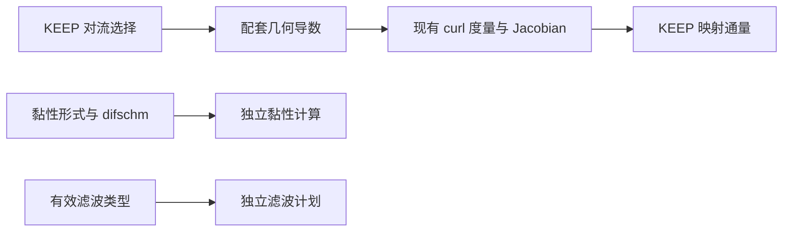

# KEEP 与 ME6 静态几何候选

日期：2026-11-10。对应总计划 KP0、KP0-A、KP4。
状态：**G1、G1a 均已于 2026-11-10 获批并实现，周期静态几何的首轮
收敛、CPU/GPU、MPI、代表滤波与恢复检查已通过，结果见第 7 节。
第 2、6 节保留修订前的失败记录。G2 的范数比候选已于 2026-11-10
单独获批，见第 8 节；组件验证和 ME6 曲线公式仍未实现。**

## 1. 现有定义与调用顺序

计算坐标采用节点索引，步长为 1。本文的 $J$ 对应程序 `jacob`，是
$\det(\partial\mathbf{x}/\partial\boldsymbol{\xi})$，不是其倒数。
定义 $G_{\alpha b}=\partial\xi_\alpha/\partial x_b$，对应 `dxi(alpha,b)`；
$A_{\alpha b}=J G_{\alpha b}$ 是映射面积分量。固定几何下：

$$
J\frac{d q}{dt}=-\sum_\alpha D_\alpha \widehat F_\alpha
                 +\sum_\alpha D_\alpha\widehat F^v_\alpha.
$$

主程序的 `q` 是物理守恒量，不是 $Jq$。`rhscal` 施加对流负号，RK 更新
除以 `jacob`。新几何接口不得再乘除一次 Jacobian。

以下是 G1 修订前的调用关系：`solvrinit → geomcal → flowinit → steploop`。
`geom:gridgeom` 用共享 `fds` 计算坐标导数、对称保守 curl 度量及 Jacobian。
`begin_compact_geometry` 仅为已有 743e/643c 平板特例提前启用全局紧致；
新周期紧致 KEEP 则到 `steploop` 才启用全局周期导数。因此，当时同名
643c 的几何导数与 KEEP 对流导数并不自动等价。

原 `derivative.F90` 的周期／MPI 子段在 -1 与 dim+1 处用显式六阶行封闭，
内部解子段三对角系统；KEEP 对流使用唯一周期节点上的全局循环 Padé。
这一差别是新接线路径的配套问题，本记录不据此判定旧 CPU 所有路径有缺陷。

## 2. 实际度量诊断

使用已有周期曲线夹具：32³ 区间、幅值 0.15，映射为
$x=\xi+0.15\sin\xi\sin\eta$，
$y=\eta+0.15\sin\eta\sin\zeta$，
$z=\zeta+0.15\sin\zeta\sin\xi$。
经真实 `geomcal` 生成几何，运行一个短步仅用于生成现有资源文件。
诊断读取实际 `geometry.h5` 的 $J,G$，不用解析度量代替它们。

令恒定物理状态为 $\rho=p=1$、$\mathbf u=(0.2,0.13,-0.17)$、$\gamma=1.4$。
对于当前算术平均 KEEP，定义

$$
C_b=\sum_\alpha D_\alpha A_{\alpha b},\qquad
\frac{d q}{dt}=-\frac1J\sum_b F_b(q) C_b.
$$

Python 诊断使用周期算子的精确 Fourier 符号。独立原生探针读取同一资源，
调用实际 `keep_two_point_flux5`；紧致导数矩阵由现有
`compact_derivative_core/rhs` 和 CPU 周期线求解器生成。均只读资源，
不修改流场或现有几何生成。

| 实际几何／后续算子 | 原生 $\max|C_b|$ | 原生恒定场物理 RHS 最大绝对值 |
| --- | --- | --- |
| 643e 几何＋显式 KEEP | 4.130e-16 | 6.673e-14 |
| 既有局部 643c 几何＋全局紧致 KEEP | 4.399e-10 | 6.863e-8 |

独立 Fourier 诊断的恒定场 RHS 分别为 6.515e-14、6.863e-8，与原生结果
相符。两组映射面积的周期重复端点差均为 0。紧致结果不是靠增加步数就能
消除的初值扰动，应先解决几何与通量的离散配套，再做曲线网格稳定性判断。
当前不更改公式，也不据单份网格宣布全部曲线几何验证完成。

可追溯入口：

- `tests/gpu_validation/run_keep_metric_audit.py`：真实几何生成与 Fourier 诊断；
- `tests/gpu_validation/keep_geometry_probe.F90`：实际 KEEP 两点通量／紧致矩阵复核；
- `results/keep_kp0a_metric_existing_e`、`results/keep_kp0a_metric_existing_c`：输入、运行日志、几何资源及 JSON；
- `metric_control_review.json`、`metric_local_closure_review.json` 是早期局部矩阵探索，
  不用它们代表包含 halo、共享节点同步和几何边界处理的原生生成链。

## 3. G1：与 KEEP 对流配套的几何导数

**用户已批准的首项范围：**

1. 仅在 `convection_form='keep'` 时，由实际对流选择几何导数：643e 用
   D6，643c 用全局六阶循环 Padé。不新增重复的几何阶数输入。
2. 保留 `geom:gridgeom` 现有对称保守 curl 组合及行列式 Jacobian 定义；
   不把度量换成解析值，不减去自由流残差，不增加经验修正。
3. 分离几何、黏性梯度、KEEP 分裂导数和滤波的实际分派。紧致资源可以
   共用底层矩阵／通信实现，但不能因任何一项紧致而整体切换所有导数。
   `difschm` 不被覆盖，原黏性梯度仍按其真实选择执行。
4. 周期紧致坐标及中间乘积使用已有 affine-periodic 增量处理思想：先处理
   沿本方向的线性增量，对周期余量应用全局导数，再补回增量；不能把
   有坐标跃迁的周期盒端点当作普通周期标量。实际 curl 抵消仍须验证。
5. 普通对流路径的默认几何保持原状。仅滤波切换不得改变任何几何导数。
   新几何身份进入既有数值控制记录；非精确迁移重建，精确恢复不得误认旧几何。

批准后先做周期静态几何，不提前覆盖物理端闭合。建议首轮为现有 32³、64³
曲线及可分离拉伸夹具，NP=1、NP=2 x/y/z 和一次多轴分解。
对实际 $A$，建议将原生 $\max|C_b|$、恒定物理状态各分量 RHS 的最大绝对值
均以 2e-10 为检查门槛；CPU/GPU 仍用已批准最大缩放差 2e-10。
几何／物理导数六阶精度另用三层制造解，不用小残差代替精度证明。
同后端同拓扑精确恢复保持逐值一致，改变有效几何身份不得按精确恢复放行。
不运行性能或生产 DNS，也不扩大为新的边界稳定性结论。

## 4. G2：已批准方案的依据与约束

ME6 原文包含非均匀曲线网格应用，其第 5.7 节将度量和映射通量说明指向
2023 年的曲线坐标论文。后者给出先将半点计算坐标梯度链式投影到物理空间，
再组装应力／导热，最后形成映射通量的组织方式。[原论文](https://arxiv.org/abs/2312.12069)、
[所引曲线坐标论文第 5.2 节](https://arxiv.org/abs/2303.10785)。

该组织方式可参考，但不能直接照搬后者的四阶 alpha-damping 系数。
本项目需保留获批 ME6 六阶半点公式及负半点 penalty 修订。

尚需解决的一项具体约束是各向异性网格的 penalty 尺度。当前笛卡尔基线
在沿 x 的半点计算 y 梯度时采用

$$
g_{xy}=I_x(D_y\phi)+\frac{P_x\phi}{h_x},
$$

其中 $D_y$ 已包含 $1/h_y$，$P_x$ 是不带长度量纲的 penalty 系数和。
若直接在索引坐标构造 $I_x(D_\eta\phi)+P_x\phi$，再统一乘 $1/h_y$，
将得到 $P_x\phi/h_y$，在 $h_x\ne h_y$ 时不等于已验证基线。
因此 G2 必须明确投影与 penalty 的尺度／方向处理，并验证均匀各向异性
极限退回当前基线，再做物理仿射场、制造解、完整应力耗散与实际几何检查。
具体缩放由第 8 节单独获批的范数比方案定义。组件通过后才能进入周期
主程序，不能用 G1/G1a 通过代表 ME6 曲线验证。

## 5. 文献依据

- [Chandravamsi and Frankel (2024)](https://arxiv.org/abs/2312.12069)：ME6 第 3.2.2 节式 (41) 的 mixed penalty 除以外层方向尺度，及第 5.7 节曲线网格应用。
- [Chandravamsi et al. (2023)](https://arxiv.org/abs/2303.10785)：第 4、5.2、7 节，保守度量、半点物理梯度与映射黏性通量；其系数不代替本项目 ME6。
- [Deng et al. (2013), Further studies on GCL](https://www.sciencedirect.com/science/article/pii/S0021999112007255)：相容的保守度量离散与几何恒等式；不能只凭连续恒等式推断任意离散实现已保持自由流。

G1 已批准的接口改动与下述 G1a 分开记录；G1a/G2 的新几何／稳定化公式
在相应候选获批前不实现。

## 6. G1 实施发现：零散度不等于几何正确

G1 的几何入口与梯度分派已接入当前工作区，CPU/GPU 构建通过。
现有 curl/Jacobian 表达式未更换，普通路径保持调用原 `fds`。
**本节是首轮失败的历史状态，不代表第 7 节修订后的代码。**

同一 32³ 曲线网格上，原生恒定场 RHS 已从 6.863e-8 降至 5.585e-14。
但进一步与解析映射核对发现，逆度量并不正确：

| 网格区间 | 归一化 Jacobian 最大误差 | 归一化逆度量最大误差 | 三个物理标量梯度分量误差的最大值 |
| --- | --- | --- | --- |
| 32³ | 7.162e-9 | 0.6151 | 1.1697 |
| 64³ | 1.116e-10 | 0.6186 | 1.1765 |

Jacobian 误差以 $J/(h_1h_2h_3)$ 对照解析映射行列式；逆度量以
$h_\alpha G_{\alpha b}$ 对照解析逆矩阵，$h_\alpha=2\pi/N_\alpha$。
标量为 $\phi=\sin x+\cos(2y)+0.2\sin z$，物理梯度解析值为
$(\cos x,-2\sin(2y),0.2\cos z)$。程序几何给出的逆度量与梯度误差没有
随加密下降，因此不能通过 G1 的六阶几何／物理导数检查。

这不是 CPU/GPU 差异，也不是需要放宽容差的舍入问题。
`results/keep_g1_metric_c32`、`results/keep_g1_metric_c64` 保留该中间状态的
实际几何与输入。64³ 只完成初始化及 step=0 输出，没有推进流场。
检查入口为 `run_keep_metric_audit.py:mapped_accuracy`，未继续下游场比较。

具体原因是 curl 中间量含 $\xi a(\xi)$，其中 $a$ 为周期但非恒定系数。
只减去由两端差值拟合的一条线性趋势，无法把它变成光滑周期函数。
例如 $f(\eta)=\eta\sin\eta$ 在 0、$2\pi$ 处同为 0，但导数分别为 0、
$2\pi$；循环导数把它当作光滑周期数据，会产生接缝误差。
这类项实际出现在 `geom:gridgeom` 的坐标乘坐标导数中，不是人为加入的测试项。
curl 的散度仍可抵消，因此只检查自由流残差无法发现错误逆度量。

### G1a：已批准的仿射背景与周期位移保守 curl

建议只为周期紧致 KEEP，将静态坐标表示为

$$
\mathbf r=\mathbf r_0+\sum_\alpha\mathbf H_\alpha\xi_\alpha+\mathbf w,
$$

其中 $\mathbf H_\alpha$ 是全域周期绕行位移除以该方向区间数的恒定向量，
$\mathbf w$ 在各方向周期。这里只考虑该表示成立的平滑周期几何，
不把一般物理边界或动网格纳入本项。

以 $(\alpha,\beta,\gamma)$ 为循环方向，候选面积向量为

$$
\mathbf A_\alpha=\mathbf H_\beta\times\mathbf H_\gamma
 +\mathbf H_\beta\times D_\gamma\mathbf w
 +(D_\beta\mathbf w)\times\mathbf H_\gamma
 +\frac12\left[D_\beta(\mathbf w\times D_\gamma\mathbf w)
              -D_\gamma(\mathbf w\times D_\beta\mathbf w)\right].
$$

它由原连续对称 curl 公式展开得到：仿射背景及其交叉项显式计入，
全局循环 Padé 只作用于光滑周期量。不能仅因连续等价就宣称离散通过；
批准后需验证此离散表示的实际几何精度和度量恒等式。
Jacobian 仍按 $\det(\mathbf H_\alpha+D_\alpha\mathbf w)$ 对应的原坐标
导数行列式计算，不换成解析 Jacobian，也不对自由流 RHS 作补偿。

在可交换的周期线性 $D_\alpha$ 下，周期 curl 的散度成对抵消，恒定背景
项导数为零，线性交叉项的二阶混合导数也成对抵消。该代数关系只支持
候选的几何恒等式设计，物理度量六阶精度仍由解析网格和制造解检查。

建议维持显式 KEEP 的现有 curl 路径及普通路径默认，只对本项紧致几何
使用新表示，并更新其几何身份，不能将首轮未验收 `/g1` 检查点当成
相同几何的精确恢复。其他数值门槛与 G1 一致，不引入均值扣除或新耗散。

此候选改变中间度量的离散表示，未因此前批准 G1 而直接实现。
用户随后单独批准 G1a，才实施下述修订，以上失败证据仍保留。

## 7. G1a 实现与首轮验证结果

`src/keep_geometry.F90:build_keep_periodic_area` 从全域坐标端点取得恒定
仿射背景，用已有坐标导数减去背景得到周期位移导数，按第 6 节公式
组装未除 Jacobian 的面积向量。全局紧致只对周期乘积求导，不对
“坐标乘周期系数”进行线性去趋势。原 Jacobian 行列式保持不变。
只读现有坐标／坐标导数，临时工作量为单条线的三个分量，不新增完整
三维设备几何数组。初始化完成后仍由已有数组和上传入口供 GPU 使用。

`compact_runtime:geometry_central` 将 KEEP 几何绑定对流，黏性梯度则由
独立的 `global_compact_gradient_enabled` 分派。显式 KEEP 不走新 curl
表示；与修订前显式参考相比，几何资源全部 17 个数据集逐值一致。
紧致 KEEP 的几何在切换黏性导数或滤波后也逐值一致。普通对流路径
仍调用原 `fds`，没有切换其默认几何。

### 三层解析几何与物理梯度

使用真实初始化、step=0 输出，不推进 CFD；Python 只作独立后处理。
紧致曲线夹具的主要误差如下，定义沿用第 6 节：

| 网格区间 | Jacobian 误差 | 逆度量误差 | 物理梯度最大分量误差 |
| --- | --- | --- | --- |
| 32³ | 7.162e-9 | 2.465e-8 | 1.557e-5 |
| 64³ | 1.116e-10 | 3.799e-10 | 2.381e-7 |
| 128³ | 1.775e-12 | 5.917e-12 | 3.700e-9 |

五个量的观测阶为 5.973--6.033。可分离拉伸夹具
`x=xi+0.15*sin(xi), y=eta+0.10*sin(2*eta), z=zeta+0.05*sin(zeta)`
也完成 32³/64³/128³，观测阶为 6.001--6.035。
显式几何路径补充三层检查，最细两层观测阶为 5.973--5.998。
各层实际度量及恒定场 RHS 均满足已批准 2e-10 门槛；它们与三层精度
检查分别判定，没有将离散误差要求为机器零。

入口：`run_keep_metric_audit.py`、`check_keep_geometry_orders.py`。
汇总：`results/keep_g1a_metric_convergence.json`、
`results/keep_g1a_stretch_convergence.json`、
`results/keep_g1_explicit_metric_convergence.json`。
32³ 原生 KEEP／紧致矩阵复核的恒定场 RHS 最大值为 1.244e-14。

### 完整步与恢复

均为非反应 TGV，Re=1600、Ma=0.1、dt=1e-3、4 个完整步，无 crashfix。
缩放差定义与原计划相同，门槛 2e-10。

| 配置 | 拓扑覆盖 | 最大场缩放差 |
| --- | --- | --- |
| 32³ 曲线，643c/643c，关滤波 | NP=1，NP=2 x/y/z，NP=4 xy，NP=8 xyz | 1.444e-15 |
| 64³ 曲线，643c/643c，关滤波 | NP=1 | 1.583e-15 |
| 32³ 曲线，643c/643e，关滤波 | NP=1/2 x | 1.444e-15 |
| 32³ 曲线，643c/643e，显式十阶滤波 | NP=1/2 x | 1.555e-15 |
| 32³ 曲线，643e/643c，紧致十阶滤波 | NP=1/2 x | 6.346e-14 |
| 33×31×29 拉伸网格，643c/643c，关滤波 | NP=1/2 x、NP=4 xy、NP=8 xyz，含不均匀分区 | 1.333e-15 |

表中同时包含 CPU/GPU 同拓扑与各后端对 NP=1 的场比较。
32³ 紧致曲线与非立方拉伸的 MPI 几何残差、恒定场 RHS 也分别检查通过。
关滤波的同状态 q 与几何逐值一致；32³/64³ 对流和完整 RHS 最大缩放差
均不超过 5.318e-15。含 NP=2 x 的各组合均完成 CPU/GPU 各自的 2+2
精确恢复，全部状态数据集逐值一致、控制文件逐字节一致。

有效紧致 KEEP 几何身份为 `/g1a`。旧 `/g1` 精确恢复按预期拒绝；
显式非精确迁移完成。该迁移首轮测试的初始输出调度与源不同，按原有规则
拒绝；将测试输入对齐源调度后完成，没有放宽程序的调度校验。

证据主目录为 `results/keep_g1a_curve_state_c32`、`keep_g1a_curve_state_c64`、
`keep_g1a_curve_c_e_frozen`、`keep_g1a_curve_c_e_filter_fixed`、
`keep_g1a_curve_e_c_filter_fixed`、`keep_g1a_stretch_odd_state`；
汇总 `results/keep_g1a_summary.json`。

### 交叉组合暴露的缓存漏接与修订

本轮新增 643c/643e、643e/643c 后，原缓存刷新条件没有包含它们。
开启滤波时内部原始量仍来自旧 q，MPI 面缓存却来自滤波后的 q。
这属于新组合接线遗漏，不是改变旧 CPU 物理或滤波公式。

旧失败记录中，NP=1/2 的密度差达到 3.394e-10；对同一物理节点，
速度缓存相对当前 q 的重建差达到 5.913e-8。CPU/GPU 的 KEEP 路径已
补齐滤波后缓存刷新，包括 GPU 首阶段准备。修订后速度缓存重建差为 0，
压力／温度最大缩放差不超过 6.652e-16，交叉组合场比较和精确恢复均通过。
只在滤波开启的混合 KEEP 组合把控制记录中的策略版本更新为 2，旧策略
检查点不能被误认为精确相容；不新增附属文件。

另一次严格同状态测试误将 CPU/GPU 各自滤波后的 q 当作逐值相同输入，
实际有约 1.42e-13 的滤波舍入差。该测试保留为失败，冻结 RHS 改用关滤波
的同配置；滤波则分别检查当前缓存、轨迹和恢复。未放宽原 q 逐值一致要求。
失败目录 `results/keep_g1a_curve_c_e_filter`、`keep_g1a_curve_c_e_filter_fields`
保留，不能用作修订后的通过证据。

以上仅关闭 G1/G1a 所述周期静态几何首轮范围。ME6 的 G2、物理壁面与
开放边界闭合、联合收支与后续长窗仍开放，不据此宣称 KP0--KP8 全部完成。

## 8. G2 已批准：完整度量投影与混合 penalty 范数比

用户于 2026-11-10 明确批准本节方案及“先组件、通过后接周期主程序”的
顺序。当前仍未实现 CPU/GPU 候选或主程序分派，批准不代表验证通过。
目标仍包含拉伸和一般静态曲线，不用只实现均匀／可分离网格替代完整目标。
当前只提出一个可检验的候选，失败时报告，不切换公式或调节系数。

### 文献、现有基线与新增设计分开

2024 ME6 原文式 (41) 将 mixed penalty 除以外层差分方向的间距。
2023 曲线坐标论文第 5.2 节提供“半点计算坐标梯度→物理梯度→应力／
导热→映射通量”的组织方式，但它使用另一组 alpha-damping 系数。
两者不能拼接后便声称完整 G2 已由原文给出。

以下保留原 ME6 的直项、插值、penalty 和外层散度系数，包括已批准的
负半点 penalty 变号。**新增的是曲线坐标下的 penalty 几何缩放，
具体范数比是本项目候选，不归因于上述论文，也不预先宣称能量稳定。**

### 半点梯度候选

外层方向为 $\alpha$，半点为相对中心的 $s=\pm1/2,\pm3/2,\pm5/2$。
$I_\alpha^s$ 是已有九点插值，$C_\alpha^s$ 是已有直项半点一阶导数，
$P_\alpha^s$ 是已批准有符号 penalty 系数和，均使用索引坐标步长 1。
$D_\beta$ 是 ME6 私有的六阶显式中心导数，不由对流的显紧选择替换。
以下省略半点上标 $s$，所有量均在同一半点计算。

先分别插值逆度量和映射面积：

$$
\overline G_{\beta b}=I_\alpha(G_{\beta b}),\qquad
\overline A_{\alpha b}=I_\alpha(JG_{\alpha b}).
$$

不能将后式替换成 $I_\alpha(J)I_\alpha(G_{\alpha b})$，也不使用解析
度量替代真实初始化的几何。定义半点逆度量行向量的范数及比值：

$$
s_\beta=\|\overline{\mathbf G}_\beta\|_2,\qquad
\chi_{\alpha\beta}=s_\alpha/s_\beta.
$$

对每个 $\phi\in\{u,v,w,T\}$，候选计算坐标梯度为

$$
d_{\alpha\beta}(\phi)=
\begin{cases}
C_\alpha\phi,&\beta=\alpha,\\
I_\alpha(D_\beta\phi)+\chi_{\alpha\beta}P_\alpha\phi,&\beta\ne\alpha,
\end{cases}
\qquad
g_{\alpha b}(\phi)=\sum_\beta\overline G_{\beta b}d_{\alpha\beta}(\phi).
$$

范数取插值后的逆度量行，不改为插值前范数或局部 covariant 向量长度。
计算中不引入正则化常数；非有限或零范数使该表达式无定义，应报告，
不能静默切换算子。当前仅考虑平滑、有效、正 Jacobian 的静态几何。

在均匀正向笛卡尔网格上，$G_{\beta b}=\delta_{\beta b}/h_\beta$，
因此 $\chi_{\alpha\beta}=h_\beta/h_\alpha$，物理 mixed 梯度严格化为

$$
g_{\alpha b}=I_\alpha(D_b\phi)/h_b+P_\alpha\phi/h_\alpha\quad(b\ne\alpha),
$$

其中此式的 $D_b$ 按索引步长 1 计算。它与现有物理间距基线相同。
若去掉范数比，penalty 将错误地变成 $P_\alpha\phi/h_b$。
该代数极限不要求不同实现浮点求值顺序逐位一致；需按既定缩放差门槛
对照旧基线，并给新算子记录独立版本。

全局刚性旋转使各逆度量行作相同向量旋转，范数比不变，因此该构造具有
刚性旋转相容的代数形式。它不保证斜切网格上的耗散性；尤其在非正交
网格中，不同逆度量行不是正交向量，必须另做完整符号检查。

### 应力、热流与一次 Jacobian

半点黏度、导热系数和速度继续使用原 $I_\alpha$ 插值。由物理梯度
构造 Newtonian 应力与正号黏性能源通量：

$$
\tau_{ib}=\overline\mu\left[g_{\alpha b}(u_i)+g_{\alpha i}(u_b)
 -\frac23\delta_{ib}\sum_c g_{\alpha c}(u_c)\right],\qquad
H_b=\overline\kappa\,g_{\alpha b}(T)+\sum_i\overline u_i\tau_{ib}.
$$

映射动量／能量通量分别为 $\sum_b\overline A_{\alpha b}\tau_{ib}$、
$\sum_b\overline A_{\alpha b}H_b$。按原 ME6 外层权重对正负半点取差，
直接累加到映射 RHS，密度贡献为零。**这里已经含 Jacobian，驱动层
不得像当前笛卡尔 `me6_direction` 那样再次乘 J；RK 仍只除一次 J。**
温度在曲线上需要完整物理梯度；在均匀正交极限，映射面积只投影到
法向直项，自然退回当前笛卡尔导热算子。

### 拟定验证顺序

1. 原生组件先比较均匀各向异性极限与当前基线，保留既有四组间距和
   正／反／斜向波数，缩放差不超过 2e-10。物理仿射场只在常度量仿射
   映射中要求精确导数；一般曲线上按截断误差收敛，不要求仿射场机器零。
2. 常度量完整黏性符号检查：复用原 25³ 波数组合及归一化门槛，增加
   刚性旋转和正 Jacobian 的简单斜切矩阵。动量 Hermitian 部分不得出现
   超门槛正增长，导热符号不得出现超门槛正实部。不因单个 mixed 项的
   符号就判断完整应力系统稳定；失败即停，不用调参补过。
3. 平滑变物性组件与真实 G1/G1a 度量上做三层制造解，分别检查动量、
   导热和黏性功六阶收敛。解析度量仅作独立参考，不替代实际度量路径。
   变物性非严格净量继续按已批准决定记录，不作均值扣除；新出现的
   不收敛／非物理增长仍须报告，不能借此前决定放行。
4. 通过上述组件后才接 CPU/GPU 主程序。先周期拉伸／曲线短窗，检查
   同状态缩放差 2e-10、代表 MPI 和短精确恢复。物理壁面与开放端另行审阅。

常度量首轮矩阵具体采用 $H=\operatorname{diag}(h)$，$h$ 沿用既有四组
`(1,1,1)`、`(0.5,1,2)`、`(1,0.25,0.75)`、`(1,0.01,2)`；另对这些
矩阵施加绕 z 轴 $\pi/7$、再绕 y 轴 $\pi/9$ 的刚性旋转。
斜切对照采用 $H=\operatorname{diag}(1,0.25,0.75)$ 且
$H_{12}=\sigma h_2$，$\sigma=0.1,0.3,1.0$。均从 $G=H^{-1}$ 计算
真实常度量，不以解析符号替代 CPU/GPU 组件本身。
旋转、斜切是组件几何参数，不新增 CFD 工况或运行白名单。

复用现有速度／温度私有边 halo；静态 J、G 只需既有有效面 halo 供半点
插值，不因该候选新增整场主机往返或新的传输后端。GPU 仍逐核显式同步。
输入继续显式选择 `viscous_form='me6_opti'`，原黏性形式保持默认。
通过组件后，新映射形式需更新既有数值身份，旧版本不能按精确
恢复误认；不新增附属文件，不把旧笛卡尔实现作为失败后的自动退路。

**已批准的执行边界：先完成本节组件检查，全部通过后才接周期主程序。**
失败时停止并报告，不自动调系数、更换公式或扩大运行准入。
本次批准不包含物理壁面／开放端闭合、严格守恒重设计或平台生产任务。
