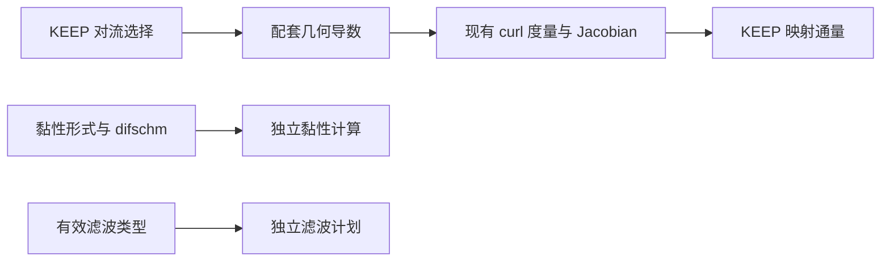

# KEEP 与 ME6 静态几何候选

日期：2026-11-10。对应总计划 KP0、KP0-A、KP4。
状态：**G1、G1a 均已于 2026-11-10 获批并实现，周期静态几何的首轮
收敛、CPU/GPU、MPI、代表滤波与恢复检查已通过，结果见第 7 节。
第 2、6 节保留修订前的失败记录。G2 的范数比候选已于 2026-11-10
单独获批，见第 8 节；现已实现 G2-1--G2-4，周期代表结果见进度文件。
物理端闭合仍未实现。**

## 当前待批准：物理CURVE紧致几何修订 G1m

2026-11-12按完整低阶兼容goal开展零推进诊断，未开放CURVE主程序准入。
原生证据：`results/keep_low_all_20261111/physical_curve_metric_diagnosis/report.json`；
固定原生Jacobian的只读候选复核见同目录`candidate_fixed_J_analysis.json`。
既有y-wavy映射为x=xi、y=eta+0.15*sin(xi)*sin(zeta)、z=zeta；y两端
为物理bc41，x/z周期，三方向区间均为[0,2pi]。测试只让原生CPU生成
几何，max_steps=0，没有GPU流动推进、额外Python推进器或生产作业。

以h=2pi/N把逆度量换算到连续计算坐标后，与解析逆矩阵比较：

| 几何路径 | N=16最大绝对误差 | N=32最大绝对误差 | 表观阶 |
| --- | --- | --- | --- |
| 当前显式KEEP配套几何 | 1.70449e-5 | 2.73763e-7 | 5.960 |
| 当前紧致KEEP物理端几何 | 5.10818e-1 | 5.22812e-1 | -0.033 |
| 未批准的混合方向curl候选，紧致 | 2.66734e-7 | 4.11156e-9 | 6.020 |

两个生产几何路径的Jacobian/h^3均接近解析值1，误差不超过1.555e-14；
当前紧致的体节点度量恒等式及静止恒压几何RHS残差分别不超过
1.053e-15／5.540e-14，却仍给出错误逆度量。这再次说明curl散度抵消、
正Jacobian和MPI一致性不能代替度量的几何准确性。16区间NP=1与2的
x/y/z分解差不超过9.318e-15，不能将0.5量级误差解释为MPI或GPU舍入。

只读复用这些不可变几何，再取物理仿射标量phi=y，精确梯度应为(0,1,0)。
当前紧致度量投影的梯度最大误差16/32分别为.510818／.522812，去掉y
两个物理端点后仍为相同量级，不只是边界端点显示或归一化差异。
相同离散导数、固定原生Jacobian配候选面积向量时，该梯度误差分别为
1.311e-14／2.021e-14；候选Jacobian数组与原生数组逐值一致。
此项是对已保存几何的分析，没有再次启动原生运行或把候选写回求解器。

`physical_curve_standard_me6_geometry`另以原中央643e对流＋ME6／643c
辅助零推进核对：Jacobian及九项逆度量与上述紧致KEEP逐值一致，问题
也涉及该组合的物理CURVE几何，不只涉及KEEP。该路径未进行流动验收。

### 原因与修改边界

`periodic_keep_geometry_active`目前仅对全周期紧致KEEP启用G1a。物理端
仍进入原`geom:gridgeom`坐标乘导数的对称curl，并以
`geometry_central`处理这些乘积。周期方向乘积含“仿射坐标×周期系数”，
一般不具有恒定绕行增量；对整条线减去一个常斜率，不能使其成为光滑
周期量。线性算子仍可能让curl散度抵消，但并不保证面积向量等于正确
的离散几何。当前证据支持这一原因，后续原生反事实修订仍须验证。

已批准G1a明确限定全周期，不能把本提案当成已有批准。拟议G1m只扩展
同一个仿射分离curl表示，保持原Jacobian行列式、导数系数及内部格式：

$$
\mathbf r=\mathbf r_0+\sum_\alpha\mathbf H_\alpha\xi_\alpha+\mathbf w,
$$

$$
\mathbf A_\alpha=\mathbf H_\beta\times\mathbf H_\gamma
 +\mathbf H_\beta\times D_\gamma\mathbf w
 +(D_\beta\mathbf w)\times\mathbf H_\gamma
 +\frac12\left[D_\beta(\mathbf w\times D_\gamma\mathbf w)
              -D_\gamma(\mathbf w\times D_\beta\mathbf w)\right].
$$

- 周期方向：w及其乘积使用已有全局循环紧致导数，不对坐标乘积去趋势。
- 物理方向：相同表示使用已有全局非周期紧致导数和当前低阶端行，不
  把物理端按周期处理，也不增加镜像或壁外物理状态。
- 只替换当前采用紧致几何导数的受影响路径：KEEP 643c，以及原对流＋
  ME6的643c辅助几何。现有显式几何与全周期KEEP G1a默认不变。
- H取全域端点仿射背景；周期面必须满足当前支持的平移周期关系，不
  新增旋转周期、动网格或任意UDF。物理方向不要求w周期。
- 可交换的方向线性算子与D(常数)=0、D(索引)=1支撑散度抵消；这不是
  全域六阶／边界稳定性证明。物理端仍保留其真实低阶导数精度。
- 新几何身份必须区分旧批次，放入现有定长记录；不增加附属文件或
  兼容转换。CPU统一生成几何、现有上传供GPU使用，不加完整设备副本。

`run_keep_physical_metric_audit.py`只在后处理中评价候选，没有替换求解器
度量。上述第3行尚不是原生实现、MPI实现或物理验收结果。

### 批准后拟执行的最小顺序

1. 先接原生G1m几何，复核y-wavy 16/32/64及16区间NP=1/2 x/y/z、代表
   NP=4。度量恒等式、静止恒压RHS及分解差沿用2e-10；此特定映射仅
   沿周期方向非线性，细两级解析逆度量误差阶需达到5.5。一般物理端
   不套用全域六阶要求。
2. 再检查物理仿射场梯度、真实曲面法向、近端节点黏性／内部ME6接口，
   接实际低阶CPU/GPU短轨迹及必要滤波、恢复身份。不能只删除tensor检查。
3. 曲壁KEEP／ME6主程序仍需各自字段／RHS≤2e-10、有限正值、代表MPI
   及同拓扑精确恢复。未取得这些证据前不宣称CURVE边界兼容完成。

状态：待人工批准。未修改生产几何、边界定义或准入，不扩展高阶研究。

## 1. 现有定义与调用顺序

计算坐标采用节点索引，步长为 1。本文的 $J$ 对应程序 `jacob`，是
$\det(\partial\mathbf{x}/\partial\boldsymbol{\xi})$，不是其倒数。
定义 $G_{\alpha b}=\partial\xi_\alpha/\partial x_b$，对应 `dxi(alpha,b)`；
$A_{\alpha b}=J G_{\alpha b}$ 是映射面积分量。固定几何下：

$$
J\frac{d q}{dt}=-\sum_\alpha D_\alpha \widehat F_\alpha
                 +\sum_\alpha D_\alpha\widehat F^v_\alpha.
$$

主程序的 `q` 是物理守恒量，不是 $Jq$。`rhscal` 施加对流负号，RK 更新
除以 `jacob`。新几何接口不得再乘除一次 Jacobian。

以下是 G1 修订前的调用关系：`solvrinit → geomcal → flowinit → steploop`。
`geom:gridgeom` 用共享 `fds` 计算坐标导数、对称保守 curl 度量及 Jacobian。
`begin_compact_geometry` 仅为已有 743e/643c 平板特例提前启用全局紧致；
新周期紧致 KEEP 则到 `steploop` 才启用全局周期导数。因此，当时同名
643c 的几何导数与 KEEP 对流导数并不自动等价。

原 `derivative.F90` 的周期／MPI 子段在 -1 与 dim+1 处用显式六阶行封闭，
内部解子段三对角系统；KEEP 对流使用唯一周期节点上的全局循环 Padé。
这一差别是新接线路径的配套问题，本记录不据此判定旧 CPU 所有路径有缺陷。

## 2. 实际度量诊断

使用已有周期曲线夹具：32³ 区间、幅值 0.15，映射为
$x=\xi+0.15\sin\xi\sin\eta$，
$y=\eta+0.15\sin\eta\sin\zeta$，
$z=\zeta+0.15\sin\zeta\sin\xi$。
经真实 `geomcal` 生成几何，运行一个短步仅用于生成现有资源文件。
诊断读取实际 `geometry.h5` 的 $J,G$，不用解析度量代替它们。

令恒定物理状态为 $\rho=p=1$、$\mathbf u=(0.2,0.13,-0.17)$、$\gamma=1.4$。
对于当前算术平均 KEEP，定义

$$
C_b=\sum_\alpha D_\alpha A_{\alpha b},\qquad
\frac{d q}{dt}=-\frac1J\sum_b F_b(q) C_b.
$$

Python 诊断使用周期算子的精确 Fourier 符号。独立原生探针读取同一资源，
调用实际 `keep_two_point_flux5`；紧致导数矩阵由现有
`compact_derivative_core/rhs` 和 CPU 周期线求解器生成。均只读资源，
不修改流场或现有几何生成。

| 实际几何／后续算子 | 原生 $\max|C_b|$ | 原生恒定场物理 RHS 最大绝对值 |
| --- | --- | --- |
| 643e 几何＋显式 KEEP | 4.130e-16 | 6.673e-14 |
| 既有局部 643c 几何＋全局紧致 KEEP | 4.399e-10 | 6.863e-8 |

独立 Fourier 诊断的恒定场 RHS 分别为 6.515e-14、6.863e-8，与原生结果
相符。两组映射面积的周期重复端点差均为 0。紧致结果不是靠增加步数就能
消除的初值扰动，应先解决几何与通量的离散配套，再做曲线网格稳定性判断。
当前不更改公式，也不据单份网格宣布全部曲线几何验证完成。

可追溯入口：

- `tests/gpu_validation/run_keep_metric_audit.py`：真实几何生成与 Fourier 诊断；
- `tests/gpu_validation/keep_geometry_probe.F90`：实际 KEEP 两点通量／紧致矩阵复核；
- `results/keep_kp0a_metric_existing_e`、`results/keep_kp0a_metric_existing_c`：输入、运行日志、几何资源及 JSON；
- `metric_control_review.json`、`metric_local_closure_review.json` 是早期局部矩阵探索，
  不用它们代表包含 halo、共享节点同步和几何边界处理的原生生成链。

## 3. G1：与 KEEP 对流配套的几何导数

**用户已批准的首项范围：**

1. 仅在 `convection_form='keep'` 时，由实际对流选择几何导数：643e 用
   D6，643c 用全局六阶循环 Padé。不新增重复的几何阶数输入。
2. 保留 `geom:gridgeom` 现有对称保守 curl 组合及行列式 Jacobian 定义；
   不把度量换成解析值，不减去自由流残差，不增加经验修正。
3. 分离几何、黏性梯度、KEEP 分裂导数和滤波的实际分派。紧致资源可以
   共用底层矩阵／通信实现，但不能因任何一项紧致而整体切换所有导数。
   `difschm` 不被覆盖，原黏性梯度仍按其真实选择执行。
4. 周期紧致坐标及中间乘积使用已有 affine-periodic 增量处理思想：先处理
   沿本方向的线性增量，对周期余量应用全局导数，再补回增量；不能把
   有坐标跃迁的周期盒端点当作普通周期标量。实际 curl 抵消仍须验证。
5. 普通对流路径的默认几何保持原状。仅滤波切换不得改变任何几何导数。
   新几何身份进入既有数值控制记录；非精确迁移重建，精确恢复不得误认旧几何。

批准后先做周期静态几何，不提前覆盖物理端闭合。建议首轮为现有 32³、64³
曲线及可分离拉伸夹具，NP=1、NP=2 x/y/z 和一次多轴分解。
对实际 $A$，建议将原生 $\max|C_b|$、恒定物理状态各分量 RHS 的最大绝对值
均以 2e-10 为检查门槛；CPU/GPU 仍用已批准最大缩放差 2e-10。
几何／物理导数六阶精度另用三层制造解，不用小残差代替精度证明。
同后端同拓扑精确恢复保持逐值一致，改变有效几何身份不得按精确恢复放行。
不运行性能或生产 DNS，也不扩大为新的边界稳定性结论。

## 4. G2：已批准方案的依据与约束

ME6 原文包含非均匀曲线网格应用，其第 5.7 节将度量和映射通量说明指向
2023 年的曲线坐标论文。后者给出先将半点计算坐标梯度链式投影到物理空间，
再组装应力／导热，最后形成映射通量的组织方式。[原论文](https://arxiv.org/abs/2312.12069)、
[所引曲线坐标论文第 5.2 节](https://arxiv.org/abs/2303.10785)。

该组织方式可参考，但不能直接照搬后者的四阶 alpha-damping 系数。
本项目需保留获批 ME6 六阶半点公式及负半点 penalty 修订。

尚需解决的一项具体约束是各向异性网格的 penalty 尺度。当前笛卡尔基线
在沿 x 的半点计算 y 梯度时采用

$$
g_{xy}=I_x(D_y\phi)+\frac{P_x\phi}{h_x},
$$

其中 $D_y$ 已包含 $1/h_y$，$P_x$ 是不带长度量纲的 penalty 系数和。
若直接在索引坐标构造 $I_x(D_\eta\phi)+P_x\phi$，再统一乘 $1/h_y$，
将得到 $P_x\phi/h_y$，在 $h_x\ne h_y$ 时不等于已验证基线。
因此 G2 必须明确投影与 penalty 的尺度／方向处理，并验证均匀各向异性
极限退回当前基线，再做物理仿射场、制造解、完整应力耗散与实际几何检查。
具体缩放由第 8 节单独获批的范数比方案定义。组件通过后才能进入周期
主程序，不能用 G1/G1a 通过代表 ME6 曲线验证。

## 5. 文献依据

- [Chandravamsi and Frankel (2024)](https://arxiv.org/abs/2312.12069)：ME6 第 3.2.2 节式 (41) 的 mixed penalty 除以外层方向尺度，及第 5.7 节曲线网格应用。
- [Chandravamsi et al. (2023)](https://arxiv.org/abs/2303.10785)：第 4、5.2、7 节，保守度量、半点物理梯度与映射黏性通量；其系数不代替本项目 ME6。
- [Deng et al. (2013), Further studies on GCL](https://www.sciencedirect.com/science/article/pii/S0021999112007255)：相容的保守度量离散与几何恒等式；不能只凭连续恒等式推断任意离散实现已保持自由流。

G1 已批准的接口改动与下述 G1a 分开记录；G1a/G2 的新几何／稳定化公式
在相应候选获批前不实现。

## 6. G1 实施发现：零散度不等于几何正确

G1 的几何入口与梯度分派已接入当前工作区，CPU/GPU 构建通过。
现有 curl/Jacobian 表达式未更换，普通路径保持调用原 `fds`。
**本节是首轮失败的历史状态，不代表第 7 节修订后的代码。**

同一 32³ 曲线网格上，原生恒定场 RHS 已从 6.863e-8 降至 5.585e-14。
但进一步与解析映射核对发现，逆度量并不正确：

| 网格区间 | 归一化 Jacobian 最大误差 | 归一化逆度量最大误差 | 三个物理标量梯度分量误差的最大值 |
| --- | --- | --- | --- |
| 32³ | 7.162e-9 | 0.6151 | 1.1697 |
| 64³ | 1.116e-10 | 0.6186 | 1.1765 |

Jacobian 误差以 $J/(h_1h_2h_3)$ 对照解析映射行列式；逆度量以
$h_\alpha G_{\alpha b}$ 对照解析逆矩阵，$h_\alpha=2\pi/N_\alpha$。
标量为 $\phi=\sin x+\cos(2y)+0.2\sin z$，物理梯度解析值为
$(\cos x,-2\sin(2y),0.2\cos z)$。程序几何给出的逆度量与梯度误差没有
随加密下降，因此不能通过 G1 的六阶几何／物理导数检查。

这不是 CPU/GPU 差异，也不是需要放宽容差的舍入问题。
`results/keep_g1_metric_c32`、`results/keep_g1_metric_c64` 保留该中间状态的
实际几何与输入。64³ 只完成初始化及 step=0 输出，没有推进流场。
检查入口为 `run_keep_metric_audit.py:mapped_accuracy`，未继续下游场比较。

具体原因是 curl 中间量含 $\xi a(\xi)$，其中 $a$ 为周期但非恒定系数。
只减去由两端差值拟合的一条线性趋势，无法把它变成光滑周期函数。
例如 $f(\eta)=\eta\sin\eta$ 在 0、$2\pi$ 处同为 0，但导数分别为 0、
$2\pi$；循环导数把它当作光滑周期数据，会产生接缝误差。
这类项实际出现在 `geom:gridgeom` 的坐标乘坐标导数中，不是人为加入的测试项。
curl 的散度仍可抵消，因此只检查自由流残差无法发现错误逆度量。

### G1a：已批准的仿射背景与周期位移保守 curl

建议只为周期紧致 KEEP，将静态坐标表示为

$$
\mathbf r=\mathbf r_0+\sum_\alpha\mathbf H_\alpha\xi_\alpha+\mathbf w,
$$

其中 $\mathbf H_\alpha$ 是全域周期绕行位移除以该方向区间数的恒定向量，
$\mathbf w$ 在各方向周期。这里只考虑该表示成立的平滑周期几何，
不把一般物理边界或动网格纳入本项。

以 $(\alpha,\beta,\gamma)$ 为循环方向，候选面积向量为

$$
\mathbf A_\alpha=\mathbf H_\beta\times\mathbf H_\gamma
 +\mathbf H_\beta\times D_\gamma\mathbf w
 +(D_\beta\mathbf w)\times\mathbf H_\gamma
 +\frac12\left[D_\beta(\mathbf w\times D_\gamma\mathbf w)
              -D_\gamma(\mathbf w\times D_\beta\mathbf w)\right].
$$

它由原连续对称 curl 公式展开得到：仿射背景及其交叉项显式计入，
全局循环 Padé 只作用于光滑周期量。不能仅因连续等价就宣称离散通过；
批准后需验证此离散表示的实际几何精度和度量恒等式。
Jacobian 仍按 $\det(\mathbf H_\alpha+D_\alpha\mathbf w)$ 对应的原坐标
导数行列式计算，不换成解析 Jacobian，也不对自由流 RHS 作补偿。

在可交换的周期线性 $D_\alpha$ 下，周期 curl 的散度成对抵消，恒定背景
项导数为零，线性交叉项的二阶混合导数也成对抵消。该代数关系只支持
候选的几何恒等式设计，物理度量六阶精度仍由解析网格和制造解检查。

建议维持显式 KEEP 的现有 curl 路径及普通路径默认，只对本项紧致几何
使用新表示，并更新其几何身份，不能将首轮未验收 `/g1` 检查点当成
相同几何的精确恢复。其他数值门槛与 G1 一致，不引入均值扣除或新耗散。

此候选改变中间度量的离散表示，未因此前批准 G1 而直接实现。
用户随后单独批准 G1a，才实施下述修订，以上失败证据仍保留。

## 7. G1a 实现与首轮验证结果

`src/keep_geometry.F90:build_keep_periodic_area` 从全域坐标端点取得恒定
仿射背景，用已有坐标导数减去背景得到周期位移导数，按第 6 节公式
组装未除 Jacobian 的面积向量。全局紧致只对周期乘积求导，不对
“坐标乘周期系数”进行线性去趋势。原 Jacobian 行列式保持不变。
只读现有坐标／坐标导数，临时工作量为单条线的三个分量，不新增完整
三维设备几何数组。初始化完成后仍由已有数组和上传入口供 GPU 使用。

`compact_runtime:geometry_central` 将 KEEP 几何绑定对流，黏性梯度则由
独立的 `global_compact_gradient_enabled` 分派。显式 KEEP 不走新 curl
表示；与修订前显式参考相比，几何资源全部 17 个数据集逐值一致。
紧致 KEEP 的几何在切换黏性导数或滤波后也逐值一致。普通对流路径
仍调用原 `fds`，没有切换其默认几何。

### 三层解析几何与物理梯度

使用真实初始化、step=0 输出，不推进 CFD；Python 只作独立后处理。
紧致曲线夹具的主要误差如下，定义沿用第 6 节：

| 网格区间 | Jacobian 误差 | 逆度量误差 | 物理梯度最大分量误差 |
| --- | --- | --- | --- |
| 32³ | 7.162e-9 | 2.465e-8 | 1.557e-5 |
| 64³ | 1.116e-10 | 3.799e-10 | 2.381e-7 |
| 128³ | 1.775e-12 | 5.917e-12 | 3.700e-9 |

五个量的观测阶为 5.973--6.033。可分离拉伸夹具
`x=xi+0.15*sin(xi), y=eta+0.10*sin(2*eta), z=zeta+0.05*sin(zeta)`
也完成 32³/64³/128³，观测阶为 6.001--6.035。
显式几何路径补充三层检查，最细两层观测阶为 5.973--5.998。
各层实际度量及恒定场 RHS 均满足已批准 2e-10 门槛；它们与三层精度
检查分别判定，没有将离散误差要求为机器零。

入口：`run_keep_metric_audit.py`、`check_keep_geometry_orders.py`。
汇总：`results/keep_g1a_metric_convergence.json`、
`results/keep_g1a_stretch_convergence.json`、
`results/keep_g1_explicit_metric_convergence.json`。
32³ 原生 KEEP／紧致矩阵复核的恒定场 RHS 最大值为 1.244e-14。

### 完整步与恢复

均为非反应 TGV，Re=1600、Ma=0.1、dt=1e-3、4 个完整步，无 crashfix。
缩放差定义与原计划相同，门槛 2e-10。

| 配置 | 拓扑覆盖 | 最大场缩放差 |
| --- | --- | --- |
| 32³ 曲线，643c/643c，关滤波 | NP=1，NP=2 x/y/z，NP=4 xy，NP=8 xyz | 1.444e-15 |
| 64³ 曲线，643c/643c，关滤波 | NP=1 | 1.583e-15 |
| 32³ 曲线，643c/643e，关滤波 | NP=1/2 x | 1.444e-15 |
| 32³ 曲线，643c/643e，显式十阶滤波 | NP=1/2 x | 1.555e-15 |
| 32³ 曲线，643e/643c，紧致十阶滤波 | NP=1/2 x | 6.346e-14 |
| 33×31×29 拉伸网格，643c/643c，关滤波 | NP=1/2 x、NP=4 xy、NP=8 xyz，含不均匀分区 | 1.333e-15 |

表中同时包含 CPU/GPU 同拓扑与各后端对 NP=1 的场比较。
32³ 紧致曲线与非立方拉伸的 MPI 几何残差、恒定场 RHS 也分别检查通过。
关滤波的同状态 q 与几何逐值一致；32³/64³ 对流和完整 RHS 最大缩放差
均不超过 5.318e-15。含 NP=2 x 的各组合均完成 CPU/GPU 各自的 2+2
精确恢复，全部状态数据集逐值一致、控制文件逐字节一致。

有效紧致 KEEP 几何身份为 `/g1a`。旧 `/g1` 精确恢复按预期拒绝；
显式非精确迁移完成。该迁移首轮测试的初始输出调度与源不同，按原有规则
拒绝；将测试输入对齐源调度后完成，没有放宽程序的调度校验。

证据主目录为 `results/keep_g1a_curve_state_c32`、`keep_g1a_curve_state_c64`、
`keep_g1a_curve_c_e_frozen`、`keep_g1a_curve_c_e_filter_fixed`、
`keep_g1a_curve_e_c_filter_fixed`、`keep_g1a_stretch_odd_state`；
汇总 `results/keep_g1a_summary.json`。

### 交叉组合暴露的缓存漏接与修订

本轮新增 643c/643e、643e/643c 后，原缓存刷新条件没有包含它们。
开启滤波时内部原始量仍来自旧 q，MPI 面缓存却来自滤波后的 q。
这属于新组合接线遗漏，不是改变旧 CPU 物理或滤波公式。

旧失败记录中，NP=1/2 的密度差达到 3.394e-10；对同一物理节点，
速度缓存相对当前 q 的重建差达到 5.913e-8。CPU/GPU 的 KEEP 路径已
补齐滤波后缓存刷新，包括 GPU 首阶段准备。修订后速度缓存重建差为 0，
压力／温度最大缩放差不超过 6.652e-16，交叉组合场比较和精确恢复均通过。
只在滤波开启的混合 KEEP 组合把控制记录中的策略版本更新为 2，旧策略
检查点不能被误认为精确相容；不新增附属文件。

另一次严格同状态测试误将 CPU/GPU 各自滤波后的 q 当作逐值相同输入，
实际有约 1.42e-13 的滤波舍入差。该测试保留为失败，冻结 RHS 改用关滤波
的同配置；滤波则分别检查当前缓存、轨迹和恢复。未放宽原 q 逐值一致要求。
失败目录 `results/keep_g1a_curve_c_e_filter`、`keep_g1a_curve_c_e_filter_fields`
保留，不能用作修订后的通过证据。

以上仅关闭 G1/G1a 所述周期静态几何首轮范围。ME6 的 G2、物理壁面与
开放边界闭合、联合收支与后续长窗仍开放，不据此宣称 KP0--KP8 全部完成。

## 8. G2 已批准：完整度量投影与混合 penalty 范数比

用户于 2026-11-10 明确批准本节方案及“先组件、通过后接周期主程序”的
顺序。G2-1--G2-4 已实现并完成周期代表验证，具体误差、源文件和证据见
[进度文件 G2 记录](ASTR_GPU_KEEP_INTEGRATION_PROGRESS.md#g2-1--g2-4me6-周期映射扩展)。
目标仍包含拉伸和一般静态曲线，不用只实现均匀／可分离网格替代完整目标。
本节只包含这一获批候选，失败时报告，不切换公式或调节系数。

### 文献、现有基线与新增设计分开

2024 ME6 原文式 (41) 将 mixed penalty 除以外层差分方向的间距。
2023 曲线坐标论文第 5.2 节提供“半点计算坐标梯度→物理梯度→应力／
导热→映射通量”的组织方式，但它使用另一组 alpha-damping 系数。
两者不能拼接后便声称完整 G2 已由原文给出。

以下保留原 ME6 的直项、插值、penalty 和外层散度系数，包括已批准的
负半点 penalty 变号。**新增的是曲线坐标下的 penalty 几何缩放，
具体范数比是本项目候选，不归因于上述论文，也不预先宣称能量稳定。**

### 半点梯度候选

外层方向为 $\alpha$，半点为相对中心的 $s=\pm1/2,\pm3/2,\pm5/2$。
$I_\alpha^s$ 是已有九点插值，$C_\alpha^s$ 是已有直项半点一阶导数，
$P_\alpha^s$ 是已批准有符号 penalty 系数和，均使用索引坐标步长 1。
$D_\beta$ 是 ME6 私有的六阶显式中心导数，不由对流的显紧选择替换。
以下省略半点上标 $s$，所有量均在同一半点计算。

先分别插值逆度量和映射面积：

$$
\overline G_{\beta b}=I_\alpha(G_{\beta b}),\qquad
\overline A_{\alpha b}=I_\alpha(JG_{\alpha b}).
$$

不能将后式替换成 $I_\alpha(J)I_\alpha(G_{\alpha b})$，也不使用解析
度量替代真实初始化的几何。定义半点逆度量行向量的范数及比值：

$$
s_\beta=\|\overline{\mathbf G}_\beta\|_2,\qquad
\chi_{\alpha\beta}=s_\alpha/s_\beta.
$$

对每个 $\phi\in\{u,v,w,T\}$，候选计算坐标梯度为

$$
d_{\alpha\beta}(\phi)=
\begin{cases}
C_\alpha\phi,&\beta=\alpha,\\
I_\alpha(D_\beta\phi)+\chi_{\alpha\beta}P_\alpha\phi,&\beta\ne\alpha,
\end{cases}
\qquad
g_{\alpha b}(\phi)=\sum_\beta\overline G_{\beta b}d_{\alpha\beta}(\phi).
$$

范数取插值后的逆度量行，不改为插值前范数或局部 covariant 向量长度。
计算中不引入正则化常数；非有限或零范数使该表达式无定义，应报告，
不能静默切换算子。当前仅考虑平滑、有效、正 Jacobian 的静态几何。

在均匀正向笛卡尔网格上，$G_{\beta b}=\delta_{\beta b}/h_\beta$，
因此 $\chi_{\alpha\beta}=h_\beta/h_\alpha$，物理 mixed 梯度严格化为

$$
g_{\alpha b}=I_\alpha(D_b\phi)/h_b+P_\alpha\phi/h_\alpha\quad(b\ne\alpha),
$$

其中此式的 $D_b$ 按索引步长 1 计算。它与现有物理间距基线相同。
若去掉范数比，penalty 将错误地变成 $P_\alpha\phi/h_b$。
该代数极限不要求不同实现浮点求值顺序逐位一致；需按既定缩放差门槛
对照旧基线，并给新算子记录独立版本。

全局刚性旋转使各逆度量行作相同向量旋转，范数比不变，因此该构造具有
刚性旋转相容的代数形式。它不保证斜切网格上的耗散性；尤其在非正交
网格中，不同逆度量行不是正交向量，必须另做完整符号检查。

### 应力、热流与一次 Jacobian

半点黏度、导热系数和速度继续使用原 $I_\alpha$ 插值。由物理梯度
构造 Newtonian 应力与正号黏性能源通量：

$$
\tau_{ib}=\overline\mu\left[g_{\alpha b}(u_i)+g_{\alpha i}(u_b)
 -\frac23\delta_{ib}\sum_c g_{\alpha c}(u_c)\right],\qquad
H_b=\overline\kappa\,g_{\alpha b}(T)+\sum_i\overline u_i\tau_{ib}.
$$

映射动量／能量通量分别为 $\sum_b\overline A_{\alpha b}\tau_{ib}$、
$\sum_b\overline A_{\alpha b}H_b$。按原 ME6 外层权重对正负半点取差，
直接累加到映射 RHS，密度贡献为零。**这里已经含 Jacobian，驱动层
不得像当前笛卡尔 `me6_direction` 那样再次乘 J；RK 仍只除一次 J。**
温度在曲线上需要完整物理梯度；在均匀正交极限，映射面积只投影到
法向直项，自然退回当前笛卡尔导热算子。

### 拟定验证顺序

1. 原生组件先比较均匀各向异性极限与当前基线，保留既有四组间距和
   正／反／斜向波数，缩放差不超过 2e-10。物理仿射场只在常度量仿射
   映射中要求精确导数；一般曲线上按截断误差收敛，不要求仿射场机器零。
2. 常度量完整黏性符号检查：复用原 25³ 波数组合及归一化门槛，增加
   刚性旋转和正 Jacobian 的简单斜切矩阵。动量 Hermitian 部分不得出现
   超门槛正增长，导热符号不得出现超门槛正实部。不因单个 mixed 项的
   符号就判断完整应力系统稳定；失败即停，不用调参补过。
3. 平滑变物性组件与真实 G1/G1a 度量上做三层制造解，分别检查动量、
   导热和黏性功六阶收敛。解析度量仅作独立参考，不替代实际度量路径。
   变物性非严格净量继续按已批准决定记录，不作均值扣除；新出现的
   不收敛／非物理增长仍须报告，不能借此前决定放行。
4. 通过上述组件后才接 CPU/GPU 主程序。先周期拉伸／曲线短窗，检查
   同状态缩放差 2e-10、代表 MPI 和短精确恢复。物理壁面与开放端另行审阅。

常度量首轮矩阵具体采用 $H=\operatorname{diag}(h)$，$h$ 沿用既有四组
`(1,1,1)`、`(0.5,1,2)`、`(1,0.25,0.75)`、`(1,0.01,2)`；另对这些
矩阵施加绕 z 轴 $\pi/7$、再绕 y 轴 $\pi/9$ 的刚性旋转。
斜切对照采用 $H=\operatorname{diag}(1,0.25,0.75)$ 且
$H_{12}=\sigma h_2$，$\sigma=0.1,0.3,1.0$。均从 $G=H^{-1}$ 计算
真实常度量，不以解析符号替代 CPU/GPU 组件本身。
旋转、斜切是组件几何参数，不新增 CFD 工况或运行白名单。

复用现有速度／温度私有边 halo；静态 J、G 只需既有有效面 halo 供半点
插值，不因该候选新增整场主机往返或新的传输后端。GPU 仍逐核显式同步。
输入继续显式选择 `viscous_form='me6_opti'`，原黏性形式保持默认。
通过组件后，新映射形式需更新既有数值身份，旧版本不能按精确
恢复误认；不新增附属文件，不把旧笛卡尔实现作为失败后的自动退路。

**已批准的执行边界：先完成本节组件检查，全部通过后才接周期主程序。**
失败时停止并报告，不自动调系数、更换公式或扩大运行准入。
本次批准不包含物理壁面／开放端闭合、严格守恒重设计或平台生产任务。

## 9. 已批准：ME6 低阶壁面过渡候选

状态：2026-11-11用户批准，平直bc41组件、代表主程序／滤波／MPI／恢复及
短稳定窗口已取得证据，详见进度记录；不属于一般曲壁或高阶闭合验收。
已有ME6九点半点重构在外层方向读取中心正负4个节点，混合项的横向
中心导数读取正负3个节点。不能把周期ghost当成物理壁面外的真实数据。

首轮候选采用现有算子的空间拼接，不增加新的半点系数。令d为到最近
物理y壁面的全局节点索引距离，MPI内部接口不算壁面：

- d=0,1,2,3：复用原节点黏性RHS，包括其现有物理端梯度、应力、导热
  和黏性功处理；壁面状态和完整RK存储相位保持原语义。
- d>=4：采用现有ME6 G2完整映射黏性RHS。该区域所有模板都可由物理
  节点或合法MPI halo提供，不构造镜像速度／温度或虚构壁外状态。
- 四个动量／能量贡献使用同一个区域选择，密度黏性贡献仍为零。
  这里指三个动量分量和一个总能量分量，不分别切换应力和黏性功。

区域宽度来自既有模板半径，不新增经验调节参数。该路径是显式选择
`viscous_form='me6_opti'` 后的固定物理端算法，不是运行失败后的回退。
首轮限定非反应FP64、平直y向bc41、原643e节点梯度，先配显式KEEP、
关闭滤波与crashfix；通过组件后再接其他已支持对流组合。
普通黏性默认不变，周期ME6 G2不变。新物理端组合须有独立数值身份。

拼接区没有由此获得共用界面通量或能量估计，可能引入额外的动量／能量
收支残差。已有ME6变物性非严格净量也不会自动消失。不得称严格守恒，
不得以全域均值扣除补过。原节点梯度和散度组合的近壁RHS阶数需实际
制造解核对，不能把单个D2/D4模板的阶数当成组合黏性算子阶数。

执行顺序为先复用真实原节点实现和ME6实现，对壁面相容制造场检查：各区域
及拼接附近误差随网格变化、三个动量／导热／黏性功的同状态CPU/GPU差
<=2e-10、相同阶段缓存、实际收支和不读取未定义壁外字段。再做代表MPI、
短窗与恢复。不能通过则报告该候选失效，不自动调宽度或换系数。
优先复用已有梯度／通量工作区，不新增一份全量q或全量RHS来掩盖接线问题。
若用户选择真正单边半点闭合，则另行提交具体公式，不与该候选混称。

## 10. 已批准：开放端复用已修订的bc22，并修订CPU旧通用右出口

状态：2026-11-11用户批准接入，并要求CPU bc22一并修订。CPU通用x+
五变量修订及18项解析CPU/GPU对照已完成；KEEP开放端准入在相应主程序
接线完成前保持关闭。
这与第9节ME6壁面候选是两个独立决定。

`bc:outflow_nscbc`的右出口有两条实际路径。旧通用分支直接使用
`3.75*(1-gmachmax2)*a/Lx`并无条件覆盖第5特征；当前
`profile_nscbc_outlet_enabled`只覆盖743e MP7-LD平板，因此新KEEP不会
自动进入修订分支。超声速法向流出仍被旧分支施加目标，且系数可以为负。
这不是KEEP体算子的误差。该旧行为已在NSCBC物理修订记录中明确排除为
GPU正确性参考，不能重新复制到新GPU KEEP路径。

现GPU出口及CPU已有平板专用分支使用局部法向特征分类，亚声速流出只
处理传入声波，按当前特征矩阵归一化压力差；超声速流出保留内场特征。
倒流使用既有完整常数背景及连续恢复率，公式和既有范围见
`ASTR_NSCBC22_BACKFLOW_ADAPTATION_PLAN.md`第4节。本候选不新增这些
公式或目标，只提议让新CPU/GPU KEEP一致复用它们。

若批准，按以下工程合同接入：

- 首轮仍为非反应FP64、原黏性、平直tensor网格、
  `11/22/41/52/1/1`，显式／紧致KEEP分项核对。bc52的compatibility、
  incoming_only、nonreflecting仍分别保留原物理定义，不混入入射激波。
- 使用现有低阶法向与横向导数，不因选择KEEP而启用Hermite7或已有
  MP7专用高阶修正。紧致KEEP体算子及物理端辅助导数仍为原全局系统。
- 对新KEEP路径统一执行：入口状态及出口／底壁交点准备，出口自身
  横向滤波，底壁／顶面处理，再形成出口特征RHS。复用已有延后出口RHS
  的分步接口；不重复壁面随机数抽样，不改其他原CPU分支的执行顺序。
- GPU不直接套用只为已有incoming_only平板编排的紧致准备函数；
  nonreflecting须保留自己的源项平衡。每个边界法向、横向和黏性贡献
  只由一个模块装配。前述KEEP RHS累加修订保留这些面贡献。
- CPU/GPU冻结输入快照均记录在边界滤波、物性刷新及最终halo更新之后，
  不能拿滤波前GPU快照与滤波后CPU快照比较。生产默认不增加整场回读。
- 沿用现有控制记录保存有效方法、目标和恢复身份；新开放端闭合与
  w24/w34壁面标签区分。不增加检查点附属文件或另一份全q/RHS。

最小检查先用实际边界实现的解析状态辨别亚／超声速出流、倒流及传出波
保留，再用共有平板初场检查三种顶面模式的同相位CPU/GPU RHS与短场，
最大缩放差<=2e-10。各模式不互相逐场比较。代表MPI、滤波和精确续算
复用已通过接口，只补新增的开放面所有权及交线组合，不做无关全排列。
用户追加批准了CPU旧通用x+出口的非反应五变量修订，而不只在KEEP中
绕开它。其他法向面、反应流和物理模型不借此扩大范围；不表示已有任意
边界组合稳定性证明。

## 11. 已批准接线短测：nonreflecting与压力出口交线的对流RHS候选

状态：2026-11-11用户批准compatibility／incoming_only交线漏z项的最小
CPU修复，并批准本节候选的组件验证。随后批准16³、dt=1e-5、4步、
原643e黏性、无滤波／修复的主程序接线与代表MPI／精确恢复短测。
组件与上述短测均已通过，不等于生产采用、声学反射或完整黏性物理验收。

### 来源与当前代码合同

Lodato、Domingo、Vervisch（2008）的出版社摘要明确：将横向项纳入
NSCBC后，需要对边和角点单独施加相容处理。这里核对了出版社摘要，
没有将下述自推候选称为该文完整算法的复现。
[原文与DOI](https://www.sciencedirect.com/science/article/abs/pii/S0021999108000685)。

2011年的后续工作讨论了斜向流动和出流角点，并指出孤立建模项的表达
依赖所选参考坐标。这支持保留斜向／掠流检查，不表示本项目已经选择
其流线坐标算法或应自动改换几何法向。
[原文摘要](https://www.sciencedirect.com/science/article/abs/pii/S0045793011002477)。

本项目x+ bc22目前是法向压力松弛／背景恢复策略，不是对完整三维RHS
所有传入x特征作零投影。顶面nonreflecting则通过
`nscbc_farfield_balance_incoming_lodi`平衡其传入y特征中的横向源项。
CPU `nscbc_farfield_y_upper_source`及GPU对应核在物理x端也包含x单边
导数和z差分，原验证平板为x+21。若在x+22处再叠加完整出口RHS，会
重复计算部分法向／展向输运，不能只靠换调用先后解决。

旧`corner4nscbc`仅找到定义、未找到调用。它没有提供当前两个完整面
之间的RHS相容合同，不将它当成现成可接入的新KEEP交线算法。

### 供审阅的最小候选A

首轮限定当前平直、非反应五变量、FP64、x+正向出流的11/22/41/52
组合。令Dx为已按bc22修订的正映射法向散度，Dy为尚未替换传入波的
原y法向散度，Dz为既有中心二阶展向散度。三项均包括各自该有的度量
修正且只装配一次，定义未闭合的交线对流RHS：

$$
r_0=-(D_x+D_y+D_z).
$$

在当前冻结状态上，以原特征矩阵定义
$P_y^-=R_y I_y^- L_y$，其中$I_y^-$只选原分类规则中的传入y波。
候选交线闭合为

$$
r=(I-P_y^-)r_0.
$$

它给出$P_y^-r=0$，且保留$(I-P_y^-)r=(I-P_y^-)r_0$。
这是对交线总对流RHS的y向非反射定义，不是把x、y两套完整零传入
投影任意顺序串联。x面仍先计算既有法向压力松弛／倒流背景策略，
但不额外承诺最终交线完整RHS也满足零x传入波，或孤立压力松弛的同一
衰减率。这一不对称合同已获准用于首轮组件验证，生产采用仍须依据物理
检查决定。若要求两套完整三维传入约束同时满足，需另立联立特征设计，
不能把本候选更名为同时满足两面条件。

实施上必须先让该角点的顶面过程只提供原y法向贡献，避免沿用旧面核
已经加入的x/z源项后又重复计入。出口拥有唯一z项；两面贡献完成后
仅在交线上作上述局部5分量投影。无需新增全q／全RHS工作数组或MPI
协议，不将当前相加结果直接投影后冒充消除了重复项。

首轮保持现nonreflecting对流源项语义，黏性贡献仍走原流程，不借此
宣称完整黏性非反射。当前黏性源项修正的平板能力限定x+21，不会因
这个候选自动扩展到x+22或紧致黏性。完整NS源项平衡仍须单列审阅。
上入口与顶面交点还须明确由原11剖面状态及其零RHS合同拥有，不能
让另一面处理无意覆盖它；底壁交点保持原低阶流程及完整RK存储相位。
首轮只检查x+正向出流；已有单面bc22倒流能力不等于这个新交线已获
倒流物理验收，不增设未经批准的运行时回退。

### 已做的代数检查与未做的验证

`review_keep_nonreflecting_corner.py`是独立理想气体特征代数，不调用
生产边界核、不推进流场。使用rho=1、u=1、w=0、Ma=0.3，以及
v=-1e-4/0/1e-4，检查三个冻结状态。x传入子空间为1维，y传入子空间
分别为4/1/1维。投影幂等残差不超过4.45e-16，上述候选的传入残差和
传出保持残差不超过2.23e-16。x/y投影不交换，任意先后投影不能替代
明确的角点物理合同。脚本中任意诊断向量的投影差不是实际流场误差。
证据为`results/keep_wall_low_20261110/nonreflecting_corner_algebra.json`。

传入子空间在法向速度过零时改变维数，因此须单独检查原分类下的
掠流响应。代数恒等式不证明这一切换稳定或连续，也不构成声学低反射
率证明；不擅自添加平滑权重、松弛参数或新的容差。

批准后的实际组件验证已完成：`keep_nonreflecting_corner_probe.cuf`复用
根构建的出口面、顶面原始法向及特征投影，覆盖恒定目标和三种法向
速度。CPU/GPU投影后绝对差<=2.35e-16，传入残差／传出变化<=1.74e-18，
独立理想气体公式对照<=5.21e-18。组件证据为
`nonreflecting_corner_components_v2/report.json`，接口修订后重链复核见v3。

已批准的主程序接线仅对KEEP生效，唯一装配Dx/Dy/Dz后投影，入口顶角
保留剖面所有权，底壁不变。显式KEEP的NP=1、NP=2 x/y/z、NP=4 xy，
以及紧致KEEP的NP=1/2 y短测通过；原643e黏性、滤波／修复关闭。
CPU/GPU各自同拓扑2+2精确恢复一致，身份为`keep-top-nr-corner-conv-v1`。
实际主程序交线RHS还经独立冻结状态公式核查，详见进度文件及
`open_nonreflecting_corner_native`、`open_nonreflecting_corner_compact`。

后续亚声速出流、弱流入／掠流扰动的物理观测窗、声学反射／目标保持
门槛仍须冻结；完整黏性源项另行审阅，不因四步CPU/GPU相同就宣布通过。

## 12. 高阶相容边界可行性：现有导数审计与显式SBP 6/3候选族

状态：2026-11-11，完成数学分析，未选定新算子或接入生产代码。
低阶紧致壁面长窗问题按用户要求暂跳过；本节推进原计划KP0-A及KP5
后续的独立候选分析，不修改该低阶闭合，也不将其失败改为通过。
公共统计的新窗修订随后已获批并通过代表检查，不改变本节候选的审批状态。

### 现有高阶导数不能直接充当对角范数SBP算子

`keep_wall_derivative_matrix_probe.F90`从根CPU构建的实际`ddfc`和
`compact_derivative_core/rhs`提取三个一阶导数矩阵。高阶组调用现有
`boundary_derivative6`；它只是既有高阶边界链中的梯度组件，不是完整
Hermite7边界处理。没有修改原系数、边界状态、求解器准入或生产默认。

对标准端点矩阵B=diag(-1,0,...,0,1)，对角范数SBP要求

$$
H D+D^T H=B,\qquad H=\operatorname{diag}(h_i),\quad h_i>0.
$$

由非端点对角项可得`2*h_i*D_ii=0`；由非对角项可得
`h_i*D_ij+h_j*D_ji=0`。实际16／32区间矩阵均给出明确反例：

| 实际组件 | 必要条件的排除见证，零基索引 |
| --- | --- |
| 原低阶显式导数 | D(0,3)=0而D(3,0)=-1/60，正对角权重不可能消除该非对角项 |
| 原紧致导数 | D(1,1)约为-0.6927568586，不满足非端点对角项为零 |
| 已有高阶导数 | D(1,1)=-1.4，不能通过另选正对角权重解决 |

高阶导数在前三行的0--6次归一化多项式误差仍<=7.495e-16。该结果
区分Taylor一致性与SBP相容性，不是发现其六阶系数编码错误，更不证明
全部既有Hermite7工况失稳。只排除了这三个固定矩阵直接配正对角H的
标准全网格SBP解释；非对角范数、约束子空间或其他边界稳定机制未被排除。
证据为`results/keep_wall_low_20261110/high_order_diagonal_sbp_audit/report.json`，
复现入口为`audit_keep_boundary_sbp.py`。未重跑任何已失败的低阶长窗。

### 未选参数的显式6/3数学候选

`study_keep_sbp63_family.py`以精确有理数独立求解SBP及多项式约束，
不是从生产中启用一个新格式。保留内部现有D6系数3/4、-3/20、1/60，
仅研究两端各六行、左端最多读取节点0..8的闭合，定义D=H^-1 Q。
端部局部三阶、内部六阶，是原计划稳定优先策略下的候选，不称边界六阶。

解得左侧六个对角权重：

$$
(h_0,\ldots,h_5)=
\left(\frac{13649}{43200},\frac{12013}{8640},\frac{2711}{4320},
\frac{5359}{4320},\frac{7877}{8640},\frac{43801}{43200}\right).
$$

右端镜像，内部权重为1。令theta=Q(4,5)，完整左端Q块保存在
`high_order_sbp63_family.json`，含一个未选定的自由参数，不用经验默认值
填充。对16／32区间，在任意实theta下的精确检查均成立：

- Q+Q^T=B，且H严格正；边界0--3次、内部0--6次多项式导数一致。
- H对0--5次多项式的积分精确，对应六阶求积。
- 标量单位速度流入参考L=-D-H^-1 e0 e0^T满足
  H L+L^T H=-e0 e0^T-eN eN^T。这只是标量参考的能量关系，不是已经
  选定ASTR的SAT项或完整NS壁面公式。
- 在正密度／压力、两端三速度为零的有理数冻结场上，原算术平均KEEP
  两点通量的五个守恒量体积分等于端点物理通量；动能／内能的压力功
  交换残差均精确为零。没有调用壁压Neumann外推或等温能量状态投影。

这是可供继续研究的显式一阶导数／冻结对流候选族，不是KP5已通过。
尚未选theta，尚未完成真实壁面状态及质量／能量所有权、黏性应力和导热
边界项、滤波、映射、MPI模板数据来源或CPU/GPU主程序验证。
已有hm=5不能单凭此就保证九节点端部块在任意局部分解下可用，需按
真实物理端所有权与全局索引核对；不在本节增加新的运行限制。

### 对紧致路径及后续设计的含义

本候选不能替代紧致KEEP的物理端联立行或全局PCR接口。紧致后续必须
单独研究保留当前内部Pade关系的端部矩阵／范数及坐标变换；不能在MPI
端点改成独立显式闭合。若需改变内部系数或几何构造，须另行提出具体方案。
也不能把标量SAT或冻结通量的代数通过当成等温可压缩黏性壁面稳定性。

文献依据与本次独立推导分开：

- [Strand (1994), JCP](https://doi.org/10.1006/jcph.1994.1005)：对角范数
  SBP及内部／边界阶数构造；本节没有声称复现其某个已选自由参数。
- [Linders, Lundquist and Nordstrom (2018), SINUM](https://doi.org/10.1137/17M1139333)：
  本类固定模板对角范数算子的阶数约束；不将限制外推到全部紧致形式。
- [Mattsson and Ljungberg Rydin (2023), JCP](https://doi.org/10.1016/j.jcp.2022.111743)：
  带状范数隐式SBP及弱边界构造提供紧致研究参考，不等于可直接替换现有
  Pade/PCR代码或已经解决本项目的非均匀度量与NS壁面耦合。

后续用户已选择路线A，即SBP6/3＋SAT弱壁面。自由参数和具体壁面／黏性
候选见第14节，具体公式未获批准前不向src或src_gpu接入新闭合。

## 13. OPEN-P1已批准：KEEP现有开放端的法向声学返回波窗口

状态：2026-11-11，用户批准本节窗口与门槛；先执行四步CPU/GPU检查，
通过后再启动物理窗口。该顺序已执行，12个GPU窗口全部通过本节门槛；
具体结果见本节末及进度文件，不扩大到未列入的工况。
本节不改边界公式或准入，不启用第12节SBP候选，也不恢复已暂跳过的
低阶紧致壁面长窗。先验收显式KEEP及原643e黏性下的现有低阶开放端，
紧致和斜入射后续独立提出，不因本节通过就一并关闭KP6。

### 为什么不能直接复用旧声学脚本

旧`run_curvilinear_nscbc52_acoustic_compare.sh`使用周期x/z及下壁／上远场，
不是当前KEEP的11/22/41/52组合。旧黏性包装脚本明确只检查后端一致和
网格趋势，将绝对反射门槛置为1e30；这不提供本节的有限物理验收标准。
旧脚本还使用遗留整场输出，不能直接用于当前完整步／二维数值平面流程。
本节只复用压力／法向速度声学分解的定义，不直接运行或放宽这些旧脚本。

压力松弛兼顾平均目标和声学透射，不应要求三种模式波响应逐场相同。
Poinsot--Lele的特征边界构造及Polifke--Wall的平面波分析提供此区分；
后者给出压力松弛下反射随omega*tau变化的关系。本节不增加新的tau，
不把该线性模型公式直接当作当前三维黏性代码的解析解。
[Poinsot and Lele (1992)](https://doi.org/10.1016/0021-9991(92)90046-2)，
[Polifke and Wall (2002), CTR](https://web.stanford.edu/group/ctr/ctrsp02/polifke.pdf)。

### 受控背景、网格与推进参数

空间和时间均无量纲，t=0.23不是0.23秒。继续使用非反应五变量、gamma=1.4、
Ma=0.3、Re=1000、Pr=0.72、Sutherland模型；本试验参考温度明确为273.15 K，
Sutherland常数110.3 K，不沿用旧S1模板的1 K参考设置。
边界仍为11/22/41/52/1/1，静态prof入口、pout=1的既有自由流压力比，
底壁Tw=1，z周期，零吹吸，无海绵。只选643e显式KEEP＋原643e黏性，
主滤波与crashfix关闭，保留边界模式自身既有流程和数值系数。
incoming_only显式给定全局常数目标rho/u/v/w/T=1/1/0/0/1；不额外为
nonreflecting增加平均目标松弛。三种模式的现有物理含义保持不变。

| 项目 | 初轮 | y向细化 |
| --- | --- | --- |
| 主域尺寸 | 10×1×0.25，三方向均匀轴对齐网格 | 相同 |
| 主域区间数 | 64×128×16 | 64×256×16 |
| 扩域参考 | 10×1.5×0.25，64×192×16，保持相同dy | 64×384×16 |
| 固定dt／完整步数 | 1e-4／2300 | 5e-5／4600 |
| 终止物理时刻 | t=0.23 | 相同 |
| MPI | 本地GPU NP=2，1×2×1 | 相同 |
| 声学观测面 | 全局零基j=112，y=7/8 | j=224，相同物理位置 |

背景rho=T=1、v=w=0，u(y)=1-exp[-(y/0.08)^2]，p0=1/(gamma*Ma^2)，
a0=1/Ma。该黏性剪切初场不是静态精确解，所以每种模式必须有同配置、
同时间采样的无波包基线；不能把后续全部变化解释为边界反射。
层流剖面本身只作为受控背景，不宣称已达定常平板解。

### 波包与可分离的观测窗

压力扰动幅值A=1e-4，A/p0=1.26e-5；中心y0=0.45，半支撑宽度b=0.06。
F(y)=cos^4[pi*(y-y0)/(2b)]在|y-y0|<b内成立，外部严格为零。
x包络E在[3,7]为1，在[2,3]以五次光滑步函数升高，在[7,8]对称降低，
外部为零；z均匀。底壁、入口、出口和顶面在初始时刻均未被波包改变。
定义Pi=1+A*E*F/p0，并按正y等熵简单波关系初始化：

$$
\rho=\rho_0\Pi^{1/\gamma},\qquad
T=T_0\Pi^{(\gamma-1)/\gamma},\qquad
v=\frac{2a_0}{\gamma-1}\left[\Pi^{(\gamma-1)/(2\gamma)}-1\right].
$$

u仍为背景剖面，w=0，p=p0*Pi。弱扰动计算用log1p/expm1，避免相近数
相减。该关系在包络平台给出纵向简单波初值；带x包络的整体场不是全域
Euler精确解，也不是用于证明六阶精度的制造解。

观测只积分x∈[4.5,5.5]内真实节点，即i=29..35，实际端点4.53125和
5.46875；沿z用真实物理长度权重。两级网格使用同一x/z节点，不插值
拼接不同观测区域。线性声学估计给出：

- 入射波包经过y=0.875的支撑时间[0.1095,0.1455]，采样窗[0.105,0.150]。
- 顶面返回波支撑时间[0.1845,0.2205]，采样窗[0.180,0.225]。
- 扩域参考的最早顶面返回约0.4845，底壁至探针声学传播约0.2625，
  均晚于t=0.23；x包络边缘至观测区的线性估计约0.346。
- 初轮／细化的波包支撑约15.36／30.72个dy，已超过旧脉冲夹具的
  15区间解析度参考。按线性平移的解析时间信号估计，约95%能量落在
  无量纲频率0--41.2内；这是宽频波包，不是严格带限或单频激励。

上述传播时间不是离散算子的严格有限传播速度证明；后续还必须核对
主域／扩域的实际入射信号一致性。初轮背景C_upper估计0.0668、细化
0.0547；它们不是运行测量。运行仍检查实际C_upper<=0.5及状态有限、
rho/p/T>0，失败即停止，不改变步长或修复状态掩盖问题。

### 声学量、参考与已批准门槛

先以各自无波包基线扣除背景，得delta_p、delta_v。令
w_plus=delta_p+rho0*a0*delta_v、w_minus=delta_p-rho0*a0*delta_v。
扩域参考也先扣除自己的无波包基线，用其w_minus去除有限幅初始化、
体离散及黏性传播产生的返回成分。对模式m定义本探针的返回振幅比：

$$
R_m=\left[
\frac{\int_{I_r}\int_{\Sigma}(w_{-,m}-w_{-,ref})^2\,dS\,dt}
{\int_{I_i}\int_{\Sigma}w_{+,ref}^2\,dS\,dt}
\right]^{1/2}.
$$

分母必须有限且为正，不设置人为下限替代弱信号。该量含规定探针距离
和黏性传播，不是边界处单频本征反射系数。使用扩域数值参考的做法与
Lodato等的开放边界比较思路一致，但不称复现其全部3D-NSCBC算法。
[Lodato, Domingo and Vervisch (2008)](https://doi.org/10.1016/j.jcp.2008.01.038)。

用户已批准的数值门槛，不是文献普适常数：

1. 每种模式主域与扩域的入射平方积分相对差<=1%，先确认参考成立。
2. nonreflecting在两级网格上R<=5%，两级R绝对差<=0.01。
3. compatibility及incoming_only报告同一定义下的R，不强求等于
   nonreflecting，也不把它们因目标松弛而产生的返回波直接称为编码错误。
4. 首轮先选nonreflecting做CPU/GPU四步同状态／短场检查，沿用最大
   缩放差2e-10；长窗口以GPU为主，不重复全部CPU长跑。

首轮三种模式各做无扰动／波包一对，另做扩域nonreflecting参考一对，
共8个GPU窗口；通过后只对nonreflecting主域／扩域各一对细化，共4个。
不全排列对流、黏性、滤波、拓扑或后端。紧致KEEP、斜向／掠入流、
交线局部脉冲和完整黏性特征源项仍单列后续，不借此关闭全部开放端。

仅输出完整RK后的j索引数值平面，每5步一次，含声学分解所需原始量与
实际时刻；不写三维场序列、检查点或渲染图。图与性能结论不在本项。
固定步编号选择积分窗：初轮入射1050--1500、返回1800--2250，细化分别
2100--3000及3600--4500；梯形积分使用文件中实际时刻，并报告实际窗端。
不因长期浮点累加与名义时刻的末位差丢弃边界样本，也不改写原始时间。
不设置资源上限，不操作Git或平台任务。未来执行不得先试结果再调整R门槛。

参数复核入口`review_keep_open_acoustic_parameters.py`没有启动ASTR，
只检查波包初始化恒等式、网格与观测窗。证据为
`results/keep_wall_low_20261110/open_acoustic_proposal_review.json`，状态明确为
`proposed_parameters_reviewed_not_executed`，保留其原始状态，不改写为运行证据。
执行入口为`run_keep_open_acoustic.py`，声学积分入口为
`analyze_keep_open_acoustic.py`。四步后端对照使用既有测试专用q/RHS快照，
不增加长期三维存档；物理窗口仍只输出上述二维数值平面。

### 已执行结果

证据根目录：`results/keep_wall_low_20261110/open_acoustic_p1_native/`，
`report.json`状态为`passed`。CPU/GPU四步60项q/RHS对照最大缩放差
7.772e-16。8个初轮GPU窗口各2300步，4个细化窗口各4600步，均推进到
无量纲t约0.23；每个初轮／细化窗口分别保存461／921帧二维探针。

| 模式／网格 | 返回振幅比R | 主域／扩域入射平方积分相对差 |
| --- | --- | --- |
| nonreflecting，初轮 | 0.001318135667（0.131814%） | 8.925072e-7 |
| compatibility，初轮 | 0.018023080726（1.802308%） | 8.925129e-7 |
| incoming_only，初轮 | 0.001332488566（0.133249%） | 8.925315e-7 |
| nonreflecting，细化 | 0.001281578631（0.128158%） | 1.553178e-8 |

nonreflecting两级R绝对差3.655704e-5，小于0.01；两级R均小于0.05。
各模式入射一致性均小于1%。初轮最大实测C_upper=0.06686565，细化
0.05480658；完整RK及既有KEEP阶段可容许域检查未报失败，无滤波或修复。
这是指定弱法向波包和受控剪切背景的窗口结果，不是全频、任意流向或
长期稳定性结论；也未解决暂跳过的低阶紧致壁面问题。

## 14. 路线A已批准：显式SBP6/3弱壁面首轮实现

2026-11-11用户选择A，允许沿第12节显式SBP6/3族研究弱施加无滑移、
等温壁面及配套黏性；随后明确批准本节具体系数、通量、提升、罚项及
第14.7节首轮实现范围。该批准不改变生产默认，也不放行尚未验证的耦合。
先针对平直静止双y壁、x/z周期、非反应FP64五变量；内部仍是原始算术
平均KEEP与六阶D6，不切换成另一种熵守恒体通量。紧致端部另行设计。

### 14.1 参数选择建议，不以试跑结果调系数

保留第12节H及Q(theta)。建议以六个近壁行的三阶导数领先误差系数
作H加权平方和最小化。定义单位计算坐标下

$$
c_i(\theta)=\frac{\sum_{j=0}^{8}Q_{ij}(\theta)(j-i)^4}{24h_i},\qquad
\Phi(\theta)=\sum_{i=0}^{5}h_i c_i(\theta)^2.
$$

精确有理数求解得到严格凸目标的唯一极小点

$$
\theta_*=
\frac{5591070156686698065364559}{7931626489314500743872000}
\simeq0.7049084023584565.
$$

这是已批准的候选参数选择准则，不是生产默认。它只最小化该局部领先误差，
不意味着色散、非线性稳定性或GPU性能最优。SBP及以下半离散恒等式对
族内所有实theta成立，不能把这些恒等式作为theta_*优于其他成员的证明。
近壁行最大相对节点偏移为5；“六行、最多九个全局节点”不等于需要9层halo。
实际MPI仍须由现有通信提供正确全局邻点，内部接口不得使用物理端闭合。

### 14.2 候选对流壁面通量与所有权

以下先写单位物理法向及物理RHS，n为朝外单位法向，静止壁面目标u_w=0、
T_w>0。建议对流数值壁面通量为

$$
F^I_w=(0,pn_x,pn_y,pn_z,0)^T.
$$

p为当前内部合法状态的EOS压力，不再同时用旧壁压Neumann外推覆盖该候选
壁面状态。原算术KEEP体离散作用到所有物理节点，物理端用SAT通量差替换
其端点物理通量。均匀一维写为

$$
\dot q=-2(D\circ F^{\#})\mathbf1-H^{-1}B(F^I_w-F^I(q)),
\quad B=\operatorname{diag}(-1,0,\ldots,1).
$$

矩阵式中的F_w取相应坐标有向通量；不能把朝外通量直接填入两端而遗漏
左端法向符号。若采用计算坐标整数间距，实际体通量含J*dxi，SAT也用同一
面积映射，存储q仍不含J。CPU原正散度与最终q_t的符号转换只做一次。

SBP、两点通量对称性与同态一致性给出质量和总能的零壁面穿透；法向动量
只保留压力作用。对一组端点速度不为零的正密度／压力有理数状态，直接
展开原KEEP通量及SAT后，五分量表面通量残差、动能压力功残差均精确为零。
这不是额外的壁面Riemann耗散，也不保证正性或完整非线性熵稳定。

### 14.3 梯度提升与黏性数值壁面通量

先在一维中令H的端点对角元为h_b，定义

$$
G_u=Du+H^{-1}B(u_w-u),\qquad
G_T=DT+H^{-1}B(T_w-T).
$$

即在正常节点梯度上增加壁面目标跳量，不构造负温度镜像状态。三维平直
tensor网格的物理形式为G_u=grad_h(u)+(u_w-u)\otimes n/ell_b，
G_T=grad_h(T)+n(T_w-T)/ell_b，其中
ell_b=h_b/|dxi_y|，h_b此处是整数计算间距的SBP端点权重。均匀物理一维
坐标下，ell_b就是物理H端点元。该几何推广尚须组件及MPI验证，不据1D
结果直接放开一般曲壁。

应力sigma用G_u及现有Stokes关系、Sutherland mu(T)构造，kappa(T)沿用
现有无量纲导热系数。建议朝外黏性数值通量为

$$
t^*_w=\sigma(G_u)n-\frac{\mu}{\ell_b}
\left(I+\frac13nn^T\right)(u-u_w),
$$
$$
g^*_{E,w}=u_w\cdot t^*_w+
\kappa G_T\cdot n-\frac{\kappa}{\ell_b}(T-T_w).
$$

静止壁面机械功使用目标速度u_w=0，不用仍可能偏离目标的数值trace速度
乘罚力；否则可能将动量罚项与总能修订不相容地拼接。
上式正向热项是守恒能量输入，物理向外热流应取其负号。
这里罚尺度来自SBP端点质量及材料系数，不新增经验调节参数。

新候选不能沿用旧路径“法向端点RHS不提交后再覆盖状态”的组合：体RHS
须包含物理端点，再通过唯一数值壁面通量施加条件；每个RK阶段不再调用
旧bc41速度／温度／压力的强覆盖。现有低阶路径与其默认值保持不变。

### 14.4 已得到的精确参考结果及未证明部分

标量变量系数扩散参考写为

$$
L=DA(D-H^{-1}B)-H^{-1}RAH^{-1},\quad
R=\operatorname{diag}(1,0,\ldots,1),\quad A>0.
$$

等价的H*L是对称Nitsche形式。对齐次壁面数据，有

$$
u^THLu=-\|A^{1/2}(D-H^{-1}B)u\|_H^2
-\sum_{b=0,N}\frac{a_b}{h_b}u_b^2\le0.
$$

16／32区间已用精确有理数核对矩阵恒等式、负平方表达式，且u=x、
a=1+x及其非齐次端点数据给出精确RHS=1。冻结静止理想气体的五变量
线性声学另核对正定对称化矩阵，壁面SAT使对流边界能量项精确抵消。
这些参考不依赖先选theta_*，也不包含完整非线性基流的增长结论。

对变温Sutherland材料的一组一维法向变化、三速度分量的非线性有理数
冻结状态，黏性候选给出

$$
\dot K=-\langle\sigma(G_u):G_u\rangle_H
-\sum_b\frac{\mu_b}{\ell_b}
\left(|u_b|^2+\frac13(u_b\cdot n_b)^2\right),
\qquad
\dot E=\sum_b g^*_{E,w}.
$$

两项残差均精确为零，且内能收支与总能减动能一致。它们是半离散冻结
通量恒等式，不是密度／温度保正、完整熵稳定、全域六阶或完整RK3证明。
原始算术KEEP体通量也没有被改称严格熵守恒。

### 14.5 时间推进、几何、恢复及后处理必须同步设计

- 罚项的自然刚性与黏性扩散同为O(nu/ell_b^2)。既有C_upper自动步长
  只控制对流／声学，不提供此限制；首轮新候选必须给出固定dt及相应
  线性／原生检查，不能靠修改现有CFL默认值或回滚来补偿。
- 新算子的SBP加权体积分与现有生产统计J梯形积分不是同一权重。收支检查
  用明示的SBP范数；生产统计不能静默改权重或拼入旧方法历史。
- MPI共享节点按全局索引只计一次；壁面SAT只由真实物理端拥有，不在
  内部分区面重复施加。原hm=5与具体端部行的数据来源须逐行核对。
- 弱施加后壁面trace的u/T不被强制设为目标值。须分别报告其偏差和
  网格收敛，不沿用旧“面值逐值等于目标”的验收含义。
- 原位壁面热流若只读取未经罚项修订的温度梯度，不能代表候选数值能量
  通量。验收应并列报告数值热流、原梯度物理诊断和目标壁温；后续输出
  接线另核对，不把它们混为同一个字段。
- 新端部／SAT方法须有独立数值身份；不能将旧低阶检查点称为同算法
  精确续算。已有非精确方法切换规则可以复用，但具体配置仍需联测。

### 14.6 文献与证据

本节的精确推导入口`study_keep_sbp63_sat_wall.py`只分析矩阵和冻结通量，
不推进流场；结果位于`results/keep_wall_low_20261110/`中的
`high_order_sbp63_sat_route_a*.json`。后续已批准并完成首轮原生组件及
四步矩阵，证据见第14.9节；这些旧数学报告的历史状态不回写。

- [Svärd、Nordström的SBP综述](https://arxiv.org/abs/1311.4984)：SBP与弱施加
  的一般分析框架，不为本候选提供现成的全非线性证明。
- [Hindenlang等的壁面通量分析](https://arxiv.org/abs/1901.04924)：区分
  特殊壁面通量和镜像状态Riemann通量；本节首个候选未加入后者的耗散。
- [Parsani等，2015](https://doi.org/10.1016/j.jcp.2015.03.026)：绝热／给定
  热熵流的结论不能直接替代固定壁温处理。
- [Sayyari、Yamaleev，2026预印本v1](https://arxiv.org/html/2610.09249v1)：
  定温罚项与热通量／热力学界的独立处理值得参考；其高精度罚强度存在
  显著刚性，不直接移植到当前显式RK3。本节没有采用其内部熵通量或
  强罚项缩放，也不声称复现该文。

本节具体公式及首轮短测范围已获批准，按组件、主程序及MPI顺序执行。
组件和短测的通过不自动扩展为后续紧致、开放端或滤波公式的授权。

### 14.7 已批准的首轮实现／检查范围

保持低阶w24/w34及其默认行为不变，独立接入
显式SBP6/3数学组件，再接平直双bc41、x/z周期的主程序候选。不启用
ME6、高阶开放端、主滤波或crashfix，不改变原始KEEP内部通量。

组件使用16／32／64区间：实际导数的常数及多项式阶数、SBP关系、
弱壁面质量／总能通量、压力功及黏性功热关系，与独立精确参考比较；
CPU/GPU沿用最大缩放差2e-10。三阶近壁行与六阶内部误差分开报告，
不将它们命名为全域六阶。

原生首轮复用已有光滑槽道初场定义：rho=T=1，
u=.05*sin(y)*(1+.1*cos(x)*cos(z))、v=.002*sin(x)*sin(y)^2、
w=.001*cos(z)*sin(y)^2，定义在[0,2pi]×[0,pi]×[0,2pi]，初始壁面三速度
为零。使用均匀tensor网格、Re=3000、Ma=.3、参考温度273.15 K、Tw=1、
原标准黏性，关闭驱动以单独核对壁面收支；这是首轮测试配置，不改
channel生产驱动默认值。固定dt=1e-5、4完整步，先NP=1，再NP=2 y，
另外20³、NP=4 y使首个MPI共享节点落在第5行，专门核对端部带跨分区
及SBP权重的全局索引，不将共享面当成物理边界。

检查当前物理节点有限、rho/p/T>0、CPU/GPU及同后端分解场差<=2e-10、
同拓扑2+2精确恢复逐值一致。弱壁面trace偏差报告原值，不强制覆写或
要求逐值等于目标。半离散量用新SBP范数及唯一共享节点记账；完整步
另计RK非线性余量及数值热流，不能以固定壁温就要求总能严格不变。
先NP=1及跨端部带MPI的GPU memcheck，无资源预算上限、Git或平台操作。

固定dt只用于这一小网格首轮，运行前依据实际材料和候选算子核对
黏性／罚项尺度，不以自动声学CFL替代。若该dt不能满足已推导的参考
限制，先报告再决定，不自行改步长、加修复或跳过失败。
更长稳定窗口、拉伸几何、滤波和ME6依赖该轮结果，分别设计，不预先放行。

### 14.8 获批前的实施前提预审，不是原生验收

本预审生成时第14节具体公式仍待批准，仅执行
`study_keep_sbp63_sat_wall.py --preflight-only`的矩阵／索引分析。
公式随后获批后的原生结果见第14.9节，不能将预审本身改称原生验收。

依据CPU `parallel:array4d_sendrecv`现有范围，下邻居发送其局部
`jm-hm:jm-1`、上邻居发送`1:hm`，均排除共享节点。对16区间NP=1/2 y
及20区间NP=4 y逐行核对：候选所有非零系数所需全局节点均在本地或该
五层接收范围内。20区间四分解时，rank0/1共享全局节点5，对应的SBP权重
均应是43801/43200，而不是rank1的局部端点h0。SAT只在全局0/20施加。
这验证拟定数据需求可由该打包合同提供，不是实际MPI或GPU通信通过。

另在拟定均匀盒[0,2pi]×[0,pi]×[0,2pi]，取静止rho=T=1、Re=3000、
Ma=.3、Pr=.72，组合全部五变量线性声学、Stokes黏性、导热及候选SAT。
沿x/z使用实际D6离散Fourier符号、沿y使用SBP矩阵；静止基流的反射对称
允许检查非负波数象限，16/20区间分别包含81/121组模式。

| 区间数 | 最大dt*谱半径 | 最大RK3特征值放大率 | 最大对称化能量范数放大率 |
| --- | --- | --- | --- |
| 16 | 4.053258e-4 | 1.0 | 1.0000000000000009 |
| 20 | 5.065250e-4 | 1.0 | 1.000000000000005 |

这里dt=1e-5，直接计算线性RK3多项式矩阵，没有积分流场。谱最大实部的
浮点观测约2.66e-16／1.60e-15；上述接近1的范数包含中性质量模式及
舍入，**没有改写成严格放大率<=1的原生通过项，也没有新增容差**。
该结果与已推导的静止基流半离散关系相符，仅支持所提步长的线性预审。
实际初场含剪切、材料及RK状态会演化，仍须执行已提议的原生状态检查。

证据：`results/keep_wall_low_20261110/high_order_sbp63_sat_preflight.json`。
该预审本身不批准theta准则、具体罚项、长期稳定性或多卡生产能力。
随后收到的用户批准及实际组件／主程序结果分别记录，不回写预审原始报告。

### 14.9 已批准首轮的原生结果

新增独立配置`boundary_options.high_order_wall_mode='keep_sbp63'`，低阶
w24/w34及默认值不变。共享的CPU／device数学公式与各自主循环接线分离；
复用现有dvel/dtmp及sigma/qflux工作数组。导数行与H权重按全局j选择，
只有全局0/N节点施加SAT；旧bc41的强状态覆盖在该候选中不执行。
新检查点记录`s63sat-v1`，不将旧壁面方法冒称同算法精确恢复。

独立组件证据位于`results/keep_sbp63_20261111/component_gate/report.json`：
16／32／64区间CPU/GPU最大缩放差1.735e-18，精确矩阵／通量参考最大差
4.105e-14，memcheck零错误，插桩与非插桩的组件表逐值一致。

主程序四步矩阵位于同根`native_wall_gate/report.json`，CPU/GPU各覆盖
16³ NP=1/2 y和20³ NP=1/4 y，全部按第14.7节初场、物性与固定dt执行。
这里16／20指每方向区间数，对应17／21个物理节点。
NP=4在本地双卡共享运行，只验证并行正确性，不代表四卡性能。

| 检查量 | 本轮最大值／结果 |
| --- | --- |
| CPU/GPU终场最大缩放差 | 2.082e-17 |
| 同后端NP=1与分解终场最大缩放差 | 8.674e-19 |
| 首步实际对流／完整RHS的CPU/GPU缩放差 | 9.094e-16 |
| 三个RK阶段与独立三维矩阵参考的梯度／RHS缩放差 | 1.411e-12 |
| 无黏质量／总能SBP积分残差 | 见逐阶段记录，均小于2e-10 |
| 黏性动能功热关系绝对残差 | 1.356e-20 |
| 黏性总能与数值壁面热流积分差 | 3.618e-15 |
| 同后端同拓扑2+2精确恢复 | 全部state数据集及三个控制文件逐值一致 |
| GPU memcheck | NP=1/2/4所有rank均0 errors |

`complete_step_budgets.json`对已归档的首个完整RK步另作SBP范数记账。
原生阶段递推、准备环节、对流／黏性贡献与非线性RK余量分开，闭合最大
绝对残差1.777e-15。此处由已有阶段数据计算收支，不另写Python推进器。

四步末壁面trace速度最大约1.93e-10，温度偏差最大约7.96e-10，均作为
弱施加的观测原值报告，没有强制投影到零或将其与CPU/GPU场差门槛混用。
测试分析最初将单位区间矩阵误按整数间距再缩放一次，已修正分析程序，
复用原生归档核对；没有因此调整原生公式或门槛。

原低阶槽道输入另重跑四步，CPU/GPU各自的15个state数据集与改造前冻结
结果逐值一致，记录位于`unchanged_low_wall/unchanged_vs_frozen.json`。
主程序、组件与上述数值短测已交付；长期稳定性、解误差网格收敛、
拉伸几何、滤波、紧致高阶及ME6／开放端耦合仍不据此认定完成。

### 14.10 已批准的固定时刻网格／步长窗口

先核对显式弱壁面自身的固定物理时刻网格差，再扩大方法耦合：
同一光滑初场、均匀16³／32³／64³、Tw=1、Re=3000、Ma=.3、零驱动，
无滤波／修复，dt=1e-5推进至t=.01（1000完整步），GPU用NP=2 y；
CPU仅做16³同拓扑对照。另用32³、dt=5e-6对照时间离散影响。
复用既有有限正值与CPU/GPU缩放差2e-10门槛，报告SBP加权L1/L2/Linf
的相邻网格差、各壁面trace误差和数值热流，不预设全域六阶或把自收敛
当成解析解误差。只保留必要最终检查点和轻量日志，不扩展生产DNS。
2026-11-11用户明确确认该范围，goal恢复active，按先16区间CPU/GPU门槛、
再32／64区间及半步长的顺序执行。紧致壁面和ME6的新闭合公式仍须单独审阅。

#### 14.10.1 已完成窗口与观察

五组原生运行已全部结束：CPU16及GPU16／32／64各1000步，GPU32半步长
2000步，均到t约0.01。末场rho/p/T有限且严格为正；16区间CPU/GPU五个
守恒场最大缩放差2.568e-16。最大实测C_upper为64区间的0.0013642433，
这里只记录实际值，不改变固定dt或增加其他时间控制。
每组仅写最终检查点，没有中间整场／切片或统计累计。

| GPU区间数 | 最大壁面速度模 | 最大壁温trace偏差 | 下壁平均数值黏性能量通量 |
| --- | --- | --- | --- |
| 16 | 5.3625e-6 | 2.0511e-7 | -1.7405e-10 |
| 32 | 4.8855e-6 | 1.8388e-7 | -3.4800e-10 |
| 64 | 4.1055e-6 | 3.9187e-7 | -6.8801e-10 |

热流从最终q按同一SBP梯度、提升、罚项和实际存储度量重构，不是新增
生产输出字段；上表为进入黏性散度的朝外法向能量通量，物理向外热流
取其负号。均值接近抵消，不能以小均值掩盖逐点通量差。
分析初版曾把Fortran的dxi(a,b)列序按行序解释，已修正并重读原检查点，
未重跑流场。更正后的诊断见`report_analysis_v2.json`。

SBP加权相邻网格差不支持宣布全域渐近阶数。以32→64为例：

| 量 | 全域Linf网格差 | 固定内部区Linf网格差 |
| --- | --- | --- |
| rho | 5.2821e-7 | 2.4487e-11 |
| v | 7.8004e-7 | 3.0185e-12 |
| p | 5.8429e-6 | 2.7213e-10 |
| T | 2.0800e-7 | 9.8013e-12 |

固定内部区为3*pi/8<=y<=5*pi/8；全域峰值均在物理壁面。
rho/p/T的L1表观阶约2.98／2.98／2.99，但v的Linf表观阶约-0.71、w约-0.86，
因此不能只摘取L1改善就称高阶闭合收敛通过。
32区间减半dt的p、T最大差分别约6.18e-13、4.57e-14，明显小于相邻
网格差；当前数据不支持将这些壁面差异主要归因于时间步误差或GPU误差。
这仍不是对其他空间离散原因的完全排除。

#### 14.10.2 初场时间相容性检查

初始速度与Tw满足壁面值，但固定壁面还要求经典解在t=0具有u_t=0、T_t=0。
直接对本初场的连续NS右端求值，在下壁得到

$$
(u_t,v_t,w_t)=\left(0,\frac{(16-5\cos z)\sin x}{9000000},
\frac{\cos z}{1500000}\right),\qquad
T_t=\frac{21(10+\cos x\cos z)^2}{50000000000}.
$$

上壁v_t中的减号改为加号，另外两项相同。因此初场不满足第一时间
相容条件，不能拿这一窗口直接测量光滑相容解的渐近全域阶数。
这不等于正值初场不可运行，也不能据此把所有壁面误差都归结于初场。
压力梯度对下壁v_tt的一项贡献为(4-5*cos(z))*sin(x)/90，量级与本窗
壁面速度响应相符，但该项不是完整二阶时间导数或单独的因果证明。

原生状态、空间／时间差、位置及解析相容式的证据位于
`results/keep_sbp63_20261111/wall_fixed_time/report_analysis_v2.json`。
入口`run_keep_sbp63_wall_convergence.py`运行ASTR；`--analyze-existing`只读
这些原生检查点，不积分PDE。当前结论是窗口有限正值与后端实现检查
通过，而全域精度／壁面热流收敛仍未关闭。

### 14.11 已批准：保持原速度剖面的定常制造解

建议不改壁面公式、初始速度或非零壁面剪切，而仅在测试构建显式添加
制造源，使同一rho=T=1及原速度场成为已知的定常精确解。
这可移除初始时间相容性干扰，同时继续检查壁面梯度和功热通量。
用户于2026-11-11明确批准本节源项、独立身份和先短测后网格矩阵的范围。
已仅在测试构建接入CPU/GPU，具体运行证据另列，不改生产默认。

记G=grad(u)、d=div(u)、p0=1/(gamma*Ma^2)、mu=1/Re，
E0=p0/(gamma-1)+|u|^2/2。精确参考T恒为1，故导热项为零、Sutherland
黏度为空间常数。令

$$
\sigma=\mu(G+G^T-\tfrac23dI),\qquad
r_\mu=\mu(\Delta u+\tfrac13\nabla d).
$$

对保持原来的守恒方程q_t=-div(FI)+div(FV)+S，定常参考源为

$$
S_\rho=d,\qquad
S_m=Gu+ud-r_\mu,
$$
$$
S_E=(E_0+p_0)d+u\cdot(Gu)-\sigma:G-u\cdot r_\mu.
$$

源项在固定精确参考上求值，不用演化中的q反算并抵消当前离散RHS。
已独立对连续守恒通量直接求导，与上式五分量残差均精确为零；这只是
候选源的数学核对，不是原生MMS实现或数值阶数通过。
两壁源项恰好平衡上述初始加速度与黏性发热，使参考壁面时间导数为零。

按批准顺序，先做4步16区间CPU/GPU同状态及短轨迹检查，再复用本轮
16／32／64、dt=1e-5至t=.01、GPU NP=2 y和CPU16对照范围，32区间
补半步长。误差改为直接比较已知定常解，仍分别记录SBP加权全域、
近壁与内部范数，不预设全域六阶。有限正值及同状态CPU/GPU缩放差
2e-10门槛不变，主滤波和crashfix关闭。
源项用CPU／GPU同一数学定义，不增加整场q副本，不改变生产默认；
检查点以独立制造源身份区分，不能与无源物理算例互称同问题精确续算。
本项批准不自动替代未关闭的无源稳定性结论。

#### 14.11.1 原生制造源、身份与完整步检查

共享数学入口`keep_sbp63_mms_body.inc`只在`ASTR_BUILD_TESTING`编译，
通过`ASTR_TEST_KEEP_SBP63_STEADY_MMS=1`显式启用。CPU/GPU按坐标计算
固定参考源，每点只用局部小数组，不分配整场参考q或源项副本；生产
默认不变。检查点追加`mms-v1`身份。

16区间NP=1/2 y四步通过：实际五分量源与独立连续守恒通量求导参考
最大缩放差1.388e-16，CPU/GPU终场差3.470e-18。2+2恢复的全部state
数据集及三个控制文件逐值一致；关闭制造源请求精确恢复明确被拒绝。
GPU所有NP=1/2 rank的memcheck为零错误。完整RK分开记录对流、黏性、
制造源及非线性余量，收支闭合最大绝对残差2.961e-15。
证据：`results/keep_sbp63_20261111/mms_native_gate/report.json`。
源关闭的CPU/GPU独立四步，各15个state数据集与此前无源冻结结果仍
逐值一致，见同根`unchanged_without_mms/unchanged_vs_frozen.json`。

#### 14.11.2 固定时刻精确解误差

CPU16及GPU16／32／64各1000步、GPU32半步长2000步均到t约.01，
末场rho/p/T有限且严格正。CPU/GPU16最大缩放差4.879e-18。
以下为对已知定常解的全域Linf绝对误差，不是相邻网格差：

| GPU区间数 | rho | 法向速度v | 展向速度w | T |
| --- | --- | --- | --- | --- |
| 16 | 4.8415e-7 | 3.5676e-7 | 1.2143e-9 | 1.9347e-7 |
| 32 | 7.0052e-8 | 1.1040e-7 | 4.3622e-10 | 2.7904e-8 |
| 64 | 6.5911e-9 | 2.5515e-8 | 1.0462e-10 | 2.5849e-9 |
| 32→64表观阶 | 3.410 | 2.113 | 2.060 | 3.432 |

细两级v的L1/L2阶约3.097/2.605，w约2.914/2.454，均改善但不支持
“全域六阶”。64区间固定内部区v误差1.557e-13、T误差5.356e-13，明显
小于壁面峰值。32区间半步长v最大变化2.719e-13、T约8.966e-13、E约
1.275e-11，远小于全域空间误差；不据此宣称测得RK3时间阶。
完整数据：同根`mms_fixed_time/report_analysis_v2.json`。

保留旧无源窗口：两组问题和误差定义不同，不能直接相减定量分配初始
瞬态与空间离散的贡献，也不能用制造解窗口替代无源长期稳定性。

#### 14.11.3 复合节点黏性的局部阶数

本轮仍先用D63求梯度，再求通量散度。在常材料、精确参考trace满足
目标时，提升及SAT跳量为零，法向主项包含D63*D63。精确矩分析确认
其0..3次多项式二阶导数矩正确，但近壁有非零h^2*f''''项；充分远离
两端时0..7次矩正确，领先项为h^6*f^(8)/70。这与v/w约二阶的全域最大
误差相符，不是CPU/GPU差异；也不证明全部SBP黏性都只能二阶。

第一导数的非中心闭合占六行，复合影响可延伸到前／后九行。解变量
halo供本地梯度，sigma/qflux halo供散度，现有hm=5两阶段通信仍够用，
不新增网格准入限制。若要提高局部黏性阶数，需要单独设计同范数相容
二阶导数及动量／能量／热通量，不是仅调theta；该修订未选定或实施。
当前显式弱壁面准确标为“一阶导数6/3，复合节点黏性近壁2阶”的受限
数值路径，滤波和紧致高阶闭合仍未完成。

## 15. 紧致高阶壁面：范数与原KEEP的相容性前提

2026-11-11，本节是独立数学分析，不选择新端部系数、不修改src/src_gpu、
不启动§14.10窗口，也不恢复暂跳过的低阶紧致长窗。

### 15.1 文献结论的适用范围

[Kato、Kuya (2025), JCP 528, 113829](https://doi.org/10.1016/j.jcp.2025.113829)
分析了KEEP-compact的二次守恒性质；其所讨论的周期抵消不能直接作为
有限区间物理壁面的证明。
[Mattsson、Ljungberg Rydin (2023), JCP 473, 111743](https://doi.org/10.1016/j.jcp.2022.111743)
提供带状范数的隐式SBP和弱边界框架。该框架是紧致候选来源，不意味着
将其范数换入本项目的逐点原KEEP后即可保留全部非线性收支。
这里没有引入该文的系数或宣称复现其Euler离散。

现有ASTR紧致端部的实际导数矩阵仍用§12不可变提取结果，不重新运行CFD。
16／32区间的内部节点D(1,1)约为-0.6927568586；标准端点B要求
2*w1*D(1,1)=0，因而这两个固定矩阵不能配正对角W满足SBP。
这排除的是“保持旧端部不变、只加一个新范数/SAT”的直接解释，不是
全部紧致高阶闭合不可行的定理。

### 15.2 带状范数SBP不自动给出逐点KEEP质量守恒

以下是本项目独立推导。设H对称正定，D*1=0且HD+D^T H=B。
对节点物理量采用行和求积权w=H*1，记W=diag(w)。线性通量仍有
w^T D=1^T B，但原始KEEP质量分裂包含逐点乘法：

$$
L_\rho=-\tfrac12\{D(\rho u)+\operatorname{diag}(\rho)Du
+\operatorname{diag}(u)D\rho\}.
$$

直接展开全域质量收支得

$$
w^T L_\rho=-[\rho u]_0^N
-\tfrac12\rho^T\{WD+D^T W-B\}u.
$$

因此，H的线性SBP关系不能代替括号中逐点求积缺陷为零的检查。
非对角范数下若采用不同的变量投影或非线性质量矩阵，需要重新说明
所守恒的物理量、节点量含义和通量形式，不能沿用本项目已有KEEP证明。
这不是说任何带状范数方案都不守恒，也不改变周期紧致基线的已验结果。

为排除“只要H正定且SBP就足够”的推断，构造四节点的纯代数反例：

$$
H=\frac16\begin{pmatrix}3&1&0&0\\1&3&1&0\\0&1&3&1\\0&0&1&3\end{pmatrix},
\quad
Q=\frac16\begin{pmatrix}-3&2&1&0\\-2&0&1&1\\-1&-1&0&2\\0&-1&-2&3\end{pmatrix},
\quad D=H^{-1}Q.
$$

H顺序主子式为1/2、2/9、7/72、55/1296，严格正定；Q+Q^T=B，
D*1=0，D*(0,1,2,3)^T=1，w=(2/3,5/6,5/6,2/3)^T对常数和一次量求积精确。
取rho=(1,2,3,1)、u=(0,1,2,0)、p=1和gamma=1.4，两壁速度零、壁压相同，
五分量物理壁面净通量为零，无黏SAT通量差也为零。
但直接套用原逐点KEEP两点通量，得到质量积分率-5/11，恰好等于上式
双线性缺陷；动能率为-10/3，压力功为0。线性H能量边界恒等式却精确成立。
该四节点矩阵不是ASTR格式候选，不具有此处未验证的高阶性质，只用于
检验一项一般推断；不能据它宣称所有紧致KEEP都不守恒。

精确有理数入口：`study_keep_compact_norm_prerequisites.py`。
证据：`results/keep_sbp63_20261111/compact_norm_prerequisites_v2.json`。
没有浮点容差放宽、流场推进或新系数接线。

### 15.3 后续紧致设计需要满足的条件

保持原逐点KEEP和当前内部Padé关系时，优先研究新的物理端联立行是否
能使完整D满足正对角W的SBP及所需多项式条件。这是待求解的可行性问题，
不是已确定存在的方案；不能先用显式端点或分rank局部闭合替代它。
若该受限构造不可行，必须提交具体约束矛盾，再由用户决定是否改变
内部格式、非线性装配或允许不同收支结构，不自行切换。

若研究带状H的另一条路线，还需同时处理非线性节点乘法、守恒量求积、
坐标度量和壁面黏性／热流；H^-1*B提升不再天然只作用于单一端点。
全局线系统和真实MPI接口须保留，不能把已有全局PCR求解能力当作这些
数学问题已经解决。该路线尚未获实现授权，不据标量或线性SBP结果放行。

### 15.4 两种受限复用构造的精确可行性检查

进一步核对一个具体的复用设想，而非泛化判断：固定§14显式SBP6/3的
正对角W，保留当前内部Padé系数，允许紧致RHS两端各六行重新求解。
左端只读全局0..8节点，最大相对偏移5；右端镜像，共48个独立RHS系数。
对16区间要求完整D=P^-1 Q满足W D+D^T W=B，并使Qf=P f'对0..3次
多项式一致。只研究一阶导数，尚未添加KEEP壁面或黏性SAT。

固定P分别取两种数学设想：

1. 原紧致左端P(0,1)=2、第一内点两侧1/4、内部两侧1/3，右端镜像。
2. 所有有效相邻耦合均为1/3的对称三对角P。

Q内部均保留实际7/9、1/36两级反对称差分。两种构造各得到221条
精确线性方程，系数矩阵秩48、增广矩阵秩49，消元均得到0=1。
所以在这些固定P、固定显式W和给定端部支撑下，仅修改RHS端部行不够。
第二种P仅用于分析，没有进入生产，也没有被选为新候选。

该矛盾只排除上述两种受限设想，不排除联动设计P的边界行、新对角范数、
更宽支撑或其他紧致SBP结构。不能据它宣布紧致格式不适用，也不允许
自动放宽守恒要求、替换为显式壁面或取消MPI全局联立。

同一分析脚本的`--restricted-closure`入口生成
`results/keep_sbp63_20261111/compact_norm_prerequisites_v3.json`，前述v2证据保留。
后续若推进紧致高阶壁面，需要先完成P／范数／端部RHS的联合候选设计，
再把具体公式提交用户审阅，而不是直接复用显式权重与当前旧端部。
