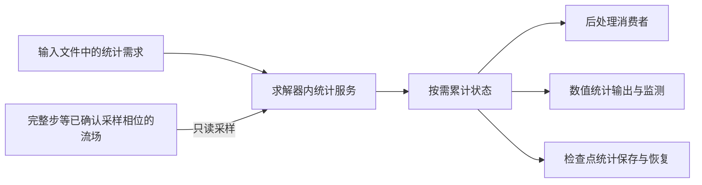

# ASTR 按需时间统计服务设计草案

状态：需求讨论中，暂不执行。记录日期：2026-11-03。

本文记录用户批准的架构方向，不授权源码迁移、输入语法修改、默认行为
修改、算例启动或检查点格式变更。尚未冻结的细节通过 grill-with-docs
逐项讨论；讨论完成后再决定实施范围与验收方法。此前 TB1–TB4 goal
保持暂停，本草案不自动恢复该任务。

上位计划：[原位后处理计划](ASTR_INSITU_POSTPROCESSING_PLAN.md)。

## 1. 已确认方向

1. 时间统计作为求解器内的独立服务，接入主程序统一的设备资源管理和
   生命周期。统计存储单独管理，不将全部统计数组无条件加入基础流场
   数组，也不复用仍被 RK、RHS 或滤波使用的工作数组。
2. 由输入文件声明需要累计的统计变量，各个统计变量可独立开关，不因
   开启某类出图而默认分配该类别的全部统计数组。
3. 不需要且不被其他已启用统计所依赖的数组不分配，不累计、不传输。
   开启局部统计不应隐式分配整域三维累计数组。
4. 后处理按已启用的统计定义、区域和窗口读取结果，不重新累计一套
   相同定义、相同采样身份的统计状态。渲染失败或关闭渲染不应停止
   输入文件已要求的时间统计。
5. 求解器权威场保持独立；统计只读采样流场，不通过统计配置修改
   流场、物理模型或时间推进方法。
6. 当前阶段仅写设计文件。输入配置位置、开关粒度、依赖分配规则、
   运行中变更、续算和迁移方式均未因本记录自动确定。

## 2. 术语与职责

| 术语 | 本草案含义 |
|---|---|
| 统计变量 | 用户要求的时间平均、RMS、协方差或其他明确数学定义的统计结果；可选清单和粒度待冻结 |
| 累计状态 | 得到统计结果必需的权重、矩、上一采样状态等，不等同于最终输出结果数组 |
| 依赖数组 | 某统计变量即使没有独立输出要求，为得到另一个已启用结果仍必需的累计存储 |
| 统计服务 | 负责累计状态的分配、采样、查询、续接与释放，不负责相机或图像渲染 |
| 消费者 | 读取统计结果的出图、数值存档、监测或其他调用方；消费者不等于累计器 |

以上是本文讨论用定义。待配置和数学规格冻结后，再同步公共术语表及
必要的架构决策记录，不把待选实现写成既有接口。

预期职责关系：

采样相位必须保留定义身份，不因集中管理而把旧阶段采样与完整步采样
当作同一历史。图中不代表所有调用方必须始终启用。

## 3. 当前代码依据与迁移边界

- `src/statistic.F90` 已有 `allomeanflow` 和 `meanflowcal`。
  例如 `u1m` 累计 `rho*u`，`u11` 累计 `rho*u*u`；不能仅按变量名
  将这些原始矩解释为已完成的 Reynolds 应力。
- `src_gpu/insitu_sample_moments_gpu.cuf` 已有选区设备累计状态，
  `src/insitu_selected_runtime.F90` 已协调选区采样。这些是可复用基础，
  不是本文新设计已经完整实现的证明。
- 现有旧统计、紧凑统计、AIR5 和原位统计承担的定义与空间范围可能
  不同。先按实际启用关系检查重复，不假定它们同时重复分配，也不为
  统一名称而删除不同数学定义。
- 旧 `meanflowcal` 按样本累加；新原位统计有实际时间权重和采样区间
  规则。集中资源管理不授权改变旧文件含义或把两者历史直接拼接。
- 检查点统计 I/O 开关与是否持续累计统计是不同开关。具体续接规则
  仍以当前输出/重启实现为准，本文不立即改变它们。

## 4. 必须通过 grill 冻结的细节

| 编号 | 待决定事项 | 具体分歧或场景 |
|---|---|---|
| TS-D01 | 独立开关与依赖分配 | 仅开启 `u_rms` 而关闭均值输出时，是否自动保留必需的均值和二阶累计状态？推荐自动处理内部依赖，但不分配无消费者的结果副本；尚未确认 |
| TS-D02 | 开关粒度及数学清单 | 每个物理字段、每种平均类型、每个协方差/应力分量是否独立；RMS 与方差是否共享状态；不默认启用高阶矩 |
| TS-D03 | 空间支持与共享条件 | 探针、线、面、子域、整域如何声明；相同需求如何去重；区域重叠是否值得共享，不能默认用整域数组覆盖全部区域 |
| TS-D04 | 输入入口 | 统计配置属于哪个输入文件、如何引用；与产品清单的职责如何区分，不能由动态产品清单悄悄开启累计 |
| TS-D05 | 时钟和定义身份 | 采样相位、窗口、权重、间隔、空间平均顺序及 Favre 密度权重；沿用已确认定义还是新增独立定义 |
| TS-D06 | 生命周期 | 只支持启动时配置，还是允许运行中启停；新增统计不能补造过去样本，停用后共享状态何时释放 |
| TS-D07 | 结果供给 | 按请求解码结果还是保留缓存；如何防止重复结果数组；GPU 消费者直接访问、CPU 消费者只取必要选区 |
| TS-D08 | 保存与续算 | 哪些累计状态必须保存；统计 I/O 关闭后的新窗口；精确与非精确续算、缺失依赖和配置变化的处理 |
| TS-D09 | 旧接口迁移 | 保留哪些外部字段和文件含义；如何让旧调用方接入服务，避免同时保留两份相同累计历史 |
| TS-D10 | 覆盖与验收 | 先迁移哪些路径，如何核对权威场不变、统计定义一致、按需分配及传输；具体测试矩阵与门槛待批准 |

不能同时承诺“关闭均值就绝不占用任何均值相关存储”和“仍然计算依赖
均值的 RMS/协方差”。TS-D01 必须先解决此语义，再确定输入开关。

## 5. 待讨论后的推进顺序

以下仅划分将来的工作，不代表已经获准执行，也不预设测试资源上限。

| 阶段 | 工作内容 | 当前状态 |
|---|---|---|
| TS0 | 冻结统计清单、内部依赖与配置含义，核对现有实现和消费者 | 待 grill；暂不执行实现 |
| TS1 | 整理服务接口、所有权、输入解析及生命周期设计 | 未启动 |
| TS2 | 选定一个现有统计路径接入按需分配，保留数学定义和采样语义 | 未启动 |
| TS3 | 后处理及数值消费者共享结果，去除已证实的重复累计或结果副本 | 未启动 |
| TS4 | 统计保存、恢复和配置变化的连续性验证 | 未启动 |
| TS5 | 扩大到后续获准的统计字段、区域和物理路径，实测内存与传输 | 未启动 |

后续验收至少区分数学定义、数值一致性、流场无副作用、数组分配、
传输量和性能。只减少数组数量不直接等于整步加速，短窗统计一致不
等于物理统计收敛。本草案不设置新的资源预算或生产准入限制。
