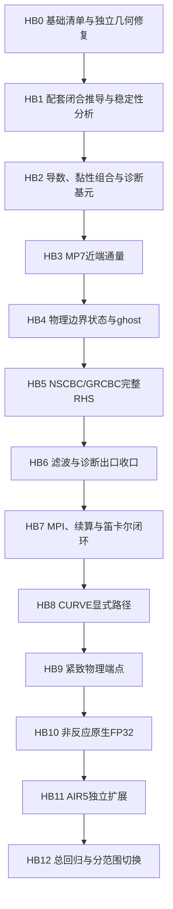

# ASTR 高阶物理边界重设计计划

创建日期：2026-10-27。工作分支：`feature/gpu_dev`。状态同步：2026-10-31。
当前：HB6九节点局部壁面滤波的获批联合数值验证及受限非测试构建交付已完成，
仍不是HB0–HB12完成或任意工况稳定保证。H1顶面展向扰动保持未解决，HB8–HB12未开始。
用户已选择并授权HB6联合验证收口，H1红例保持开放、不自动启动其新算例；
不改滤波系数或切默认。HB6交付方案A已确认：联合验证通过后以受限非测试构建准入为目标，
仍须显式选择hermite7；新增验证背景、窗口及联合判据已按HB6设计第十二项批准。
用户已选择真实槽道背景及标准局部驱动功`F dot u`、CPU/GPU一致。
已进一步确认统一修正所有channel、不保留bulk功分支、不新增选择开关；
高阶壁面仍默认关闭。主验收已选固定流向体积力驱动的充分发展层流；
主例已选两面同温静止41、x/z周期及M_ref=0.3、Re_ref=1000、F_x*=0.003；
连续体积平均密度已选1，由总质量和EOS确定参考压力，采用参考稳态初始化
并分无扰动／小幅三维扰动组；首轮仅测试报告CFL约0.2，0.5延期，
不新增运行时CFL围栏。三档均匀网格、t*=1/5/10、误差门槛和旧批次不迁移
均已获批，CPU/GPU局部功修订及对应联合数值门槛已完成。
三档GPU的无扰动／扰动、粗网格CPU对照及42/421无外力CPU/GPU均完成t*=1/5/10；
64/128扰动同相位最大缩放差1.24e-6，通过1e-3门槛。
用户已批准HB6设计第十四项，最小准入修改、非测试构建和代表实际运行均已通过；
FP64均匀笛卡尔既有41/42/421子集可显式使用，默认仍off，详见第30.14节。
当前总待办见[统一入口](ASTR_GPU_CURRENT_STATUS_AND_NEXT_TARGETS.md)，
精确证据见[实施状态第30节](ASTR_HIGH_ORDER_BOUNDARY_IMPLEMENTATION_STATUS.md#30-hb6联合窗口与受限非测试构建交付完成)。

状态：18项需求已确认。2026-10-27获准先修订HCW/SWBLI的完整边界链；
HB1-A已获用户批准并接入HCW子集的CPU/GPU主求解器。精度、实现一致性及原定Ma2角度/平台门槛通过，
但细网格顶面邻近层出现展向扰动放大，三维稳健性尚未收口。
用户随后决定暂绕过本项，不作为本次HCW启动阻挡，见第29.7节。
新版Catalyst/设备渲染已完成完整网格首帧及续算验收，见第29.8节。
用户随后授权并于2026-10-27启动新顶面HCW 30000完整步计算，启动观测见第29.9节。
2026-10-28已完成D17独立修复，以及HB1-B/C2/D/E的均匀单物理轴41/42/421有限接入与分层检查，
最新证据见第30节及独立实施状态；不代表HB0–HB12全部完成或默认切换。

执行顺序概览：独立几何缺陷复现与修复 → 候选闭合推导 → 非反应FP64笛卡尔显式路径 →
MPI/续算联测 → CURVE与紧致端点 → 非反应FP32 → AIR5 → 分范围验收与默认切换。
光滑区导数/最终空间RHS至少六阶；滤波仅要求单次映射至少六阶，不混为完整推进六阶承诺。

## 1. 目标与本轮授权

以[边界低阶误差来源审查](ASTR_BOUNDARY_LOW_ORDER_CONTAMINATION_AUDIT_20261027.md)
的 B01–B09 为基础，设计并分阶段替换不符合目标精度的物理边界及近边界离散。
不将既有较低阶闭合一概认定为程序 BUG，也不把某一光滑区高阶模板直接用于所有激波和物理边界。

需求访谈阶段只编写计划。随后用户批准先修订本次HCW/SWBLI的完整边界链：
入口11、出口22、下壁41、入射顶面52及其必要近端算子，保持网格、物理目标、壁温和内部格式不变。
新运行明确采用`sbli_grcbc`顶面，不沿用旧`sbli_shock`。
本地实现、构建和受影响短测已获准；第28节HB1-A的具体闭合及稳定化系数已获批准，后续不同数学候选仍须审阅。
不创建执行goal，不操作Git或平台任务，边界验证通过前不启动新的长算例。
本次上侧为52，不触发D17的上侧41几何索引问题，独立几何修复不混入本次子集。
其他CPU可疑缺陷仍需按项目规则单独报告、取得修复决定。

## 2. 决策记录

| 编号 | 问题 | 状态 |
|---|---|---|
| D01 | 采用局部光滑阶数目标，还是允许经整体收敛验证的较低阶边界闭合 | 已确认 A：局部阶数达标，见第3节 |
| D02 | CPU/GPU 同步统一新离散，还是只修改 GPU 并另建独立参考 | 已确认 A：两端同步采用相同的新数学离散，见第4节 |
| D03 | 先完成非反应五变量再扩展 AIR5，还是首轮同时覆盖两者 | 已确认 A：先五变量，再 AIR5，两者均在总计划内，见第5节 |
| D04 | 保留内部格式、只重设计边界及必要条带，还是允许同时重构内部算子 | 已确认 A：保留内部关系，必要时另议扩大范围，见第6节 |
| D05 | 保持现有物理边界定义、只升级离散，还是同步纳入物理闭合重推导 | 已确认 A：保持物理定义，发现不适用假设另行提案，见第7节 |
| D06 | 先完成笛卡尔非反应显式路径，还是首批同时纳入 CURVE 与紧致 | 已确认 A：先笛卡尔显式，含拉伸网格，见第8节 |
| D07 | 是否允许边界条带内与六阶光滑精度相容的稳定化项 | 已确认限定后的 A：允许研究与验证，不默认增加耗散，见第9节 |
| D08 | 滤波按完整推进的精度影响设计，还是只按单次滤波映射的阶数验收 | 已确认 B：单次边界滤波映射至少六阶，见第10节 |
| D09 | 保留混合框架，还是强制统一物理端点与 ghost 构造方式 | 已确认修订方案：保留混合，逐算子明确数据来源，见第11节 |
| D10 | 首轮保留全局 hm=5，还是允许随模板提高全局 halo 宽度 | 已确认 A：首轮保留5层，不足时单独提案，见第12节 |
| D11 | 是否同步提高用于验收及输出的壁面剪切/热流等诊断梯度精度 | 已确认 A：同步升级相关诊断梯度，见第13节 |
| D12 | 非反应流先以 FP64 验收再扩展原生 FP32，还是首批同时覆盖两种精度 | 已确认 A：先FP64基线，再独立验证非反应FP32，见第14节 |
| D13 | FP64精度验收是否预先设置有限网格观测阶和同相位场差门槛 | 已确认 A：理论至少六阶、观测阶至少5.5、短步场差不高于2e-10，见第15节 |
| D14 | 是否允许新边界在局部验证中使用更小时间步 | 已确认 A：允许必要减步并明确记录，不改生产参数，见第16节 |
| D15 | 验收后高阶替换对应默认，还是长期保留新旧生产选项 | 已确认 A：验收和上线审阅后替换对应默认，见第17节 |
| D16 | 采用独立闭合全覆盖的代表性回归，还是执行全部组合交叉矩阵 | 已确认 A：独立闭合全覆盖，组合代表性，见第18节 |
| D17 | 是否将CPU geombc上侧Jacobian halo可疑索引纳入独立前置修复 | 已确认 A：先复现，确认后独立修复，见第19节 |
| D18 | 只升级已有支持路径，还是同时补齐尚未实现的边界类型与组合 | 已确认 A：只升级已有支持路径，见第20节 |

上述需求选择已确认，实施拆分见第21–26节。具体候选系数与尚未设计的物理试验是阶段产出，
不冒充已推导、已验证或已获准运行；不预先指定全部位置统一使用某一种六阶单边公式。

## 3. D01：已确认的局部精度目标

用户选择 A，目标如下：

1. 对光滑解、非线性限制器未激活的状态，物理边界及受其闭合影响的前几层内部节点，其导数与最终空间 RHS 至少达到六阶。
2. MP7/MP7-LD 按最终通量差及其空间 RHS 核验，不只检查单个界面的重构阶数。
3. 激波区域及保正限制器激活处允许局部降阶，但需单独记录，不能据此宣称激波处也保持六阶。
4. 稳定性是独立门槛。未通过稳定性验证的高阶候选不得准入，不以系数矩检查或 CPU/GPU 一致代替。

这是设计目标，不代表已经实现或已证明某一候选可行。
具体受影响节点范围与候选稳定性试验在HB1形成，精度门槛见D13。
若候选不能同时满足目标阶数与稳定性，应报告冲突再作决定，不自动退回较低阶并声称完成。

### 3.1 核验对象

| 对象 | 按已确认目标必须核对的内容 |
|---|---|
| 显式导数 | 物理端点、偏置条带与内部中心模板的完整组合，而非仅端点单行 |
| MP7/MP7-LD 通量 | 边界界面及近端界面相减后的最终离散，不以界面名义阶数替代 |
| 黏性 RHS | 梯度、物性、通量和散度的组合；不能由两个单导数分别六阶直接认定复合 RHS 六阶 |
| NSCBC/GRCBC | 法向、面内贡献及特征闭合后的最终边界 RHS，不能只提高其中一个导数 |
| 紧致导数 | 包含物理端点和 MPI 耦合的完整算子，而非仅内部紧致关系 |
| 状态重建与 ghost | 检查其对实际消费模板和最终 RHS 的影响，不由常值延拓的外观直接推断全局阶数 |

本决定不自动要求所有滤波闭合达到十阶，不改变 RK 时间积分阶数。
滤波的独立精度目标见D08，壁面诊断梯度按D11同步纳入。

## 4. D02：已确认的 CPU/GPU 同步升级

用户选择 A：CPU/GPU 同步采用相同的新数学离散，分别实现。
旧 CPU 低阶结果不作为新算法必须复现的目标，不为维持旧结果而复制已确认缺陷。

验证分为两个层次：CPU/GPU 同算法对照检查实现差异，独立解析/制造场和稳定性检查评价新算法。
不能仅以两端结果一致认定新边界正确，也不能将新 GPU 与旧 CPU 的算法差异当作移植误差。
共享定义或系数可复用，主机与设备执行保持分离；具体代码接口尚未冻结。

本决定是设计选择，不是立即修改源码的授权；改变物理条件或修复审查中尚未确认的 CPU 缺陷仍按项目规则单独决定。

## 5. D03：已确认的五变量与 AIR5 交付顺序

用户选择 A：先完成非反应五变量的高阶边界与稳定性验证，
再复用已通过的公共算子扩展 AIR5。两者均纳入本次总计划，不将阶段划分解释为永久排除 AIR5。

AIR5 的组分、双温能量、保正基准和边界化学耦合仍须单独验证，不由五变量通过自动放行。
非反应路径内部的建议实施次序见第21节，不能用阶段划分删去已确认交付项。

## 6. D04：已确认的内部格式与修改范围

用户选择 A：保留现有内部显式差分、MP7/MP7-LD及紧致关系，重设计物理边界及必要的近边界条带。
条带必须覆盖最终通量差、梯度/散度组合和特征闭合的实际依赖，不只替换边界单行。
若保持内部关系后无法同时满足D01的阶数与稳定性要求，应报告冲突，再单独决定是否扩大修改范围。
这不是保证所有内部算子都可与任意六阶端点模板稳定配对。

不因边界升阶自动替换整域内部格式或整体引入新的离散框架。
具体稳定闭合方法、所需条带宽度及系数尚未确定，后续需在该范围内研究并验证。

## 7. D05：已确认的物理边界定义

用户选择 A：保持入口目标、壁温与壁面运动、滑移/无滑移类型及远场状态等物理定义，
只重设计其离散施加方式。保持物理定义不意味着保留旧差分、ghost填充或低阶特征数值闭合。
若发现某一零梯度假设在目标工况不成立，应停止该项的下游结论，报告证据并另行决定物理修订，
不能将不成立的条件高阶化后当作正确边界。

本轮不以数值升阶的名义，自动将壁面零压力梯度替换为另一种法向动量闭合，
也不自动改变远场目标、壁温或吹吸参数。

## 8. D06：已确认的首批路径

用户选择 A：先在非反应五变量、笛卡尔网格上完成显式边界闭合，包含均匀和拉伸网格，
覆盖现有显式中心导数及MP7/MP7-LD相关路径中的已实现物理边界。
随后独立验证CURVE与紧致端点，再按D03扩展AIR5。实施表建议先CURVE显式、再紧致物理端点，
两者分别验收，不要求在一个改动批次中一起完成。
分阶段不表示删去总计划中的其他低阶边界来源。

具体边界类型及测试的组织见第22–24节，发布切换遵循D15。

## 9. D07：已确认的相容稳定化设计空间

用户确认限定后的 A：允许在边界及必要近端条带内研究和验证相容的罚项或高阶数值耗散，
但必须与主离散一起满足D01的光滑精度要求，且不改变D05的物理目标。
需要记录稳定化形式、系数依据和作用范围，并分别验证稳定性、耗散、反射及时间步约束。
不将允许稳定化解释为无条件增加低阶滤波、经验调强阻尼或改动整域内部格式。
该选择不预先确定采用SBP/SAT，也不批准某组尚未推导的系数。

该决定区分三类机制：边界罚项用于离散施加边界约束，数值耗散/滤波控制未解析波动，
特征松弛/海绵层则涉及传入信息或有限区域的扰动吸收。不能将这些机制合成一个默认阻尼开关。
不要求所有边界都添加耗散，不自动开启海绵层，也不自动恢复GRCBC首轮已关闭的顶面横向滤波。

已有高阶有限差分研究采用配套SBP导数与SAT罚项处理
[远场](https://doi.org/10.1016/j.jcp.2007.01.023)和
[无滑移壁面](https://doi.org/10.1016/j.jcp.2007.12.028)，
但其稳定性结论不能直接套到ASTR现有算子。
[SBP综述](https://arxiv.org/pdf/1311.4984#page=14)中讨论的常见对角范数闭合，其边界局部阶数低于内部，
也不能不经核验就视为满足D01。
本决定只确定允许的设计空间。后续执行授权见第1节，不代表未知稳定化系数已获批准。

## 10. D08：已确认的单次滤波精度目标

滤波映射的光滑残差阶数，与反复施加滤波后的完整推进误差不是同一个量。
若单次滤波满足F_h(q)-q=O(h^p)，每时间步以固定次数施加，
则其等效数值作用的首项量级通常涉及O(h^p/deltat)。
网格加密时deltat如何缩小、滤波施加次数和强度如何定义，必须一并纳入精度分析。
这不是断言现有完整解已经降到某一固定阶数。

用户选择 B：要求单次边界滤波映射在光滑区至少六阶，
据此替换不达标的四阶等较低阶闭合，不将其作为实际频率下完整推进仍保持六阶空间收敛的保证。
滤波映射精度与D01的导数/空间RHS精度分别记录，不用其中一项通过替代另一项。

内部主滤波关系仍受D04约束，物理面目标仍受D05约束。
不自动将主十阶滤波所有近端闭合提高到十阶，不改变现有滤波启用语义，
不因升阶开启原本关闭的GRCBC顶面横向滤波。
具体滤波候选仍须通过稳定性及物理边界相容检查，不能仅以多项式矩达标放行。

单分量/全分量存储方式继续保持数值等价，不把不同存储方案作为不同滤波算法。
具体滤波系数、作用节点和测试口径尚未冻结。

## 11. D09：已确认的混合边界框架

用户指出现有实现已经混用物理端点闭合与ghost处理，并确认修订后的方案：
保留混合框架，按边界和算子选用相容的高阶方式，不强制统一为纯ghost或纯单边方案。
原先主导方式二选一不作为已确认要求。

每个候选必须列明实际消费的数据：域内物理节点、内部MPI/周期halo、由物理条件构造的ghost，
或GRCBC的解析外部参考。分配了ghost空间，不等于该空间在每个分支均被完整且正确地更新。
导数、界面通量、状态重建、物性、几何和RK阶段应配套验证，
仍按D01与D07检查最终RHS及稳定性，不能仅以高阶外推或端点多项式矩达标放行。

内部MPI接口的halo含义不因该选择改变，不把rank内部接口当作物理端点。
采用混合框架不要求提供两套用户可选后端；各算子的数据所有者和施加顺序必须明确。
具体整链系数和更新流程尚未冻结；当前候选与接线状态见第27节。

### 11.1 已核对的当前基础

- `src/commvar.F90:187` 使用编译期常量`parameter(hm=5)`，不是输入选项。
- 普通物理端点导数具有专门单边/偏置模板；OpenSBLI保守模式则填充物理ghost并让对流重构消费完整模板。
- 同一保守模式的黏性累加范围可以扩展，但并未因此全部改用内部中心模板，见`src/solver.F90::diffrsdcal6`。
- AIR5部分物理ghost采用重建状态延拓，仍存在专用物理端点与特征处理。
- `hm+1`层解交换包含共享节点面，不表示ghost宽度为6。
- GRCBC的解析外部参考点不等同于填入主流场数组的物理ghost节点。

## 12. D10：已确认的 hm=5 约束

用户选择 A：首轮保持全局`hm=5`，先利用域内偏置模板、现有halo和明确的分区数据依赖设计候选。
六阶导数不自动要求六层ghost；所需点数应按最终组合算子逐项计算。
若确实不足，应提交具体算子、读取范围及显存/通信影响，再决定是否扩大halo或采用局部工作区，
不为简化某个模板直接改动全部流场数组的halo宽度。

已核对的当前基础模板如下，5层足以容纳它们的直接已知场读取范围：

| 当前格式 | 内部已知场模板的最大单侧距离 | 依据 |
|---|---:|---|
| 六阶显式中心导数 | 3节点 | `src_gpu/gradcal_gpu.cuf::deriv6` |
| MP7/MP7-LD | 合并左右界面通量差后最多4节点 | `src_gpu/solver_gpu.cuf::mp_ld_interface_flux/reconstruct_mp_ld_stencil`及对应MP7构造 |
| 十阶显式中心滤波 | 5节点 | `src/filter.F90::spafilter10exp` |
| 当前六阶紧致导数RHS | 2节点 | `src/compact_operator.F90::compact_derivative_rhs` |
| 当前最高十阶紧致滤波RHS | 5节点 | `src/compact_operator.F90::compact_filter_rhs_global` |

表中不把紧致未知量的全局耦合等同于已知场ghost宽度，也不把梯度/散度组合的所有数据依赖压缩成一个单模板半径。
实际完整算子仍依赖中间场交换、有效节点范围及边界数据更新。
本决定不等于所有物理ghost已经正确填充，也不预先证明尚未推导的新高阶闭合均无需更宽数据。
当前不改变`hm`、数组布局、通信宽度或检查点格式。

## 13. D11：已确认的壁面诊断同步升级

用户选择 A：将用于验收及常规/原位输出的壁面剪切、热流等相关诊断梯度一并纳入高阶升级，
保持既有物理定义、几何投影和归一化，不扩大到新的可视化产品或渲染功能。
已达目标的私有后处理梯度不重复改写；现存二阶诊断不能作为新六阶推进路径的高阶精度参考。

相关CPU/GPU、统计、文件输出和原位产品应按各自实际调用点核对，
不能只改某个出图核而遗漏同一物理量的其他输出路径。
诊断取同相位状态，不回写权威流场；诊断精度与推进精度分别验证。
具体调用点、算子共享方式和分阶段覆盖将补入实施步骤。

## 14. D12：已确认的精度模式验收顺序

用户选择 A：非反应路径先用FP64建立高阶精度、稳定性及CPU/GPU一致性的基线，
随后独立验收原生FP32。不因首批采用FP64而将公共算子和非反应执行代码写死为FP64，
仍沿用项目的`real_kind`与精度选择方式。
FP32必须按其舍入尺度单独确定误差门槛，不套用FP64的严格场差门槛，
也不能由FP64通过推断FP32已通过。

本决定不自动新增AIR5低精度化学或改变其现有精度范围。
具体FP32误差尺度和回归矩阵在FP64基线建立后独立确定，不将FP32舍入平台误判为理论阶数缺陷。

## 15. D13：已确认的FP64分层精度门槛

用户选择 A：FP64采用分层精度门槛。系数矩/多项式条件严格满足至少六阶；
光滑制造场在预先声明的截断误差主导网格区间内，至少三档网格的边界/近端条带最大范数误差观测阶不低于5.5；
短步CPU/GPU同相位字段继续采用最大缩放差不高于2e-10的口径。
字段缩放沿用max(abs(GPU-CPU)/(1+abs(CPU)))，不以仅比较总体统计替代逐场核验。
5.5是有限网格观测门槛，不是将D01的理论目标降低到5.5阶。

算子浮点误差容差应依据模板放大和变量尺度分析，不将短步场差门槛机械套到所有导数分量。
制造场空间阶数检查需隔离RK时间误差、非线性限制器激活及D08允许的滤波影响；
滤波映射另按D08验收，不能为获得更好观测阶而修改其已确认的验收含义。
若进入舍入平台、出现零误差或非单调误差，应报告完整数据并分析，
不使用不适用的对数阶数公式，也不事后挑选有利网格隐去失败。

具体制造场、网格和变量归一化将在实施步骤中明确，不能以未冻结的夹具参数冒充已批准测试。
本项不替代稳定性或物理算例验收，相关门槛仍需分别冻结。

## 16. D14：已确认的时间步策略

用户选择 A：允许在局部验证中按新闭合的稳定性需要减小时间步，
但必须显式记录原时间步、新时间步、实际CFL和选取依据，不把减步隐藏在启动脚本中。
精度与稳定性分别评价，不能将时间误差下降误当作空间阶数提高。
评估计算代价时同时报告每步耗时和推进相同物理时长的代价，不能只比较单步速度。

旧方案的稳定时间步范围作为比较数据，不作为本轮高阶候选必须逐值保持的前提。
本决定不授权改动现有生产算例或平台任务的时间步。
减小时间步也不能挽救半离散本身不稳定或物理条件不相容的候选。
具体稳定性窗口和CFL测试范围仍需在实施计划中明确。

## 17. D15：已确认的默认切换与历史策略

用户选择 A：在相应边界/格式组合通过约定验收并完成上线审阅后，由新高阶方案替换该组合的默认实现。
旧低阶方案保留为历史证据或开发参考，不要求长期维护生产级新旧双开关。
尚未完成的组合维持其当前状态并明确范围，不将局部通过扩展为全项目已高阶化。

边界数学算法变更应记录独立版本身份。
优先沿用现有检查点控制元数据，不因该选择自动新增旁文件或修改权威场布局。
跨算法版本不能声称精确续算；需要从旧状态启动时应明确标记为非精确分叉，
并按既有非精确恢复规则验证，不能静默继承旧版本的精确续算结论。

本轮仍处于设计阶段，尚未切换默认、删除旧实现或修改恢复行为。

## 18. D16：已确认的代表性回归策略

用户选择 A：采用按独立闭合覆盖的代表性回归，不执行全部边界类型、格式、拓扑、精度和开关的笛卡尔积。
每一种独立数学闭合必须有对应检查，不能由某一类壁面或某一个方向通过替代其他不同实现。
共享系数/算子的重复证明可以复用，但不同装配、所有权和数据生命周期仍需验证。

首批回归层次为：

1. 系数矩与光滑制造场，至少三档网格，按D01/D13分别检查边界条带与内部。
2. CPU/GPU短步同相位对照，在合法夹具上覆盖NP=1及NP=2的x/y/z分解。
3. 选一个NP=4、2×2×1混合分解检查交线与多方向通信，局部双卡共享仅作正确性检查，不作扩展性能结论。
4. 同算法、同精度、同拓扑的连续/重启对照；版本变化另检查不能误称精确续算。
5. 对实际变化的代表性GPU路径做内存检查，再进入针对性物理稳定性窗口。

夹具必须具备所需全局/局部节点数，不能为了统一拓扑强行使用不足尺寸。
具体网格、步数和物理窗口将在步骤表明确；本选择不授权运行远程或生产长任务。
旧失败与参考证据保留；只有可执行代码、输入和环境均未改变的证据才可直接复用为相同检查的结论。

本决定确认回归策略，不代表具体夹具参数均已冻结；后续本地执行授权见第1节。

## 19. D17：已确认的几何索引前置任务

审查发现`src/bc.F90::geombc`上侧bc41分支在`i=0:im`循环中，
其余度量写入`dxi(i,...)`，Jacobian一行却写为`jacob(1,jm+1:jm+4,k)`。
这与应逐列处理的结构不一致，原始证据见审查存档第6.1节。
尚未将其唯一归因于既有运行误差，不能据此宣称所有现有算例均受影响。

用户选择 A，将其作为独立前置任务：用横向变化且严格为正的制造Jacobian复现逐列写入错误，
追踪实际CPU/GPU几何初始化与halo消费点，确认后修复索引及确实相关的数据同步。
缺陷复现与修复验证同高阶边界验收分别记录，避免把几何索引修复的收益当成升阶收益。
本项不顺带提高几何外延阶数、修改物理条件或清理无关代码。

本决定允许将已指出的索引缺陷及相关数据流程纳入后续执行计划。
其他新发现的CPU数值或物理缺陷仍应分别报告，不由本决定自动取得修复授权。
截至本次HCW子集起步，尚未修改该CPU语句或对应GPU数据流程。

## 20. D18：已确认的能力范围

用户选择 A：本计划覆盖已有CPU/GPU支持路径中的低阶闭合，不同时新增尚未移植的边界类型或一般边界组合。
现有组合所必需的状态所有权、交线兼容和高阶精度必须检查，不能用“范围不扩展”回避已有路径的错误。
但一般亚声速出口/顶面双面NSCBC联合闭合等当前尚未实现的能力，单独列为后续扩展，不视为本次替换低阶的必交付项。

公共CPU算子的修改仍需核对实际消费者和受影响路径，不能因GPU未支持某个组合就忽略CPU侧回归风险。
物理数据不光滑的真实角点或条件切换点不能套用光滑六阶判据，应单独检查物理归属和稳定性；
也不能据此扩大排除区，掩盖本应光滑的条带降阶。

RANS/LES、新化学模型、未实现的CPU专用边界类型、一般亚声速双面NSCBC交线及新浸入边界能力不在本次交付内。
普通已支持路径和OpenSBLI/AIR5等专用路径须分别列明，不能仅凭相同bctype编号推断数学闭合相同。

## 21. 分阶段执行计划

以下均为待执行步骤，不表示已修改或通过。HB编号与审查B01–B09、既有CP/S阶段编号分别使用。
一个阶段可按独立边界闭合分小批次推进，不要求先修改全部边界再统一测试。



该图表示工作依赖，不授权重构主循环为新框架，也不改变既有RK算法或输出相位。

| 阶段 | 对应发现 | 工作与阶段交付 | 放行条件 | 状态 |
|---|---|---|---|---|
| HB0 | 独立几何项及全部依赖 | 列出现有边界/格式/方向/精度/专用模式和实际消费者；保留旧参考；按D17复现并修复已确认索引错误；核对算法身份字段 | 缺陷先红后绿；明确实际影响与未受影响路径；不把修复效果当升阶效果 | HCW依赖/旧结果已核对，其余未完成 |
| HB1 | B01–B09 | 为首批显式路径推导配套导数、近端通量、状态/ghost及特征闭合；列节点范围、守恒/度量关系、稳定化依据和时间步约束 | 理论阶数至少六阶；闭合与内部关系相容；新罚项/耗散不得靠猜系数；形成可复核候选 | HCW的HB1-A及槽道HB1-B/C2/D已批准并有限接入，见第30节；裸拼接失败证据保留，其余分支待扩展 |
| HB2 | B03、B06、D11 | CPU/GPU接入基础高阶闭合，检查梯度与黏性散度组合；提供壁面诊断所需的高阶基元；核对融合核与传感器消费者 | 算子及完整组合按D13验收；周期内点不因物理端点改动降阶；不据分项通过宣称完整算例通过 | HCW及HB1-B/C2/D/E已声明方向的完整RHS／梯度加密通过；其他消费者待扩展 |
| HB3 | B01 | 联合重设计MP7/MP7-LD物理端附近界面通量及过渡；保留内部重构与激波/保正机制 | 第一内点及过渡末端的最终通量差满足目标；CPU/GPU和正反向通量一致；限制器激活单独记录 | HCW近端通量已接入，内部与既有限制分支不变；其它格式/权重未扩展 |
| HB4 | B06及专用ghost路径 | 升级已有壁面、入口、出口、外推/远场状态施加，分别处理普通路径与专用保守模式；保持物理目标和几何法向含义 | 每个独立闭合有相容制造场；物理面/ghost/物性同阶段；既有吹吸与动态入口时序不被无意更改 | HCW链及hermite7单轴41的x/y/z、42的x/y、421的y已有限接入；411与其他已有组合仍待扩展 |
| HB5 | B02、B04、B05 | 提高已有NSCBC法向和面内离散，重设计GRCBC传入信息供给，统一检查完整RHS与现有交线归属 | 不残留未声明的一阶外点瓶颈；出射波保留；擦边连续性与目标保持分别验证；先完成解析斜激波闭环 | HCW的22/52完整RHS已接入，擦边及原定角度/平台门槛通过；细网格三维扰动仍待收口 |
| HB6 | B08、D08、D11 | 升级未达标的边界滤波，并核对所有壁面诊断出口；保持单分量/全分量等价与GRCBC滤波关闭语义 | 单次映射至少六阶且稳定；滤波后缓存/halo及时刷新；诊断与推进分开核验 | 本轮hermite7 41/42/421均匀笛卡尔受限交付完成，默认off，见第30.14节；GRCBC顶面滤波仍不开放，不代表总范围普遍稳定 |
| HB7 | D13、D15、D16 | 笛卡尔FP64下完成代表性MPI、同相位、内存和续算联测，评估必要减步的代价 | 已覆盖组合逐场通过；同算法同后端精确恢复一致；跨算法不误称精确；不推广到未测组合 | HCW链代表性MPI、精确续算、memcheck及真实HCW短窗通过；三维稳健性异常阻止生产放行 |
| HB8 | 几何/交线风险 | 在已有CURVE能力内接入高阶物理法向闭合，覆盖原有静态网格及受影响方向 | 几何投影、度量相容与自由来流保持分别检查；不把逻辑零梯度当物理法向零梯度；不扩展新边界组合 | 未开始 |
| HB9 | B07及紧致滤波 | 升级现有紧致物理端点及邻近行，保留内部关系和全局两层PCR，复核矩阵预处理与算子身份 | 全局算子而非仅RHS系数满足目标；MPI接口不人为截断；周期循环耦合保持；若需改三对角结构先提案 | 未开始 |
| HB10 | D12 | 按既有原生FP32计算合同验证已升级非反应路径，分别报告舍入和截断误差 | 算法与FP64一致；FP32门槛在阶段入口提出，不套2e-10；不为过关新增全场FP64计算 | 未开始 |
| HB11 | B09 | 扩展现有FP64 AIR5的高阶输运边界、组分/双温状态、特征顶面和滤波；保留现有化学模型及补偿生命周期 | 先冻结化学/单独输运，再验证耦合；保正、组分闭合、能量相容、补偿及重启分别检查 | 未开始 |
| HB12 | 全部已纳入项 | 整合已有证据、能力表、用户说明和默认切换清单，按D15提交上线审阅 | 每项标明已实现/已验证/未完成；无未声明的物理变化或低阶常规分支；不以小算例替代生产物理验收 | 未开始 |

### 21.1 HB0与HB1的具体起步任务

- [ ] HB0.1：按函数/分支而非仅bctype建立覆盖清单，包含实际RHS、梯度、滤波、诊断和恢复消费者。
- [ ] HB0.2：保留审查所用旧二进制/输入/日志；只归档需要比较的证据，不复制整套大流场目录。
- [ ] HB0.3：以横向变化且正Jacobian的制造几何检查`geombc`，确认后修复已批准的索引问题；检查1–4层实际写入和GPU上传，不顺带声称第5层外延已解决。
- [ ] HB0.4：核对共享节点/物理ghost/分析参考的所有者与RK时刻，列出不会消费物理ghost的算子。
- [ ] HB0.5：确定边界版本标识与现有控制元数据的容纳方式；从首次主程序接入新数学算法起登记，不能等总回归结束后才补。
- [ ] HB1.1：恢复B01第一内点一阶误差的最小红例，分别构造正/反向及过渡末端约束。
- [ ] HB1.2：在均匀计算坐标下推导导数和通量的整套行，核对与`dxi/jacob`的尺度，禁止重复乘除网格间距。
- [ ] HB1.3：为黏性项直接核验组合RHS；为特征边界明确传入/传出投影、切向/黏性项与外部参考供给。
- [ ] HB1.4：分析完整边界算子的线性化能量/谱性质与RK稳定域；区分理论证明、线性分析和数值实测，不将其中一项冒充全部非线性稳定性证明。
- [ ] HB1.5：输出首批候选的系数、作用范围、参考问题和测试参数，提交数学候选审阅后再进行主程序接线。

此处“候选审阅”不是给每次可逆代码修改新增确认流程。已有候选范围内的局部实现与受影响测试，
在获得执行授权后持续推进；真正改变已确认物理模型、内部关系或数值验收含义时才返回人工决定。
允许用符号工具生成系数、检查矩条件或计算解析参考，不新增Python流动推进器。

候选精度从最终RHS反推中间量要求。若没有可证明的误差相消，
单个界面或ghost的O(h^6)误差经1/h放大后可能只剩O(h^5)，
因此不能给每个中间量都贴“六阶”标签就认定完整RHS六阶。
滤波单次映射仍按D08独立评价，不据此更改用户选择的滤波验收目标。

## 22. 文件与依赖清单

以下是拟修改或必须检查的责任范围，不要求每个文件都产生diff。先确认实际调用，
不全局替换通用`extrapolate_2o`、不顺手拆分大模块，不为同一种数学闭合复制多套算例专用实现。

| 责任 | CPU/共享侧 | GPU侧及依赖 | 注意事项 |
|---|---|---|---|
| 导数、对流和黏性组合 | `src/derivative.F90`、`src/comsolver.F90`、`src/flux.F90`、`src/solver.F90` | `src_gpu/gradcal_gpu.cuf`、`src_gpu/solver_gpu.cuf`、`src_gpu/shock_sensor_gpu.cuf`、`src_gpu/mp_positivity_gpu.cuf` | 核对直接核、融合核及精度分支；不把保正低阶基准误删 |
| 普通物理边界 | `src/bc.F90`，必要时增加边界专用数学辅助过程 | `src_gpu/boundary_gpu.cuf`、`src_gpu/nscbc_characteristic_policy_gpu.cuf` | CPU/GPU数学相同；不将通用低阶辅助函数的其他消费者无意改写 |
| GRCBC | `src/nscbc_incident_body.inc`、`src/nscbc_incident.F90`、`src/bc.F90` | `src_gpu/nscbc_incident_gpu.cuf`、`src_gpu/boundary_gpu.cuf` | 共用代数不等于共用整域状态；先审查新闭合的连续问题与参考 |
| 专用保守边界 | `src/perfect_gas_boundary_body.inc`、`src/conservative_boundary_faces_body.inc`、`src/conservative_boundary_runtime.F90` | `src_gpu/perfect_gas_boundary_gpu.cuf`、`src_gpu/conservative_boundary_faces_gpu.cuf`、`src_gpu/conservative_boundary_stage_gpu.cuf` | ghost填充、物性恢复与完整模板消费一起检查 |
| 几何、物理面与通信 | `src/geom.F90`、`src/bc.F90`、`src/parallel.F90`、`src/commvar.F90` | `src_gpu/commarray_gpu.cuf`、`src_gpu/halo_exchange_gpu.cuf`、`src_gpu/qswap_gpu.cuf` | 保留hm=5；几何缺陷与升阶分别验证；不改现有MPI传输后端设计 |
| 显式/紧致滤波及紧致导数 | `src/filter.F90`、`src/compact_operator.F90`、`src/compact_runtime.F90` | `src_gpu/solver_gpu.cuf`、`src_gpu/compact_operator_gpu.cuf`、`src_gpu/compact_derivative_gpu.cuf`、`src_gpu/compact_filter_gpu.cuf` | 核对单分量/全分量；分布式求解/传输模块只作必要依赖检查，不另做PCR性能改造 |
| 壁面诊断及原位量 | `src/statistic.F90`、`src/insitu_wall_statistics.F90`、`src/insitu_air5_statistics.F90` | `src_gpu/statistic_gpu.cuf`、`src_gpu/production_statistics_gpu.cuf`、`src_gpu/insitu_wall_fields_gpu.cuf`、`src_gpu/insitu_m12_gpu.cuf`、`src_gpu/insitu_sbli_gpu.cuf`、`src_gpu/output_derivatives_gpu.cuf` | 原位私有高阶算子已达标处不重复改；物理定义/归一化不变 |
| AIR5 | `src/chemistry_solver.F90`、`src/chemistry_characteristic.F90`、`src/chemistry_boundary.F90`、`src/chemistry_boundary_state.F90`、`src/chemistry_filter_math.F90`、`src/chemistry_filter_operator.F90`、`src/chemistry_compensation.F90` | `src_gpu/chemistry_solver_gpu.cuf`、`src_gpu/chemistry_boundary_gpu.cuf`、`src_gpu/chemistry_compensation_gpu.cuf`、`src_gpu/chemistry_coupling_gpu.cuf`、`src_gpu/chemistry_flow_state_gpu.cuf` | 化学/物性模型不变；边界覆盖后的补偿余量和物性有效性必须保持 |
| RK、恢复及精度 | `src/mainloop.F90`、`src/output_runtime.F90`、`src/astr_precision.F90` | `src_gpu/mainloop_gpu.cuf`、`src_gpu/checkpoint_gpu.cuf`、`src_gpu/checkpoint_state_gpu.cuf`、`src_gpu/precision_mode_gpu.cuf` | 同阶段输入；保持完整步输出语义；先FP64，后非反应FP32 |
| 构建和能力说明 | 根`CMakeLists.txt`、`src/CMakeLists.txt`、`USER_GUIDE.md` | `src_gpu/case_capability_gpu.cuf`及现有实际选择过程 | usegpu仍由输入选择；新测试不得成为生产构建强制依赖 |

若确需抽取公共数学实现，只为实际复用的系数或纯代数设一个清晰责任点，
沿用项目已有主机/设备分离模式。不要为每个bctype新建一套系数、配置和测试框架。
编译默认同步策略不因数值升阶自动改变；已有性能路径按其依赖关系验证，不另行开展异步性能改造。

### 22.1 恢复身份的实际约束

`src/output_runtime.F90`现有`driver_config`为3个128字符槽。
SBLI槽已保存模式和7个目标参数的位表示，不能假设还有足够空间直接追加通用长版本串。
HB0优先核对能否在其他现有控制槽保留原有含义并附加短的边界算子身份，
覆盖通道驱动、入口模式、紧致和随机吹吸等已有内容，禁止覆盖、静默截断或新增全场校验。
若确实需要更改控制记录结构，先提交最小元数据方案，不自动新增旁文件或更改权威场布局。

版本描述实际启用的算子集合，不能在只完成梯度时就标记为“全部边界已升级”。
同版本精确续算与跨版本非精确分叉分开验证；对累计统计还需核对诊断算子身份，
不能把旧二阶壁面累计量当作新高阶诊断参考，也不能未经说明删除已有统计。

## 23. 验证矩阵与参考问题

下表是整体审阅用的测试规格，不是已运行结果。新候选可能需要的数据范围和稳定窗口在HB1明确，
不为未知系数虚构一个“已经稳定”的CFL。

| 层级 | 夹具与范围 | 评价量与门槛 | 复用与限制 |
|---|---|---|---|
| 系数/行检查 | 仿射场、至少覆盖目标阶次的单项式及完整边界行；紧致使用完整矩阵算子 | 理论至少六阶；常数/自由来流保持；MP最终通量差和黏性组合单独验证 | 精确矩可复用，不能代替真实核或积分 |
| 光滑空间加密 | 首轮拟用33/65/129节点的一维线，逐轴布置；均匀坐标及拉伸映射；非退化光滑参考 | 截断误差主导区间至少三档，边界条带最大范数观测阶≥5.5，内部另报 | 若舍入平台或参考退化，分析后在运行前明确调整区间，不事后挑数据 |
| 短步同态 | 首轮拟用32×32×16区间的相容三维小夹具，12完整步；NP=1和NP=2 x/y/z；一个NP=4 2×2×1 | FP64逐场/原始变量缓存最大缩放差≤2e-10，状态有限且满足对应可容许条件 | 网格不是所有物理case的统一替代；保持合法局部尺寸和相同CPU/GPU拓扑 |
| 精确续算 | 同算法同精度同拓扑，连续12步与5+7步，显式选择exact_restart=t | 应恢复的权威状态/缓存及统计按既有精确合同一致，调度相位一致 | 首轮选一个壁面及一个NSCBC链，不跑所有组合；跨版本另测非精确分叉 |
| 内存安全 | 代表性物理端点、交线、ghost消费及MPI分区，4–6完整步 | Compute Sanitizer零内存错误；按实际变化补相关检查 | 不对所有小变体重复长窗memcheck |
| 解析斜激波 | 复用已批准Ma2、γ=1.4、β=40°、64/128/192²×8区间，解析初场t=1与均匀起算t=2，NP=2 x | 最细网格角误差≤1°、固定平台取样全部展向节点最大缩放状态误差≤1%；同时检查顶面全场 | 原dt=2.5e-4；需要减步时按D14记录并保持相同物理窗口，不只比较步数 |
| 声学与擦边 | 复用已有特征分类/两步熵波红例；另为真实反射测量设计入射角、波长、幅值和观测窗 | 保持传出分量、目标状态及擦边相容；反射量与稳定性分开报告 | 未批准新的统一反射率阈值；具体反射实验在阶段入口提出，不擅设“所有角度≤5%” |
| 黏性物理窗口 | 优先复用现有槽道、平板和壁面家族夹具，再提交缩小HCW窗口 | 检查剪切/热流、压力、守恒收支及时间稳定性；场与诊断分别评价 | 物理误差有独立参考才设阈值；不将正常结束视为物理收敛 |
| 扩展分支 | 已支持CURVE、紧致、非反应FP32及AIR5，按阶段增量复用夹具 | 保留D01/D08的数学含义；精度/物理分支使用对应门槛 | 不套用FP64场差到FP32；反应源项误差与空间截断分开 |

区间数与节点数明确区分。控制器的maxstep应通过已有准备工具换算为完整步数，
不能把从零计数的循环上限直接当作已完成步数。
阶数测试应直接评价空间算子或隔离时间误差；不得用固定RK3时间误差掩盖空间阶数，
也不得忽略D08对滤波验收的独立约定。

### 23.1 防止虚假的高阶参考

制造场必须满足所选物理条件，完整边界RHS应与同一个连续边界问题对照，
不能拿任意不相容流场的无约束Euler RHS作为真值。
参考应包含足够的非零导数，不能因为端点导数恰好全部消失而让二阶模板看似六阶。
只把新CPU输出存下来作为参考文件，不构成独立阶数验证。

边界条带按候选实际改写和消费范围定义，在运行前声明，所有本应光滑的相关节点都计入最大误差。
真实激波、限制器激活及物理数据不连续位置另报，不用扩大剔除区域使结果过关。
保正/激波低阶基准属于D01允许的局部降阶，不为“全部换掉”删除其数学保障；
记录激活位置/次数和误差，不将频繁修复后的“能跑完”替代精度或稳定性验收。

## 24. 测试与构建的复用落点

优先扩展现有驱动和参考，不新增一个与ASTR独立的流动推进器：

| 用途 | 已有入口 |
|---|---|
| 边界/完整RHS | `tests/gpu_validation/boundary_rhs_manufactured.F90`、`test_boundary_rhs_gate.py`、`run_boundary_rhs_gate.py`、`run_boundary_stage_gate.py` |
| MP7-LD核 | `tests/gpu_validation/mp_ld_reconstruction_probe.cuf`及已有`mp_ld_reconstruction_probe`构建目标 |
| NSCBC/GRCBC | `nscbc_physics_probe.cuf`、`nscbc_incident_probe.F90`、`test_sbli_grcbc.py`、`test_grcbc_oblique_shock.py`、`test_sbli_joint_nscbc.py` |
| 物理面/ghost | `boundary_contract_probe.F90`、`boundary_faces_probe.F90`、`test_perfect_gas_boundary.py`、`test_boundary_faces.py` |
| 滤波 | `native_filter_window_replay.cuf`、`test_scalar_filter_workspace_contract.py`及现有显式/紧致滤波探针 |
| CURVE与壁面 | 现有`run_curvilinear_*`夹具、`run_wall_family_phaseh_matrix.sh`、`test_insitu_device_curve_wall_fields.py`及相应壁面字段测试 |
| 紧致与恢复 | `compact_derivative_probe.F90`、`compact_filter_probe.F90`、`test_compact_restart_runtime.py`、`run_compact_flatplate.py` |
| AIR5 | `air5_hbl_boundary_state_probe.F90`、`test_air5_characteristic_acoustic.py`、`test_air5_boundary_flux_balance.py`、`test_air5_compensation_checkpoint.py`及现有滤波/拓扑驱动 |

如缺少独立高阶探针，可新增一个`boundary_high_order_probe.F90`和一个
`test_boundary_high_order.py`统一承载分项检查；这是拟新增文件，不是当前已存在或已通过的测试。
具体目标在`src/CMakeLists.txt`沿现有模式接入，由根CMake构建，
CPU/GPU探针模块目录隔离，生产`BUILD_TESTING=OFF`不能依赖tests目录或新测试数据。
只有修改了GPU诊断路径的阶段才重建相关Catalyst/原位目标，不为普通导数变更强制安装可视化依赖。
源码使用`real_kind`，不硬指定本地GPU架构，不为该任务改动现有后端和可视化工具链。

## 25. 需要人工决定的节点

已经确认的范围内，执行授权后持续完成局部实现、缺陷定位与相关检查，不为每次测试重复请求确认。
下列情况才返回人工决定：

1. 候选无法在保留内部关系、hm=5及既有物理目标下同时满足精度和稳定性，需要改变已确认约束。
2. 实际采用新的特征闭合、罚项或耗散形式及其系数尚未完成候选审阅；HB1应一次给出可复核方案，而非逐个常数提问。
3. 发现D17以外新的CPU数值/物理缺陷，或现有物理假设与目标工况矛盾。
4. 需要改变检查点控制记录结构、跨版本统计处理规则，或增加未实现的边界能力。
5. 需要新反射/物理误差门槛、真实长窗工况，或修改/提交生产与远程任务。

普通编译错误、已授权范围内的实现问题及数值失败由当前会话定位，不转化为一串无必要的确认。
首次科学门槛失败即停止下游物理/性能结论，允许继续做有针对性的诊断，不能降低门槛或改取样区掩盖失败。

## 26. 完成与交付口径

每个已纳入组合应有一行记录：实际算法/版本、边界与近端范围、数据来源、理论阶、
观测误差/阶数、CPU/GPU字段差、限制器激活、MPI/恢复检查、稳定时间步及适用工况。
所有阶段完成或明确报告仍未完成的项，不能用某一条路径成功宣称“全部边界已升级”。

最终交付包括更新后的源/构建、精简测试、阶段结果记录、能力表与用户说明；
源码变动仍按CPU/GPU分离原则组织，不混入chem目录、手册或大规模运行产物。
默认切换按D15逐范围审阅，不长期保留生产级低阶兼容分支。
不为本任务新增全场CRC、检查点回读校验、频繁设备到主机诊断复制或庞大的全组合测试脚本。
真实的分配、MPI和I/O失败仍报告，不能静默伪装成功。

性能只报告真实代价，不设置未经确认的加速比门槛；必要时沿用既有纯RK计时比较旧/新每步耗时及同物理时间代价，
不在精度或稳定性未通过时启动大规模性能矩阵。
本次计划审阅不包含Git提交、平台部署或生产任务授权。

## 27. 当前状态与相关记录

- B01–B09 的源码位置、系数矩核验及适用范围以审查存档为准。
- GRCBC v2 的斜激波生成尚未通过完整物理门槛，不能作为新高阶边界的已通过参考真值。
- 入射激波闭合的现状及失败证据见[专项设计](ASTR_NSCBC_INCIDENT_SHOCK_TOP_DESIGN.md)。
- 本轮18项需求已确认；第27节保留初期候选证据，第28节候选已批准，实际主程序接线进度见第29节。
- 候选系数、具体稳定窗口、FP32门槛及新增物理试验是对应阶段的产出/审阅点，不是已经通过的结果。
- 不新设统一的磁盘/显存硬配额；后续运行先按夹具估算资源，不删除旧证据，不因文档更新重跑数值算例。
- 决策摘要见`docs/adr/0054-upgrade-physical-boundaries-without-replacing-interior-schemes.md`。

### 27.1 本次HCW新运行的顶面选择

用户补充确认：新的HCW运行必须使用新入射顶面。生成器
`tests/gpu_validation/prepare_hcw_laminar_sbli_case.py`、`case_review/runtime.env`和对应manifest
已统一为`ASTR_NSCBC_FARFIELD_MODE=sbli_grcbc`。网格、激波位置/角度/跳跃关系、
壁温、入口剖面、出口压力目标、dt和输出频率均未改变。

这只完成运行配置准备，不代表现有GRCBC v2或新高阶整链已经通过物理验收。
旧30000步目录`tests/gpu_validation/out/hcw_production_20261026_np2/`不修改，
不能把旧边界检查点通过精确恢复方式接到新边界算法。后续新算法应使用独立输出目录，
从头起算或另行明确非精确分叉，不能覆盖旧结果或绕过恢复身份检查。
主滤波仍关闭，新GRCBC首轮顶面横向滤波也关闭；出口自身滤波是否执行仍按原有出口路径处理。

### 27.2 初期仅组件阶段的基础代数（历史记录）

新增`src/boundary_high_order.F90`及公共body、`src_gpu/boundary_high_order_gpu.cuf`，
当时仅编入`high_order_boundary_cpu_probe/gpu_probe`，未加入生产`ASTR_SOURCES`，
没有运行模式或默认算子切换。随后接线见第29节；不能用初期组件结果单独放行完整边界方案。

在均匀计算坐标下，前三行使用物理节点0至7，系数按行列出为：

```text
row 0: (-156, 423, -639, 715, -540, 261, -73,  9) / 60
row 1: (  -9, -84,  171,-135,   85, -36,   9, -1) / 60
row 2: (   1, -17,  -56, 115,  -65,  29,  -8,  1) / 60
```

精确满足0至6次矩，同时将第7次矩统一到内部六阶中心导数的36。
由此单导数首项为相同的`h^6 f^(7)/140`，防止近端梯度误差首项跳变后被散度放大为五阶。
右侧按向内排序并改变导数符号。必须使用原计算坐标尺度和度量投影，不能再额外重复除物理间距。
八节点读取只描述物理条带需求，不自动证明任意MPI分解均有足够的有效中间场。

现有壁面零法向压力梯度的候选状态重建，使用八节点七阶导数约束：

```text
(-1089 p0 + 2940 p1 - 4410 p2 + 4900 p3 - 3675 p4
 +1764 p5 -490 p6 +60 p7) / (420 h) = prescribed inward derivative
```

给定原有Neumann物理条件，解出p0可获得八阶状态误差，避免该状态误差经过两次微分后降到六阶以下。
目前只验收代数与相容制造场，不声称零压力梯度本身已成为完整NS壁面动量闭合。

### 27.3 本地组件检查与未通过项

根CMake、NVHPC26.1、FP64下编译两个探针。变黏度、拉伸坐标制造问题为
`u=exp(4 xi)+0.1 sin(3 xi)`、`mu=1+0.2 cos(xi)`、
`x=(exp(1.5 xi)-1)/(exp(1.5)-1)`，检查`d/dx(mu du/dx)`。
33/65/129节点全部固定检查两侧各六个节点，不剔除最大误差点。

| 检查 | 本次结果 | 含义 |
|---|---|---|
| 精确导数矩、Neumann约束与FD数值通量矩 | 通过 | 仅代数一致性 |
| 复合黏性条带最大误差，32/64/128区间 | 3.9066733e-4 / 7.2843764e-6 / 1.2400761e-7 | 观测阶5.74499、5.87630，超过5.5 |
| CPU/GPU组件最大缩放差 | 1.05911e-12 | 不是完整流场对照 |
| Neumann多项式状态重建最大误差 | 2.02529e-16 | 0至7次相容多项式 |
| Compute Sanitizer | 0 errors | 仅该探针读写 |
| 本轮Python组件/算例生成测试 | 14 passed | 包含“能检出不稳定候选”的测试，不是整链稳定性通过 |

最初使用`exp(2 xi)`的128区间复合误差为5.15798e-10，最后一档观测阶5.312，失败日志保留。
同一离散以60位算术计算，误差为1.7681296e-6、2.0666701e-8、2.6566611e-10，
观测阶6.41877、6.28155，表明原最细档已受FP64舍入放大影响。
在保留三档网格和门槛的前提下，将制造场改为上述频率4，使截断误差高于舍入量级；
这不是修改求解器精度、放宽门槛或删除失败记录。

单纯把端点改成标准七节点六阶式，或上面的八节点首项匹配式，并不能保证对流稳定。
在`u_t+u_x=0`、左端强制零入口的独立线性矩阵中，64区间下
`max Re(h lambda)`分别约为0.196329与0.314656；正实部使步长趋小时仍存在增长模态。
另一套按Bernoulli矩构造的七节点FD数值通量，在保留内部MP7-LD线性关系、权重0.5时，
同一指标约为0.167785，也不准入。这些是试验算子的反例，不是证明当前ASTR运行必然具有相同增长率。
不能将普通中点插值当成FD数值通量：界面矩必须使相邻通量之差恢复节点导数矩。

已有研究也将精度、守恒和稳定性作为联立约束，提供配套系数及试验数据，
见[Brady与Livescu的边界系数数据论文](https://pmc.ncbi.nlm.nih.gov/articles/PMC6595279/)。
其基于中心格式/RK4的结果不直接放行本项目MP7-LD/RK3，也未将外部系数并入ASTR。

证据目录：`tests/gpu_validation/out/high_order_boundary_20261027/`。
最小复查入口：`tests/gpu_validation/test_high_order_boundary_closures.py`、
`tests/gpu_validation/high_order_boundary_probe.F90`；矩阵报告为`unstabilized_candidates.json`。
该阶段不得启动整链物理/性能或HCW长算例。后续先形成满足D01的配套对流/特征稳定闭合，
按HB1提交完整数学候选，再进行主程序接线与已有Ma2斜激波门槛，不因组件通过跳过该步骤。

## 28. HB1-A：已批准的HCW完整边界链候选

本节是后续推进形成的具体数学候选，不覆盖第27节保留的失败试验。
用户已批准本节具体数学候选。CPU/GPU代数及主程序接线已经完成，
覆盖组合的`sbli_grcbc`实际选用`sbli-grcbc-h1`，当前逐项完成第29节验收。
未覆盖组合不因本节批准自动获得相同能力，也不能把组件通过等同于物理通过。

### 28.1 首轮范围与四面职责

本次只覆盖非反应FP64、笛卡尔及拉伸网格、`743e/643e`、MP7-LD权重0.1，
优先完成HCW的`11/22/41/52`。内部MP7-LD关系、物理跳跃关系、Tw、入口状态、出口目标均不改变。
不得据此宣称权重1的纯中心极限、CURVE、紧致、FP32或AIR5已经通过。

| 边界/条带 | 候选处理 | 保持不变的物理内容 |
|---|---|---|
| 11入口 | 完整剖面状态和原交线归属不变；近端通量及相关梯度改用配套闭合 | 给定rho/u/v/w/T，不改成特征入口 |
| 22出口 | 法向通量/度量导数升阶，面内使用现有MP7-LD内部关系及配套近端行；升级原有横向滤波 | 原压力松弛及倒流目标，不自动变为全状态定值 |
| 41下壁 | u/v/w和Tw仍由壁面条件给定；以第27.2节七阶Neumann导数解出八阶精度的壁面压力值；升级相关梯度与诊断 | 原零法向压力梯度模型，不声称重推了完整NS壁面法向动量条件 |
| 52顶面 | 第28.3节七个外部参考点供给传入导数；所有传入波保留同阶段G，传出波保留内部RHS | 原激波几何/RH两态、按边界法向分类、顶面滤波关闭 |
| 必要近端行 | 首三界面配套FD数值通量，导数使用第27.2节首项匹配行 | 内部关系与hm=5不变；MPI接口不作为物理边界 |

入口/顶面交点仍由给定入口负责。出口/顶面只沿用现有出口法向超声速流出组合，
不新增一般亚声速双面特征联合闭合。出口/壁面状态归属仍是壁面优先。
激波或既有限制器/critical-node机制激活处保留原降阶路径，并单独记录，不以高阶候选绕过它们。
本轮主滤波仍关闭，不能因为升级出口内部滤波就自动启用主十阶滤波或顶面横向滤波。

### 28.2 近端FD数值通量的局部稳定化候选

以物理边界向内排列节点0至7，首三个界面取第27节Bernoulli矩确定的七节点FD数值通量
`H0/H1/H2`。只对指向计算域内的分裂通量增加：

```text
delta7(f) = -f0 + 7 f1 - 21 f2 + 35 f3 - 35 f4 + 21 f5 - 7 f6 + f7
H0_new = H0 - (1/8) delta7(f)
H1_new = H1 - (1/4) delta7(f)
H2_new = H2 - (1/8) delta7(f)
```

左边界的正分裂、右边界的负分裂使用该修正；反向分裂使用原Bernoulli矩候选。
右边界按向内节点顺序镜像，不额外反转物理通量本身的符号。
同一界面只构造一次通量，近端RHS仍通过相邻通量之差取得。
内部从原有完整MP7-LD模板开始的界面不加该项，不引入全域耗散或海绵层。

`delta7`精确消去0至6次多项式，故不改变最终通量差对0至6次多项式的导数矩。
单界面修正为O(h^7)，近端相邻界面差除以h后仍至少六阶，包含与内部模板相接的过渡。
这不是把物理通量作普通中点插值，也不是声称该修正具有已证明的全系统负定耗散形式。

本轮从低维稳定性试选形成`1/8,1/4,1/8`这一具体候选。其依据是第28.5节的精确矩及
采样线性检查，不是已有文献对ASTR的稳定性定理，也不称为唯一或最优参数。
权重1的纯中心极限未获得同样结果，不扩大本次HCW权重0.1的结论。
限幅激活时的非线性通量、正值性和完整NS时步稳定性仍须接线后单独验证。

### 28.3 新顶面：七阶外部导数与完整特征源项

令外法向速度特征值为lambda，lambda<0为传入；`v=(rho,u,v,w,p)`为原始变量，
`P_b=dq/dv`、`L_b`为边界左特征矩阵。沿外法向以同一局部距离hn采样七个解析参考点，
在光滑参考区使用：

```text
D_n^7(v) = [ 7(vI1-vb) - (21/2)(vI2-vb) + (35/3)(vI3-vb)
             - (35/4)(vI4-vb) + (21/5)(vI5-vb)
             - (7/6)(vI6-vb) + (1/7)(vI7-vb) ] / hn
```

这是八节点七阶外向导数，不再把单外点的一阶差分作为光滑区闭合。
对于恒定外部目标，其面值偏差的衰减系数由原`|lambda|/hn`变为
`(363/140)|lambda|/hn`，会改变边界时步约束；不能认为只升阶而完全不改变刚性。

用同阶段的完整RHS及六阶法向通量项构造特征源项：

```text
G_b = L_b (qrhs/J) + Lnormal^(6)
b_m = G_b,m - lambda_m (L_b P_b D_n^7(v))_m     [传入]
b_m = (L_b qrhs/J)_m                          [传出]
```

随后通过原有完整RHS投影只替换传入分量。`Lnormal^(6)`从当前状态、物性和几何按同一导数
重算并配对扣除度量rest项，不使用上一阶段快照。因为`qrhs/J=-R Lnormal+G`，
该构造只替换传入法向信息，不重复累加切向/黏性贡献。

**已批准的行为变化：v2只为三个对流特征保留G，本候选扩展到所有传入特征，包含声学波。**
这是对离散闭合的实质修订，不是GPU指令层优化，也未直接复制文献中的完整算法。
当特征速度趋于零时，法向替换项也趋于零，同阶段G不随传入/传出分类被突然丢掉。

若解析参考采样线跨越指定激波波前，七阶导数所需的光滑性不成立，
该处仍使用第一个外部参考点的一阶差分，保留上述同阶段G；记录此局部降阶。
不能把跨间断多项式外插的振荡当成更准确的入射信息。
这不平滑激波几何、不移动入射点、不添加可调松弛时间，也不向整域写入解析激波状态。

### 28.4 出口内部滤波候选

保留原有六阶中心滤波的内部系数，令向内七个节点上的
`delta6=f0-6f1+15f2-20f3+15f4-6f5+f6`，物理端点及首两内点改为：

```text
F0 = f0
F1 = f1 + delta6/64
F2 = f2 - delta6/64
```

内部从第3节点继续原中心六阶关系，另一端镜像。
端点留给对应物理边界负责；首两内点不是简单关闭滤波，仍有非零高阶修正。
映射精确保持0至5次多项式，单次残差至少O(h^6)，符合D08；不声称每阶段重复滤波后的完整解仍六阶。
保存原分量逐个处理/工作数组策略，读取冻结输入、完成后再写回并刷新物性与halo，
不新增全流场ping-pong或主机回读。

### 28.5 本地组件证据与边界

源码为`boundary_high_order_body.inc`及CPU/GPU封装，测试扩展原有
`test_high_order_boundary_closures.py`和`high_order_boundary_probe.F90`。
独立矩阵报告可复现为：

```bash
python tests/gpu_validation/test_high_order_boundary_closures.py --candidate \
  --output tests/gpu_validation/out/high_order_boundary_hb1_20261027/candidate.json
```

| 检查 | 实测结果 | 不能据此宣称 |
|---|---|---|
| 三档近端通量导数误差 | 1.41136e-5、2.61212e-7、4.44112e-9；观测阶5.75572、5.87816 | 完整NS空间RHS已验收 |
| 33/65/129节点标量对流谱，权重0.1 | max Re(h lambda)约-0.0958182、-0.0955574、-0.0955574；反向镜像也通过 | 任意权重、任意网格或非线性稳定性证明 |
| RK3标量谱，CFL=0.1 | 最大放大因子约0.99045–0.99048 | 已批准HCW生产dt或已证明完整NS时步界 |
| 冻结二维Euler特征耦合 | Ma2/Ma7波后状态、17/33/65节点、3个横纵尺度比、3个切向波数，共54样本，最坏max Re(h lambda)=-1.81882e-5 | 斜激波生成、反射率或黏性SBLI物理通过 |
| 变系数复合扩散谱 | 33/65/129节点、拉伸0/1.5/3.5、mu=1+0.2cos(xi)，各采样矩阵最大实部均为负 | 非线性NS全系统能量稳定性 |
| 出口滤波 | 三档谱半径在舍入范围内不超过1；1000次映射的Linf算子范数约2.992 | 滤波保正或任意配置的全流动稳定性 |
| 外部导数与全部传入G | 相容多项式、恒定参考、正反流/擦边/声速两侧及间断降阶组件最大误差5.55537e-14 | 实际调用者的阶段时序已验收 |
| CPU/GPU组件 | 最大缩放差约1.06e-12；Compute Sanitizer零错误 | 完整流场/MPI/恢复已经通过 |

反向谱逐特征值排序对照曾暴露非正规矩阵的本征值数值敏感性；现改为直接核对镜像相似关系，
并分别检查两个风向的最大谱实部，不降低场误差或阶数门槛来匹配不可靠的本征值编号。
候选证据目录为`tests/gpu_validation/out/high_order_boundary_hb1_20261027/`。
本轮组件与HCW配置准备测试共21项通过，详见`final_checks.xml`；
最终组件内存检查记录为`component_memcheck_final.log`。这些不是主程序整链测试。
该阶段报告中的标量`admitted`只表示该标量谱检查，顶层`production_selected=false`记录当时尚未主程序准入。

### 28.6 审阅后接线与最终验收顺序

1. 在原有配置阶段冻结HCW高阶算子集合，先于几何/导数的首次消费；不增加用户生产模式选择。
2. 接入CPU/GPU导数、拉伸网格度量及复合黏性实际消费者，检查直接核、融合核、传感器和壁面诊断，不能只改一个梯度函数。
3. 在重构调用者读取真实物理节点0至7，不把旧的clamp后八点数组误当作新模板；保留既有限制/critical-node分支。
4. 将22/52的面内通量、法向项和完整阶段RHS配套接入，升级41壁面状态及22内部滤波；遵守物理面与交线所有权。
5. 原有`driver_config(2)`采用等长候选身份`sbli-grcbc-h1`并保留7个目标参数，不新增恢复旁文件；实际接线时才写入该身份。
6. 先做实际算子/阶段制造场和CPU/GPU同态，再做NP=1/2 x/y/z及一个NP=4组合、代表性memcheck和同算法精确恢复。
7. 复用Ma2解析初场及均匀起算的角度/平台门槛，再作HCW有界短窗。需要减步按D14报告，不偷改生产dt。
8. 上述通过后提交HCW新运行参数审阅。未获长算例启动授权前，不运行生产、续接旧长窗或操作平台任务。

**审阅结果：用户批准HB1-A，允许主程序接线与短测。** 不包含HCW长运行、Git或平台任务授权。

## 29. HCW高阶整链接线与实际验收

日期：2026-10-27。根CMake、NVHPC 26.1、原生FP64，主程序为`build_m12_perf/bin/astr`。
当前覆盖`743e/643e`、MP7-LD权重0.1、非反应五变量、11/22/41/52；
无黏解析对照另用421下壁。主滤波与顶面横向滤波均关闭。

### 29.1 实际消费者与阶段顺序

- `boundary_high_order`及device封装加入主程序；`refcal`之后、几何首次微分之前冻结选择。
- CPU `diff6ec`及GPU直接/融合梯度、传感器相关梯度、黏性散度共同使用首项匹配D6。
- CPU/GPU的MP7-LD调用者按真实物理节点0至7构造近端数值通量；MPI接口不套物理端点行。
- 41压力、GPU专用出口/壁面交点与解析夹具421使用七阶Neumann约束。
- 原22仍先完成自身横向滤波与halo同步；22/52的完整RHS推迟到对流、黏性及源项齐备后完成。
  法向项用D6重算，切向项用MP7-LD，52对全部传入模式保留同阶段G。
- GPU面通量核位于`mainloop_gpu.cuf`，复用solver与boundary模块，避免模块依赖环；
  所有新增核保留显式同步，不增加生产全场主机回读。
- `driver_config(2)`写入等长身份`sbli-grcbc-h1`及原7个目标参数，不增加检查点旁文件。
  v1/v2/旧松弛算法不能以精确恢复方式接入h1。

### 29.2 已通过与进行中的检查

证据根目录：`tests/gpu_validation/out/hcw_high_order_h1_20261027/`。

| 检查 | 实测结果与证据 | 结论范围 |
|---|---|---|
| 实际完整NS RHS制造场 | `runtime_convergence_budget.xml`；x区间32/64/128，固定y=16、z=8；边界条带最大误差7.31165e-6、1.47472e-7、2.60860e-9，观测阶5.63169、5.82102 | 包含特征顶面/出口的首阶段x加密，不是任意三维网格总阶数证明 |
| RHS后端一致 | 同目录`convergence.json`；加权RHS最大缩放差3.53e-15；除小Jacobian后的物理RHS原值差最多3.20e-10 | 制造场rho=1024，必须同时报告尺度，不把物理原值差伪报为≤2e-10 |
| 同相位逐场 | 12步，64×48×16；NP1、NP2 x/y/z、NP4 2×2×1；q/缓存最大缩放差约1.33e-14，统计最大约8.3e-14 | 后两项位于`mpi_restart_memcheck.xml`，x/y初次修正后证据见`corner_fixed.xml`、`mask_fixed.xml` |
| 精确续算及身份 | CPU/GPU分别12步与5+7步，状态逐值一致、control相同；旧算法身份不匹配被拒绝 | 不跨算法或跨拓扑声称精确；见`mpi_restart_memcheck.xml` |
| 内存安全 | 双rank真实壁面链及Euler夹具memcheck均0 errors | 代表性短窗；不是任意网格保证 |
| Euler短测 | `euler_short.xml`，10 passed；含正反1e-6法向速度的擦边熵波、NP1/NP2 x/y、精确恢复及memcheck | 切向输运与实现时序通过，不是声学反射率验收 |
| 实际y法向RHS加密 | `final_native.xml`，固定x=16、z=8，y区间32/64/128；边界条带误差1.40881e-6、2.35890e-8、3.92413e-10，观测阶5.90022、5.90959 | 包含壁面/顶面邻近条带，取固定中间x平面隔离出口横向滤波对非多项式制造场的影响 |
| Ma2解析初场及均匀起算 | `euler_physical.xml`，4 passed；最细解析初场角误差0.0344813°、平台最大误差0.690913%；均匀起算0.00273958°、0.488538% | 通过原定角度/平台门槛，但不覆盖第29.6节的三维稳健性异常 |
| HCW真实目标短窗 | `final_native.xml`；64×48×5、NP2 x、12步；CPU/GPU最大缩放场差5.07404e-14、统计差6.53921e-14；rho/T有限且正 | 仅目标工况启动与实现一致性，不是发展充分的物理验证或长窗授权 |
| 新旧模式及通信 | 同一`final_native.xml`，还含CUDA-aware MPI一致性、旧模式回归及新顶面驱动响应 | 原有通信和旧路径未被本轮小矩阵破坏，不是性能测试 |

制造场使用相容的无滑移定温壁面、定压出口及顶面参考，直接读取ASTR首阶段完整RHS。
Python只生成输入和解析导数，不进行流场时间推进。x边界条带固定含两侧各六/七内点及所有非壁面y节点，
不通过删掉最大误差节点满足阶数门槛。各分量误差完整保存在`convergence.json`。

### 29.3 本次实现错误的红绿闭环

1. GPU普通壁面已升阶，但专用出口/壁面交点仍保留旧压力外推，造成q误差1.23e-6。
   补齐同一Neumann闭合后降至约1.33e-14；初次失败与修正记录均保留。
2. CPU新面通量曾无条件读取邻点`lshock`，而未启用expanded mask时其halo不交换。
   NP2 y误差1.40e-8；改为与既有CPU/GPU相同的接口掩码归属规则后通过，不新增通信。
3. 实际制造场夹具的输出预算和入口压力列缺失曾导致启动失败，属于测试输入问题。
   补齐预算和显式压力列，不关闭既有状态一致性检查，不将启动失败记为空间阶数失败。

### 29.4 独立旧输入问题，未擅自修复

`src/readwrite.F90`读取边界配置时使用20字符的`strings(:)`。
例如`1.0240000000000000e+03`超过该长度，截断后本轮输出的pout约为1.02，而非1024。
制造场改用短写法`22,1024`避免此输入限制；原HCW参数未因此改动。
这是单独的CPU输入解析缺陷线索，需人工决定后再修，不能混入高阶数学修改。

### 29.5 尚未放行的范围

当前不宣称CURVE、一般亚声速双面交线、其它壁面类型、紧致、FP32、AIR5、
主十阶滤波开启、顶面滤波开启或真实声学反射率已经完成高阶验收。
GPU已有bc22非正交网格检查保持；本轮测试仅笛卡尔/可分离拉伸网格。
Ma2原定角度/平台门槛和HCW有界窗口虽已通过，第29.6节三维异常仍未收口；
用户对本次HCW启动的暂时豁免见第29.7节。旧HCW检查点仍不能精确续接新边界算法。

### 29.6 新发现：细网格顶面邻近层的展向扰动放大

原定角度/平台门槛通过后，又直接检查完整保存场，发现严格二维初边值的三维挤出夹具
在最细网格产生了不再属于舍入量级的展向差。不能用展向平均、平台取样通过或正常结束掩盖它。

| 初场/网格/时刻 | 全场最大展向q差 | 说明 |
|---|---:|---|
| 解析初场64²×8，t=1 | 9.98417e-10 | 报告所有展向节点，不只平均场 |
| 解析初场128²×8，t=1 | 1.82443e-6 | 随细化显著放大 |
| 解析初场192²×8，t=1 | 5.50219e-3 | 最大q差位于y索引191，即顶面下一层 |
| 均匀起算192²×8，t=2 | 9.99089e-3 | 最大密度差位于(x,y,z)=(86/192,190/192,3/64)；最大|w|约3.83264e-4 |

全场及顶面报告在`physical_summary.json`、四份`*_augmented.json`和`top_normal_strips.json`。
顶面全节点对分段真值的Linf还包含数值激波核心，不能给其峰值直接套1%的光滑平台门槛；
第29.6节阻止放行的原因是展向扰动及其放大，不是把间断点的Linf改作新验收标准。

已完成以下定位，没有修改生产算法或使用Python推进流场：

1. **同状态实际RHS回放**：用t=2保存守恒量重建同一原始变量初场，CPU/GPU各推进两步。
   状态最大缩放差约3.2e-15，完整加权RHS最大差1.63e-18；传感器掩码逐值一致。
   这不支持GPU单独的RHS移植差异为当前原因，也不冒充CPU完整长窗已运行。
   记录为`frozen_spanwise_replay/{same_state_errors,sensor_comparison}.json`。
2. **未初始化内存**：同一192²状态、双rank两步Compute Sanitizer initcheck均0 errors，
   日志`frozen_initcheck/run.log`。已通过的memcheck和本项不等于排除所有算法问题。
3. **实际分裂通量的光滑冻结谱**：补入Steger-Warming分裂Jacobian、三维展向波数及真实hy/hz，
   16/32/64法向条带共24样本最大Re(hy lambda)=-1.69968e-4，未发现正实部。
   `actual_split_symbol.json`仅是均匀光滑基态、无传感器切换、远端固定状态的检查，
   不能替代非均匀激波背景的稳定性，也不能据此把放大唯一归因于传感器。
4. **缩小扰动短回放**：对保存场的唯一展向节点作均值，分别保留原扰动的1e-4与1e-6，
   ASTR GPU各推进128步、dt=2.5e-4，完整物理窗0.032。顶面三层扰动L2分别放大73.494与1.95536倍。
   这是给定非均匀背景及观测窗的响应，不是渐近本征增长率；不同幅值结果表明不能只凭
   均匀冻结线性谱放行。证据为`scaled_spanwise_replay/perturbation_response.json`。
5. **初始分支检查**：两种幅值在首步三个RK阶段的顶面三层掩码均无展向分歧，
   两rank计数也相同。记录`scaled_mask_replay/mask_summary.json`。
   尚不能排除后续切换或其它非线性环节，更不能声称已经唯一定位某一分支。

**当前结论：高阶数学候选已经接入，精度与实现合同通过，但HCW链尚未完成生产稳健性验收。**
没有降低既定门槛、抹平展向扰动、调大耗散、开启顶面滤波或把新算法换回旧算法来获得通过结果。
下一轮应先以该保存状态和小扰动回放为红例，检查非均匀背景下的法向/面内耦合及激波/限幅近端行。
若需替换第28节明确保留的旧限幅端点分支、改变传入闭合或新增耗散/滤波，形成HB1-B具体提案，
经人工决定后再修改数学算法。不启动HCW长算例、生产可视化或平台任务。

### 29.7 用户决定：暂绕过展向扰动，区分启动能力与验证闭环

用户于2026-10-27决定暂绕过本次扰动，先汇报HCW启动能力。本项不再作为本次HCW启动阻挡，
但第29.6节证据与未解决状态保留，不记为修复、稳定性通过或对其它工况的普遍放行。
不删除有限性/正值性检查，不平抹展向状态，也不因此修改数值参数或物理条件。

减步诊断已经结束，同一0.032物理窗及两种扰动缩放下，顶面三层L2放大为：

| dt / 完整步数 | 原扰动的1e-4 | 原扰动的1e-6 |
|---|---:|---:|
| 2.5e-4 / 128 | 73.494 | 1.95536 |
| 1.25e-4 / 256 | 1.86957 | 1.87385 |
| 6.25e-5 / 512 | 576.614 | 1.21231 |

较大扰动的结果不随减步单调改善，不能把半步结果当成问题已解决。
附加证据位于`scaled_spanwise_replay_half_dt/`和`scaled_spanwise_replay_quarter_dt/`；
未据此改动HCW生产dt。

该问询时，`build_m12_perf/bin/astr`已经重建，支持h1链和双rank计算，但Catalyst/device rendering均关闭。
当时`build_m12_device_render_no_tests/bin/astr`仍不含h1标记，需要重建并检查完整网格首帧/检查点。
后续用户授权并完成该工作，当前结果见第29.8节。
若只计算和保存检查点，可使用新求解器并明确禁用原位产品；本次没有擅自修改case_review的输出选择。
新运行应使用独立目录和`sbli_grcbc`，不将旧`sbli_shock`或v2检查点当成h1精确续算。
用户本条是能力问询及异常豁免，不是实际长算例或平台任务启动授权。

### 29.8 Catalyst与设备渲染适配已完成

用户随后授权完成Catalyst开启和渲染程序适配。通过根CMake重建
`build_m12_device_render_no_tests/bin/astr`，启用`ASTR_WITH_CUDA`、`ASTR_WITH_CATALYST`、
`ASTR_WITH_INSITU_DEVICE`和`ASTR_WITH_INSITU_DEVICE_RENDERING`，保持`BUILD_TESTING=OFF`。
继续使用本地Catalyst 2.1.0及ParaView 6.1.1 CUDA/EGL依赖，没有改成OSMesa或增加生产测试快照回读。
根CMake的可选依赖默认值不因此改变，普通非原位构建仍可关闭Catalyst。

新边界保持五变量设备字段接口，复用`sbli_2d`及`standard-device`渲染通道，
不改物理目标、生产dt、相机、色标或原定100步出图/3000步检查点频率。
每个测试都核对启动标记和检查点中的`sbli-grcbc-h1`，不能用旧二进制出图冒充新链验收。

| 检查 | 实测结果 |
|---|---|
| 生产构建小网格NP2开/关原位 | 64×48×5、两步；完整状态逐值一致，8类JPEG均发布 |
| 完整网格开/关原位 | 1024×256×5、NP2 x、CUDA-aware MPI；两步状态逐值一致，保留q/六物性缓存、rank_extras及完整几何资源 |
| 配对精确续算 | 小网格连续4步与2+2步；完整状态一致，insitu_control.bin一致，末帧JPEG解码像素及壁面CSV一致 |
| 原频率真实首帧 | 完整网格推进100步，dt*=1.11973963428e-5；最大报告CFL=0.1528549；恰在第100步发布8类图，无提前出图 |
| 图像规格 | 5类截面3840×960，3类壁面曲线3840×1440，384 dpi，JPEG only；二维图光照关闭 |
| GPU与通信 | 两rank分别记录真实EGL GPU UUID；求解器及后处理采用device-aware；后处理host_slots、face_d2h_bytes、face_h2d_bytes均0 |
| 后处理数据传输 | frame_downloads=0、geometry_host_bytes=0；仅一维壁面数据进入主机，每rank记录32800字节；完整检查点仍按正常流程回读写出 |
| 数值对照 | 第100步五类截面FP64局部范围与保存场重算最大绝对差2.22e-15；壁面CSV逐点最大绝对差4.44e-16 |
| 写盘 | 第100步短测仅保存结束检查点，state.h5为393239296字节；未产生EPS、整场序列或测试专用plane_oracle文件 |

证据根目录`tests/gpu_validation/out/hcw_h1_catalyst_20261027/`：
`production_smoke.xml`为1 passed，`production_matrix.xml`为3 passed，摘要为`acceptance_summary.json`。
实际第100步图片位于
`production_matrix/test_hcw_h1_production_first_f0/on/outdat/render/`。
已人工查看数值纹影和壁面热流曲线，不以启动初期的图像判断充分发展的激波/边界层干扰。

本轮最初一次pytest在创建父目录前失败，另一次使用了要求测试专用快照的旧诊断测试。
后者已经成功出8类图片并通过状态一致性，只因生产构建故意不编入`write_oracle`而缺少文件。
现明确区分两种验证合同：测试构建继续逐点比较平面快照；生产构建检查发布的FP64场范围，
并逐点比较正常输出的壁面CSV，不因找不到快照而静默跳过，也不启用额外平面下载。
失败记录保留为`smoke_ready/`；生产验收使用独立目录，没有覆盖原证据。

该验收完成时，支持以该可执行文件开启带原位输出的新HCW计算。第29.6节扰动仍按用户决定暂缓，
不记为修复；验收阶段未启动长算例或操作Git/平台。后续正式启动记录见第29.9节。

### 29.9 用户授权的新顶面HCW长算例已启动

2026-10-27用户明确要求启动30000完整步并使用新顶面。
于22:36:37 CST启动用户级systemd服务`astr-hcw-h1-np2-20261027.service`，
独立目录为`tests/gpu_validation/out/hcw_h1_production_20261027_np2/`。
已复制冻结可执行文件、输入和渲染脚本，不覆盖旧结果或从旧算法检查点续接。
启动日志实际出现`sbli-grcbc-h1 high-order boundary chain`及
`sbli_grcbc: exterior reference, complete-RHS closure, top transverse filter off`。

保持1024×256×5、FP64、743e/643e、11/22/41/52/1/1、NP2 2×1×1及原dt不变。
控制器maxstep=29999，目标30000完整步；JPEG每100步、完整精确检查点每3000步保留两份，EPS关闭。
求解器与后处理采用CUDA-aware MPI。服务无RuntimeMaxSec及自动重启，linger已启用，退出SSH不终止计算。

22:38:55观测：至少743完整步，最近CFL=0.153183；第100至700步的7组、共56张JPEG均成功发布，
未见计算崩溃、MPI abort、产品禁用/失败或检查点拒绝。nvitop已确认双GPU实际计算占用约95%/96%。
当时尚未到首次3000步检查点，不能把启动观察写成检查点已生成或长窗已完成。
服务、日志、停止命令及初步耗时估算保存在运行目录`RUN.md`和对应JSON。
本条为运行中的启动记录，不是稳定SBLI、网格收敛或第29.6节扰动问题的验收；未操作Git或平台任务。

## 30. HB1-B：普通中心格式等温槽道的有限接入

2026-10-28，用户批准“连续性更新壁面密度，Hermite pressure ghost施加零压力法向导数”候选。
完整数学定义及拒绝直接复用H1的谱证据见
[HB1-B候选](ASTR_HB1B_EXPLICIT_WALL_CANDIDATE.md)。
CPU/GPU实现、消费者、测试命令及原始证据见
[实施状态第9节](ASTR_HIGH_ORDER_BOUNDARY_IMPLEMENTATION_STATUS.md#9-hb1-b实际主程序与诊断验证)。

- 选择 `ASTR_HIGH_ORDER_WALL_MODE=hermite7`；默认关闭，不切换生产算法。
- 已覆盖非反应FP64、均匀笛卡尔、643e/643e、RK3、y上下41静止等温壁面、x/z周期。
  主滤波和吹吸关闭，hm保持5。压力ghost只在其明确消费者内私有求值。
- 真实完整RHS在法向32/64/128区间的壁面及邻近七层，五分量最小观测阶约6.017，
  CPU/GPU最大缩放差约9.01e-13。独立解析参考包含Sutherland变黏性及导热，不是Python流动推进器。
- 32×32×16、dt=1e-5、12步，在NP1、NP2 x/y/z和NP4 2×2×1上通过场、有效halo、RHS及统计对照。
  CPU/GPU各通过连续12对5+7步精确续算；旧壁面算法不能精确恢复新身份。
- 对应壁面剪切／热流诊断使用八节点D6，主机和设备独立对照通过；
  诊断开／关不改变权威状态。双rank y分解Compute Sanitizer两份均0 errors。
- 主程序整合与诊断隔离共17项测试通过。本轮实际最大报告CFL约0.0044，
  不能由这个短窗宣布生产稳定窗口或一般非线性稳定性。

这只完成HB1-B有限接入及HB2/HB4/HB6/HB7的部分子项。
一般背景的能量／瞬态放大、离散收支、长窗稳定、滤波和修复生命周期仍待补齐。
其他壁面、物理方向、一般入口／出口、CURVE、紧致、FP32及AIR5仍按HB阶段推进，未从总goal删除。
HB0的D17已获批准并完成真实CPU/CUDA上传验证，具体影响范围见实施状态第2节；它不是高阶闭合本身。

### 30.1 已批准的2000步窗口及下一候选

随后批准的32×32×16、dt=1e-3、2000步CPU/GPU各NP1窗口已经正常完成，最大CFL=0.1343037，
最终场及有效halo最大缩放后端差约8.79e-14。只在末步写检查点，主滤波与修复关闭。
主程序验证累计18项通过，不代表总HB目标或一般能量稳定性完成。
质量求积敏感性、独立构造的算子列和相容质量诊断，以及首步热通量／等温约束能量分解，
均记录在[实施状态第10节](ASTR_HIGH_ORDER_BOUNDARY_IMPLEMENTATION_STATUS.md#10-hb1-b批准的2000步稳定窗口)。
未保存全时段热通量，不宣称已完成2000步连续物理热量收支。

下一项为[HB1-C绝热壁面候选](ASTR_HB1C_ADIABATIC_WALL_CANDIDATE.md)：
拒绝已发现精确热扩散增长链的独立壁温推进候选，推荐连续性密度更新与同阶段Neumann7温度重建。
该42壁面C2新数学闭合已完成用户批准的有限CPU/GPU接入与短测：主矩阵16项通过，
真实完整RHS最小观测阶约6.017、后端最大缩放差约8.20e-13，壁面热流观测阶约6.90/7.04。
NP1/NP2 x/y/z/NP4、同阶段约束、精确续算、身份拒绝、诊断隔离及双rank内存检查通过。
已有41的17项短回归通过；未将41长窗当作42长时验证，未切换生产默认。
详细证据见[实施状态第12节](ASTR_HIGH_ORDER_BOUNDARY_IMPLEMENTATION_STATUS.md#12-hb1-c2有限主程序验收)。

用户要求继续后，[HB1-D：421滑移绝热](ASTR_HB1D_SLIP_WALL_CANDIDATE.md)已完成有限接入，
18项真实主程序检查通过，完整RHS最小观测阶约6.017、后端最大缩放差约6.62e-13。
包含非零切向通量的完整壁面连续性、相切动量／能量RHS、NP1/2/4、精确续算、诊断隔离和双rank内存检查。
首轮新增GPU设备地址取样错误已定位并修复，保留失败记录，未改变数学或放宽门槛。
详情见[实施状态第15节](ASTR_HIGH_ORDER_BOUNDARY_IMPLEMENTATION_STATUS.md#15-hb1-d有限421实现与验证)。
411现有下壁xslip分区及上壁无滑移等温语义保持，不按名称泛化成纯滑移。
一般壁面方向、其他显式边界、CURVE、紧致、FP32、AIR5及总回归仍在原HB0–HB12目标内。

### 30.2 HB1-E：已有方向的坐标旋转

沿用B/C2闭合及相同系数，补齐普通GPU原已支持的x向41/42、z向41；
不新增原CPU/GPU没有的z向42，不扩大多面连接或生产默认。
采用相同制造场的保持方向循环置换，在原有TGV输入类型中用ninit=3读取，非真实TGV物理验证。

42项有限检查通过：方向／拓扑后端对照15项，旋转相容／真实RHS及梯度空间阶数／精确恢复／
内存检查18项，同阶段生命周期／身份拒绝9项。完整RHS最小观测阶约6.017，
最大缩放后端差约9.01e-13；同后端反向旋转场差约1.38e-15。
三组合6份memcheck均0 errors，受影响B/C2/D及H1的22项回归通过。
温度梯度补充复用原不可变快照，最低观测阶约6.620，不重跑流场或覆盖原记录。

详见[实施状态第16节](ASTR_HIGH_ORDER_BOUNDARY_IMPLEMENTATION_STATUS.md#16-hb1-e已有方向的坐标旋转接入)。
主显式滤波已有0–6–6–6–8–10端点映射，后续先完成与新壁面生命周期的联合验证，
不要为“升阶”重写已经满足单次映射目标的公式。普通NSCBC自带滤波仍独立待适配。

### 30.3 HB6：主滤波联合检查的停止点

实际Fortran主滤波矩阵的0–6–6–6–8–10精确矩及物理ghost独立性通过，
但与已批准42/421壁面投影、每stage滤波及首轮滤波后保存qsave的实际RK3顺序组合，
32区间冻结法向模型出现真实增长。法向声音CFL=0.20、无黏时谱半径约1.00016943，
特征对残差约9.56e-16；正黏性nu=1e-5仍出现增长，不能归为舍入。
无滤波RK3及独立滤波的谱半径在1附近舍入范围内，这不是原CPU滤波单独算法错误的充分证据。

证据及未解决的近单位特征值问题见[实施状态第17节](ASTR_HIGH_ORDER_BOUNDARY_IMPLEMENTATION_STATUS.md#17-hb6主滤波联合稳定性未通过)。
本轮门槛5通过、4跳过、1失败，不以静态诊断代替实际CPU/GPU滤波推进验收。
主滤波准入不变；后续相容闭合候选及其接入需人工决定，不自行通过减少CFL采样、
加大黏性、放宽谱半径阈值或打开修复功能放行。

同批矩阵的补充定位表明，增长模态集中于近壁条带，现有滤波不保持Neumann7约束子空间，
壁面投影随后对其温度扰动作非零修正；见实施状态第17.1节。
这只是相容闭合设计线索，不把“滤波后重做边界”本身判为CPU缺陷，
也未批准任何替换系数或新的稳定性验收含义。

### 30.4 HB6相容设计：已授权研究，未准入候选

用户已批准相容设计，但具体系数及生产接入仍须审批。
[设计记录](ASTR_HB6_WALL_FILTER_COMPATIBILITY_DESIGN.md)比较了温度正交投影、增量约束投影、
八阶／十阶近端映射，均保留真实增长反例，没有通过简单升阶或恢复Neumann约束放行。
完整步滤波、scalar/full、MPI／续算及长窗门槛继续保持待验收。

另发现明确CPU缺陷：两侧物理面且8区间时主滤波中心重复累加，常数1变成2。
已由实际Fortran过程复现；用户随后批准最小累加器重置修正，已完成CPU修复和实际GPU核对照。
该缺陷与12及更多区间的联合谱增长不同，不作为删去其他失败样本或宣称候选通过的依据。

修复后12/16/24/32/64/128区间滤波矩阵逐值不变；192组原生CPU/GPU核对照的最大绝对差
约1.78e-15，scalar/full逐值一致，memcheck为0 errors，根CMake构建通过。
详见实施状态第19节。这不是联合滤波推进或长时稳定性完成，hermite7主滤波准入不变。
受约束系数设计已有有限冻结样本通过的初步解，仍需先解决最短线对称性及瞬态／共同内积问题，
没有批准或实施具体新滤波系数。

### 30.5 HB6：小CFL复核与新的设计选择

固定八阶第4行及显式对称第4行的标量系数族均未完成联合验收。
其中一个通过初始42采样的对称候选，在8区间41、声音CFL=0.01出现约1.97e-6增长；
实际stage展开与直接缩步对照定位到正的振幅dt^2项，而非舍入。
扩大41/42及小CFL样本后仍无可准入解，未放宽门槛、减小已声明范围或改生产系数。

公式、已拒绝参数、失败样本、停止条件及原始路径见
[近壁相容设计](ASTR_HB6_WALL_FILTER_COMPATIBILITY_DESIGN.md)末两节，实施状态见第20节。
用户已确认A，允许将共用标量系数的研究空间扩展为物理分量耦合的近壁滤波／投影。
仍保持深内点十阶、hm=5、原物理目标、壁面密度独立推进及两种工作区数值等价；
不预先批准新增全场缓冲、隐式求解或具体新系数。

### 30.6 A方向研究后的停止点：无滤波短域缺陷

分量耦合候选研究尚未完成准入，另发现全局法向8/9区间的42高阶有黏模型本身具有正谱。
8区间已由真实CPU/GPU首stage完整RHS确认，关闭滤波仍有约+0.00134826的增长率，
模型／原生差约1e-10，后端RHS缩放差约7.87e-15。
这不是每rank局部8区间的多rank大域结论，也不证明原32/64/128有限验收失败。

扩展小域诊断不能自动替代原正式门槛，也不能将所有小域失败继续归因于滤波。
单纯Neumann8温度重建候选已被否决，未实现。分量耦合小域参考也没有被当成大域闭合。
证据和待决策范围见实施状态第21–22节及相容设计文档末节。

用户已确认先研究修订42、并核对421的近壁无黏与黏性RHS配套闭合；
保持深内点格式、hm=5、原连续物理边界目标及壁面密度独立推进。
具体数学候选仍先审批，不将研究授权扩展为生产RHS修复授权，
也不自动提高最小尺寸、删反例或宣布HB6／总goal完成。

### 30.7 P6/T7具体候选及下一决策

原生421已补齐与42相同的短域有黏增长复现，两后端RHS最大缩放差约7.87e-15。
修订研究得到[六次压力延拓与原温度闭合候选](ASTR_HB1C_PRESSURE6_RHS_CANDIDATE.md)：
只调整42/421的前两个内点压力梯度，保留温度Neumann7、密度独立RHS、所有黏性关系和内点D6。
15项静态检查、112个法向半离散谱样本与四组精确零模态检查通过；
单独压力梯度32/64/128阶数为5.6504/5.8225，不冒充完整NS RHS的实际收敛证据。
41不替换为P6，主滤波仍有独立联合反例，不开放准入。

用户随后已批准候选具体公式、42的x/y及421的y有限CPU/GPU接入、
现有检查点算法身份更新与受影响短测。先原生同状态与完整RHS收敛，
再做代表MPI、精确续算、内存检查及41/H1回归。正式长窗另行审批。
HB6与HB0–HB12总目标均未完成。

### 30.8 P6/T7有限接入与短测完成

用户批准后已同步修改共享数学、CPU/GPU压力消费者与既有算法身份。
只替换42/421前两个内点压力梯度，41/H1、温度闭合、密度RHS、黏性关系、hm和默认选项不变。
无新增全场工作区、运行开关或检查点结构。

原生N8/9四项RHS回归通过，完整NS RHS在42的x/y与421的y上最低观测阶6.01726，
CPU/GPU最大缩放差约8.522e-13。y壁面34项、x壁面13项及41/H1回归8项均通过，
覆盖三方向MPI、每rank局部8区间、同后端精确续算、旧身份拒绝、诊断隔离和三组双rank memcheck。
完整记录见[实施状态第24节](ASTR_HIGH_ORDER_BOUNDARY_IMPLEMENTATION_STATUS.md#24-p6t7有限实现与受影响验收完成)
及[P6/T7结果](ASTR_HB1C_PRESSURE6_RHS_CANDIDATE.md#6-cpugpu有限接入与实际验证)。

下一步恢复HB6相容滤波设计：42/421使用新P6/T7空间块，41保持P7。

### 30.9 HB6在当前空间块上的研究进展（2026-10-30）

已启用新的HB6候选设计goal，不重开未完成的CURVE、紧致、FP32或AIR5阶段。
当前P6/T7仍有实际stage滤波/RK联合增长；旧模态族及新的声学交叉族均在有界检查中被否决。
仅在无黏内积收缩的稠密小域参考也出现有黏反例，后续先研究共同能量内积及加权伴随精度。
详见[实施状态第25节](ASTR_HIGH_ORDER_BOUNDARY_IMPLEMENTATION_STATUS.md#25-当前p6t7背景下的hb6候选复核)。
这是审批前矩阵研究，不是生产修复或完整HB6验收；既有主滤波准入不变。

### 30.10 HB6共同内积及局部化边界

精确研究排除了N8/9当前42/421法向块的一份nu无关共同内积，
但未排除依赖nu的内积或直接全离散设计，不能解读为P6/T7无滤波验收被推翻。
匹配H(nu)小域参考的谱检查与其局部化、深内点保持仍是不同门槛；当前具体内积未通过后者。
下一步联合设计局部系数与内积对偶/伴随条件，不直接截取全域投影模板。
详见[实施状态第26节](ASTR_HIGH_ORDER_BOUNDARY_IMPLEMENTATION_STATUS.md#26-共同内积路线的精确边界与匹配黏度参考)。

### 30.11 HB6局部系数的联合谱与精度复核

41原P7及42/421新P6/T7分别出现有限谱通过的局部标量系数组，
但42系数在固定非线性单次滤波的32/64/128密度观测阶中未达5.5。
先行64区间的近单位反例已做80/100位复核，确认不是求谱噪声。
上述有限谱结果不能抵消精度失败，主滤波准入保持关闭。
后续将不变制造场的精度条件与联合谱同时纳入设计，再独立核对非线性全分量和瞬态。
工具与原值见[实施状态第27节](ASTR_HIGH_ORDER_BOUNDARY_IMPLEMENTATION_STATUS.md#27-当前空间块的局部系数有限谱与非线性精度复核)。

补充精确Taylor核查定位到本轮新增`rho=p/T`场在64区间的六阶/八阶项抵消。
这不构成算法理论降阶证据，也不授权自动更换参考或放宽门槛。
用户随后已批准复用原已验收壁面制造场作为正式参考，将额外场完整保留为诊断。
具体场、原值及提案见相容设计文末。该批准不包含新系数准入或生产接线。

### 30.12 HB6具体局部候选与有限接线提案

已按批准的参考区分完成九节点六阶局部候选的审批前检查：
41原P7、42/421新P6/T7不变，三类墙的正式单次映射最低观测阶分别约5.55222、5.51874、5.52754；
各1650条有理系数有限谱记录通过原浮点门槛，另有各30组法向/切向单位模态及90条有限瞬态记录。
37项宿主/原生基线工具控制通过，所有原失败证据保留。

提案明确系数、近端重叠和MPI归属、非线性守恒量/壁面状态关系、scalar/full成本，
以及共享数学过程、CPU/GPU六个核、配置/生命周期与既有恢复算法身份的最小接线步骤。
有限矩阵结果不构成任意切向波数、非线性三维或生产长窗稳定性证明。
源码、默认值、hm、RK相位、恢复结构和平台任务均未改动，主滤波仍未准入。
该提交阶段需要人工批准具体系数及有限CPU/GPU接线与原短测矩阵；用户随后已确认，
实际结果见第30.13节。审批前证据见[实施状态第28节](ASTR_HIGH_ORDER_BOUNDARY_IMPLEMENTATION_STATUS.md#28-已批准参考下的hb6具体候选提交)。

### 30.13 HB6获批有限接线与真实短测

本节为2026-10-30初期证据；后续联合窗口及受限非测试构建交付见第30.14节。

用户确认后已接入共享系数、CPU内部选择、六个GPU核及既有恢复算法身份，
仅测试构建允许hermite7主滤波。实际NVHPC CPU/CUDA矩阵825条谱记录和960组核配置通过；
三类墙真实首stage单次映射最低观测阶均≥5.5，完整短矩阵80项通过，
最后模板域条件另有15项针对补测，包含2个新负面对照，并集为82个唯一运行测试。
逐场/缓存/RHS/瞬时统计最大缩放差约3.66e-14，12与5+7精确恢复及12份memcheck通过。

scalar/full、合法最小分区、全局8/9、既有方向旋转和只读诊断均有实际证据。
原42/421局部至少8区间限制未放宽，41局部7分解仍可运行；
新测试组合不选择全局7区间的无效九节点模板，不改普通路径或未滤波壁面合法尺寸。
没有更改hm、RK相位或恢复结构，没有新全场工作区。
前期失败证据完整保留，原未滤波壁面及H1四项短回归通过，未重跑未变长窗。

后续生产开放仍需独立稳定窗口、所需背景/诊断组合与收支验收。
本轮没有新时间平均、device-aware、一般三维稳定性、长窗物理或性能结论。
实现与证据入口见[实施状态第29节](ASTR_HIGH_ORDER_BOUNDARY_IMPLEMENTATION_STATUS.md#29-hb6有限cpugpu接线与短矩阵完成)。
原未改滤波的联合反例仍保留；新局部闭合仅在测试构建有限接入，未据此开放生产或跳过验收。
本轮不包含正式长窗、CURVE、紧致、FP32、AIR5或其他壁面族验收，也未操作Git或远程任务。

### 30.14 HB6联合验证与受限非测试构建收口

2026-10-31按用户批准规格统一CPU/GPU channel局部机械功F dot u，并补齐首stage
固定驱动和恢复身份；不保留bulk功分支，不迁移旧批次。独立Sutherland层流BVP
及实际ASTR三档无扰动／扰动、粗网格CPU对照和42/421无外力窗口均完成。
共12条轨迹到t*=1/5/10，CPU/GPU最大缩放场差约2.39e-14，
64/128扰动对照约1.24e-6，通过已批准门槛；单次映射及有限谱按原范围复用。

经人工批准，仅解除现有子集主滤波的测试构建限制。根CMake的非测试FP64
CPU/CUDA可执行文件构建及实际运行通过；12项准入探针、17项非测试运行覆盖
通过，同后端跨构建场差0，CPU/GPU约1.12e-14，scalar/full差0，
三类壁面同算法同后端同拓扑续算逐值一致。默认off及几何／格式／方向限制保留，
没有新增CFL围栏，也未改变系数、hm、RK或MPI相位。

本轮受限HB6交付完成，不关闭H1或HB8–HB12，不增加CURVE、紧致、FP32、AIR5、
任意CFL或一般三维能量稳定资格。具体收支漂移、扰动响应和完整证据见
[HB6设计第十六项](ASTR_HB6_WALL_FILTER_COMPATIBILITY_DESIGN.md#第十六项hb6受限非测试构建交付完成2026-10-31)。
