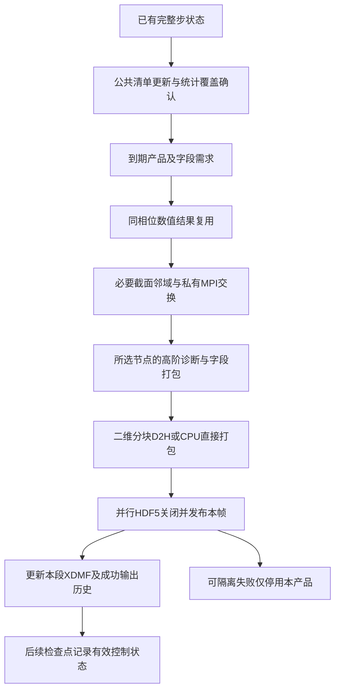

# ASTR 固定网格索引截面数值存档扩展计划

日期：2026-10-29。分支：`feature/gpu_dev`。
状态：18项访谈决策已确认；SL0–SL8及必要公共控制前置已完成本地实现与有界验收。
证据见[验收报告](ASTR_INDEX_SLICE_ARCHIVE_VALIDATION_REPORT.md)及
[执行记录](ASTR_INDEX_SLICE_ARCHIVE_PROGRESS.md)。完整动态图片清单与平台生产验收不在本轮范围。
关联：[原位后处理总计划](ASTR_INSITU_POSTPROCESSING_PLAN.md)、
[运行时产品清单设计](ASTR_INSITU_RUNTIME_PRODUCT_CATALOG_DESIGN.md)、
[输出与重启重设计计划](ASTR_OUTPUT_RESTART_REDESIGN_PLAN.md)。

## 1. 已确认的目标与范围

用户希望在长条计算域中保留可供离线放大、重新着色和定量分析的二维截面数据，
不依赖生产过程中持续输出超大像素图片。

| 编号 | 已确认事项 | 含义 |
|---|---|---|
| S-D00a | 仅扩展二维截面数值存档 | 不新增三维体场存档；既有checkpoint职责独立，不因本计划自动关闭或改写 |
| S-D00b | 固定全局网格索引足够 | 固定全局i/j/k，保留该面的物理坐标与节点字段；不增加任意物理平面插值 |
| S-D00c | 本轮先访谈并写设计 | 逐项确认影响范围和接口的决定，不修改生产代码、不运行算例、不操作Git或平台作业 |

S-D00c记录最初访谈阶段边界；之后用户已明确授权本地实现与短测，Git及平台作业仍未授权。

术语沿用`CONTEXT.md`中的“ASTR grid-index slice”和“ASTR slice series”。
截面数值文件不同于渲染截图，也不是用于重启的完整状态。
曲线网格上的固定索引面可以是曲面，不能标成任意恒定物理高度平面。

## 2. 实施前源码基线

本节保留本地`063ee97`的实施前核查，不描述新增工作区实现。实际交付及测试见第8–9节和验收报告。

| 能力 | 当前实现与缺口 | 代码依据 |
|---|---|---|
| 截面位置 | 全局i/j/k多位置，未按图片像素降采样 | `src/output_config.F90::read_product`、`src/output_archive.F90::plane_selections` |
| 基础字段 | 五变量流动六个标量；AIR5十二个标量；当前按basic组输出，不是任意字段子集 | `src/output_config.F90`、`src/output_fields.F90::basic_output_names` |
| GPU下载 | 仅打包选中截面字段，分块下载，不先回读整个三维场 | `src_gpu/output_fields_gpu.cuf::pack_basic_output_gpu` |
| 文件与坐标 | 并行HDF5、XDMF截面/时间索引，静态截面坐标共享 | `src/output_fields.F90::write_basic_output`、`write_slice_output_xdmf` |
| 重复载荷 | 三个标量速度之外，还物化一个三分量velocity数据集 | `src/output_fields.F90::write_basic_output` |
| 时钟 | slices组按完整步或物理时间调度；组内所有截面共用时钟和字段选择 | `src/output_archive.F90::observe_archives` |
| 派生字段 | 文件梯度、涡量、Q及散度仅准入登记的16³、NP≤2等组合，不包括M12生产网格 | `src/output_archive.F90::configure_archives` |
| 派生工作区 | 当前私有速度和halo仍为三维邻域工作区；只下载截面不等于只占二维显存 | `src_gpu/output_fields_gpu.cuf::begin_derived_output_gpu` |
| 边界求导 | 旧文件算子在物理边界附近降为二/四阶；原位私有速度求导另有七节点六阶边界候选，不等于文件路径已统一 | `src_gpu/output_derivatives_gpu.cuf::output_derivative6_gpu`、`src_gpu/insitu_device_velocity.cuf::derive_sample_velocity_gpu` |
| 数值纹影 | 密度梯度模长不在当前截面存档可选字段中 | `src/output_fields.F90`字段登记、`src/output_config.F90::output_product_derived_indices` |
| 动态配置 | input.output启动读取；逐实例运行中增改停用尚未实现 | `src/output_config.F90`及运行时产品清单设计 |

已有接口与已验证组合分别记录。不得把原位图片中的派生量能力直接写成数值存档已准入。

## 3. 逐项访谈决策

### S-D01 配置入口与运行中更新

已确认A：纳入统一运行时产品清单。每个截面存档实例独立指定全局索引、字段与频率，
支持运行中新增、修改及停用。未选择独立的纯静态扩展方案。

这不要求启用Catalyst、图片渲染或三维输出。数值文件允许所选二维字段下载，
不将图片专用的设备驻留合同误用于禁止必要的截面数据写盘，也不授权整场主机回读。
字段、状态恢复和文件组织按本节后续决策细化；具体JSONL参数与源码接入以工程方案整体审阅为准。

### S-D02 旧静态截面配置的处理

已确认A：统一产品清单成为截面产品定义的唯一入口。位置、字段和频率不再由
`input.output`的旧`slices`组定义；`input.output`仍保留checkpoint及共享输出设置等职责。
不保留旧静态截面与新动态截面两个可切换的定义入口，也不自动合并两份配置。

后续实现需同步调整解析器、输入示例与文档。旧组的具体语法退出处理在工程设计中落实，
不得让同一产品被两个时钟重复写出，也不把未发布的磁盘配置当成已生效定义。
这项决定不修改当前可执行程序，不干预已提交的旧版本作业。

### S-D03 工况覆盖目标与首轮验证对象

已确认A：面向现有已支持的CPU/GPU五变量及AIR5路径，设计覆盖静态笛卡尔与CURVE网格；
以M12为首轮应用，再按实际受影响能力补代表工况。不为截面输出改变求解器数值格式或边界。
未选择仅限非反应M12的专用实现。

覆盖目标不等于当前全部组合已经准入，也不以一次M12短测替代其他路径的验证。
不包含尚未支持的流动物理、移动网格或新的空间插值算法。

### S-D04 基础字段的选择方式

已确认A：每个截面实例显式列出所需基础字段，可以只保存一个或若干标量。
不强制附带整个basic组，也不因选择某个速度分量额外保存完整速度向量。
未选择继续整组六/十二个基础标量输出。

基础字段选择与派生量、归一化量和平均量分别按S-D05至S-D11定义。
物理坐标与完成步/时间等必要描述不属于可随意删除的场变量。

### S-D05 三维梯度派生量的截面存档

已确认A：本次同时覆盖密度梯度模长、物理速度梯度、涡量、既有Q定义及速度散度，
均作为可独立选择的截面字段。从同一完成步的三维邻域计算，只下载和保存截面结果。
未选择仅扩展基础字段。

具体数学定义见第5节，求导与复用方式按S-D10至S-D12。不能仅由单张截面的
面内差分代替三维梯度模长、三维涡量或Q；不保存三维中间场，不将当前小网格派生量
准入直接放宽成生产能力。数值纹影所用原始密度梯度量与出图时的对比度映射分开讨论。

### S-D06 数值原值与显示归一化

已确认A：保存求解器当前量纲体系下的基础字段原值及按该体系定义的派生量，
明确记录SI或无量纲约定、字段含义和必要参考量。不默认转成SI，不重复存归一化副本。
压力比、温度比及纹影的指数/对数/对比度映射在离线绘图时设置。

这不改变当前求解器的有量纲/无量纲配置。文件保存的密度梯度模长与
某个固定色标、灰度或对比度下的纹影图片不是同一个对象，不能以像素灰度替代梯度原值。
具体参考量与元数据项需从现有工况和字段定义核对，不能为缺失参考量默填物理值。

### S-D07 瞬时场与已有平均场

已确认A：支持瞬时场以及已启用、已具有效采样覆盖的Reynolds/Favre平均场截面，
每个实例显式选择数据来源。仅开放已有统计实际提供的字段，不自动启动、重置或补造统计。
未选择本轮仅限瞬时场。

沿用统一产品清单已确认的统计依赖规则：未启用所需统计时拒绝相关产品；
已启用但尚未覆盖时等待数据就绪，其他产品继续。存档须记录相应窗口和覆盖时长。
平均场的梯度、平均瞬时梯度以及平均Q等非线性统计不能混称同一个量；
平均数据的可选字段及派生量组合仍需从现有统计实现核对，不预先承诺全部可用。

### S-D08 面内索引范围

已确认A：同一固定索引面既可保存整面，也可显式指定另两个方向的全局整数索引范围，
保存一个矩形索引子区。选择整面时保留全平面的原始节点；子区不插值、不按图片像素重采样。
未选择本轮仅限完整索引面。

示例：固定j=20时，可选择全局i=500..1500、k=0..480。
索引范围在CURVE上对应原网格曲面的一部分，不解释为物理空间矩形。
本轮不增加采样步幅选项，不能以子区支持为由隐式跳点或降低采样分辨率。

### S-D09 数值存档精度

已确认A：按字段来源保留原生数值精度。FP64瞬时字段保存FP64，FP32瞬时字段保存FP32；
统计与派生量保留其实际数值计算精度，不因为图片显示需要FP32而统一降精度。
本次不新增逐实例转换存档精度的选项。

本项不改变求解器精度、统计累积精度或派生量计算精度。具体字段与坐标精度写入文件描述，
不能把较低精度来源转存FP64称为恢复了FP64计算精度；不以渲染显示数组替代数值来源。

### S-D10 私有诊断求导方式

已确认A：采用独立于流场推进格式的统一六阶显式诊断求导链。内点及MPI接口使用
六阶中心差分，物理边界附近采用七节点六阶单边/偏置差分，CURVE通过网格度量投影到物理梯度。
从所选同相位数据来源求值，使用有效邻域与halo，不修改求解器导数、边界状态或推进。
未选择按显式/紧致等求解器格式分别维护诊断求导链。

当前文件算子的二/四阶边界闭合不能直接称为A已实现。已有私有原位高阶算子只作为复用起点，
密度、均值、开放边界及CURVE适配需按实际缺口补齐；CPU/GPU和各精度分别验证。
几何度量本身的精度与边界输入状态会影响最终物理梯度，不因计算坐标中的六阶模板而自动提高。

### S-D11 平均场派生量的含义

已确认A：平均来源的派生量由已有的所选平均字段计算，例如Reynolds/Favre平均速度的
梯度、涡量、Q和散度。字段身份与元数据明确保留数据来源，不称为瞬时派生量的时间平均。
本轮不为这些产品新增瞬时Q等量的时间累积状态，未选择扩展相应统计系统。

Q是速度梯度的非线性函数，通常Q(平均速度)不等于平均Q(瞬时速度)。
本项也不将Reynolds平均与Favre平均互相替代。未被已有统计提供的基础平均字段，
不能根据瞬时值、状态方程代入均值或缺省值伪造，仍按S-D07处理依赖。

### S-D12 派生量工作区与同相位复用

已确认A：优先复用同一完成步、相同数据来源与诊断定义的现成数值结果；若无可复用结果，
按选定截面/子区所需的三维差分邻域计算，不为单张截面新建整场速度或梯度副本。
多产品按依赖合并或分组分块处理，避免每实例各保留一套整场私有缓存。
未选择先沿用整场私有缓存、以后再优化的实现顺序。

A的局部工作区目标不禁止读取求解器或统计系统已经持有的三维数组，也不减少六阶模板
所需邻域。MPI接口仍需得到正确的同相位邻域值，不能把截面边缘或分区接口当作物理边界。
只读私有处理不得反向平均或修改权威场、统计及求解器halo。
瞬时、Reynolds、Favre来源以及不同定义/时间的结果不能混用；渲染显示数组不能替代原生数值结果。

### S-D13 文件格式与时间帧组织

用户回复“多个时刻，多个产品独立a”，按所选A记录：多个产品各自独立，
每个产品/定义版本保留多个时刻，每个实际输出时刻独立写一个HDF5数据文件，
通过时间序列索引组织；不采用多个时刻追加同一HDF5文件的B方案。
沿用现有并行HDF5与XDMF读取路径，静态截面几何不随每帧重复保存。
先结束本帧写出，再将其纳入可读时间序列。

本项不增加三维数据、完整性校验和或写后全量回读，不要求任意VTK运行依赖。
几何共享与故障继续条件按S-D14至S-D16；矢量读取而不重复存储的方式见第7节。
已批准的定义版本规则仍适用：不同位置、范围或字段定义不混入同一未变版本序列。

### S-D14 静态坐标的共享范围与产品独立性

已确认A：每个产品/定义版本目录内保存一份静态截面坐标，所有时间帧引用它，
不依赖其他产品目录或运行根的共享几何池。整体复制该版本目录即可读取其本地序列。
不采用跨产品运行级坐标池。

不逐帧重复坐标，也不保存三维坐标场。接受不同产品间少量二维坐标冗余，换取独立搬移和清理。
单帧HDF5是否能脱离坐标文件独立读取，与产品目录独立性是不同要求。
续算按S-D16建立自包含新段，不自动复制或引用其他运行的历史场文件。

### S-D15 可安全隔离的数值存档写盘失败

已确认A：对可安全隔离的单产品写盘失败，记录并停用该产品，保留此前已完成的帧，
继续其他产品与CFD。失败帧不进入正式时间索引，不标为成功；使用既有显式enable_request重新启用。
未选择任何截面存档失败都终止整个作业。

A仅适用于参与rank能够一致退出该次文件操作、释放资源并保持MPI/GPU可用的失败。
不可恢复的MPI、设备上下文或进程故障不承诺继续；并行HDF5实际可恢复的错误范围须在实现中核查。
故障判断只在相关错误分支进行，不新增成功路径的全场校验、CRC或写后回读。
本项仅定义新截面数值存档通道，不改变checkpoint的保存要求，也不改写既有图片发布失败规则。

### S-D16 续算后的截面时间序列

已确认A：每次续算建立新的输出段，恢复产品定义、版本与调度，但新段只索引本段实际写出的帧，
所需二维坐标在本地保存。不复制或修改旧段，不自动引用其他运行的历史文件。
需要跨段展示时显式合并索引，不能据未保存的时刻补造截面。
未选择自动构建引用旧运行文件的父链时间索引。

沿用已批准的检查点有效清单与调度恢复，不重新执行已消费的启用请求，
不因续算改写旧定义版本或混入恢复点之后的另一条计算分支。文件序列与检查点权威状态分开。
各新段的产品/定义版本目录拥有本地坐标与本段索引，目录独立性不依赖复制大量历史场文件。

### S-D17 文件压缩范围

已确认A：本轮先采用不压缩的HDF5数值存档，不新增压缩依赖或有损量化。
优先完成按需字段、去重复速度、截面邻域计算和可靠的并行写出，
本轮不增加显式无损压缩选项。

保留原生精度不等于必须压缩；无损压缩也不保证更短的输出阻塞时间。
本项不允许通过降低精度、隐式跳点或有损编码减少文件大小。

### S-D18 离线读取与重新出图的交付范围

已确认A：除HDF5/XDMF文件及格式说明外，提供轻量离线读取与批量出图工具/示例，
支持查看已保存时刻和字段、选择面内区域及色标重新出图、提取数值剖面。
复用ParaView或Python读取路径，不运行ASTR，不依赖原位Catalyst会话。
未选择仅交付文件和格式说明。

离线工具只能处理实际保存的截面、字段和时刻，不能恢复未保存的三维域、面外导数或时间历史。
可视化/读取工具依赖不成为ASTR求解器的强制构建与运行依赖，不增加Python流场推进器。

## 4. 工程方案与上位设计的关系

第3节记录已确认需求；以下接口、文件布局和测试矩阵已落实到本轮工作区实现。
需重新通过根CMake构建后使用，基线提交或平台旧二进制不会自动获得这些功能。

本方案复用X2-0至X2-3的JSONL解析、单一有效登记表、完整步发布与控制状态恢复。
不得为数值存档另建一套活动清单、轮询器或启用请求协议；未完成公共控制层时，
可用内部类型化测试入口验证写出器，但不开放第二个生产配置入口。

原位图片、二维数值文件和checkpoint是不同输出通道。关闭渲染或未编译Catalyst不能阻止
合法的数值截面写出；开启数值截面也不能偷偷触发固定profile的额外图片。
旧`&slices`产品定义退出后，同步修改解析器与全部受影响示例，给出明确迁移说明，
不自动导入旧定义、不静默忽略仍声称开启输出的旧配置。checkpoint、volume与共享预算等职责保留。

统一清单已有的定义版本、仅调频不改版本、首帧、完整目标集合、逐产品错误隔离、
默认10完整步检查及显式enable_request规则均沿用，不逐项发明第二套语义。
频率支持步数或物理时间；已有事件/窗口调度只在其实际支持范围内复用，不以配置字段存在代表工况已验证。

## 5. 字段定义与真实数据来源

### 5.1 数值字段与三维诊断定义

基础字段名优先沿用现有文件接口，不输出着色后的RGB或归一化副本：

| 字段 | 定义与来源 |
|---|---|
| `density`、`velocity_x/y/z`、`pressure`、`temperature` | 所选来源的密度、物理坐标速度分量、压力、平动温度；瞬时值直接取完整步原始变量 |
| `vibrational_temperature`、`mass_fraction_N2/O2/N/O/NO` | AIR5已有振动温度与五组分质量分数，后五项均带`mass_fraction_`前缀；不新增状态方程反演或组分裁剪 |
| `density_gradient_magnitude` | 物理坐标三维密度梯度的欧氏模长，不是显示灰度 |
| `velocity_gradient_ab` | 第a个物理速度分量对第b个物理坐标的偏导，九分量分别可选 |
| `vorticity_x/y/z` | 所选速度场的三维旋度分量 |
| `velocity_divergence` | 所选速度场的三维散度 |
| `Q_rs` | 沿用现有旋转与全应变率定义，不扣除应变率迹 |

设$A_{ab}=\partial u_a/\partial x_b$，则诊断采用

$$
g_\rho=\sqrt{(\partial_x\rho)^2+(\partial_y\rho)^2+(\partial_z\rho)^2},\qquad
\boldsymbol\omega=\nabla\times\boldsymbol u,\qquad
d=\operatorname{tr}A,
$$

$$
Q_{rs}=\frac{\|\Omega\|_F^2-\|S\|_F^2}{2}
       =-\frac12\operatorname{tr}(A^2),\quad
S=\frac{A+A^T}{2},\quad\Omega=\frac{A-A^T}{2}.
$$

这不是可压缩速度梯度的第二主不变量$[(\operatorname{tr}A)^2-\operatorname{tr}(A^2)]/2$。
九分量命名与现有`output_fields.F90`一致，元数据说明分量顺序，不能按数组存放顺序猜偏导方向。
SI路径中$g_\rho$为$\mathrm{kg\,m^{-4}}$、速度梯度/涡量/散度为$\mathrm{s^{-1}}$、Q为$\mathrm{s^{-2}}$；
无量纲路径保留对应定义及可用参考尺度，不默认转换为SI。

平均来源先获取对应平均字段，再套用上述诊断定义。字段身份必须同时包含来源，
例如Favre平均速度的Q不能标成瞬时Q的时间平均。离线纹影工具从$g_\rho$生成显示映射，
不需要重新猜测面外密度梯度。

### 5.2 平均字段不是任意基础字段的自动副本

已有统计来源的差异如下。本轮仅接入其中实际可用的点态字段，没有扩大累计范围。

| 现有来源 | 实际保留的信息 | 对截面存档的含义 |
|---|---|---|
| `insitu_velocity_statistics`与GPU对应实现 | 点态密度均值、Reynolds/Favre速度均值及二阶矩；具有自身窗口/权重 | 可适配所选节点的已有均值读取，不能凭此生成平均p/T/Tv/Y |
| `sample_statistics_gpu_mean_vectors` | 当前受限于登记32³ TGV，且会物化整局部域均值 | 不能直接调用后宣布满足M12和局部工作区目标；需按所选节点/邻域读取已有累计量 |
| `production_statistics_gpu`紧凑平板统计 | 沿z积分后的(i,j)矩和壁面量，不保留逐z点态历史 | 不能复制到各k层伪装成任意位置的三维时间平均场，不能由其恢复面外平均梯度 |
| CPU `statistic`及GPU AIR5 44分量累计 | 已有样本矩、计数与对应时钟；AIR5现有数组并未累计所有Tv/Y均值 | 仅输出确实可由已有矩得到的字段；不由平均状态方程代入伪造缺失均值 |

字段登记必须给出`数据来源×后端×字段×空间支持×权重/窗口`的可用性。
Reynolds/Favre是统计定义，不足以唯一识别所有累计器；需要时显式选择已有统计来源，
只有唯一合法来源时才能无歧义解析，多个不同来源不能由“优先找到哪个”静默决定。
等权采样矩与物理时间加权积分不能混称；记录实际采样相位、计数、可用覆盖与权重规则，
不把输出时刻冒充最后统计采样时刻，不凭首末时刻构造未保存的积分权重。
点态速度统计提供的密度均值是Reynolds密度均值，不能在Favre来源下默当作Favre密度均值；
来源与字段的数学组合逐项登记，不靠同名基础字段推定存在对应统计。

本轮不新建统计累积。M12若只开启空间归约后的紧凑统计，瞬时截面仍可用，
任意索引面上的点态平均产品则按缺少实际来源处理；扩大这种统计覆盖需另行决定。
已有未就绪来源等待，实际不存在的字段/来源拒绝对应产品，不拖累其他产品和CFD。

## 6. 产品记录与运行阶段

### 6.1 同一JSONL清单中的数值通道

使用`kind="slice"`，以`output.channel="data"`区别于图片；数值产品使用`fields`列表，
不要求相机、色标、图像分辨率等无关参数。
以下是两个独立产品的参数结构；索引须适配实际网格，不代表已批准的生产输入：

```jsonl
{"catalog_schema":"astr-insitu-products-v1"}
{"id":"xy_instant","kind":"slice","enable_request":1,"source":"instantaneous","fields":["density","velocity_x","pressure","temperature","density_gradient_magnitude","Q_rs"],"sampling":{"mode":"grid_index","axis":"k","index":240,"index_ranges":{"i":[0,2250],"j":[0,260]}},"output":{"channel":"data","format":"hdf5-xdmf"},"schedule":{"mode":"steps","interval":100,"events":[],"windows":[]}}
{"id":"xz_nearwall","kind":"slice","enable_request":1,"source":"instantaneous","fields":["velocity_z","temperature"],"sampling":{"mode":"grid_index","axis":"j","index":20,"index_ranges":{"i":[500,1500],"k":[0,480]}},"output":{"channel":"data","format":"hdf5-xdmf"},"schedule":{"mode":"steps","interval":200,"events":[],"windows":[]}}
```

索引为含端点的全局零基整数，不是rank局部索引；面内范围显式给出，整面用全范围表示，步幅为1。
CURVE上保持物理坐标，不将数组索引画成物理长度。字段顺序或JSON空白的无意义变化不生成新定义。
位置、范围、来源或字段集合改变时进入新定义版本；只改频率保留版本，不重置正式统计。

### 6.2 目标执行顺序



此图对应现有完整步输出入口，不是新增RK阶段。使用现有完整步身份，先让本步正式统计完成既定采样，
再读取其实际可用均值；不因产品到期重复采样。清单检测不能被`render=f`的早返回跳过。
未到期或停用产品不提取、下载或写盘；检查点按既有开关运行，不因图中节点而强制开启。

## 7. 邻域、MPI、文件与恢复细节

### 7.1 保留数学模板而不是整场诊断副本

按全局所选节点计算精确邻域：中心模板半径3，物理边界偏置模板使用域内连续七节点。
面内子区边缘不是物理边界，仍可读取子区外的必要原网格节点；MPI接口跨rank取得邻域值。
不能为了满足局部数组长度而降阶，也不能把MPI接口换成单边闭合。
全局节点不足以形成模板时，仅拒绝依赖该诊断的产品，不影响仍可输出的基础字段产品。

基础字段只读所选节点；Q、旋度和散度仅取所需速度分量与导数，密度梯度仅取密度邻域。
使用现有静态几何度量投影，不因一个截面重算或回读完整三维坐标/度量。
复用键包含实际状态身份、统计来源及窗口身份、精度、诊断定义和索引范围；
可复用原生数值数组，不可复用着色/显示转换数组，也不能用上一时刻的瞬时结果。
旧整场私有速度halo与均值物化入口若不满足这些条件，不直接拿来充当新路径。

MPI共享节点只有一个写出所有者，其他rank用空HDF5选择参与同一集合顺序。
周期坐标端点按原全局网格编号保存，不因场值相等就合并几何端点。
私有交换不反向修改或平均求解器场/halo，不强制继承某一求解器通信后端；
复用已有明确配置的分析通信层，设备缓冲和pinned路径分别按实际支持验证。

FP32/FP64基础字段与已有FP64累计量可以来源不同。打包器按字段实际kind工作，
不能把FP64统计先降成全局FP32的`real_kind`再声称保留了原精度。
共用数学系数不等于调用求解器边界更新，诊断闭合不以流动求解器H7开关为开关。

### 7.2 自包含的产品版本输出段

当前文件布局如下，不增加每帧大文件校验或检查点旁路文件：

```text
<output-root>/slice_products/<product-id>/version000000000001/segmentXXXXXX/
  definition.json
  geometry.h5
  series.xdmf
  step000000000100.h5
  step000000000200.h5
```

各段只有本地相对引用；坐标文件仅包含该索引面/子区，绝不包含三维整域几何。
每个数据帧保存所选字段及小型身份属性：完成步/实际时间、产品ID和定义版本、
索引位置/范围、来源、字段精度/单位、必要参考量与统计身份。坐标精度明确声明。
一个字段只存一份，选择三个标量速度也不再额外物化完整velocity数据集。
标量读取是必需能力；优先验证XDMF组合引用能否提供无重复存储的速度矢量，
若目标读端不支持，则由离线工具或ParaView Calculator组合，不为其恢复磁盘上的速度副本。

临时帧在并行HDF5操作正常返回并关闭后发布，随后更新本段XDMF与成功时钟。
写出及索引发布失败分别记录，不把残留临时帧或未索引帧标为正式成功输出。
不增加CRC、全文件哈希、写后回读、逐帧外部验证进程或循环等待文件稳定。
可恢复分支必须先保证集合操作已收敛、资源可释放；HDF5库已损坏或MPI不可恢复时不假装可继续。
错误判断不要求成功路径反复扫描大数组，停用后也不按正常频率反复尝试。

### 7.3 控制恢复与文件独立

有效定义、版本、时钟、停用原因和已消费enable_request仍由公共登记表持有，
追加到X2既定的`insitu_control.bin`控制合同，不再同时由旧`slices`档案持有第二份权威状态。
旧`archives.bin`中尚未迁移的volume职责不因本计划改变；不增加新的强制附属控制文件。
是否保存累计统计仍由既有检查点开关控制，没有恢复统计时不伪造之前的平均覆盖。

恢复后建立新输出段，不重复恢复点已成功的输出，不回补停机期间或未保存的历史。
磁盘上的产品清单不自动覆盖检查点有效清单；新的修改仍需重新发布，沿用X2。
新段几何可从已恢复的静态网格重新选取，只写所需二维坐标，不读取旧三维档案来准备截面。
离线跨段合并只建立显式选定源段的索引，不改变原文件，也不把外部引用索引称为自包含目录。

## 8. 源码分工与依赖

| 文件/模块 | 实际分工 |
|---|---|
| `src/insitu_catalog.F90`、`insitu_catalog_json.c`、`insitu_run_config.F90` | 结构化JSONL解析、实际字段登记、根rank观察与类型化MPI分发；静态链接原始yyjson源码 |
| `src/insitu_product_schedule.F90` | 单一数值产品登记表、定义版本、时钟、请求与故障状态；复用现有事件/窗口，不复制监测器 |
| `src/output_config.F90` | 退出旧`slices`生产定义入口，保留共享输出与checkpoint等职责，更新输入迁移错误 |
| `src/index_slice_archive.F90`、`index_slice_hdf5.c` | 产品/版本/续算段、并行原生HDF5及相对XDMF；C薄层返回可隔离写盘错误，不调用旧致命退出写盘路径；volume仍由原`output_archive`负责 |
| `src/index_slice_source.F90` | 解析真实瞬时/平均来源及覆盖、字段支持；只读已有累计量 |
| `src/index_slice_stencil.F90`、`index_slice_provider.F90` | 共享数学模板、CPU诊断、唯一节点所有权、局部邻域与私有主机MPI条带 |
| `src_gpu/index_slice_gpu.cuf` | 原生精度设备打包、局部邻域和诊断；仅回读所选二维字段，可返回分配失败，不新增整场工作区 |
| `src/output_fields.F90`、`src_gpu/output_fields_gpu.cuf` | 保留已测试的字段/子区辅助写出接口，新生产通道复用前者的字段单位及XDMF格式化；不依赖旧整场派生工作区 |
| CPU/GPU现有统计模块 | 增加只读的所选节点/邻域访问与来源元数据，不改采样定义或增加新累计场 |
| `src/insitu_session.F90`、`output_runtime.F90` | 完整步观察、ASTRIR07外层与原渲染段/公共动态状态恢复；关闭渲染仍可输出，不重复采样 |
| `scripts/insitu/product_catalog.py`、`slice_archive.py`及`scripts/output/`示例 | 原子发布与显式重启用；列字段、只读重画、按行剖面及显式跨段索引，不另写求解器 |
| 根与`src/CMakeLists.txt` | 按真实模块依赖接入，CPU-only/Catalyst OFF均可构建数值写出，离线Python工具不是求解器强制依赖 |

模块按控制、来源、邻域、设备与文件所有权划分，不为每个字段或产品实例新建文件。
正式构建仍仅通过根CMake，私有条带目前是主机MPI，不宣称设备直连。

## 9. 分阶段实施与验收

SL0–SL8均已完成本地有界检查，逐阶段结果见执行记录，原始证据与成本见验收报告。
下表保留批准的交付和完成检查，不以本地短测替代生产物理或平台规模验收。

| step | 交付与依赖 | 最小完成检查 |
|---|---|---|
| SL0 规范与字段登记 | 与X2-0固定数值通道schema、原值/单位/精度及实际来源矩阵；继承公共解析依赖 | CPU/Catalyst OFF宿主配置探针；错误条目不吞后续有效条目；区分无均值来源、未覆盖和不支持字段 |
| SL1 公共实例控制接入 | 依赖X2-1至3；数值通道参与同一版本、时钟、停用/启用与检查点控制 | 合成完整步序列，增改停用、仅调频、重复请求、无渲染模式；未改实例状态不重置 |
| SL2 基础字段与独立文件 | 字段子集、三轴整面/子区、原生FP32/FP64、唯一节点、二维坐标及无重复速度写出 | 不对称合成网格和真实M12瞬时场；HDF5实际读回、ParaView时间序列、移动产品目录后读取；下载量等于所选字段 |
| SL3 截面邻域诊断 | 复用SL2选择器；密度与速度独立六阶诊断、七节点边界、CURVE度量、CPU/GPU | 已有解析/离散参考；内部、物理边界、MPI接口、子区边缘；公式/系数及来源精度一致，不分配新整场诊断副本 |
| SL4 已有均值来源 | 所选节点/邻域的已有Reynolds/Favre字段，窗口/覆盖/权重与来源标签；不新建累计器 | 真实可用均值对照；零覆盖等待、缺字段局部拒绝；M12空间归约不能伪装三维均值；平均Q定义正确 |
| SL5 文件故障与续算 | 数据发布/索引/停用；独立新段；控制定义、时钟和请求恢复 | 可隔离错误注入不影响其他产品/CFD；连续12与5+7短窗的对应场与控制历史；新段不引用旧运行数据 |
| SL6 离线工具 | 列出时刻/字段、局部与色标重新出图、剖面提取、显式跨段索引 | 只读文件、不推进ASTR、不启动统计；真实ParaView/Python读取，图像/剖面可追溯到产品/版本/时刻和坐标 |
| SL7 代表工况集成 | M12优先，补已有TGV、壁面、AIR5、静态CURVE的受影响路径；CP/渲染开关组合 | 小规模CPU/GPU、代表分区及空选择；数值写出独立于Catalyst；开关/清单修改不改变同后端权威场与正式统计 |
| SL8 规模成本与交付 | 本地中等M12，比较无截面、基础截面、含派生量、不同字段/子区需求 | 分项计时、D2H字节、显存/主机工作区、文件数/磁盘量、可读性；更新示例/说明，报告尚未验证组合 |

### 9.1 最小验证组织

- 配置与所有权先用已有不对称小网格、NP=1/2，补一个NP=4多轴/空选择场景；不先跑长CFD。
- 首个真实应用采用现有M12短测夹具，保留原数值格式、边界与吹吸，CPU/GPU按相同拓扑比较。
  跨拓扑所有权用同一冻结状态验证，不将不同拓扑的随机吹吸演化当作同一随机轨迹比较。
- 派生量先做同状态离散参考与解析网格收敛，再接真实短窗；不以图像清晰或程序跑完代替数值正确。
- 基础字段存档与来源同kind逐值一致；输出开关不改变同后端权威场及累计统计。
  FP64同状态诊断沿用相关路径既有约2e-10量级判据；SI字段沿用其物理尺度，不统一比较未缩放原值。
  FP32不套FP64阈值，核对同kind读写、公式/系数及已有原生精度参考，并报告数值差，不新增物理解偏差淘汰门槛。
- 现有平均场只检查已定义来源的正确读取，不将“没有某字段”改成默认零或新累计器。
  若验证要求必须改变统计定义、物理模型或求解器边界，应先提交人工决策。
- 代表新增GPU邻域核做一次有针对性的双rank内存检查；文档更新不重复长测，既有未变证据只读复用。

不为本计划新设一组任意固定显存、磁盘或运行秒数上限。实施时按实际本地空闲资源和预估载荷安排短测；
需要新生产任务或明显更大资源时单独审阅，不操作正在排队/运行的作业。
没有新增长时物理定常或论文数据库吻合的前置门槛，输出正确性与物理算例验证分别报告。

### 9.2 成本报告口径

每帧字段载荷按$B=\sum_f N_f b_f$核算，静态坐标另计一次；记录实际打包D2H字节，
必要halo通信、图像回读和checkpoint流量分开报告，不能把字段载荷当成所有通信量。
计时至少区分控制检测、私有邻域通信、诊断求值、打包/D2H、HDF5写出与索引发布。
性能候选不因本地短窗无明显加速就自动删除，但不将理论收益写成实测结果。

以M12原网格2251×261×481节点估算，完整XY与XZ面各保存六个FP64基础分量，
原始字段载荷约27 MiB与50 MiB/时刻；不含坐标及HDF5元数据，也不是实际写出耗时。
本计划不再额外写完整速度向量；选择更少字段或更小子区按真实节点数下降。

## 10. 整体审阅与完成条件

18项需求确认后，用户已授权完整本地goal。接口、SL0–SL8及检查范围保持为批准基线，
实际完成项和证据见执行记录及验收报告。平台作业和Git写操作不在本次授权中。

完成应以实际交付判断：固定索引面及子区能按产品选择字段，读取与定义一致，
只传输所选二维载荷；诊断使用必要邻域而非新增整场副本；各产品/版本/续算段独立可读，
动态控制、已批准范围内的故障隔离与恢复有效，离线工具可使用，并报告资源与成本。
不将未提供的平均字段、未测的生产拓扑或新增物理模型写成已支持。
