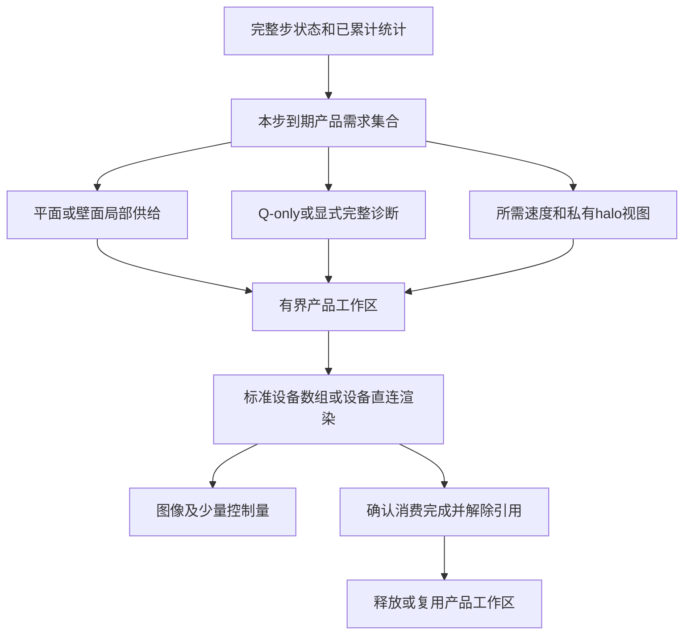

# ASTR 原位后处理显存优化设计

日期：2026-10-18，执行更新：2026-10-19。IM0–IM8已完成获批的本地有界实现及检查。
IM8仅完成默认不接入生产的单产品VTK组件，不表示已替换真实产品的显示打包或已通过全尺寸平台验收。
上位计划：[ASTR_INSITU_POSTPROCESSING_PLAN.md](ASTR_INSITU_POSTPROCESSING_PLAN.md)。
实际分配、图像、续算、传输及限制见[实施记录](ASTR_INSITU_GPU_MEMORY_OPTIMIZATION_RESULTS_20261018.md)。

## 1. 目标与范围

降低同一网格、同一产品和同一图像配置下的每物理GPU显存峰值，使已有Q等值面、流线、截面和统计能力能够用于更大的计算域。
首先减少不必要的全域数组、布局转换和同时存活的中间结果，不通过降低求解精度、改变物理定义、减少种子或偷偷缩小出图范围获得收益。

以下步骤及第7节本地测试规格/预算已获批准，不表示已经实现、已经测得收益或已经获得平台运行授权。
只在当前工作区执行，不操作Git，不干扰现有本地或平台任务。

建议分批审阅：

| 批次 | 步骤 | 定位 |
| --- | --- | --- |
| 第一批 | IM0、IM1、IM2、IM3、IM4 | 记录实际同时存活量，完成Q-only、M12截面局部供给、临时归约和字段去重 |
| 第二批 | IM5、IM6、IM7 | 共享字段存储、统计结果按需生成、产品及跨帧生命周期调整 |
| 本轮后续候选 | IM8 | 已批准显示数据直接生成到图形缓冲的受限验证；不作为前两批完成条件，但纳入完整goal |

HDF5写盘去重、GPUDirect Storage、异步checkpoint、求解器工作区压缩和新增物理算例不属于本设计。
两条现有设备渲染入口继续保留，不自建替代ParaView的渲染器。

## 2. 优化前源码快照（IM0基线）

### 2.1 不是所有重复都是显存重复

HDF5中的速度分量和速度向量属于重复文件载荷。
删除其中一份可以减少写盘量，但不能据此推断设备渲染的全域速度数组会减少。
本设计只把有独立设备分配或明确延长资源生命周期的对象列为显存对象。
`borrow_cuda_array`及ArrayHandle的共享引用不按新的载荷分配重复计数。

| 对象 | 当前实现及条件 | 源码入口 |
| --- | --- | --- |
| 规范化速度快照 | 临时4分量rho/动量与3分量速度同时存在；前者完成共享节点处理后释放 | `src_gpu/insitu_device_velocity.cuf::snapshot_sample_velocity_gpu` |
| 私有速度halo | 已有完整速度快照后，再建立含三层halo的3分量数组 | 同文件`extend_sample_velocity_gpu` |
| 全诊断数组 | 只请求Q时仍分配14分量FP64：9梯度、Q、散度、3涡量 | 同文件`derive_sample_velocity_gpu` |
| Q/u选择数组 | 从14分量诊断和速度中另生成全域Q、u标量，交给等值面提取 | `src_gpu/insitu_device_geometry.h::extract_tgv_geometry` |
| CURVE/物理坐标 | 设备坐标快照、必要时的坐标halo，以及流线消费者的向量式打包可能同时存在 | `src_gpu/insitu_products_gpu.cuf::render_device_sample_gpu` |
| M12截面 | 后段已只提取夹住平面的两层，但前段仍准备全域速度、halo、物理坐标，温度截面还准备全域温度 | 上述Fortran入口及`src_gpu/insitu_m12_products.h::append_m12_planes` |
| 流线布局转换 | `pack_component_halo`分配新的交错向量数组，不是原分量数组的零拷贝视图 | `src_gpu/insitu_device_streamlines.h` |
| 流线拼接 | 分块轨迹与最终连续轨迹数组在拼接时共同存在 | 同文件`trace_partition_device` |
| 几何显示转换 | FP64坐标/字段、FP32显示坐标、64/32位索引、颜色数组共同存在 | `src_gpu/insitu_device_geometry.h::DeviceGeometryOwner` |
| 显示检查暂存 | 每几何点9个FP64元数据，另有索引检查数组，归约后才释放 | 同上构造函数 |
| 图形缓冲 | 两入口使用的VTK设备上传仍有CUDA到OpenGL的D2D复制 | `src_gpu/insitu_device_vtk_mapper.h`及`scripts/insitu/patches/paraview-6.1.1-device-rendering.patch` |
| 同帧产品保留 | 一帧多个产品先加入`meshes`，随后共同进入渲染 | `src_gpu/insitu_device_products.cu::astr_insitu_device_render` |
| 上一帧保留 | `retained_device_products`在新一轮`catalyst_execute`完成后才替换，新旧几何可能重叠存活 | `src/insitu_mesh_adapter.cpp::render_resident_products` |
| 五变量三维统计 | 对应统计开启后，30分量累计状态与41分量结果数组均长期分配 | `src_gpu/insitu_statistics_gpu.cuf` |
| AIR5体统计 | 对应功能启用后有120分量累计状态，另有权重和标记 | `src_gpu/insitu_air5_statistics_gpu.cuf::allocate_state` |

这些对象属于不同产品和阶段，不能将整张表相加当作某次运行的实测峰值。
本表也不证明Viskores/VTK内部各分配的实际峰值占比；第三方扫描、排序、插值及图形驱动资源需要IM0归因。
现有能力矩阵仍有效，列出AIR5统计不表示已准入任意AIR5体渲染。

### 2.2 两个需要纠正的判断

“设备直连”表示不经主机回读几何，不等于计算数组与图形缓冲共享同一份显存。
当前显示坐标已经使用FP32、显示索引已经使用32位；不能再次把这一项列为尚未实施的减半优化。

同一几何的弱扰动配色图当前已经共享坐标和索引，只另存颜色数组。
不得将它重新算成整套几何复制，也不应撤掉已经有效的共享机制。

## 3. 容量模型与预期

记`N`为本rank采样物理节点数，`Nh`为含私有halo节点数，`P`为提取后几何点数，`I`为索引元素数，`Ns`为统计唯一节点数。
以下是名义载荷，不含分配器保留、第三方工作区、图形上下文或求解器基础显存。

| 项目 | 当前名义设备载荷 | 优化目标 |
| --- | ---: | --- |
| 14分量诊断 | `112N`字节 | Q-only为`8N`，梯度只在寄存器中临时计算 |
| 独立Q/u选择 | `16N`字节 | 直接消费Q-only；u优先取向量分量视图或在需要时生成 |
| 速度及其halo | `24N + 24Nh`字节 | 缩短共存，评估以一个私有存储提供内部/halo视图 |
| 流线再打包 | 每种输入额外约`24Nh`字节 | 消费原布局或共享视图，避免整域复制 |
| 显示元数据暂存 | `72P`字节 | 分块/融合归约，暂存随块数而不是几何点数增长 |
| 五变量统计结果 | `328Ns`字节，另有`240Ns`累计状态 | 保留累计状态，结果按消费范围临时生成 |
| 上帧/本帧几何 | 两组实际存活几何及显示资源 | 明确解除消费引用后退休，不再无条件跨帧保留完整产品 |

按`2250×260×480`区间、四卡平均分摊粗估，一个FP64标量约0.523 GiB/卡，14分量约7.322 GiB/卡。
仅将14分量改为1分量，名义差约6.799 GiB/卡。
这没有考虑实际拓扑、端点、halo和第三方峰值，既不是生产显存预测，也不能与其他阶段节省量直接相加。

实际峰值按时间线判断：`求解器基础 + 持久统计/几何 + 当时存活的字段 + 当前产品/临时工作区 + 未退休产品 + 图形资源`。
减少调用次数、降低频率或扩大预算不等于降低单帧峰值。
缓存静态坐标可以减少分配时间，但若原引用未释放，也可能提高常驻量；必须分别报告容量和时间收益。

## 4. 不改变的行为

- 权威求解状态、FP64离散、RK/化学控制、边界处理、随机吹吸和物性恢复不改。
- 完整步相位、私有共享节点规范化、halo宽度和通信顺序不因存储优化改变。
- Q定义、差分及边界闭合、网格度量投影不改；不借用其他阶段的过期梯度。
- 种子、积分速度种类、RK45容差、弧长、终止规则及跨rank轨迹语义不改。
- 相机、视域、色标、光照、分辨率、图片/提取数据的产品选择及触发时刻不改。
- 累计统计定义、采样序列、覆盖时长和权威重启状态不改。
- 不借本计划取消现有求解器及后处理依赖同步；IM8仅使用D3获批的映射/完成事件/解除映射所有权。
- 不新增每帧CRC、全场回读核验或大文件审计；数值参考下载只用于显式短测。
- 保留正常运行必要的有限性、索引和I/O失败处理，不以优化名义静默降级。

只在渲染中使用速度模长时，仍先按原算法插值速度向量，再取模长。
不能改成先对网格速度取模长再插值，两者一般不相等。
同样，不以等值面阈值常数替代仍需要验证或导出的实际插值Q值。

## 5. 目标数据流



需求是内部执行信息，首批不增加一组面向用户的环境变量。
不新增静默的低分辨率模式；同时请求多个产品时可以取需求并集，也可以在后续获批后分组执行。
完整诊断和几何导出消费者必须收到明确的字段布局，不能把1分量Q数组仍按14分量指针解释。

## 6. 实施步骤

### IM0. 冻结参考与显存生命周期归因

涉及：现有`src/insitu_resource_observer.cpp`、`src/insitu_shared_allocation_budget.h`、`src/insitu_mesh_adapter.cpp`，以及`tests/gpu_validation/run_insitu_device_budget.py`和现有M12覆盖驱动。

1. 冻结当前含本轮未提交改动的实际二进制和输入，记录构建配置、设备UUID、版本与源码差异；不能只用HEAD代表参考。
2. 复用现有原生阶段观察和20 ms外部采样。补充仅测试构建启用的数组角色、实际分配字节、创建/释放阶段及产品点/索引数，不另造生产级显存追踪系统。
3. 分别检查Q-only产品、截面产品、流线产品及它们的组合，区分字段峰值、提取峰值、图形上传和前后帧重叠。
4. 同一底层分配被多个视图引用时只计一次；同时报告实际活跃载荷与分配器/驱动观察到的总占用。

验收：形成一张真实生命周期表，定位最大重叠阶段；不能仅凭帧后NVML值或`cudaMalloc`请求总和认定峰值来源。
首轮只运行第7节小规模矩阵，不复现平台生产OOM。

### IM1. Q-only设备诊断

依赖：IM0。
涉及：`src_gpu/insitu_device_velocity.cuf`、`src_gpu/insitu_sample_gpu.cuf`、`src_gpu/insitu_products_gpu.cuf`、`src_gpu/insitu_device_geometry.h`、`src_gpu/insitu_device_products.cu`。
测试：扩展`tests/gpu_validation/insitu_device_velocity_probe.cuf`、`test_insitu_device_velocity.py`、`test_insitu_device_geometry.py`。

1. 为私有诊断定义内部`none / q-only / full14`布局；将明确的布局和Q入口传到C++，不沿用错误的14分量强转。
2. 提取共用单点FP64导数/Q计算，保持原操作顺序；Q-only只写一个分量，不再写梯度、散度和涡量。
3. 等值面直接借用连续Q数组，不再为Q生成一份选择副本；显式完整诊断、现有测试和导出请求继续得到完整布局。

验收：Q-only与原full14中的Q逐值一致；仿射/周期场、空等值面及MPI接口通过原门槛。
证明Q-only实际分配为`8N`而不是`112N`，并记录提取阶段峰值是否随之下降。
不能用降低差分阶数、关闭边界梯度或改变Q阈值实现。

### IM2. M12截面需求前移

依赖：IM0，可与IM1分别验收。
涉及：`src_gpu/insitu_products_gpu.cuf`、`src_gpu/insitu_sample_gpu.cuf`、`src_gpu/insitu_m12_gpu.cuf`、`src_gpu/insitu_m12_products.h`，必要时复用`src_gpu/insitu_device_velocity.cuf`的局部规范化与交换。
测试：扩展`tests/gpu_validation/test_m12_hd_coverage.py`及其实际覆盖驱动，新增局部采样与全域参考对照。

1. 首先限定已有M12正交笛卡尔截面，按实际产品提取夹住平面的两层坐标及所需字段。
2. 在必要共享节点上先规范化rho和动量再求速度，保持原处理方向和算术顺序，不能直接平均速度替代。
3. 只有截面到期且无Q/流线需求时，不建立全域速度快照、三层速度halo、全域坐标快照和全域温度副本。
4. 同步请求Q或流线时复用已存在的同状态输入，不建立局部与全域两份相同字段。空rank仍参与必要集体协议。

验收：局部输入与原全域路径所得平面字段、几何、配色和图片一致；证明新增采样载荷随平面面积而不是体积增长。
覆盖切面落在rank内部、MPI共享面以及不拥有切面的rank。
任意CURVE截面搜索不自动套用“两层”假设；后续需要单独设计几何候选单元选择。
已有壁面轻量通道保持原实现，不把它称作本轮新优化。

### IM3. 几何检查融合归约

依赖：IM0。
涉及：`src_gpu/insitu_device_geometry.h::DeviceGeometryOwner`及相关测试探针。
测试：扩展`tests/gpu_validation/test_insitu_device_geometry.py`。

1. 将逐点9分量`DisplayMetadata`改为每块局部摘要，最终只归约块摘要；图形数据转换与该摘要计算尽量共用一次读取。
2. 索引有效性同样按块归约，不保存与全部索引等长的错误数组。
3. 保留原范围、颜色范围、非有限和越界判定，不新增一次几何回读。

验收：空几何、非有限坐标/字段及坏索引与原结果相同；合法几何摘要和显示数据一致。
临时摘要不再使用`72P`全量数组；记录块工作区上界与峰值变化。

### IM4. 按消费者去重几何字段

依赖：IM1、IM3。
涉及：`src_gpu/insitu_device_geometry.h`、`src_gpu/insitu_device_streamlines.h`、`src_gpu/insitu_device_products.cu`、`src_gpu/insitu_m12_products.h`。
测试：扩展现有几何、设备产品和流线测试。

1. 区分“仅图像消费者”和“定量/提取数据消费者”，字段需求由已有产品配置推导，不增加默认行为不明的开关。
2. 独立`u`优先用速度分量视图；仅图片需要速度模长时，在原速度插值完成后计算模长，随后允许释放不再消费的向量字段。
3. 只在所有当前消费者完成后释放Q、审查坐标或轨迹诊断字段。定量导出与显式审查仍保留原字段、FP64和单位。
4. 弱扰动图和多相机图继续共享已有几何；颜色不同允许独立颜色数组，不重新提取或积分。

验收：同状态、同后端解码图片逐像素一致；原几何导出与显式审查字段不缺失，字段去重确实减少独立载荷。
不把ArrayHandle引用计数变化当作载荷节省。

### IM5. 私有快照、halo和静态几何共享

依赖：IM0及第一批受影响路径通过。
涉及：`src_gpu/insitu_device_velocity.cuf`、`src_gpu/insitu_device_streamlines.h`、`src_gpu/insitu_device_curve_trace.h`、`src_gpu/insitu_products_gpu.cuf`。
测试：扩展`test_insitu_device_solver_sampling.py`、`test_insitu_device_curve_streamlines.py`及现有物理轨迹检查。

1. 选择一种私有存储提供内部节点和halo视图，或让Viskores消费者原地读取原分量布局，消除不必要的全域AoS/SoA转存。
2. 保留原规范化和交换，不直接借用会被改写的求解器数组替代私有状态。
3. 静态坐标在同网格、同分区的会话内复用或借用已验证的不变存储；显式重建、分区/网格改变和finalize时失效。
4. 速度、Q和平均场只在同一完整步与同统计覆盖身份内共享，绝不跨步复用旧值。

验收：pinned/device-aware两后端、NP2 x/y/z和已登记CURVE代表路径的同状态字段与跨rank流线保持原门槛；求解状态和RNG不变。
同时报告访问布局对速度的影响，不以少一次分配直接宣称整步更快。

### IM6. 统计派生结果按需生成

依赖：IM0；不依赖放宽AIR5物理或渲染准入。
涉及：`src_gpu/insitu_statistics_gpu.cuf`、相关原位结果消费者及`src/insitu_session.F90`；AIR5另审`src_gpu/insitu_air5_statistics_gpu.cuf`。
测试：扩展`test_insitu_channel_statistics.py`、`test_insitu_curve_statistics.py`、`test_insitu_air5_volume_statistics.py`及现有统计续算测试。

1. 保留五变量30分量权威累计状态，将41分量结果改为消费时生成所选字段/分块；仅流线需求只形成所需Reynolds或Favre速度。
2. 终态结果、空间归约和检查点读取者逐一接通，保持文件内容、覆盖时间及采样序列不变。
3. AIR5的120分量累计状态暂不压缩或裁剪；先明确其上一样本、中心矩和权重作用。后续若压缩对称项或改变累计布局，单独审批重启兼容性。

验收：权威累计和同后端连续/重启逐值一致；原CPU/GPU统计门槛不变。
证明常驻41分量结果被移除或确实按需缩小，而不是转为另一个长期缓存。
无需为原始累计状态没有节省另设固定收益百分比。

### IM7. 同帧分组与跨帧资源退休

依赖：IM0、IM4；第9节D2的具体生命周期已获用户确认。
涉及：`src_gpu/insitu_device_products.cu`、`src/insitu_mesh_adapter.cpp`、`src/insitu_compact_mesh.h`、`scripts/insitu/device_render_pipeline.py`及两渲染入口的消费者释放逻辑。
测试：扩展`test_insitu_resident_lifecycle.py`、`test_insitu_product_schedule.py`、既有图片故障与精确续算测试。

目标生命周期为`BeginFrame -> SupplyGroup -> RenderGroup -> DetachGroup -> EndFrame`，这是内部设计合同，不是新增用户配置。

1. 一个逻辑完整步只更新一次统计和调度。Q、平面、流线按组生成与渲染，产品名、输出身份和文件数保持不变。
   所有rank按相同产品组顺序调用集体接口，空rank不能跳过；未到期通道不得保留旧几何而被误渲染。
2. 当前组完成后，解除Conduit、VTK数组、actor/mapper及执行token对该组外部数组的引用，再释放其载荷。
3. 下一帧大分配之前，明确退休不再消费的上一帧资源；不能只把`retained_device_products.clear()`移动到前面。
4. 固定视图、过滤器和图形缓冲尽量复用。图形缓冲若持续保留容量，需计入常驻量，不将其标记为已释放。
5. 无法在现有Catalyst消费合同中证明安全退休时，先保留旧路径并报告阻碍，不引入悬空指针或偷偷触发额外截图。

验收：多个产品同一步触发、不同频率、缺失图片、零几何、连续/重启及两渲染入口均保持原调度与结果。
连续帧检查新旧数组重叠减少且无悬空访问；至少一个受影响双rank场景做memcheck。
标准入口和直连入口必须分别证明引用解除，不能只修直连后宣称两者都完成。

### IM8. 直接生成图形缓冲候选

依赖：前两批完成且IM0证明显示中间数组仍值得优化；D3已批准本阶段的受限验证，不自动扩大其接口与工况。
涉及：`src_gpu/insitu_device_vtk_mapper.h`、`src_gpu/insitu_device_generated_mapper.h`、`src_gpu/insitu_graphics_interop.h`及现有ParaView补丁。

保留FP64计算/定量几何，将最终FP32坐标、RGBA和32位索引直接写入已映射图形缓冲，减少独立CUDA显示暂存和后续D2D复制。
CUDA写入期间OpenGL不能同时消费映射资源；采用明确的完成事件及map/unmap所有权。
不能仅把原CUDA指针传给OpenGL就称为零复制。
先在直连入口做单产品组件验证；是否扩展标准入口、依赖补丁及非CUDA后端另审。

验收候选：同图像、无几何回读、显示暂存分配减少、互操作memcheck和逐阶段时间/峰值记录。
不作为当前阶段的生产默认或未来DCU可用性承诺。

2026-10-19本地完成：`GeneratedDeviceMapper`在VTK拥有的GL存储上注册/映射，调用同一显示转换内核写最终坐标、颜色与索引，
以可复用完成事件同步后解除映射，再由原VTK着色器/相机绘制。调用方保持FP64源存活至消费结束，截图后清空producer引用。
组件探针显式选择`--im8-mapped`，当前ASTR产品入口仍使用原`DirectDeviceMapper`，没有新增生产开关。
双卡分别20帧、增长/缩小/空几何、像素对照、memcheck及异常释放通过；Nsight证实显示暂存少3次cudaMalloc及14,400,000字节，57次共216,000,000字节D2D复制消失。
同改动下真实TGV双rank直连回归保持场、控制和图片一致，memcheck为零错误。

后续若接入真实产品，必须检查FP64源延长存活与GL缓冲的重叠。IM4原路径可在进入渲染前退休FP64图像字段，
不能直接把本组件保留同一FP64源时的节省量套到生产峰值；原调色/插值算法也必须作为原样producer接入。
标准入口、多产品/多rank、平台规模、DCU均不由此组件自动准入。

## 7. 建议验证范围

### 7.1 小规模先行

以下规格已获批准。执行时选择受影响的最小子集，而不是每个步骤重跑完整矩阵。

| 场景 | 提议规格 | 要回答的问题 |
| --- | --- | --- |
| Q组件 | 既有32³周期TGV与仿射探针，含空等值面 | Q-only数值和全诊断切换，几何字段不缺失 |
| 实际TGV | 32³，dt=1e-3，8完整步；NP1及NP2 x/y/z | 权威场隔离、两通信后端、同状态产品与峰值 |
| M12截面 | 既有64×32×24区间夹具，原dt=0.02，最多10步；NP1/NP2已准入分解 | 无Q/流线时是否还存在全域采样分配；共享面及空rank |
| 静态CURVE | 既有32³夹具，最多8步，NP2代表分解 | 坐标、Q梯度、物理插值及接缝保持原门槛 |
| 统计 | 原有小型五变量/AIR5统计夹具 | 累计、按需结果及4+4或已有等价窗口精确续接 |
| 生命周期 | 32³，连续20帧；双产品/全产品按受影响范围选择 | 上下帧重叠、释放与图形容量稳定，不证明任意长时无泄漏 |

两入口先在一个相同小夹具完成，再补与改动相关的差异路径；无变化的既有证据复用。
CPU/GPU独立参考优先复用原探针；没有改CPU公式时不反复运行完整CPU算例。

本轮获批本地预算：最多双GPU、4CPU配额；附加显存2 GiB/物理GPU、主机4 GiB/节点、设备空闲至少1 GiB；普通单目录256 MiB、M12单目录512 MiB、整组8 GiB。
初始整组预算为4 GiB。2026-10-18先仅批准M12参考/对照单目录增至512 MiB，随后仅批准整组证据目录增至8 GiB。
后一次批准不提高任何内存上限或单目录上限。2026-10-19另批准D6：仅两步M12混合Q+截面参考/对照使用3 GiB/卡附加设备预算，其他运行仍为2 GiB/卡。
同日确认后续默认关闭EPS，新增运行仅输出JPEG；旧参考及其JPEG/EPS文件不改写，图像一致性仍比较JPEG解码像素。
M12及CURVE先用上述小夹具，不自动继承历史大规模例外预算。
不足时提出具体运行与新增占用，不将测试预算写成生产默认，也不改变被测产品来伪造节省。

### 7.2 数值、显示与性能分开判断

- 同后端同拓扑的开/关后处理、优化前/后权威场、累计统计及RNG逐值一致。
- Q-only与原full14的Q保持相同运算顺序并逐值一致；现有独立CPU/GPU无量纲检查沿用绝对差≤2e-10。AIR5 SI量沿用其已批准固定尺度，不能直接套无量纲绝对差。
- 不改变提取算法的步骤要求几何点、连接关系和字段与参考一致；若候选必须改点序或拓扑算法，先停下提出独立方案。
- 同设备、同依赖、同入口下比较解码JPEG像素，不用JPEG/EPS文件容器字节作为唯一判断。几何导出原字段和单位继续存在。
- 保留严格入口无整场/最终几何D2H，允许既有粒子/归属控制及图像合成。诊断回读只在显式测试启用。
- 记录分配字节与实际峰值，区分单rank、物理GPU合计及节点主机合计；峰值不能跨阶段相加。
- 有可核算容量收益且通过正确性者可保留，不设固定百分比。整体后处理速度是否改善另以无profiler配对计时判断，变慢如实报告。

计时先做一次匹配开/关或旧/新短窗；差异接近波动时再补三轮交错，不默认每步五轮重测。
Nsys只用于代表路径确认D2H/D2D和分配归因，不以插桩时间报告加速比。
20 ms外部采样不能捕获所有瞬时峰值，与可控分配生命周期记录共同使用；不能承诺拦截任意第三方OOM。

### 7.3 构建与测试入口

始终通过根`CMakeLists.txt`构建，复用当前匹配Catalyst/Viskores的构建配置，不另建worktree。
下列命令是执行期入口，不表示本次已运行；组件probe须使用与astr相同的依赖构建，未启用的测试不能按通过计数。

```bash
cmake --build build_m12_device_render --target astr -j 4
python3 -m pytest -q tests/gpu_validation/test_insitu_device_velocity.py
python3 -m pytest -q tests/gpu_validation/test_insitu_device_geometry.py
python3 -m pytest -q tests/gpu_validation/test_m12_hd_coverage.py
```

按各步骤实际改动选择其中的具体用例，不直接将上述命令当作一次全套验收。
真实RK、统计与续算使用现有驱动，冻结实际可执行文件并记录匹配参考，不增加独立Python流体推进器。

## 8. 完成条件与停止条件

第一批完成要求：IM0给出真实分配/生命周期表；Q-only不再存14分量；M12仅截面不再准备不需要的全域采样；显示摘要不再逐点存9分量；消费者字段去重通过参考检查。
每项同时交付容量变化、数值/图像证据及未覆盖边界，不要求第一批一次解决所有产品的总峰值。

第二批完成要求：受影响快照/布局复制减少，41分量统计结果不再无条件常驻，分组和跨帧退休在两入口证明安全。
既有产品、完整步、统计和精确续算合同保持不变。
生产全尺寸能否容纳必须在独立批准的资源与平台实测后判断，不把本地模型估算写成生产验收。

遇到新数值差异、未知引用所有权、必须改变checkpoint权威布局或必须改变输出语义时停止对应步骤并报告。
局部实现问题在已批准范围内继续修复，不因每个函数或测试入口要求重复确认。
分配失败仍报错，不自动降低分辨率、减少种子、改Q阈值或回退主机几何。

## 9. 请审阅的决策

| 决策 | 建议 | 影响 |
| --- | --- | --- |
| D1 首批授权 | 已批准IM0-IM4及第7节小规模范围/预算，先不启动大规模测试 | 不改产品语义，优先删除已确认的冗余设备载荷 |
| D2 第二批生命周期 | 已批准IM5-IM7及具体生命周期：固定rank产品组顺序、每完整步只更新一次统计/时钟/记录，截图后解除两入口外部数组引用，直连Mapper清空视图，再释放所有者；保留可复用图形容量；双帧与memcheck通过后取消上帧几何保留 | 不能直接提前free，不新增截图或改变检查点语义 |
| D3 图形互操作 | 已批准将IM8纳入本轮goal，按该阶段依赖及有界验证执行 | 涉及依赖补丁和CUDA/OpenGL所有权，不跳过前置门槛 |
| D4 产品/统计取舍 | 已确认不降低已有产品分辨率、种子、精度，不关闭累计统计以满足容量 | 保持能力和结果；AIR5累计状态压缩、提取ROI另行设计 |
| D5 M12出图续接状态 | 2026-10-19已批准：将首帧冻结的u/T/w六个FP64色标端点和有效标志保存到现有`insitu_control.bin`的可识别版本，在重启时恢复；不新增文件，不改色标定义或求解状态 | 仅M12写ASTRIR06及64字节显示状态，其他case格式不变；旧M12无状态时仅显式override重新标定，不冒称图片精确续接 |
| D6 M12混合短测预算 | 2026-10-19已批准：仅64×32×24、NP2 x、dt=0.02、两步Q+截面参考/对照的附加显存从2 GiB增至3 GiB/卡；其他预算和生产默认不变 | 不是一般M12运行或生产规模的预算调整 |

本轮执行只在IM0–IM8及受影响验证实际完成后结题；平台、生产规模及超出批准预算的运行仍须另行批准。

## 10. 依据与边界

本稿以2026-10-18当前工作区源码为依据，包含尚未提交的运行时清理改动；实际执行应在IM0冻结该工作区构建。
同名路径、ArrayHandle别名和逻辑字段名不代表真实独立显存分配，最终以分配及消费生命周期验证。

历史平台`489559`首帧约33.8 GiB附加需求超过原32 GiB预算，属于主动拒绝，不是已经观测到的CUDA物理OOM，见[接入计划17.4节](ASTR_M12_C13_GPU_INSITU_INTEGRATION_PLAN.md#174-原尺寸显存预算调整2026-10-12-已批准)。
该历史记录不直接证明后续作业失败的每一项分配来源，本稿不把它当作完整生产显存归因。

CUDA/OpenGL资源注册、映射及消费同步遵循[NVIDIA图形互操作说明](https://docs.nvidia.com/cuda/cuda-programming-guide/04-special-topics/graphics-interop.html)。
IM8仅借助现有ParaView/VTK消费合同减少中间副本，不以替换可视化软件解决容量问题。
