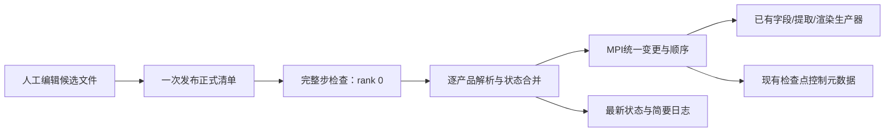

# ASTR 运行时后处理产品清单设计

日期：2026-10-29。分支：`feature/gpu_dev`。
状态：通用清单21项访谈决策及X2-0–8已完成本地实现与有界验收。
二维截面专项SL0–SL8证据见[验收报告](ASTR_INDEX_SLICE_ARCHIVE_VALIDATION_REPORT.md)，
完整家族的实际范围、错误边界及逐项证据见[执行记录](ASTR_INSITU_RUNTIME_PRODUCT_CATALOG_PROGRESS.md)。
完成的是既有提供器范围内的动态管理，不是任意工况组合或平台生产规模验证。
上位需求见[原位总计划第5.7节](ASTR_INSITU_POSTPROCESSING_PLAN.md)。
不操作平台作业，不启动长算例，不执行Git暂存、提交或推送。

2026-10-29后续授权：用户要求设立goal，完整推进剩余X2产品家族。
本地实施与收口已完成，分阶段状态见[执行记录](ASTR_INSITU_RUNTIME_PRODUCT_CATALOG_PROGRESS.md)。
2026-10-30：GPU索引面、物理面、Q及瞬时/Reynolds/Favre流线多实例在两条设备桥通过首轮，
包括同状态复用、热更/IO故障/精确续接及两种私有MPI传输。
四类图片的局部原生分配预检拒绝已验证只停用本实例，并由新请求恢复；
壁面节点CSV/图已通过首轮，含CURVE及AIR5压力代表；原SBLI物理中点、
M12动态图片/监控/精确续接及AIR5双温/五组分壁面截面已通过首轮。
GPU生产器的显式兼容消费者及原生VTK几何导出已接通，含四类图片、壁面图和几何的有界检查；
显式主机处理的TGV四类产品、已有平均及壁面代表已通过首轮。
后续已补齐安全局部拒绝边界、均值/壁面/SBLI代表、旧基础产品字段退役和当前启动入口迁移。
共享初始化、MPI失败、CUDA执行/上下文损坏及无法安全匹配的第三方分布式异常仍不可恢复，
不承诺捕获任意OOM。完整JSONL例、安装、能力表及成本观测已交付。
下文保留设计形成时的现状/缺口记录，不应将其当作最新待办。
下文原访谈中的“待审/尚未授权”是设计形成时的历史状态，不撤销本次明确授权；
仍不授权改变物理/求解器数值/统计定义或操作平台作业、Git。

## 1. 目标与边界

用户根据已有监控结果编辑并发布一份JSON Lines完整产品清单，在计算继续时
新增、修改、停用已有类型的后处理实例。配置错误按产品隔离，不能让一个坏条目
阻断其他产品或CFD。主流场、正式统计的定义及采样、边界条件和时间推进不因改图改变。

| 范围 | 本方案含义 |
|---|---|
| 产品类型 | 已实现的截面、探针、壁面曲线、Q等值面、流线及其已支持的数据来源/输出形式 |
| 多实例 | 同一类型可有不同ID、区域、字段、视角和频率，不再绑定为一组固定场景 |
| 工况 | 逐项复用已有准入范围；不把某类TGV或M12证据外推为任意边界、AIR5或CURVE组合 |
| 新算法 | 不支持从配置加载任意Python/CUDA算法、公式表达式或未知积分器 |
| 数据驻留 | 保持已批准管线的驻留边界，不因改图增加整场主机快照或隐式几何回读 |
| 统计 | 只消费已经开启且覆盖有效的统计；未开启时拒绝相关产品，已开启但未就绪时等待 |
| 重启 | 新版本只接受含动态清单状态的检查点，不做旧检查点兼容或迁移 |
| 发布范围 | 当前goal完整推进X2，分阶段证据见执行记录；已提交旧二进制的作业不自动获得新功能 |

2026-10-29补充：用户确认将固定全局i/j/k索引的二维截面数值存档纳入同一清单，
每实例独立指定位置、字段与频率，支持运行中新增、修改及停用。该通道不要求Catalyst，
允许所选二维字段下载写盘，不复用图片专用的“仅图像回读”限制，也不引入三维整场回读。
用户已确认清单为截面产品定义唯一入口，不保留旧`input.output`的`slices`定义与其双入口切换；
checkpoint及共享输出设置等职责保留。18项扩展决策及字段、文件布局、工况覆盖、续算与SL0–SL8
实现及检查范围已写入[截面存档专项计划](ASTR_INDEX_SLICE_ARCHIVE_EXTENSION_PLAN.md)。
数值文件允许二维载荷回读，图片通道的设备驻留合同不变。
当前工作区已接节点CSV和上述四类GPU图片，正式输入示例见
`scripts/output/input.products.tgv.images.example.jsonl`及壁面CSV例
`scripts/output/input.products.channel.walls.example.jsonl`；尚未接入的图像接口不能据schema解析成功视为可执行。

“壁面速度”必须说明分量与位置：静止无滑移壁面的切向速度为零，
吹吸壁面的法向速度可能非零；若观察转捩，使用明确离壁位置的速度截面/探针，
或已有壁面剪切、摩擦系数等量，不把固定网格索引当作任意曲壁的固定物理高度。

## 2. 完整产品家族的实施前缺口

下表保留访谈时的原始核查。当前数值通道与必要公共控制已按SL0–SL8实现，
其实际分工和证据见专项报告；完整图片家族仍需继续迁移。

| 当前源文件/入口 | 已确认现状 | 本轮需要的改变 |
|---|---|---|
| `src/insitu_session.F90::configure_session` | `session_checked`阻止会话内重复读取配置 | 拆开基础会话初始化与产品清单更新，不重复初始化统计或求解器 |
| `src/insitu_run_config.F90` | 整组Namelist解析，产品ID和可选配置由预设范围限定 | 保留基础后端设置；独立JSONL产品记录逐行解析，按类型要求显式完整参数 |
| `src/insitu_product_schedule.F90::configure_product_schedules` | 重置所有状态及停用表 | 增量更新实例状态，未改实例保留时钟、失败记录及缓存身份 |
| `src/mainloop.F90::steploop` | 完整推进后调用`sample_insitu_step`，随后进入完成步输出/检查点 | 在已有完整步原位入口处理更新；检查点记录本步已应用状态，不插入RK中间 |
| `src_gpu/insitu_products_gpu.cuf`、`src_gpu/insitu_device_products.cu` | 按固定profile选择捕获和设备提取 | 按实例类型与到期集合组织字段/算子需求，仍调用已有数值生产器 |
| `scripts/insitu/device_render_pipeline.py` | 存在固定产品名与M12家族联动，例如一个切片触发其他固定视图 | 渲染以实例ID定位对象、以类型分派，不给每个新区域增加硬编码分支 |
| `src/insitu_product_failure.h`、`scripts/insitu/product_dispatch.py` | 已有局部错误归约、产品停用和设备健康边界 | 复用明确安全边界，不把分布式算法错误当作单rank普通异常吞掉 |
| `src/insitu_session.F90`原生控制文件、`src/output_runtime.F90` | 已有`insitu_control.bin`，但不包含通用动态实例的完整定义与运行历史 | 新格式始终写入必要动态状态，包括空清单；恢复先检查小型格式头 |
| 根/`src/CMakeLists.txt` | 主工程先启用Fortran；Catalyst配置才启用C++等依赖路径 | JSONL控制层须在CPU/Catalyst OFF也可用，不假设VTK附带的JSON库始终可链接 |

因此可行，但不是给`input.insitu`增加一个重复读取调用。主要工作是实例化产品、
保留各自历史以及把控制状态和GPU资源所有权分开。
尤其不能让旧固定profile在目录之外继续隐式出图：新机制下所有实际执行产品都必须
有对应实例。原profile代码可作为内部数值生产器复用，但不是参数继承模板或第二份活动产品清单。
旧示例的产品定义需在X2-8迁入显式JSONL；基础Namelist继续负责后端/统计等设置。
完整图片家族的迁移进行中；数值截面、节点CSV与上述设备图片共用清单和控制状态。

## 3. 文件与参数规范草案

### 3.1 基础配置与产品文件

基础配置保留统计、GPU/MPI后端、Catalyst依赖、资源预算和输出根目录。
拟增加正式产品文件路径、检测步数间隔和状态文件路径；默认检测间隔为10完整步。
产品清单拟命名`datin/insitu_products.jsonl`，状态文件拟置于输出根目录下
`products.status.json`。这些字段名/路径作为接口草案在X2-0最终固定。
每次检测只消费当时观察到的正式清单；两次检测之间多次发布时，未被观察到的中间
清单不作为已生效版本回放，启用请求号跨过多个值也只对最终请求作一次处理。

每条产品JSON必须自足，不使用模板或继承。共享基础设置不重复到产品中，
程序生成的版本、实际生效时间和错误状态也不要求人工填写。
只校验本类型及输出通道实际需要的参数，不要求探针提供相机等无关字段。

### 3.2 JSONL记录及边界

拟采用一个固定格式头，随后每行一个产品，读取到文件末尾；不添加尾标记、产品总数或CRC。
格式头不是产品，编辑产品时不必修改它；仅保留合法格式头就明确表示空目标清单。
候选文件完成后一次原子发布，读取已打开的同一文件版本，不额外等待文件“稳定”。
以下是格式草案，不能直接用于当前二进制：

```jsonl
{"catalog_schema":"astr-insitu-products-v1"}
{"id":"nearwall_u","kind":"slice","enable_request":1,"source":"instantaneous","field":"u_Uinf","sampling":{"mode":"physical_plane","origin":[0,1,0],"normal":[0,1,0],"bounds":[0,300,1,1,0,90]},"display":{"projection":"parallel","camera":[150,-1799,45],"focal_point":[150,1,45],"view_up":[0,0,1],"parallel_scale":55.8,"color_map":"diverging_blue_red","color_range":[-0.05,1.05],"lighting":false},"output":{"channel":"image","formats":["jpeg"],"image_size":[5120,1536],"jpeg_quality":95,"dpi":300},"schedule":{"mode":"steps","interval":100,"events":[],"windows":[]}}
```

该例说明完整参数形式，不是新的物理验证：`u_Uinf`须由已有工况字段登记表确认其
参考速度和归一化；显示色图标识由已有色图实现映射，不另造数值诊断。
上述参数描述全局物理平面和显示范围，不是rank局部坐标。具体所需字段由X2-0逐类型核对。

- 仅有合法格式头、没有产品行，是主动停用全部产品的有效空清单；零字节文件不是。
- 先完成文件读取及格式头识别，再应用条目；缺头、格式无法识别或读取失败时按D12保持当前状态。
- 中间每个非空行独立解析。一行坏JSON只拒绝该行，不吞后续行，不进行跨行JSON拼接。
- 能识别的产品ID用于定位错误；语法破坏到ID不可识别时报告行号，不猜测它属于哪个产品。
- 完整清单语义仍成立：不再有有效或可识别目标记录的旧产品按D11停用，不保留隐形活动实例。
- 重复ID涉及的条目视为该ID的配置错误，不默认先者或后者覆盖；其余ID继续。
- 缺必需参数、未知字段、无法表示的数值或不支持的类型/组合均记录到该产品，不静默补齐或夹紧值。
- 显式空行可忽略；不引入自定义注释、表达式求值或脚本加载语法。

这些规则是待审schema细化，不是新的运行保护上限，不新增全场CRC、写后回读或任意产品数量测试围栏。

### 3.3 参数分类

| 参数组 | 内容 | 对身份的影响 |
|---|---|---|
| 实例身份 | 唯一`id`、已实现`kind` | ID用于匹配前后实例；不是路径或算法名称 |
| 观测定义 | 字段、已有瞬时/Reynolds/Favre来源、几何、已有归一化/参考系选择 | 变化产生新的定义版本；不允许借此重置统计 |
| 提取定义 | Q阈值、已实现种子布局/坐标、RK45参数及已有停止条件 | 变化产生新的定义版本，所需数值链重新提取 |
| 显示/输出定义 | 相机、色图、色标、分辨率、照明、已有输出通道/格式 | 变化产生新版本，但同相位相同提取定义可以共享几何 |
| 调度 | 步数或物理时间间隔、已登记事件/窗口关联 | 只改频率不改变定义版本，按实际输出锚定 |
| 人工启用 | 正整数`enable_request`，如1增为2 | 是操作请求，不是定义版本；消费后不因重复发布而重试 |

相同语义的字段顺序/空白变化不生成新版本。定义比较用解析后的类型化结果，
不以JSON原文不同、文件修改时间或整场校验和代替定义比较。
启用请求号相同或回退只表示没有新启用操作，不能单独导致正常产品停用；
不能表示为接口整数的请求值则属于该条目的参数错误。

### 3.4 各产品的必要参数

| 类型 | 需要明确的内容 | 不应引入的行为 |
|---|---|---|
| 截面 | 已支持字段/来源；全局网格索引面或物理平面；截取/显示区域；完整显示与时钟设置 | 不把固定j误称固定物理高度，不自动改为最近网格面 |
| 探针 | 已支持采样方式、全局节点或已有定位方式、字段、数值输出与时钟 | 首轮复用已有探针记录；不凭此宣称已实现新的在线历史绘图或任意曲线定位算法 |
| 壁面曲线 | 物理壁面/方向、已支持量及参考尺度、已有空间归约方式、范围和通道 | 不假定任意方向统计均匀，不修改摩擦或热流定义 |
| Q等值面 | 原Q定义、明确阈值、区域、颜色字段、显示及输出时钟 | 不改变梯度公式/归一化；Q=0不能自动称为涡核 |
| 流线 | 已实现的速度来源、种子与积分/停止参数、颜色字段、完整视图和时钟 | 不把瞬时流线变成含时粒子轨迹，不自动周期回绕或改种子数量 |

JPEG/EPS仍属于同一图像通道；数值CSV、兼容几何导出按既有能力单独登记通道/实例及时钟。

几何控制接口现采用`output.channel="geometry", format="vtk-xml"`，以显式`fields`选择
已有字段，不带`display`或着色`field`。仅适用于已有截面、Q和流线几何，
不借此增加三维体场存档或新的量定义。现已在显式兼容消费者接入原生多字段、
VTK XML逐rank分片和根清单写出、已有参考/单位/完整步元数据。
流线保留原种子身份、积分方向、已接受长度和终止元数据，不重新积分或全局拼线。
安全写出失败只删除本帧自己创建的文件并停用本实例，须新请求恢复；不新增CRC或写后回读。
两个严格设备入口明确拒绝该几何出口，不能静默切换到兼容回读。

显式主机处理继续使用原CPU诊断及VTK提取器，不改为设备入口的隐式后备。
其流线导出保留VTK原生`IntegrationTime`和`ReasonForTermination`，不是设备积分器的接受弧长/终止枚举。
两者均保留种子ID、方向、完整步相位、源和单位。具体生产后端写入帧元数据；
不同生产后端不承诺相同三角化/顶点顺序，同后端精确续接另行检查。

当前壁面CSV首轮使用已有壁面节点量，`sampling.mode=wall`、`axis=j`、`side=lower/upper`，
并显式指定全局`spanwise_index`及物理`bounds`。这是取节点线，不是展向平均，
也不替代原SBLI的物理展向中点插值曲线。壁面图使用`display.y_range/line_width`，
不要求三维相机，复用已有少量主机曲线编码器；三维ParaView设备管线不变。
ROI保留原节点邻接，不跨被排除节点连线。原生控制内层为`ASTRRC04`，外层仍为`ASTRIR07`，
不推测旧实验版本缺少的明确采样参数。瞬时CSV无需启用统计或渲染；均值仍只消费已开启的`wall-time`。
若同一帧多个实例共享数值提取，使用提取键复用，不能通过捆绑显示强迫它们共享频率。
严格设备驻留管线不因请求不支持的几何导出而偷偷改走主机桥接。
EPS关闭体现在示例中显式只写`formats:["jpeg"]`，不是省略格式后的隐藏默认。

## 4. 运行与状态转换

### 4.1 目标数据流

以下是目标架构，不是当前调用图。



在`sample_insitu_step`入口、任何禁用状态的提前返回之前加入控制检查。
此时CFD完整步已结束，尚未决定本步产品集合；保持已有正式统计采样顺序，
然后按更新后的到期集合供给字段/提取产品。完成步检查点写出位于其后，
因此保存的是本步实际应用并处理后的状态，不在写检查点时重新读取磁盘清单。

空清单不妨碍后续检测与新增。管理器本身不依赖ParaView；
图片产品仍要求启动时基础后端和依赖已配置可用，不从产品行热更GPU/MPI或动态库路径。

### 4.2 按实例合并，不重建全部会话

| 情况 | 处理 |
|---|---|
| 文件无变更 | 不重新解析、分配采样场或渲染；只承担周期性小型检测/同步 |
| 新ID | 验证本类型必要参数，创建实例；就绪后首帧 |
| 定义变化且实例允许运行 | 新定义版本；保留旧输出；只失效受影响提取/显示资源 |
| 仅调频 | 保留定义版本和必要历史；按D14计算下一输出，不补帧 |
| 未改条目 | 保留时钟、失败等待、启用请求消费状态和可复用资源 |
| 从清单移除 | 停止输出并释放其私有资源，保留恢复所需的最小ID/版本历史 |
| 可识别错误条目 | 停用该ID或跳过无旧实例的新ID；处理其他行 |
| 正式文件级错误 | 保持当前实例状态，不把读取失败当空清单 |
| 统计尚未覆盖 | 有效实例等待，不制造平均量或成功帧 |
| 资源不足且可安全隔离 | 停用本实例，记录原因，不自动重试或降质量 |
| 更大的启用请求号 | 消费请求，明确恢复目标实例并安排首帧；定义未变时保留版本 |
| 失败的相同启用请求再次发布 | 不重试；其他合法修改仍处理 |

资源停用与配置无效必须区分：修正无效记录后按D07恢复，
不能给配置修正附加一次无关的启用请求门槛；合法记录的资源停用则按D21显式恢复。
必要控制历史随检查点保留，不能删除后重新加入同一ID便倒退版本号或覆盖旧序列。

控制状态只设一个权威持有者：扩展`insitu_product_schedule`集中持有有效定义、
版本、生命周期、已消费请求及输出时钟；`insitu_catalog`负责文件检测、候选解析、
调用合并和反馈，不另存一份可独立变更的活动目录。共享类型放在既有配置层，
避免配置、清单和调度模块相互循环依赖。资源拥有者只持有派生对象，不成为配置权威。

### 4.3 MPI与GPU所有权

rank 0先处理文件级完整性，再逐行解析并生成类型化变更；按稳定ID形成所有rank一致的顺序。
广播小型控制数据，不让每个rank重新访问共享文件，不传GPU指针或带未初始化padding的原始结构。
所有rank参与一致的接受/停用决定，未拥有新区域数据的rank提供合法空贡献，不能跳过其集体调用。
读取期间再次发布时，当前读取仍对应已打开的文件版本；已处理标识必须对应该版本，
不能把稍后替换到同一路径的新文件误标为已处理。下一次检测继续发现后一次发布。

同一完整步按需求键合并字段、梯度/Q、相同流线积分或几何提取，再分别显示。
跨不同完整步的瞬时结果不能作为缓存复用。只改变相机/线宽/色标不能在同一冻结状态重复积分流线。
复用IM阶段的分组生成/渲染/退休，释放旧私有资源前须确认无未完成使用，
共享字段和几何按所有消费者维护生命周期，不能因停用一张图破坏其他图。

可捕获产品错误必须在匹配的MPI汇合点统一处理。损坏的CUDA上下文、MPI失效、
原求解器数值故障和不能证明安全隔离的共享初始化错误不属于“坏配置跳过”保证。
生产产品错误隔离也不放宽本地验收的实际资源上限；两者是不同约束。

## 5. 重启与反馈

新检查点始终保存合法动态控制状态，包含空清单。最小内容包括：
当前有效/停用/等待实例定义、定义版本、必要ID版本历史、已消费启用请求、
最近输出与失败尝试、待首帧、产品/PF/AP时钟及下一检测所需状态。
不保存GPU缓存、完整几何、图像或第二份流场。

保存到既有`insitu_control.bin`的新版本布局，主流场文件不增加产品副本。
恢复开始先读取必要小型格式头，拒绝缺动态状态的旧格式，不做兼容猜测或旧状态迁移，
也不以`exact_restart=f`绕过格式要求。正常写完关闭即可，不新增写后回读、CRC或逐场校验。

恢复后以所选检查点的实际状态为准。记录当前正式文件的观察基线但不将其内容自动覆盖恢复状态；
用户再次发布后才接受更新。同样语义下重复发布不重置未改实例，不因重启重复首帧。

最新状态文件只反映最近控制事件：更新时间、当时完整步/物理时间、产品ID、状态、
有效版本、输入错误行号/原因和对应已消费请求。只在变化时由rank 0原子更新。
它不是重启依赖，也不能单独证明进程还活着；写反馈失败只报告失败，不能伪造更新成功。
完整版本定义随对应输出保存一次以供追溯，不每帧重复写整份目录。

拟提供无常驻服务的辅助工具：检查/报告条目错误、原子发布、递增指定ID的启用请求。
发布工具不能因为一条产品错误就阻止所有合法产品提交；文件级结构损坏须明确报告。
不由辅助工具操作Slurm、GPU作业或求解器时间步。

## 6. 文件与依赖责任

| 责任 | 现有或拟新增位置 | 限定 |
|---|---|---|
| 定义类型/有效状态 | `insitu_run_config.F90`类型与`insitu_product_schedule.F90`有效注册表 | 只有一份有效状态/时钟，不按产品种类复制控制系统 |
| 候选清单与合并协调 | 拟新增`src/insitu_catalog.F90`，调用调度注册表API | 不创建第二份活动目录，不依靠启动函数重置所有状态 |
| JSONL解析 | 拟新增独立宿主解析适配层 | 结构化JSON库、固定版本/许可；优先静态编译的C接口以复用现有构建条件，不依赖VTK私有JSON或每步外调Python |
| 配置/广播 | `insitu_run_config.F90`、`insitu_config_collective.F90` | 基础设置不热变；元数据按类型广播 |
| 完整步/统计/恢复 | `insitu_session.F90`、`output_runtime.F90`及根CMake | 必需空状态可在Catalyst OFF写读；不重写CFD推进框架 |
| 设备供给/提取 | `insitu_sample_gpu.cuf`、`insitu_products_gpu.cuf`、`insitu_device_products.cu`、`insitu_plane_products.cu`及已有产品头文件 | 从profile分派解耦实例ID，沿用已验证数值生产器 |
| 两条驻留桥接 | `insitu_device_geometry.h`、`insitu_mesh_adapter.cpp`及设备Mapper/数组桥 | 实例身份与类型分离；不重新发明渲染器 |
| 渲染/故障 | `device_render_pipeline.py`、`product_dispatch.py`、`insitu_product_failure.h` | 独立实例与时钟，安全错误集体处理，不再隐式捆绑M12固定视图 |
| 用户工具与示例 | `scripts/insitu/`及正式使用说明 | 示例显式完整，无模板填补或自动质量降级 |

当前未确认已有可复用的常开宿主JSON解析依赖。X2-0必须固定库、许可和编译方式，
先证明CPU/Catalyst OFF可构建；若需要额外安装或改变部署假设，应先报告，
不把未核实依赖当作已存在。所有正式构建均通过根`CMakeLists.txt`。

## 7. 分阶段执行与验证草案

当前进度：X2-0数值schema及静态解析依赖、X2-1至3必要公共控制已通过本地检查；
X2-4数值截面子集和对应X2-7/8验证/交付由SL0–SL8完成。
完整家族仍在逐类接入，当前已通过的子集见执行记录；以下保留全部交付范围与依赖，
不将数值子集的证据外推为所有家族通过。

| 步骤 | 交付与依赖 | 最小验证 |
|---|---|---|
| X2-0 规范与依赖 | 固定JSONL格式头、各类型必需字段/单位、输出通道、状态与解析库；从生产器导出实现/验证能力表，区分真实依赖与测试围栏 | 纯宿主逐行解析；坏行后好行、重复/缺ID、类型错误、坏格式头、显式空清单；无GPU/ParaView也可构建 |
| X2-1 清单状态机 | 类型化定义、定义版本、完整替换、调频、统计依赖和启用请求；依赖X2-0 | 合成控制序列逐值检查，不新增Python流动推进器；未改实例状态不变、无旧帧伪造、失败不当成功 |
| X2-2 检测与MPI反馈 | 默认10完整步检测、根读取、共同决定、发布/启用工具和最新状态；依赖X2-1 | NP1/2/4合成元数据、单rank无区域、读取期间再次发布、重复发布/请求、文件错误与反馈失败；不测试长CFD |
| X2-3 新检查点合同 | 始终保存清单/空状态、消费请求、停用/等待与时钟；依赖X2-1/2 | 小型控制状态往返、新旧格式拒绝、未启用渲染时无大分配；现有控制文件扩展，不增加附属文件 |
| X2-4 二维与监控 | 通用截面实例、已有探针/壁面量，独立参数/时钟；依赖X2-0至3 | 小TGV/已有壁面与平板夹具，新增/改版/移除、零区域rank、坏产品不影响好产品，CPU/GPU已有量一致 |
| X2-5 Q实例 | 复用已有GPU Q和等值面，分开阈值/颜色/视角；依赖X2-4 | 同步静态参考；同相位同提取多视图只提取一次，换阈值新版本，保持驻留与实际分配/传输记录 |
| X2-6 流线实例 | 已有瞬时/Reynolds/Favre来源与种子/积分参数；依赖X2-4/5 | 同状态静态对照、跨rank、只变显示不重积分、改变种子/速度需重积分、缺平均依赖不降为瞬时 |
| X2-7 续算与故障闭环 | 动态清单纳入真实连续/重启和错误生命周期；依赖X2-3至6 | 小TGV同拓扑12与5+7，恢复定义/时钟/消费请求；可隔离资源失败停用、其他产品/CFD继续，代表双rank memcheck |
| X2-8 成本与文档 | 各产品类型的完整JSONL示例、输入接入说明、能力矩阵与本地规模报告；依赖前项 | 对比无产品/不变清单/变更/实际出图的成本与传输；不强设提速门槛，不用大生产作业替代接口短测 |

真实短测先用已有32³ FP64 TGV、CPU/GPU、NP1/2及已验证壁面夹具。
数值截面通道的字段、邻域计算及独立文件验收另由SL0–SL8负责，依赖X2公共控制层，
但不要求先完成X2-5/6的Q等值面与流线产品扩展。CPU/Catalyst OFF仍须可用。
NP4可先用纯控制探针或本地双卡共享，只验证一致性，不称四卡性能。
数值提取沿用相应产品已批准的门槛；已有FP64同相位量以2e-10级门槛核对，
不同精度不套同一绝对阈值，图像不机械套用场差阈值。

同后端、同算例的清单开/关及仅控制变更，不得改变权威流场或正式统计数组；
使用已有小网格保存数组逐值比较，不新增全场CRC。实际续算还须核对产品身份、
覆盖时长/输出序列和已消费请求一致，不能仅以“跑完”认定精确恢复。

沿用相应既有本地短测资源预算，先控制元数据后GPU产品；预算不当作生产默认。
文档更新不重跑长期物理算例；需要扩大尚未批准的规模/资源、增加新数值生产器、
进行平台部署或改变物理定义时单独提出，不自动执行。

## 8. 审阅与完成标准

需求选择以总计划D01-D21为准，本文schema与步骤待用户整体审阅后才进入实现。
完成必须同时具备：各已纳入产品/后端的实际接入证据、坏条目隔离、正确版本/调度、
新检查点闭环、求解/统计无副作用、驻留/内存检查和明确成本。
不以JSON解析、单一TGV或一个后端通过宣称任意M12、CURVE、AIR5和所有规模完成。
当前没有新增代码、GPU运行、Git提交或平台操作，原HB系列goal仍保持用户暂停状态。
