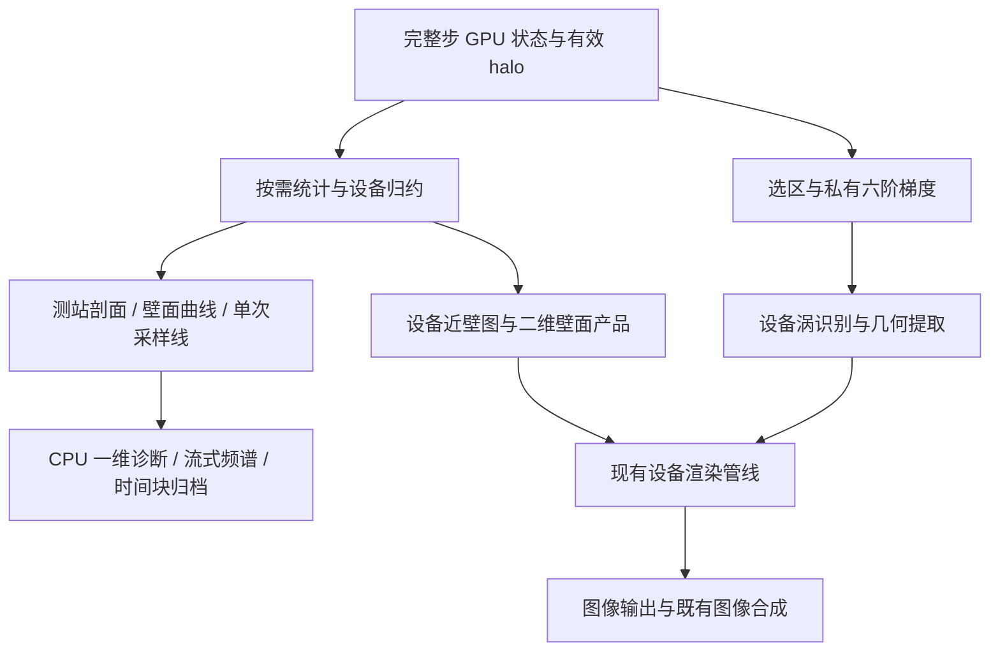

# 湍流边界层原位后处理产品扩展计划

日期：2026-11-02。分支：`feature/gpu_dev`。
状态：D01–D42 需求访谈已收口，2026-11-02 用户已授权建立 goal 并开始 TB1–TB4 本地实施。
实施与验收状态见[进展记录](ASTR_INSITU_TURBULENT_BOUNDARY_LAYER_PRODUCTS_PROGRESS.md)；Git 和平台任务不在实施授权内。
最新授权：2026-11-03 用户批准 §16.1 数值规格后，明确取消本轮人为资源
预算上限。以下 12/14/16 GiB 等数额只保留历史，不再作为新验收运行的
限额或扩容审批门槛；监测继续，真实硬件分配失败、数值和驻留合同仍检查。
2026-11-03 补充确认：本轮证据磁盘预算为 12 GiB，保留已有证据；D14 的
外流带使用真实壁法向梯形长度权重，rho_e/p_e/T_e 为 Reynolds 均值的长度
平均，U_e=sum(w*rho_mean*u_Favre)/sum(w*rho_mean)，单节点直接取值。
边缘黏度采用算例关系 mu(T_e)，明确为均值状态物性，不是 mean(mu(T))。
以上局部参考不改变固定自由来流 Cf/Cq 分母。
2026-11-03 后续确认：为修复 CSV 三位指数输出并完整重验 SBLI，证据总磁盘
预算由 12 GiB 提高为 14 GiB，保留全部旧证据；网格、步数、显存与主机
内存预算不变。该数值不是生产运行默认预算。
同日 TB2.1 已有固定 j 脉动数值通道、TGV 双设备后端出图及小型 SBLI 数值
矩阵记录；采用产品级 `fluctuation=true`、`source=reynolds/favre` 与
`statistics_source=selected-time`。TB2 整阶段未关闭，壁面二维矢量/剪切线、
TB3 和 TB4 仍待实施，详细验收边界见进展记录末节。
随后补接 TB2.2 的二维瞬时/平均完整壁面标量足迹；不作展向归约。已有
小型 SBLI 七拓扑数值矩阵、M12 原随机吹吸二维保持检查、精确续算和两类
设备后端出图证据，不以标量云图替代矢量或剪切线。
TB2.2 随后补齐瞬时/平均剪切矢量箭头的首轮有界实现与矩阵。
采用显式全局 i/k 间隔和原生坐标中的
固定箭杆长度，颜色为所显示矢量的模；真实零值不画箭头，显示放大只对
箭头头部作形状补偿。共享/周期节点去重、MPI 接口选区末点、精确续算、
字段/最终几何零回读已有通过记录；仅回读六个坐标范围标量及小型控制量。
这不是流线积分，TB2.3 剪切线和后续 TB3/TB4 仍未完成。
随后 TB2.3 接通 `wall_shear_lines`：真正二维求值、严格壁面 RK45 与原流体
共用粒子/MPI/几何驱动。已完成 §16.1 获批本地矩阵、真实壁面供给、双设备
后端图片、精确续算与动态缺口检查；实现限定非反应 FP64 笛卡尔底壁，
本轮真实流动验证采用 bc41 的 GRCBC 夹具。
该短测不证明生产 SBLI 物理发展充分，TB3/TB4 仍未完成。
上位计划：[原位分析与批量可视化](ASTR_INSITU_POSTPROCESSING_PLAN.md)。

2026-11-03 保存工作区状态：TB3 已有瞬时判据、索引选区和设备等值面候选，
但精确续算在 `native dynamic-product control tail` 处失败，尚未关闭 TB3。
TB4 尚未实施。用户已暂停 goal；具体通过项、失败记录和待验收范围见
进展记录末节，不以候选接线或构建成功替代阶段验收。

2026-11-04 用户建立新 goal 继续完整已批准范围。TB3 已定位并修复
`volume_index` 在动态清单恢复校验中的遗漏，当前新输入/新检查点的精确
续算、开关、动态清单、共享采样后数值/双管线矩阵、真实 NP4 内存检查及
成本记录通过，首轮本地 TB3 收口。TB4 开始组件实施，真实采样/存档/统计
续接尚未交付；按需时间统计独立服务仍待讨论，不恢复 grill。

同日 TB4 已接通固定索引线/探针的独立完整步采样、时间块 CSV、流式 Welch、
既有 statistics.h5 持久化以及两设备管线的小型主机结果绘图。七拓扑
CPU/GPU 数值、精确恢复和对应图片已有本地通过证据。随后补齐动态缺采/
共享连续采样、真实自动步长时间轴、单产品写盘失败与人工重新启用、动态
分块/段长变更、单位/参考状态及成本记录。2026-11-04 用户选择 A：Welch
只使用 D04 公共统计窗内的实际完整步样本，不插值或补边界样本；原始探针
存档开关及时间块历史不改变。窗外不更新谱，已有谱仍可按产品频率发布。
该语义的窗口边界、动态采样、精确续算及当前格式集成检查已通过，TB4 首轮
本地范围收口。均值/脉动索引线的实际覆盖元数据和
CPU/GPU 数值、精确续算已补齐，不据此放行均值时序频谱/图片或更宽动态
累计器身份组合。不保存统计的检查点恢复后新历史已有 CPU/GPU 代表性通过记录。
瞬时产品的短窗通过不替代其他门槛；
实际证据与剩余项见进展末节。独立按需时间统计服务仍暂不执行、不恢复 grill。

2026-11-04 当前交付：TB1–TB4 已批准首轮本地范围完成。TB1 的坐标/剖面/
完整壁面量/参考标度/厚度，TB2 的脉动/壁面足迹/矢量/剪切线，TB3 的瞬时
涡识别与选区，TB4 的时间块/公共窗 Welch 均有实现和对应数值、生命周期及
成本证据。该结论不扩展生产规模、长时统计定常、其他壁面家族及全部可选
组合；AIR5、CURVE、FP32 和半局部尺度仍按原决定后续推进。旧暂停/失败/
待确认记录保留为时间线，不作为当前状态。详细闭环见进展末节。

## 0. 访谈方法

用户要求：后续类似涉及物理定义、统计处理或算法选择的访谈，先查询已有
论文或公开方案，提供可核查来源、采用的定义及适用条件，再提出项目建议和
待决策问题。能由现有代码直接查清的实现事实，不转交用户猜测。
区分文献明确采用的方法、由方法推出的结论及本项目的工程候选。
发现先前表述过于绝对时明确修正；不把查询视为用户批准，也不静默推翻已确认决策。

## 1. 目标产品

用户选择补齐前次审查中优先级为“最高”和“高”的产品：

1. 物理坐标刻度、长度标尺及必要图像标注。
2. 指定测站的平均量、RMS、Reynolds/Favre 应力剖面。
3. 传统壁面单位和网格分辨率诊断；半局部尺度按 D31 延后扩展。
4. 边界层厚度、位移厚度、动量厚度、形状因子和雷诺数。
5. 定义明确的近壁速度、压力和温度脉动图。
6. 二维壁面足迹、壁面剪切矢量及剪切线。
7. lambda2 和 lambda_ci 涡识别及相关可视化。
8. 时空图及功率谱。

首轮需求、定义及验证口径按下述决策冻结，工程任务和验收矩阵见第 15–18 节。
尚未实施或验证的产品不得标为已支持。已有统计累计、图片、截面数值存档及动态清单继续保留，
不重新实现已有功能，不将数据字段存在等同于完整产品已经可用。

## 2. 已确认决策

| 编号 | 问题 | 用户决定 |
| --- | --- | --- |
| D01 | 首轮是否同时纳入 AIR5 双温五组分 | A：首轮完成非反应平板/SBLI；产品接口通用，不硬编码 M12。AIR5 后续单独扩展和验证，已有 AIR5 产品不受影响。 |
| D02 | 首轮网格范围 | A：支持笛卡尔网格，包括非均匀与拉伸网格；静态 CURVE 后续扩展，预留几何接口，不削减已有 CURVE 产品能力。 |
| D03 | 小型结果的 CPU 处理边界 | A：三维场、派生量与大规模归约留在 GPU，沿用设备渲染且不新增三维场或最终等值面几何回读。允许测站剖面、壁面曲线、有限探针时序等一维结果下载到 CPU，完成一维频谱、绘图和小型结果写盘；时序存储见 D27/D40，资源安排见 D42。 |
| D04 | 正式时间统计窗口 | A：新产品共用一套正式统计起止时间，按需组织区域和字段并尽量共享累计；各产品输出频率独立。不要求累计完整三维场。2026-11-04 进一步确认 A：Welch 输入仅采用实际时间位于该闭区间内的完整步样本，不插值或补采边界；原始探针存档和时空图历史保持各自启用范围。频谱分段见 D25/D27，动态新增产品的实际覆盖见 D24。 |
| D05 | 常用测站剖面的空间处理 | A：固定流向测站，模板显式配置展向物理长度平均，汇总逐点时间统计得到壁法向剖面。RMS 先汇总局部方差再开方，应力汇总局部应力，不加入展向平均场差异产生的附加脉动项。局部截面图仍保留展向结构；未配置空间平均时保留逐点结果。Favre 权重组合见 D06。 |
| D06 | Favre 剖面的展向密度权重 | A：均值采用 `U_F=<rho_mean*u_F>_z/<rho_mean>_z`；应力归约各点密度加权的局部时间协方差，Favre RMS 从对角应力除以展向平均时间均密度后开方。展向归约使用物理长度权重，不加入各点时间均值相对组合均值的空间差异项。该 RMS 是局部时间脉动强度的密度加权汇总，不冒充相对单一时空均值的总方差。 |
| D07 | 壁面单位的参考量来源 | A：每个测站以共用统计窗口内的时间、展向平均壁面剪应力、密度和黏度建立统计参考标度；剖面、应力归一化及网格分辨率诊断共用，不采用瞬时局部标度后再平均。剪应力取模、分离及近零处理见 D08。 |
| D08 | 分离及反向剪切区域的壁面标度 | A：摩擦速度以平均壁面剪切矢量的模及平均壁面密度定义，先平均矢量再取模，不以平均瞬时模长替代。流向剪应力和 Cf 保留符号；反向区域可保留尺度诊断，但不作为平衡对数律验收区域。平均矢量为零或浮点归一化无法安全计算时，标记对应标度不可用，其他产品和主计算继续；不截断剪应力，不自动换用入口参考值。 |
| D09 | 新壁面剪切产品的物理定义 | A：从完整黏性应力张量构造壁面切向剪切矢量，不将无穿透平板的法向速度梯度简化式作为通用定义。笛卡尔底壁流向分量包含 `mu_w*(du/dy+dv/dx)`，展向分量同样保留法向速度的切向导数，覆盖空间变化的吹吸。新产品标识定义；既有简化输出单独审查，不静默覆盖，不改变求解器。 |
| D10 | 壁面热流的组成及正向 | 确认 A：主产品采用傅里叶导热，正值为热量流入固体。令壁面法向从固体指向流体，则 `q_into_wall=kappa*grad(T) dot n_wall_to_fluid`。吹吸携带的焓/动能、黏性功及流体内湍流焓通量不混入该字段，总能量收支另行定义；归一化见 D11/D12/D34。 |
| D11 | 主壁面系数的参考状态 | A：使用算例输入指定的固定自由来流参考，`Cf=2*tau_w_streamwise/(rho_inf*U_inf^2)`、`Cq_inf=q_into_wall/(rho_inf*U_inf^3)`；Cf 保留符号，原始量同时保留。局部边缘参考不得隐式替换主分母；Stanton 数参考及统计口径见 D12/D34。 |
| D12 | Stanton 数的恢复温度来源 | A：算例显式提供恢复温度 Tr 或恢复因子 r；二者为互斥的参考输入形式。首轮理想气体由 r 计算时采用 `Tr=T_inf*[1+r*(gamma-1)*Mach_inf^2/2]`。不自动判断层流/湍流或填入经验恢复因子；未提供参考时不生成 Stanton 数，其他产品继续。 |
| D13 | 测站定位 | A：采用全局网格索引指定流向测站并记录真实物理坐标，不依赖 MPI 分区编号。可用辅助工具将期望物理位置匹配至最近网格面并交由用户确认；运行时不插值，也不把实际网格位置标成用户期望位置。 |
| D14 | 边界层积分诊断的外流参考 | A：每测站显式指定壁法向外流参考节点区间，从统计剖面提取 rho_e、U_e、T_e、p_e；参考带按算例选择在外流平台并避开激波和海绵层，不默认使用顶面值或剖面最大速度。该局部参考用于厚度和积分参数，不隐式替换 D11 的固定自由来流系数参考。 |
| D15 | 非单调剖面的速度厚度识别 | A：以 Favre 平均流向速度达到 0.99*U_e 为判据，从显式外流参考带向壁面回查，取与参考带连续相连的外流区域内边界，避免任取内部局部过冲的第一次跨越。保留多交点标志；无有效跨越时只将该厚度诊断标为不可用，保留剖面，不平滑/截断速度，不终止 CFD 或其他产品。 |
| D16 | 位移/动量厚度的积分上限 | 确认修订 A：支持积分至 delta99 和显式外流上限两种明确区分的口径，常用文献对照模板默认 delta99；保留显式上限及累计积分诊断以检查上限敏感性，不默认将人工外流参考带下缘当作普遍标准。记录平均方式、边缘参考、上限与真实坐标；在已提取的一维剖面上处理，不新增三维统计副本。 |
| D17 | 首轮涡识别的速度场 | A：lambda2 和 lambda_ci 使用瞬时真实速度的完整三维物理梯度；不默认扣除均值，不以脉动速度或均值速度场替代。均值/脉动场判据须另行明确命名、定义并扩展，当前不纳入首轮。 |
| D18 | 涡识别阈值与尺度 | A：用户显式指定阈值，跨帧固定；支持原生单位或固定参考尺度归一化，`lambda2_star=lambda2*(L_ref/U_ref)^2`、`lambda_ci_star=lambda_ci*L_ref/U_ref`。可预览比较若干阈值后选定，不预设通用最佳数值，不逐帧按 RMS/分位数自动改变，不修改已有 Q=0 产品。 |
| D19 | 涡识别计算与提取选区 | A：支持显式全局索引选区，尽量在场量计算和等值面提取前缩小范围，也允许显式全域。保留网格原始分辨率，读取框外必要模板邻域；人工选区边缘不当作物理边界，不改变求解器或梯度闭合。与全域计算后裁切作一致性检查，实际显存和耗时收益另测，不把显示裁剪等同于提取优化。 |
| D20 | 图像坐标轴呈现 | A：二维截面显示对应的两根坐标轴及数值刻度，三维图显示包围盒坐标轴及数值刻度；默认关闭背景网格线，允许按产品隐藏坐标轴。方向轴不替代长度刻度，坐标单位及归一化见 D21。 |
| D21 | 坐标单位及归一化 | A：默认沿用算例原生坐标，明确标注有量纲或无量纲；每产品可显式指定固定参考长度与原点，以如 `(x-x0)/L_ref` 的形式显示刻度。参考值跨帧固定，不自动采用随时间变化的边界层厚度；仅改变刻度表达，不拉伸几何，不将随流向变化的局部 y+ 直接标成整幅截面的统一线性纵轴。 |
| D22 | 细长计算域的显示比例 | A：默认保持真实几何比例；允许按产品显式设置壁法向等显示放大，并在图中标明倍数，坐标刻度仍对应真实坐标。只作用于显示，梯度、涡识别、流线积分及数值存档均使用原始几何；不从拉伸图直接判定真实结构长宽比或倾角。 |
| D23 | 近壁脉动图的均值来源 | A：使用共用正式统计窗口内、截至出图时刻已累计的局部时间均值。速度明确区分 Reynolds 脉动 `u_prime=u-u_mean` 与 Favre 脉动 `u_double_prime=u-u_favre`；压力、温度首轮采用 Reynolds 脉动。记录实际统计覆盖区间，窗口结束后均值固定，不将在线累计均值冒充未来完整窗口的最终均值。统计发展不足时，均值漂移仍可能影响脉动图，不据单帧图宣称统计收敛。 |
| D24 | 动态新增产品的统计历史 | A：已有定义、区域和采样一致的统计时复用；否则从产品生效后开始累计，明确标注实际起止时间及未覆盖完整窗口。不回放历史，不清空其他产品统计；组合诊断只使用覆盖一致的数据。瞬时产品不因缺少统计历史而停用。沿用 D04 的共用请求窗口，但不伪造新增统计的历史覆盖。 |
| D25 | 首轮时域功率谱估计 | A：采用 Welch，首轮使用 Hann 窗、50% 重叠、每段去均值；段长由产品显式配置，输出单边功率谱密度，记录采样间隔、段长和有效段数。分段长度限制频率分辨能力；采样与存储见 D26/D27，续接沿用既有统计生命周期，具体接入见 TB4。 |
| D26 | 频谱的采样时间轴 | A：采样独立于图片输出，默认每个完整步采样；固定时间步下允许配置整数步间隔。首轮 Welch 仅处理等间隔物理时间时序；变时间步仍保存真实时间戳及探针值，但暂不生成该频谱，不影响主计算或其他产品。不以平均采样频率冒充等间隔采样，不从图片输出频率推定频谱采样频率；稀疏采样的混叠风险须明确。 |
| D27 | 长时频谱的历史存储 | A：默认流式计算，每个探针只保留分段所需缓冲、累计谱及有效段数，内存不随运行时长增长。完整原始探针时序作为独立可选输出，默认关闭；不保存原始时序时，不承诺事后任意修改参数重算全部历史频谱。D26 所述变时间步探针保留真实时间戳和值，不代表默认永久存档；长期原始时序须显式开启存档，时空图另按 D40 处理。 |
| D28 | 时空图的空间采样路径 | A：首轮采用全局索引指定的网格线，保留真实坐标与原始分辨率；平板模板支持近壁流向-时间图和展向-时间图。每次只提取一维线，不下载整块截面；记录真实物理时间，不将步数直接当作时间。任意物理直线或折线的空间插值不纳入首轮。 |
| D29 | 壁面剪切线的矢量场 | A：支持瞬时和时间平均壁面剪切线，产品中明确选择，常用诊断模板默认平均场。先按 D09 计算瞬时完整壁面剪应力再累计平均，不用平均速度梯度乘平均黏度代替；平均保留壁面二维分布，不作展向归约。剪切线处处与壁面切向剪应力矢量相切，不等同于用壁面速度生成的流线，也不将吹吸壁面上的剪切线解释为穿过壁面的流体轨迹。 |
| D30 | 近壁脉动图的取样高度 | A：首轮使用固定全局索引 j 的网格层，跨帧保持不变。可辅助根据参考测站的目标 y+ 选择最近网格层，但记录实际高度及对应测站的实际 y+，不将整张空间发展边界层图标成处处相同的局部 y+。沿流向变化的等 y+ 采样面及其空间插值不纳入首轮。 |
| D31 | 首轮半局部尺度范围 | B：首轮仅提供传统壁面单位及其网格分辨率诊断，半局部尺度移至后续扩展，不将候选半局部公式视为已批准的首轮实现。既有产品能力不受影响。 |
| D32 | 小型定量结果的默认存档 | A：测站剖面、壁面曲线、厚度参数及频谱默认保存数值和必要元数据，包括单位、平均定义及实际统计覆盖；复用已有小型数值输出接口，图片独立开关。该决定不默认开启完整探针历史，不增加三维场或最终等值面几何回读。 |
| D33 | 厚度交点及剖面积分离散 | A：delta99 交点采用相邻节点线性插值；位移和动量厚度沿真实壁法向坐标采用复合梯形积分，包含积分上限落在网格区间内部时的部分区间。保留原始剖面，不外推，不改变 D15 的交点选择规则；该诊断离散通常为二阶，不随求解器的六阶离散自动成为六阶，须独立检查诊断网格收敛。 |
| D34 | 壁温变化时的统计 Stanton 数 | A：以固定来流及 cp_inf 为参考，先按产品声明的相同统计权重平均导热热流和壁温，再构造 `St_stat=mean(q_into_wall)/[rho_inf*U_inf*cp_inf*(Tr-mean(Tw))]`。该量不冒充逐样本计算后平均的 `mean(St_inst)`；温差为零时仅将该 Stanton 数标为不可用，不人为补分母，不影响其他产品。恒定壁温、固定参考量时两种口径一致。 |
| D35 | 实施顺序 | A：先完成坐标标注、测站剖面、传统壁面单位、厚度积分及壁面定量结果；随后完成近壁脉动图、二维壁面足迹和剪切线；再接入 lambda2/lambda_ci；最后完成时空图及流式 Welch。复用已有统计、动态产品清单、重启和产品失败隔离机制，不另建平行框架。 |
| D36 | 首轮并行验证范围 | A：覆盖 NP=1/2/4；NP=2 检查 x/y/z 分解，NP=4 检查代表性混合分解。采用解析/合成数据及小型非反应平板、SBLI 短测，包含连续运行与重启续接检查。本地 NP=4 共享双卡仅验证正确性，不宣称四卡性能或扩展效率。 |
| D37 | 新增产品的首轮精度覆盖 | A：以 FP64 完成新增产品验收；接口保留精度适配，原生 FP32 标为待验证，后续单独检查累计误差、近零量及涡识别敏感性。不削减已有 FP32 能力，不改变求解器的 FP64 默认值，不将 FP32 流场可渲染等同于新增 FP32 统计和诊断已验证。 |
| D38 | 新增产品的 FP64 数值一致性门槛 | A：对相同输入状态和离散定义的 CPU/GPU 及不同 MPI 分解结果，要求 `max_i(abs(a_i-b_i)/max(1,abs(a_i),abs(b_i)))<=2e-10`，同时报告最大绝对差。RMS 以对应方差比较该门槛，并报告 RMS 原值差；同后端、同拓扑重启的累计状态要求逐值一致。解析解误差、空间离散收敛及图像展示质量单独验收；既有产品已批准的绝对误差门槛保持不变。 |
| D39 | 新增诊断的空间导数 | A：新增速度和温度梯度统一使用独立的六阶显式后处理离散，在完整步状态上计算，再按实际网格度量转换为物理梯度。复用现有六阶中心及七节点六阶单边/偏置规则，不随求解器显式/紧致格式切换诊断定义，不直接使用 RK 中间阶段的旧梯度缓存。仅针对新增诊断，不改变求解器或静默替换既有输出；模板与物理边界闭合的解析验证单独进行。 |
| D40 | 时空图的长期存储 | A：按时间块保存已开启时空图的全部数值历史，内存仅保留当前块；每块样本数可配置，记录真实坐标和时间。图片按产品配置输出，可分块展示长时间窗。该决定仅针对时空图，不改变 D27 中频谱探针完整原始时序默认关闭的规则。 |
| D41 | 性能验收口径 | A：记录各产品耗时、整段额外耗时、显存峰值及数据传输量，区分普通步、触发后处理的步和整段平均耗时；不设置统一开销百分比硬门槛。必须满足已批准的数据驻留约束，并验证启用后处理不改变主计算结果。依据实测定位优化，不将未设统一百分比解释为忽略性能问题。 |
| D42 | 本地测试资源安排 | 2026-11-03 最新修订：取消本轮人为磁盘、主机/设备增量、空闲预留及墙钟预算上限，继续估算并记录资源，不再请求预算扩容审批。不关闭监测或真实分配失败检查；数值容差、积分步数/弧长定义和已授权工况范围不变，不据此启动生产或平台任务。 |

## 3. 设计边界与实施时落实事项

本轮需求选择已由 D01–D42 确认，不再将其重复列作待决策。
配置键、工作区布局、特征值算法、剪切线种子及临界点积分处理、时间块文件布局
属于下一阶段的实施设计，须满足已确认定义并复用现有框架，不代表这些功能已实现。

每个算例仍须提供自己的测站索引、外流参考带、固定参考量、涡识别阈值、
输出周期及 Welch 段长等参数。不得用本地测试参数覆盖生产输入，或新增未经
批准的普适物理阈值。GPU 工作区按需分配和复用，资源安排见 D42。

首轮不包含：新增 AIR5/CURVE 产品准入、原生 FP32 专项数值验收、半局部尺度、
等 y+ 插值采样面、任意路径时空采样、变时间步重采样频谱、均值/脉动场涡识别、
一般三维分离线自动判定、额外总能量收支及异步执行。已有能力不因本次范围而削减。

若实施中发现 CPU 数值缺陷，或需要改变物理定义、离散方法、验证含义及已有
资源授权范围，提交具体证据和最小提案后再继续；不以自行放宽门槛完成收口。

## 4. 壁面热流的文献核对

以下是需求访谈的参考。壁面热流及主系数见 D10/D11；Stanton 数参考及统计口径见 D12/D34。

- [Huang, Duan and Choudhari, JFM 2022](https://www.cambridge.org/core/journals/journal-of-fluid-mechanics/article/direct-numerical-simulation-of-hypersonic-turbulent-boundary-layers-effect-of-spatial-evolution-and-reynolds-number/636D277B962D2F9CED0C8A303871F41B)：
  采用 `Ch=qw/[rho_inf*U_inf*cp*(Tr-Tw)]`、
  `Cf=2*tau_w/(rho_inf*U_inf^2)`，并使用 `2*Ch/Cf` 分析雷诺类比。
- [Wall-temperature effects in a turbulent hypersonic boundary layer in chemical non-equilibrium](https://www.cambridge.org/core/journals/journal-of-fluid-mechanics/article/walltemperature-effects-in-a-turbulent-hypersonic-boundary-layer-in-chemical-nonequilibrium/3BB987CEED528A5ACB94553207C1C864)：
  明确采用 `qw=(-lambda*dT/dy)_w`，并以 `Cq=-qw/(rho_e*u_e^3)`
  表示正向冷壁加热系数。此处使用边界层边缘参考，而非固定自由来流参考。
- [Christopher et al., IJHMT 2020](https://www.sciencedirect.com/science/article/pii/S0017931019355656)：
  吹吸冷却平板 DNS 将非零壁面法向速度引起的热平流和冷却气膜效应区分分析，
  不能据存在吹吸就将壁面导热与所有能量输运合并为一个未区分的量。

文献并不存在所有工况共用的热流正负号、参考状态或归一化分母。
傅里叶导热、湍流焓通量及穿透边界的总能量通量应独立定义。
Stanton 数有恢复温度差、总温差或相应焓差等口径，比较时必须对齐。
平均导热应先以各样本物性和温度梯度计算通量，再作时间/空间统计，
不能默认用平均温度计算的导热率乘平均温度梯度代替。

D10 已确认：主壁面热流采用导热，明确正向为流入固体；总能量收支另设产品。
D11 已确认主热流系数使用固定自由来流动能通量尺度；D12/D34 已确认 Stanton 数参考及统计口径。

## 5. 厚度积分上限的文献核对

- [Wenzel, Gibis and Kloker, JFM 930, A1 (2022), Section 2](https://www.cambridge.org/core/journals/journal-of-fluid-mechanics/article/about-the-influences-of-compressibility-heat-transfer-and-pressure-gradients-in-compressible-turbulent-boundary-layers/E078D213A3500A4539AC2D44EB31396E)：
  论文明确以 delta99 为位移厚度和动量厚度的积分上限。边缘状态 e 则采用
  展向涡量衰减到壁面值的 1e-6 所对应的位置，两者不能混为同一概念。
  该处公式使用 Reynolds 平均速度，ASTR 已确认的 Favre 口径应独立标识，
  不因积分上限一致就声称逐式复现该文。
- [Xu, Ricco and Duan, Physics of Fluids 35, 035107 (2023)](https://doi.org/10.1063/5.0142129)：
  可压缩动量积分关系包含从壁面到无穷远的理论积分处理。该无限域理论
  不能被描述为数值代码必须积分至网格顶面或不得使用有限边界层上限。
- [Griffin, Fu and Moin, Physical Review Fluids 6, 024608 (2021)](https://doi.org/10.1103/PhysRevFluids.6.024608)：
  针对非平衡流动讨论边界层边缘定义问题，采用局部无黏速度重建来定义
  U/U_I=0.99 的边缘。不能据该文把恒定外流平台假设外推到任意复杂 SBLI，
  也不直接将其算法视为已获准的含激波可压缩实现。

修正此前访谈措辞：积分到 delta99 是有明确主流文献依据的一种正式口径，
不是不能用于论文的做法；积分到人工参考带下缘也不是普遍文献标准。
不同上限得到的量须记录平均方式、边缘参考、上限及实际坐标。
外流区域确有平台时，可用有限上限近似外流极限，并考察累计积分对上限的敏感性；
若外流本身仍有强变化，不能用积分至顶面或宣称积分已收敛来掩盖定义问题。

用户已确认 D16 修订 A：支持 delta99 和显式外流上限两种明确命名的口径，
以 delta99 作为常用文献对照模板，同时保留显式上限与累计积分诊断。
这不要求增加三维统计副本，也不更改 D14/D15。

## 6. 涡识别速度场的文献参考

- [Jeong and Hussain, JFM 285 (1995)](https://doi.org/10.1017/S0022112095000462)：
  lambda2 从速度梯度的对称/反对称部分构造的 `S^2+Omega^2` 特征值定义。
- [Zhou et al., JFM 387 (1999), author-institution manuscript](https://www.ideals.illinois.edu/items/120440/bitstreams/394494/data.pdf)：
  用速度梯度复特征值的虚部识别、显示演化中的发卡涡结构。

由定义可知，对瞬时真实速度、均值速度、脉动速度计算判据是不同产品；
空间变化的均值扣除不是单纯的常量参考系平移。
均值场的判据也不等于瞬时判据的时间平均。
三维涡识别需使用完整物理速度梯度，不以二维切面上的2x2梯度冒充3x3判据。
D17 已确认首轮使用瞬时真实速度，均值/脉动场判据另行明确命名后扩展。

阈值参考：[Chakraborty, Balachandar and Adrian, JFM 535 (2005)](https://www.oist.jp/sites/default/files/img/pages/units/fm/chakraborty-pinaki-pubs/vortex_identification_jfm05.pdf)
讨论了零/非零阈值及不同判据的对应关系，表明阈值影响提取出的涡结构。
其典型流动结果不是任意可压缩算例的统一数值阈值，也不证明不同判据可以
无条件使用相同数值。[一个按壁法向位置 RMS 筛选旋转强度的应用](https://www.cambridge.org/core/journals/journal-of-fluid-mechanics/article/stochastic-generation-of-velocity-fields-to-reproduce-the-energy-spectrum-in-wall-turbulence/1D7BDC29D1D577DAE7672E86E21641B7)
使用二维测量平面和明确的统计定义，不直接作为本项目三维默认规则。
lambda2 的量纲为时间的负二次方，lambda_ci 为时间的负一次方。
D18 已确认：采用显式阈值，可选原生单位或固定参考尺度归一化，
不逐帧自动按 RMS/分位数改变，不修改已有 Q=0 产品。

## 7. 等值面选区处理的公开方案参考

[ParaView 官方指南](https://docs.paraview.org/en/v5.13.2/UsersGuide/filteringData.html)
建议尽早剔除不需要的数据，并指出 Extract Subset 能保留结构网格类型。
[Viskores 的 ExtractStructured](https://viskores.readthedocs.io/en/v1.2.0/provided-filters.html)
支持以 i/j/k 范围指定结构网格选区，也支持降采样；后者不意味着本项目获准降采样。
选区先于等值面提取，可避免先产生整个输入体上的几何再裁切。
是否降低峰值及总耗时仍须实测，不能从选区大小直接宣称加速比例。

源码核对：`src_gpu/insitu_plane_products.cu::runtime_q_surface` 对供入体数据
运行 ContourFlyingEdges，然后调用 `clip_runtime_device_mesh`。
因此不能把设置几何/显示 bounds 等同于前端已经只计算该区域。
D19 已确认新的选区目标，梯度必须读取原流场中必要的框外模板邻域；
人工选区边缘不是物理边界，不改变求解器或用新的单边闭合替代原梯度。

## 8. 坐标轴与尺度标注的公开方案参考

[ParaView Axes Grid 官方说明](https://docs.paraview.org/en/latest/ReferenceManual/axesGrid.html)
支持带数值刻度的坐标轴，可独立关闭背景网格线；Data Axes Grid 可采用具体
数据对象的范围，而非整个场景的范围。D20 已确认二维坐标轴与三维包围盒
坐标轴的呈现方式。方向轴只表达方向，不能替代位置与长度刻度。

[VTK CubeAxesActor 接口](https://vtk.org/doc/nightly/html/classvtkCubeAxesActor.html)
分别提供几何 bounds、坐标轴 range、标题和单位设置。D21 已确认原生坐标
默认及显式固定参考尺度的刻度归一化，不要求修改底层几何或流场数据。

[ParaView Display properties 官方说明](https://docs.paraview.org/en/latest/UsersGuide/displayingData.html#display-properties)
区分只作用于显示的 Transforming 属性和改变管线数据的 Transform 过滤器。
D22 已确认默认真实比例和显式显示放大；不得将显示变换送入诊断量计算。

## 9. 近壁脉动显示的文献参考

[Huang, Duan and Choudhari, JFM 937, A3 (2022), Figure 20](https://doi.org/10.1017/jfm.2022.80)
用 Favre 流向速度脉动展示近壁条带，并明确采用局部密度参与幅值归一化。
其具体幅值归一化不自动成为本项目默认；D23 首先冻结脉动的均值来源。
减去局部时间均值和减去当前帧展向均值不是同一诊断量。
D30 已确认首轮采用固定网格层，不将论文中的特定展示高度视为普适默认，
也不将单个参考测站的壁面坐标推广为整幅空间发展边界层的统一局部壁面高度。

## 10. 动态统计覆盖的公开方案参考

[OpenFOAM fieldAverage 官方说明](https://doc.openfoam.com/2306/tools/post-processing/function-objects/field/fieldAverage/)
允许运行中更新字段清单，按字段保存累计步数和统计时长，并提供续接或重置
统计的选项。该方案说明应单独记录实际覆盖，不表示本项目自动采用其所有
重置选项。D24 已确认优先复用匹配的统计，否则从产品生效后累计。

## 11. 时域功率谱的公开方案参考

[Welch (1967)](https://doi.org/10.1109/TAU.1967.1161901)
采用短时序分段、加窗及周期图平均来估计功率谱。
[SciPy welch 官方说明](https://docs.scipy.org/doc/scipy/reference/generated/scipy.signal.welch.html)
列出窗函数、重叠、去趋势和谱密度缩放参数，并指出 Hann 窗下 50% 重叠
是一种合理折中，不是任意流动的最优参数。D25 已批准首轮方法组合，
段长仍需按关心的频率与可用统计时长配置，不承诺通用最优数值。

[SciPy resample 官方说明](https://docs.scipy.org/doc/scipy/reference/generated/scipy.signal.resample.html)
明确其傅里叶重采样输入为等间隔样本，非等间隔数据需要另外的插值处理。
D26 已确认首轮不隐式插值变时间步时序，不将其直接交给标准 Welch。

## 12. 时空图采样路径的公开方案参考

[OpenFOAM Sampling data 官方指南](https://www.openfoam.com/documentation/user-guide/7-post-processing/7.4-sampling-data)
区分直线、折线和离散点等采样方式。D28 选择适合本项目结构网格的固定索引线，
不是照搬其非结构网格采样实现；首轮不增加任意路径的空间插值。

[HDF5 Extendible Datasets 官方说明](https://support.hdfgroup.org/documentation/hdf5/latest/_l_b_ext_dset.html)
说明按块扩展、逐批写入数据集的机制。D40 选择时空图分块归档全部历史及
仅保留当前块的内存策略；具体复用现有存档接口的文件布局在实现设计中落实，
不将 HDF5 内部 chunk 与产品的时间块文件边界混为一谈。

## 13. 壁面剪切线的公开研究参考

[NASA 壁面流动拓扑技术报告](https://ntrs.nasa.gov/api/citations/19880016959/downloads/19880016959.pdf)
将壁面剪切线定义为处处与壁面剪应力矢量相切的曲线，并讨论剪应力为零
时的临界点。D29 已确认瞬时/平均两种场的选择，不意味着将一般三维分离
判定简化为流向剪应力的一次零点检测。种子和临界点附近的积分处理仍待落实。

## 14. 剖面积分离散的公开方案参考

[SciPy cumulative_trapezoid 官方说明](https://docs.scipy.org/doc/scipy/reference/generated/scipy.integrate.cumulative_trapezoid.html)
支持以显式坐标数组计算复合梯形累计积分，适用于非均匀坐标。
[PchipInterpolator 官方说明](https://docs.scipy.org/doc/scipy/reference/generated/scipy.interpolate.PchipInterpolator.html)
提供保形分段三次插值、求根及积分，可作为未来候选，不属于 D33 批准的首轮算法。
D33 已确认线性交点和复合梯形积分；部分区间按同一线性重建处理，不隐式
取整到邻近网格节点，也不以更换积分算法掩盖外流参考或上限定义的问题。

## 15. 已确认的实施顺序

以下阶段落实 D35 的先后依赖；子任务、代码责任面及验证矩阵见第 16–18 节。
当前实施授权及进展以文首记录为准，不能将阶段任务定义当作完成证据。

| 阶段 | 交付范围 | 主要依赖 |
| --- | --- | --- |
| TB1 | 坐标轴与显示尺度；测站剖面、传统壁面单位和网格诊断；厚度积分、壁面剪切/热流及小型数值结果 | 复用现有统计与采样；冻结物理定义、权重及实际统计覆盖 |
| TB2 | 固定网格层近壁脉动图；二维壁面足迹；瞬时/平均壁面剪切线 | TB1 的均值、壁面量及坐标定义；保留二维壁面分布 |
| TB3 | 瞬时完整三维梯度的 lambda2/lambda_ci、显式阈值及提取前索引选区 | 复用设备字段/几何/渲染路径；保留必要模板邻域，不新增最终几何回读 |
| TB4 | 固定索引线时空图；等间隔探针时序的流式 Welch；统计状态续接 | 复用动态清单、独立采样调度及现有统计续接接口；控制长期内存增长 |

各阶段分别验证数学计算、CPU/GPU 与并行一致性、生命周期及输出行为。
已有 Reynolds/Favre 统计数学不重复实现；半局部尺度按 D31 延后。
新增产品的首轮数值验收以 FP64 为基线，原生 FP32 的专项数值验收按 D37 后续安排。

首轮并行矩阵按 D36 覆盖 NP=1/2/4、NP=2 三方向及 NP=4 代表性混合分解。
优先使用解析/合成数据定位提取、归约及共享节点去重问题，再做小型非反应
平板和 SBLI 短测；连续与重启结果单独比较。该范围不是长时统计定常或
生产规模验收，也不授权在本次需求访谈中启动运行。

新增梯度按 D39 复用 `src_gpu/insitu_device_velocity.cuf::private_wall_derivative6`
及对应 CPU 规则，并为温度等所需标量补接相同离散；新产品先确认字段来自
同一完整步及有效 halo，不能直接引用推进阶段缓存。该复用不代表所有旧壁面
输出已具有同样的导数精度，不静默改变旧产品定义。

性能记录按 D41 分产品及完整运行窗口统计，不用平均时间掩盖输出步峰值。
[Catalyst 同步执行说明](https://catalyst-in-situ.readthedocs.io/en/latest/async_execution.html)
描述常规同步执行会延长仿真墙钟时间；此处仅作为计时边界的参考，
不构成采用异步执行、增加线程或改变 MPI 线程级别的批准。

## 16. 分阶段任务与代码责任面

下列路径用于定位既有接口，不要求把全部逻辑写入同一个文件。
具体增量应保持 CPU/GPU 分离，优先扩展现有组件，不创建第二套产品框架。

| 子任务 | 实施内容 | 优先复用的责任面 | 完成依据 |
| --- | --- | --- | --- |
| TB1.1 | 接入新增字段、测站、统计依赖及定义身份，区分请求窗口与实际覆盖；接通非反应平板/SBLI 正式累计的配置与完整步入口 | `src/insitu_catalog.F90`、`src/insitu_run_config.F90`、`src/insitu_session.F90` | 真实配置下关闭渲染仍能持续累计并输出统计数值及覆盖元数据；晚加入、缺失历史及单产品配置错误不污染其他统计，不补造历史 |
| TB1.2 | 二维/三维坐标刻度、单位、固定尺度归一化及显式显示放大 | `scripts/insitu/runtime_products.py`、`scripts/insitu/render_coordinates.py`、`scripts/insitu/device_render_pipeline.py` 及现有目录配置接口 | 刻度对应真实位置，放大有标注；显示变换不改变数值、梯度或积分 |
| TB1.3 | 按需提取测站剖面，组合 Reynolds/Favre 均值、方差和应力；补接压力、温度的正式均值供给 | `src/insitu_velocity_statistics.F90`、`src/insitu_sample_moments.F90`、`src_gpu/insitu_sample_moments_gpu.cuf`、`src/index_slice_source.F90` 及现有 GPU 统计接口 | 时间与展向权重符合 D05/D06；共享节点只计一次，不引入空间均值差项；压力、温度均值与产品实际统计覆盖一致 |
| TB1.4 | 完整壁面剪应力、导热、固定来流系数、统计 Stanton 数及传统壁面单位 | `src/insitu_fields.F90`、`src_gpu/insitu_wall_fields_gpu.cuf`、现有壁面统计组件 | 含空间变化吹吸的解析场验证切向导数项；先计算瞬时物性与通量再统计 |
| TB1.5 | 外流参考带、delta99、两类积分上限、累计积分与厚度派生参数 | 已提取的一维剖面及小型 CPU 诊断接口 | 线性交点、非均匀梯形积分、部分区间及多交点规则正确；无有效定义时保留原剖面 |
| TB1.6 | 小型定量数值输出和对应元数据，图片独立开关 | 现有 CSV/产品输出及统计持久化接口 | 单位、参考量、实际位置、统计范围可追溯；不增加默认完整探针存档 |
| TB2.1 | 固定 j 层的速度、压力和温度脉动图 | TB1.1/TB1.3 的真实统计接线、均值供给与现有截面设备产品 | 使用截至出图时刻的真实累计均值，明确 Reynolds/Favre，统计覆盖可辨识 |
| TB2.2 | 二维壁面足迹及剪切矢量显示 | 既有壁面设备字段和渲染接口 | 保留展向结构和流向符号；不以一维壁面曲线代替二维分布 |
| TB2.3 | 瞬时/平均壁面剪切线 | 既有设备积分/几何框架与 TB1 壁面切向矢量 | 记录种子及积分设置，检查跨 rank 连续性、真零矢量和边界终止；不等同于流体轨迹或一般分离线识别 |
| TB3.1 | 完整物理速度梯度上的 lambda2/lambda_ci | `src_gpu/insitu_device_velocity.cuf` 及匹配的 CPU 参考 | 解析旋转、剪切和应变场；特征值定义、排序及近退化情况有独立参考 |
| TB3.2 | 原生/固定尺度阈值和提取前索引选区 | 现有设备采样、halo、`src_gpu/insitu_plane_products.cu` | 选区含必要模板邻域；与全域计算后裁切一致，不把框边当物理边界 |
| TB3.3 | 接入现有设备处理/渲染后端 | 既有设备几何、字段供给及产品调度接口 | 不新增最终等值面几何回读；按需复用同状态梯度，不强制永久保留九分量梯度副本 |
| TB4.1 | 独立于出图的完整步探针/索引线采样 | 现有 probe、调度和采样接口 | 保留真实时间戳；固定步长及整数步间隔形成等间隔序列，变步长不冒充平均采样频率 |
| TB4.2 | 有界缓冲的流式 Welch | 小型一维结果的 CPU 处理接口 | 显式段长、Hann、50% 重叠、逐段去均值及单边谱密度缩放；不完整段不隐式改变段长 |
| TB4.3 | 时空图时间块存档与按配置出图 | 现有小型采样及数值存档接口 | 全部已启用时空图历史可串接，块边界无重样或漏样；完整历史不常驻内存 |
| TB4.4 | 频谱、时间块和采样状态续接；处理动态停用、重加及故障恢复时的实际采样断点 | `src/insitu_session.F90`、`src/insitu_product_schedule.F90` 与既有统计/checkpoint 生命周期 | 恢复重叠样本、未完成分段、累计谱、有效段数及下一采样身份；不重采检查点时刻、不计停机墙钟时间；不跨真实缺口拼 Welch 段，时空图保留时间缺口 |

TB1 的厚度和 Reynolds 数应明确使用哪个边缘参考及黏度来源，不能把
`mean(mu(T))` 和 `mu(mean(T))` 无标识替换；导数精度与积分精度分别报告。
局部参考失效只影响依赖该参考的诊断，不自动换用入口状态或经验下限。

TB1 的复用包含必要的接通工作，不表示现有平板/SBLI 预设已能正式累计，
也不表示现有速度统计供给已经包含压力和温度。TB1.1/TB1.3 须交付真实
配置下的完整步累计与字段供给，作为 TB2.1 前置；独立累计器测试不能替代
关闭渲染后的真实统计链路短测。

频谱及时间块状态纳入既有统计持久化选择，不另加一套无关重启入口。
精确续接对照使用既有精确恢复模式，不改变生产默认的非精确续算选择，
也不把非精确流场恢复宣称为后续轨迹逐值一致。统计未保存时不得伪造续接，
按现有显式新窗口规则处理。修改段长、采样定义等不得继续冒用原累计谱身份。

产品定义版本不等同于连续采样身份：同 ID、同定义移除后重加可能保留版本，
仍须依据实际采样序列区分连续与缺采。发生真实缺采时不得跨缺口拼接未完成
Welch 段，时空图按真实时间保留缺口。若共享采样持续有效，或仅改变图片
显示/输出设置，不应因此无故重置未改变定义的有效统计。

### 16.1 TB2.3 壁面剪切线实施规格，已批准

2026-11-03 代码复核后提出；用户随后回复“均批准”，本节数值规格获批。
用户最新要求取消本轮人为资源预算上限，替代此前 14/16 GiB、附加主机/
显存及保留空闲量等人工额度；继续记录资源使用，真实分配失败仍报错。
新验收配置使用已有 unlimited 语义和零人工预留，不设置证据目录总额、
新增峰值或墙钟超时上限；历史冻结输入/证据不重写，生产默认不整体变更。
数值误差门槛、积分最大步数/弧长、有限性和数据驻留合同不属于资源预算，
仍执行。获得实施授权不等于实现或验收已经完成。
D29 的物理定义不重开；下列二维插值及临界点/误差受限终止落实第 3 节
此前保留的实施选择。不得先运行新积分路径再补写批准。

三维流体入口 `insitu_device_streamlines.h::trace_partition_device` 将三方向 extent
均限制为正，并构造三维体网格；物理插值/所有权接口也按三维单元工作。
壁面数据不能靠复制一层虚假厚度或把无滑移壁面速度当作剪切应力来接入。
现已将粒子接续/压缩/拼接提取为 `drive_device_trace`，普通及物理坐标流体
入口继续使用原求值和接受规则；壁面提供真正的二维求值/所有权适配，
复用同一驱动和设备渲染，没有第二套生产调度或渲染框架。

[VTK StreamTracer 官方接口](https://vtk.org/doc/nightly/html/classvtkStreamTracer.html)
区分归一化切向的弧长积分、误差/步长设置和终止原因，也支持约束到二维
单元表面的积分。以下是本项目已批准的实施离散，不宣称直接采用该 CPU filter 或把
其终止速度阈值设为壁面应力的通用阈值。

| 项目 | 已批准规格 |
| --- | --- |
| 场与相位 | 采用完整步的瞬时或节点 Reynolds 平均切向应力；均值来源和实际覆盖沿用 D29/TB2.2，不按展向归约 |
| 空间插值 | 在真实 x/z 坐标的四节点矩形单元内，对两剪切分量作双线性插值，再稳定归一化；不得先归一化节点矢量再插值。双线性插值通常具有二阶空间误差，不把六阶应力梯度或 RK45 小容差等同于六阶轨迹精度 |
| 积分与种子 | 复用 Cash–Karp RK45，按真实物理弧长积分；种子为产品显式提供的全局 `[i,k]` 节点列表，其次序定义稳定 seed ID。节点物理坐标只用小型种子包读取，不下载壁面字段 |
| 每产品参数 | 显式初始/最小/最大物理步长、局部误差控制值、最大弧长、最大步数及正向/反向/双向。不继承箭头的 stride 或长度，不自动套用某个 CFD 网格的 h |
| 精确零矢量 | 不引入经验应力阈值。种子/已接受点为零时记录零切向终止；试探 RK stage 遇到精确零时停在最后已接受点，单独记录 stage-zero，不把该末点称为精确临界点。不补方向或外推 |
| 最小步长 | 仅对新壁面产品：若最小步长仍不满足所设误差控制值，保留最后已接受点并记录 accuracy-limited，不接受超差候选步。最后剩余弧长短于最小步长时仅以该剩余段闭合，并仍严格检查误差，不因到达末段接受超差步。原流体流线的共享 RK45 行为保持不变 |
| 几何边界 | 保持 y 为真实壁面位置；跨 x/z MPI 单元接续。出物理壁面范围或显式选区时记录相应终止，不周期回绕，不把出选区称为物理分离；空壁面 rank 仍参加协议。只保留已接受的域内点，不声称旧步进器能精确落到边界交点 |
| 持久化 | 沿用产品清单、均值历史及精确恢复；几何每帧重建，统计/时序身份不伪造。仅改变相机/线宽不重积分，改变种子/积分设置需要重积分，不清空匹配的均值历史 |
| 回读边界 | 二维场、插值与归一化、积分及线几何留在 GPU；仅种子/有限粒子状态、终止原因和包围盒等控制读回。完整场或最终线几何只在显式小型诊断 oracle 中读取，不作为生产零回读证据 |

首轮验证仍用已有 FP64、NP1、NP2 x/y/z、NP4 三混合分解。合成壁面
沿用 16×16 单位方形；h=1/16 时，常向量短轨迹用初始/最小/最大步长
0.1h/0.01h/0.5h、局部控制值 1e-8；在域内跨分区，端点和直线偏差
≤2e-10。正负 x/z、斜向、1e-300 非零应力、全零、空 rank、超长请求的
边界终止及步数上限分别检查。真实零值不与最小步长失败混为一个状态。

另用线性旋转场验证曲线：中心 (.5,.5)、半径 .25、起点 (.75,.5)、弧长
.25；该解析专用例把 RK45 控制值设为 1e-12，再检查解析端点/半径误差
≤2e-10。此设置不修改普通产品或生产默认。CPU/GPU 使用同离散参考，
端点、接受长度和有效点的最大缩放差≤2e-10；状态与种子身份严格对应。

真实短测复用 64×48×16、dt=2.5e-4 的 GRCBC 夹具，不改边界或主计算格式。
本地短测种子为 `[8,4]`、`[24,8]`、`[40,12]`，双向；初始/最小/最大物理步长
.01/.001/.05、控制值 1e-8、最大弧长 2、最大步数 100000。先做两步和
七拓扑供给/轨迹检查，再做已有 12 步与 5+7 精确续算、输出开关和相机
复用检查。数据/图片不作发展充分的 SBLI 或分离物理验收。

当前全部证据实占 14742781952 B，距已批 14 GiB 约余 0.27 GiB。
按上轮真实检查点矩阵约 0.20 GiB，加 CPU/GPU 短测、图片、诊断和失败
余量，预计新增 0.4–0.7 GiB，完整矩阵不能承诺在旧余量内完成。建议总
证据磁盘增至 16 GiB，全部保留原证据；网格、物理步数、附加显存 2 GiB/
卡、主机 4 GiB/节点、设备空闲至少 1 GiB 等范围不变。批准前不运行完整
矩阵，不删除或覆盖旧证据；也不改变平台任务、Git 状态或生产默认。
以上 14→16 GiB 为当时提案，现由本节开头的用户无限额授权取代，不再请求
该额度的重复批准；继续优先合理规模测试并保留全部证据。

## 17. 数据供给与传输边界

### 已授权补充：读取式笛卡尔平板的原随机吹吸续算

2026-11-03 用户确认补齐该组合。保留原随机数生成/消费次序、每 rank 的
首次调用状态、运行时签名、拓扑和精确恢复约束，不把原随机吹吸换成确定性
新模型。二维挤出路径继续冻结 grid.2d；三维读取式冻结实际 grid.h5，并从
检查点资源恢复 grid.h5/inlet.prof/wallbs.dat/初始场，不依赖原运行目录。

启动时先识别原显式平板配置候选并重定向资源，在 gridgen/geomcal 之后、
首个 RK 与检查点发布之前，检查已在主机的真实物理坐标：轴向可分离、三轴
严格递增且所有 MPI 共享轴节点一致。此证明只做一次，每次重启重建，不保存
可被误用的永久准入标志。失败不发布该新组合的检查点，不扩大 CURVE。
新读取式能力须在证明通过后才进入正式输出准入，不能只删除 lreadgrid 判断。

复用现有一维坐标算子及控制文件的 RNG 数据，无新增三维流场/几何回读、
随机数接口、检查点附属文件或校验文件。临时一维轴和 MPI 归约的主机
内存用量继续记录，输出初始化耗时与字节数单独记录，不混入 RK 推进计时。

验证首先重用已失败的 read-grid M12、CPU/GPU NP2 z 的连续 10 步与 5+5 步
续算，再覆盖 NP1、NP2 x/y 和 NP4 混合分解。逐值比较完整 state/statistics，
逐字节比较对应续算 CSV；删除仅测试目录中的可再生输入副本以证明冻结资源
足够，不删除既有证据或原算例。另用非轴分离、反向轴的只读网格副本确认
不意外扩大准入。原估算新增证据约 2 GiB、当时已有约 8.78 GiB，仅作为
历史用量记录，不再按原 12 GiB 额度中止或请求扩容。物理与数值格式保持现有小夹具不变。

| 数据类型 | 允许的路径 | 不允许混淆的行为 |
| --- | --- | --- |
| 三维原始场、派生场和大规模归约 | GPU 内按需供给、缓存复用、必要 halo 通信 | 为 CPU 一维诊断先下载整个三维场 |
| 最终等值面几何 | 保留设备处理/渲染路径 | 先下载完整几何到主机整理，再称作设备驻留 |
| 剖面、曲线、探针及单次一维采样线 | 小型结果回读，在 CPU 做一维计算和存档 | 将允许一维结果回读解释为允许下载整个截面或体数据 |
| 二维图像和壁面足迹 | 默认使用既有设备图像路径 | 为获得图片隐式开启二维数值存档 |
| 显式启用的二维数值存档 | 沿用独立存档通道已有传输契约 | 将既有合法二维回读与三维场/等值面几何回读混为一谈 |

统计持久化和流场 checkpoint 沿用各自 I/O 契约，不属于图片路径的零大场回读承诺。
共享计算仅在状态、区域、字段定义和采样身份一致时复用，不能因字段同名就
混用不同完整步、不同平均窗口或旧 RK 阶段的缓存。

新增产品沿用当前单产品失败隔离：配置或可捕获产品错误报告到该产品，
其他合法产品和主计算继续。数学量未定义应在结果状态中明确表达，不以
静默零值、经验截断、自动降低分辨率或更换后端掩盖问题。

## 18. 验收矩阵、资源及交付条件

| 检查 | 参考与覆盖 | 判定方式 |
| --- | --- | --- |
| 统计组合 | 可解析均值/协方差序列、非均匀展向权重、局部均值不同的对照 | 验证 D05/D06；特别区分局部时间方差汇总与整体时空方差 |
| 梯度与壁面量 | 仿射/多项式及光滑非多项式场；包含切向变化法向速度与温度 | CPU/GPU 同离散用 D38；解析导数与拉伸网格收敛独立判断 |
| 厚度积分 | 已知根和积分的剖面、非单调/多交点、部分末区间、两种上限 | 检查交点身份与累计积分；按 D33 检查诊断离散收敛，不要求截断误差小于 2e-10 |
| 涡识别 | 刚体旋转、纯剪切、应变及近退化梯度；选区与全域裁切对照 | 独立特征值参考与 CPU/GPU 对照；区分场值误差和等值阈值附近的几何敏感性，不改阈值掩盖误差 |
| 壁面剪切线 | 已知方向场、真零矢量及跨分区轨迹 | 检查方向、端点/连续性和终止原因；不以流线图替代一般分离物理验收 |
| Welch | 已知频率信号、独立批处理参考、非整数周期及不足一段的序列；半段时停用后发生缺采再重加 | 峰值与段长分辨率相符；核对单边谱频点求和与分段加窗能量归一化，不冒充未加窗完整时序方差；不跨缺口拼段 |
| 时空图 | 已知平移信号、跨块采样序列及动态停用/恢复后的时间缺口 | 真实坐标/时间、块边界身份及无重漏样；不把缺口标成连续覆盖，当前块内存不随总运行时长增长 |
| 并行 | NP=1/2/4；NP=2 x/y/z；NP=4 代表性混合分解 | D38 数值比较及共享节点只计一次；本地共享双卡不作为四卡性能证据 |
| 真实短测 | 复用小型非反应平板和 SBLI 夹具，覆盖壁面、吹吸及 MPI 接缝；包含关闭图片输出的正式统计配置 | 核对真实统计数值、压力/温度均值供给及覆盖元数据，不以独立累计器通过替代；只验接口、数值和输出闭环，不宣称长时湍流统计定常或 SBLI 物理复现 |
| 生命周期 | 连续/重启、产品晚加入、统计覆盖不匹配、单产品配置错误、输出开关；同定义停用重加、故障恢复及仅修改图片设置 | 按 D24/D38 及既有重启契约；精确对照检查累计状态逐值一致；区分真实缺采与持续有效采样，后者不无故重置，主计算不因可选产品而改变 |
| 展示及性能 | 解析坐标标尺、真实短测图像、启用/关闭产品对照 | 检查刻度/单位/放大标注与可读性；按 D41 记录时间、峰值与传输，不强制图像逐像素一致或统一开销比例 |

初始参考可复用现有 `tests/gpu_validation/insitu_velocity_statistics_probe.F90`、
`test_insitu_catalog.py`、`run_insitu_gpu_derivatives.py`、
`test_insitu_wall_scalar_statistics.py`、`insitu_catalog_state_probe.F90`
及配对重启等测试中的夹具和接口。
这些已有文件不是新增产品已通过验收的证据；新增检查及测试名称应与阶段任务对应。

资源按 D42 最新修订执行：逐阶段估算并记录字段工作区、采样缓冲、渲染峰值、
图像及时间块存档量。本轮新验收不设置人为资源上限或超时，不再因历史额度
请求扩容；保留资源监测与实际分配失败检查。本计划不设置新的生产网格、时间步、
长时运行或平台任务，也不把本地正确性短测扩大为生产性能结论。

每阶段交付对应代码、最小测试、产品配置示例、数学定义/元数据说明和实测摘要。
只有对应检查通过，才能把该阶段标为完成；不以编译通过替代数值或物理验证。
需求访谈阶段仅交付设计文件；其后用户已于 2026-11-02 授权从 TB1.1 开始本地实施。
实际完成状态按进展记录及验证证据判断，Git 操作继续遵守仓库的单独授权边界。
