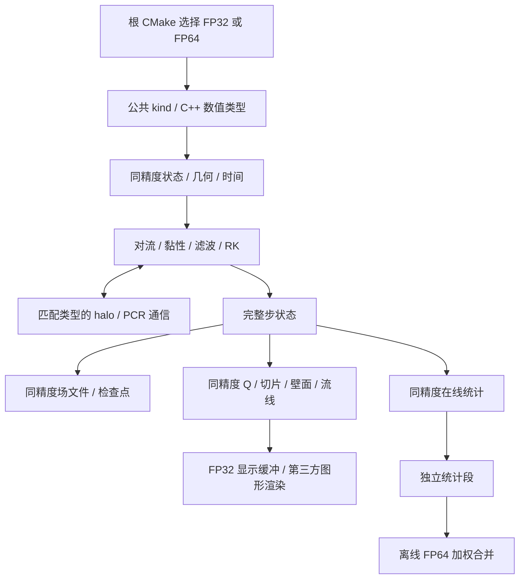

# ASTR 原生 FP32 设计

日期：2026-10-20。状态：用户已批准整体设计并启用实施goal。
实际进度与证据见 `ASTR_NATIVE_FP32_RESULTS.md`；下文访谈记录保留其当时授权背景。
源码基线：`7a2ded9`，分支 `feature/gpu_dev`。

## 1. 目标与当前授权

用户拟研究原生 FP32 计算，以扩大低精度算术和低字节数据传输的覆盖，
而不只降低一个临时工作数组的存储精度。
本轮交付已限定为非反应五变量；AIR5 双温反应流后续单独推进，不计入本轮完成条件。
精度采用共享源码、根 CMake 构建期选择，FP32/FP64 使用独立构建目录和程序；usegpu 仍是运行时选择。
本轮仅以本地双卡完成，包含中等规模 GPU 计时，不包含 A800 部署或生产长算例。
本轮授权为逐项澄清需求并编写设计，不包含求解器修改、数值运行、平台任务或 Git 写操作。

推荐项不是已确认决策。每个问题单独确认，随即更新本文件；形成稳定术语和重要架构选择后，
再分别补充 `CONTEXT.md` 与必要的 ADR。不以先前的混合精度短测作为原生 FP32 的验收证据。

## 2. 已核查的现有实现

| 对象 | 当前状态 | 源码或记录 |
| --- | --- | --- |
| 精度模式 | 默认 FP64；mixed_workspace 仅选择一组 FP32 工作区 | `src_gpu/precision_mode_gpu.cuf`、`src_gpu/mixed_candidate_gpu.cuf` |
| 主状态与更新 | q、qrhs、qsave、原始变量及主要核参数明确声明 real(8) | `src/commarray.F90`、`src_gpu/commarray_gpu.cuf`、`src_gpu/solver_gpu.cuf` |
| 现有低精度候选 | 例如黏性通量仍以 FP64 计算，在存储处收窄成 FP32 | `diffusion_flux_sp_global_kernel` |
| MPI | 公共 halo 使用 MPI_REAL8，紧致私有通信使用 MPI_DOUBLE_PRECISION | `src_gpu/halo_transport_gpu.cuf`、`src_gpu/compact_transport_gpu.cuf` |
| 紧致线求解 | 系数、RHS 与 PCR 工作区使用 real64 | `src_gpu/compact_line_solver_gpu.cuf` |
| 文件边界 | 权威状态接口及场数据集按 real64/F64 定义 | `src/checkpoint_state_io.F90`、`src/output_fields.F90` |
| 原位设备接口 | 场指针与部分数值处理固定使用 double/const double*，新精度需要类型化适配 | `src_gpu/insitu_device_geometry.h`、`src_gpu/insitu_device_products.cu` |
| 构建 | 根 CMake 尚无原生 FP32 流场精度选择；usegpu 仍是运行时输入 | `CMakeLists.txt`、`USER_GUIDE.md` |

旧设计见 `docs/superpowers/specs/2026-09-12-gpu-mixed-precision-workspace-design.md`。
该设计保护 FP64 权威状态，不能仅增加一个运行选项就声称已实现新的 FP32 推进。
按已确认的 D3b，FP64 构建保留旧工作区候选，原生 FP32 构建不叠加这些候选。

## 3. 精度术语

| 术语 | 定义 | 不应混淆的概念 |
| --- | --- | --- |
| FP32 工作区存储 | 主要算术和状态可能仍为 FP64，仅指定结果以 FP32 保存 | 原生 FP32 推进 |
| 原生 FP32 推进 | 主流场状态、RHS、RK 缓存及所覆盖推进算术使用 FP32 | 仅改数组声明或临时工作区存储 |
| 严格 FP32 数值模式 | 本次选定的新模式；数值状态及计算包括几何、物理时间、CFL、统计与辅助求解均采用 FP32；D5b 允许性能计时使用 FP64，不属于数值计算例外 | 将 FP64 性能计时用于物理时间或统计权重 |
| 推进精度 | 时间推进实际使用的数据与算术精度 | 文件存储精度、显示属性精度 |

用户已将 D1 从 A 改选 B，不再采用 FP64 辅助例外清单，相关定义同步到项目词汇表。
该合同只针对拟新增的原生 FP32 模式，不将已有 FP64 参考程序也改成 FP32。
性能计时已按 D5b 允许 FP64，D8d 允许独立离线统计合并采用 FP64；
D9b 保留第三方纯图形渲染的内部类型，不将这些约定扩展为 FP64 数值推进或在线数值后处理。

## 4. 决策记录

| 编号 | 问题 | 状态 |
| --- | --- | --- |
| D1 | 原生 FP32 推进是否允许明确的 FP64 辅助例外，还是要求严格全程序 FP32 | 已改选 B，覆盖先前 A |
| D2 | 首轮与最终交付的物理范围，是否先限非反应五变量，AIR5 如何安排 | 已确认 A；本轮非反应五变量，AIR5 后续独立推进 |
| D3 | 精度通过构建选择还是运行时分派，CPU/GPU 如何共用类型和接口 | 已确认 A；共享源码，构建期选择 |
| D3b | 现有 mixed_workspace 模式的保留或替代 | 已确认 A；FP64 构建保留，新 FP32 路径不叠加 |
| D4 | 主状态、RHS、RK、原始量、常量与计算表达式的精度归属 | 由 D1/D3 确定均随构建精度；具体工程方案见 §6 |
| D5 | 坐标、度量、法向、时间、CFL 和统计的具体精度与转换位置 | 数值部分均采用 FP32；D5b 已确认 A；D5c 已确认 B，保留现有累计算法 |
| D6 | 显式/紧致格式、滤波、传感器、NSCBC 和 crashfix 的覆盖顺序及特殊处理 | D6a至D6e 已确认 A；包含代表性显式静态 CURVE，不扩展紧致 CURVE |
| D7 | 公共 halo、紧致缩减接口、缓冲布局与 MPI 类型的精度合同 | 由 D1 确定载荷及 MPI 类型匹配构建精度，保留既有后端；见 §6.3 |
| D8 | 检查点与场文件的精度、身份、同精度精确续算和跨精度状态转换 | D8a/D8b/D8d 已确认 A；D8c 已确认在线分段及离线合并 |
| D9 | 原位后处理接口如何消费 FP32 流场，保留哪些高精度计算 | D9a/D9b 已确认 A；数值后处理随构建精度，纯图形渲染保留库内部类型 |
| D10 | 算法一致性、差值报告、性能规模及分阶段完成条件 | D10a 已确认不设跨精度偏差上限；D10b 已确认 A，本地双卡；实施细节见 §8至§10 |

### D1：原生 FP32 的定义

**候选 A，未采用**：以原生 FP32 推进为目标，允许几何、时间和统计等辅助环节采用
一份明确的 FP64 例外清单。具体例外在后续问题逐项确认；本题不自动批准整个边界、
紧致求解或滤波继续使用 FP64，也不自动将 AIR5 纳入首轮。

**候选 B，已选定**：严格 FP32 数值模式，包括几何、物理时间、CFL、统计与辅助求解，均不保留 FP64 数值例外。
这会额外要求研究长时间累计、几何一致性和求和误差，不只改造流动推进核。

决策：2026-10-20 用户最初选择 A，在了解全域 FP64 几何和统计的容量后，
明确要求“问题1，使用B”。新选择覆盖先前 A；不以保留 FP64 标量或只将几何常驻数组改为 FP32 来替代严格 FP32 目标。
见 `docs/adr/0053-use-strict-fp32-numerical-computation.md`。

### D2：本轮交付的物理范围

**候选 A，已选定**：本轮先交付非反应五变量的严格 FP32 基础与已选工况验证，
AIR5 双温反应流作为后续独立阶段，不作为本轮完成条件。

**候选 B**：本计划包含非反应流与 AIR5 严格 FP32，分阶段实施，
AIR5 通过其独立数值与物理门槛后才算总交付完成。

决策：2026-10-20 用户选择 A。五变量指密度、三分量动量及总能量；
不以本轮非反应流结果宣称 AIR5 的物性、输运或刚性化学已通过严格 FP32 验证。
所选工况、格式及边界覆盖见后续 D6 各项决策。

### D3：精度选择与构建方式

**候选 A，已选定**：共享一套源码和统一的精度类型定义，由根 CMake 在构建时选择
FP32 或 FP64，使用独立构建目录生成两套程序。现有 FP64 默认不变，
同一构建内 CPU/GPU 使用一致的数值精度合同；usegpu 仍是运行时执行后端选择。
这不是依赖编译器全局实数转换选项或复制第二套求解器源码。

**候选 B**：同一个可执行程序包含 FP32 和 FP64 两套类型化实现，启动时选择。
需要分别处理入口、模块及分派，但只分配所选模式的流场，不意味着同时分配两套场。

决策：2026-10-20 用户选择 A。两套程序提前构建后，切换精度只需选择对应可执行文件，
不要求每次重新编译。不手工维护两套计算源码，也不通过编译器全局实数转换选项实现。
建议构建参数名称见 §6.1，随整体设计审批；旧 mixed_workspace 的保留策略见 D3b。

### D3b：既有 mixed_workspace 的去留

**候选 A，已选定**：FP64 构建保留既有 mixed_workspace 及其已验证候选，
不改变原默认。原生 FP32 构建直接使用统一的 FP32 数值路径，不叠加工作区混合精度候选，
也不重复分配一套同精度工作区。旧选择器在 FP32 构建中的建议输入行为见 §6.1。

**候选 B**：停用并移除旧 mixed_workspace 路径，只维护原生 FP32 与 FP64 两类构建。
旧结果记录仍作为历史证据保存，但旧模式不再是可运行选项。

决策：2026-10-20 用户选择 A。不删除原有候选或历史证据，也不把旧候选的验证
自动记为原生 FP32 验收；本决策不改变 D1 的数值精度合同。

### D6a：显式与紧致格式的交付范围

**候选 A，已选定**：本轮包含现有已支持非反应流组合中的显式与紧致两类格式，
按先显式、后紧致的顺序分别验收；不新增尚未移植的数值格式。
具体格式、滤波、边界和工况清单由 D6b 至 D6e 确定。

**候选 B**：本轮只交付显式格式，紧致格式留待后续独立计划，不计入本轮完成条件。

决策：2026-10-20 用户选择 A。显式与紧致均计入本轮交付，分别验收，
不因显式路径通过而自动放行紧致路径。按后续 D10a 的选择，紧致线系统独立核对
系数、缩减、回代及接口算法并报告 FP32 残差，不照搬 FP64 容差或新增跨精度偏差上限。

### D6b：Ma12 平板是否计入本轮交付

**候选 A，已选定**：除低马赫数周期 TGV 基础验证外，本轮要求通过已有非反应 Ma12 平板的
有界代表性验证，保留其 MP7-LD 对流与 NSCBC 边界，梯度/黏性及滤波只选择已有支持组合。
先完成低马赫数基础，再检查高马赫数总能量减动能的内能恢复、边界及限制器行为。
不以降低马赫数或改变边界目标代替该项；不自动增加生产规模或长时物理定常要求。

**候选 B**：本轮不将 Ma12 平板列为完成条件，先验收低马赫数非反应流；
高超声速 FP32 作为后续独立阶段，当前能力说明不得据此宣称已适用于 Ma12。

决策：2026-10-20 用户选择 A。Ma12 平板计入本轮完成条件，先低马赫数后高马赫数，
显式与紧致仍各自验收。网格、运行时长、差值口径及修复活动记录由 §9 的实施矩阵落实。

### D6c：保正限制器与 crashfix 的验收处理

现有 FP64 中等规模平板并非所有组合均不触发修复。
`ASTR_GPU_COMPACT_SCHEME_RESULTS.md` §23.11记录：40步显式滤波组有3次非零修复调用，
合计291次节点修复访问，计数含存储副本；紧致滤波组在该短窗未触发修复。
邻点替换不保证全域守恒，不能归为机器舍入噪声，也不能要求 FP32 必须复现完全相同的触发序列。

**候选 A，已选定**：复用已有保正限制器及 lcracon 开关，测试对照保持相同配置；
crashfix 的数值运算在新构建中采用 FP32。已有非零修复不自动否决该组合，
但须分别报告修复调用、节点修复访问、守恒量改变量及 FP64 对照，区分正常推进与修复影响。
不新增任意修复次数上限，不用额外截断或加强修复掩盖降精度失效；
有限性和正值仍独立检查，误差按后续 D10a 只报告、不设跨精度上限；
不把修复后跑完当成算法一致或物理精度已获证明。

**候选 B**：正式 FP32 验收要求 crashfix 无非零修复，仅将有修复组作为问题诊断。
这会将现有 FP64 已触发修复的代表性显式滤波组合排除在正式通过证据之外，
不能将其重新归因为 FP32 独有缺陷。

决策：2026-10-20 用户选择 A。允许沿用现有开关触发修复，不要求 FP32 与 FP64 的
修复序列逐次一致；修复影响与精度误差分开报告。本题不批准新增保正公式、
提高物理温压下限或改变能量方程。

### D6d：代表性数值格式组合

**候选 A，已选定**：沿用 CP9 已有四类对照路径，分别验收滤波关闭及开启，
不新增差分与滤波的独立组合选择器：

| 工况 | 对流格式 conschm | 梯度/黏性格式 difschm | 滤波开启时的路径 |
| --- | --- | --- | --- |
| 周期 TGV | 643e | 643e | 现有十阶显式滤波 |
| 周期 TGV | 643c | 643c | 现有紧致滤波 |
| Ma12 平板 | 743e，MP7-LD | 643e | 现有十阶显式滤波 |
| Ma12 平板 | 743e，MP7-LD | 643c | 现有紧致滤波 |

每组 FP32 结果与同格式、同边界及相同修复配置的 FP64 参考对照，
不要求显式与紧致两种不同算子的场逐值一致。
本项只冻结代表性格式范围，不沿用 CP9 的性能网格、时间步或运行次数作为新精度验收条件。

**候选 B**：本轮扩大到其他现有 GPU 非反应流格式组合并逐项验收；
需要补充具体清单，仍不引入尚未移植的新格式。

决策：2026-10-20 用户选择 A。以上四类路径及各自滤波关/开计入本轮代表性验收，
不扩大到其他数值格式。其他几何覆盖、滤波存储变体及差值报告口径另行明确。

### D6e：静态曲线网格的覆盖

**候选 A，已选定**：本轮加入已有显式 643e/643e 路径的代表性静态 CURVE 验证，
复用周期曲线 TGV 和带 bc41 壁面的 y-wavy 夹具；先检查 FP32 几何度量、
自由来流保持及物理梯度，再检查相应统计、几何提取和流线产品。
自由来流保持使用与边界相容的独立恒定场，不要求非零常速穿过无滑移壁面。
验证控制在本地有界规模，不扩大为任意曲线几何或所有物理边界的证明。
现有紧致路线尚未覆盖一般 CURVE，本项不增加紧致 CURVE 求解器移植。

**候选 B**：本轮只验收笛卡尔及平板拉伸网格，静态一般 CURVE 的原生 FP32
留待后续阶段；保留现有 FP64 CURVE 能力，不据本轮结果宣称 FP32 CURVE 已通过。

决策：2026-10-20 用户选择 A。两类代表性静态 CURVE 纳入本轮，仍限已有显式路径；
不扩大为紧致 CURVE 移植。D1 对新模式数值几何采用 FP32 的定义不变。

### D5a：现有 FP64 数据的容量核算

以下是选择过程中核查的现有 FP64 存储，并非新模式允许保留的例外清单。
空间复杂度以本 rank 的有效节点数或存储范围计；全域数据随 MPI 分区分布，不默认每 rank 保存全局副本。

| 类别 | 空间范围 | 说明 |
| --- | --- | --- |
| 时间、dt、采样权重和全局结果 | 标量或少量控制数据 | 保留 FP64 的存储成本很小 |
| 归约临时量 | 分块部分和及少量最终量 | 不是完整流场镜像；具体容量取决于块数与统计项目 |
| 坐标 x、Jacobian、度量 dxi | 当前为三维全域数组，分别 3、1、9 分量 | 当前 `commarray_gpu.cuf` 分配外部 halo；不能称为标量例外 |
| 六面物理法向 | 边界二维面，每面 3 分量 | 当前六面均分配；属于面积规模，不是体积规模 |
| 原生产展向统计 | 二维平面累计及一维壁面累计 | `production_statistics_gpu.cuf` 的 plane_sum 为 12 分量，plane_measure 为 1 分量 |
| 可选三维 Reynolds/Favre 统计 | 每个采样节点 30 个 FP64 状态分量 | `insitu_statistics_gpu.cuf::state_d`；不是所有计算都必须启用 |
| 通用统计输出临时量 | 按输出请求另有 41 分量的三维 output_d | 不与 30 分量累计状态混为一个固定开销，也不假定每种产品都会分配它 |

设节点数为 N，一个 FP64 标量场为 8N 字节。下表只计算所列数组，不含 halo、共享/周期副本、
分块归约、其他工作区、输出暂存或主机副本；是公式核算，不是实测进程峰值。

| 数组类别 | 256³ 节点 | 512³ 节点 |
| --- | ---: | ---: |
| 一个 FP64 标量场 | 128 MiB | 1 GiB |
| 三维坐标，3 分量 | 384 MiB | 3 GiB |
| Jacobian，1 分量 | 128 MiB | 1 GiB |
| 网格度量，9 分量 | 1.125 GiB | 9 GiB |
| 上述几何合计，13 分量 | 1.625 GiB | 13 GiB |
| 三维速度统计累计状态，30 分量 | 3.750 GiB | 30 GiB |
| 若请求通用统计输出，另有 41 分量 | 5.125 GiB | 41 GiB |

若这些数组不再保留完整三维形式，容量也会改变。均匀笛卡尔几何可以用常数描述，
可分离拉伸网格可以采用一维坐标/系数；一般 CURVE 通常仍需逐节点几何。
这些是后续可讨论的存储改进，当前源码尚未因此改变，原位和统计接口也需要随之适配。
在 FP64 中初始化几何、再以 FP32 常驻存储，是另一种精度方案，不能称为保留 FP64 数值几何。

此前保留全域 FP64 几何及小量 FP64 控制/累计的建议已由 D1 改选 B 取代。
若保持同一数组布局，FP32 几何 13 分量在 256³/512³ 节点下分别为 0.8125/6.5 GiB，
FP32 三维统计累计 30 分量分别为 1.875/15 GiB。是否启用全域统计及几何紧凑存储仍需独立设计，
不能因单数组字节减半就宣称整程序峰值减半。

一般 CURVE 也不保留 FP64 数值几何；需在其进入新模式范围前验证 FP32 几何的自由来流保持及边界一致性。
不增加 FP64 瞬时流场镜像或静默高精度回退。

### D5b：仿真物理时间与性能计时

仿真物理时间、dt、CFL、采样时间权重和流场统计的 FP32 合同已由 D1 确定。
程序执行耗时用于衡量算法性能，不是仿真物理时间。当前 `src/parallel.F90::ptime`
为 real(8) 函数，调用 MPI_Wtime；GPU 阶段计时也使用该计时基础设施。

**候选 A，已选定**：允许性能测量沿用 MPI_Wtime 及 FP64 时间差，不将该结果反馈到
物理时间推进、CFL、采样权重或流场统计。只保留少量计时标量，不保留 FP64 流场或数值工作区。

**候选 B**：性能计时也不使用 FP64；改用整型时钟计数计算差值，再转换为 FP32 耗时，
额外适配现有计时与输出接口。不把绝对墙钟直接收窄为 FP32 后相减。

决策：2026-10-20 用户选择 A。本题只确定性能测量边界，不将物理时间或统计累计改回 FP64，
也不预先批准第三方后处理算法或文件转换采用 FP64。

### D5c：FP32 内部的稳定累计

现有 `mainloop.F90` 通过 time=time+completed_step_dt 累计物理时间；
`insitu_velocity_statistics.F90::add_weighted_state` 已使用加权均值和中心矩递推，
并非直接用原始二阶矩减均值平方。不能把已有稳定实现误记为尚未具备。

**候选 A，未采用**：允许新 FP32 路径针对实际累计误差采用 FP32 补偿、分块累计或
稳定递推，物理积分定义和统计权重不变，不通过 FP64 恢复精度。
先复用已有稳定公式，只在有必要的累计位置增加状态；不预先为全部三维统计分量
配置一套补偿镜像。额外 FP32 状态计入内存与性能报告，影响未来推进或累计的状态
纳入同精度精确续算，原 FP64 路径不因此改变。
补偿求和不消除单个 FP32 绝对时刻的分辨率极限，物理时间表示、窗口裁剪及调度
仍需联合验证，不能仅凭一次累计探针宣称任意长时间可用。

**候选 B，已选定**：本轮只进行类型与接口适配，保持现有累计算法；
若 FP32 长时间累计不通过，另行设计修订，不在本轮采用新增补偿或分块累计。

决策：2026-10-20 用户选择 B。保留已有加权均值/中心矩递推，不新增补偿、分块累计
或其持久状态；不将拒绝新增算法误解为删除已有稳定实现。
若出现时间停滞、统计覆盖或调度错误，应报告实际可用步数/时间范围并提出后续修订；
累计差值按 D10a 报告而不设跨精度上限，不自动改回 FP64，
也不以缩短正式验证窗口掩盖失效。本题不批准改变 RK、通量、物理模型或统计量数学定义。

### D8a：检查点与场文件的存储精度

当前检查点及场文件代码使用 H5T_IEEE_F64LE，并在读取中核对该类型。
新模式需要明确存储精度，不能仅改变数组类型而保留不匹配的内存类型或接口。

**候选 A，已选定**：数值载荷跟随构建精度。FP32 构建的检查点、流场序列及切片写 FP32，
FP64 构建写 FP64；记录实际推进精度与存储类型，适配对应读取接口。
整数身份和其他元数据不因流场精度变化而盲目缩短。此项不决定跨精度续算策略。

**候选 B**：文件中的浮点载荷保持原 FP64 存储，FP32 构建仅在 I/O 边界显式转换，
保留计算与设备常驻数据的 FP32 合同。转换可按已有打包块进行，不增加全域 FP64 镜像；
这样不节省相应浮点载荷的磁盘字节，也不提高原 FP32 数据的精度。

决策：2026-10-20 用户选择 A。文件记录推进精度与实际载荷类型，使用相应的读取和
打包接口；不新增整场 FP64 输出镜像。其他输出开关与保留策略仍沿用原有显式配置。
该存储选择本身不证明精确续算；完整状态、精度身份及执行合同仍需验证。

### D8b：同精度精确续算与跨精度状态转换

同一精度、后端、拓扑和数值配置的精确续算仍以连续/重启状态逐值一致为目标。
改变推进精度会改变后续舍入路径，不能因恢复点的值可表示就称为原精度下的精确续算。

**候选 A，已选定**：本轮同时支持同精度精确续算和显式的 FP64/FP32 双向非精确恢复。
跨精度使用既有 exact_restart=f，在 I/O 边界转换所需状态，按目标精度重建派生缓存；
exact_restart=t 不接受跨精度恢复。用于复用已有新式检查点，不恢复已退役旧格式，
不同时放开物理模型或离散配置更换。累计统计及精度切换后的采样窗口另行明确。

**候选 B**：本轮只支持同精度续算，跨精度检查点恢复留待后续独立实现。
FP32 测试从其自身初始条件或同精度检查点启动。

决策：2026-10-20 用户选择 A。跨精度使用目标精度的读入/打包接口完成必要转换，
不在时间推进中保留源精度镜像。不因“文件读入成功”而自动通过数值续算门槛。

### D8c：跨精度恢复的累计统计

本题仅讨论改变推进精度后的统计历史。同精度精确续算仍完整恢复已启用的统计状态，
不重置累计值、覆盖时长或采样调度。

**候选 A，经补充后已选定**：跨精度恢复后建立新的统计段，不继承源精度的均值、协方差、
应力等累计结果。物理时间和流场继续从检查点恢复，源统计文件保持只读；
新段从恢复时刻按当前统计配置累计，并明确记录精度切换和统计重新起算。
不在线静默拼接，但保留各段充分统计状态，本轮提供显式的离线合并功能。
用户可在新计算结束后选择合并，不据此声称切换后已统计定常。

**候选 B**：将原统计状态转换为目标精度后接续累计，保留此前覆盖时长；
明确标记窗口跨越不同推进精度，不能把合并结果称为纯 FP32 或纯 FP64 统计。

决策：2026-10-20 用户确认“在线分段保存，结束后可选离线合并”。
统计处理不清空必要的物理边界、吹吸随机状态或驱动历史。

离线合并需保存并使用每段的覆盖时长、密度时间积分、Reynolds/Favre 均值、
二阶中心矩累计量，以及实际覆盖区间、空间布局、物理定义与精度来源。
现有 `insitu_velocity_statistics.F90` 的 duration、mass_duration、mean_r、mean_f、
central_r、central_f 具备相关状态，后续仍需适配新精度文件并实现合并工具。
不要求为此保留全部瞬时流场，也不在每个时间步自动启动离线处理。

令两段权重为 W_A、W_B，均值为 mu_A、mu_B，未归一化二阶中心矩为 S_A、S_B，
delta=mu_B-mu_A。合并规则为：[^pebay]

```text
W = W_A + W_B
mu = mu_A + (W_B / W) * delta
S = S_A + S_B + (W_A / W) * W_B * outer(delta, delta)
covariance = S / W
```

Reynolds 的权重为覆盖时长，Favre 的权重为密度时间积分。
密度加权应力由合并后的 Favre 中心矩除以合并覆盖时长，RMS 由合并协方差的对角元开方，
不直接平均两段 RMS 或忽略均值差修正。零覆盖段不贡献统计量。
采用分块读取、计算和写出，不要求在内存中建立完整全域高精度镜像。

必须核对统计定义和网格对应关系，按真实时间区间处理接缝，避免重复累计。
若原采样覆盖存在缺口，不能仅凭总时长和均值补出缺失区间，也不能把合并结果冒称无缺口的连续窗口。
跨推进精度结果标记为跨精度统计，保留各段来源；离线合并不恢复已经丢失的有效位，
也不承诺与一次在线累计逐位一致。独立的小型加权统计合并检查纳入后续验收设计。

### D8d：离线合并工具的精度

**候选 A，已选定**：独立离线工具采用 FP64 合并和输出统计数值，减少额外累计舍入；
可读取 FP32/FP64 段，按块提升参与合并。该环节不进入原生 FP32 求解器的时间推进，
不改变其几何、物理时间、RK 或原位统计精度，也不把合并结果称为 FP64 推进结果。

**候选 B**：离线合并与统计数值输出也使用 FP32；保持该后处理环节的 FP32 算术，
但需独立评估长时权重和二阶矩合并的舍入影响。

决策：2026-10-20 用户选择 A。离线合并与在线数值推进分离，是已披露的独立后处理环节，
不把求解器、在线累计或数值几何改回 FP64。合并结果保留源推进精度，不能声称提升了源段物理计算精度。

### D9a：本轮原位可视化的交付范围

**候选 A，已选定**：本轮将 FP32 流场接入既有常见非反应流原位产品，包括切片、壁面量、
Q 等值面、瞬时及平均流线和相关平均场产品。先关闭渲染验证数值推进，再逐类接入并验收，
不新增可视化产品，不穷举所有产品与工况的笛卡尔积。
原位数值处理与第三方渲染内部精度的边界另行明确，不以本项自动批准 FP64 私有数值工作区。

**候选 B**：本轮只交付 FP32 计算、数值统计、检查点与原生场文件输出；
原生 FP32 流场的原位渲染适配留待后续独立阶段，既有 FP64 渲染能力不因此移除。

决策：2026-10-20 用户选择 A。统计、文件输出和可视化仍保持各自独立的配置开关。
产品与测试工况依据已有非反应能力的交集选择，不宣称尚未验收的任意组合已支持。

### D9b：数值后处理与第三方图形渲染边界

当前设备产品接口包含固定 double*，不能把 FP32 场指针直接传入后按 double 解释。
接口、元素字节数、外部数组视图及数值核需要匹配构建精度；不能用整场提升为 FP64 来掩盖缺失适配。

**候选 A，已选定**：ASTR 负责的取样、梯度、Q、壁面量、统计、剖切/等值面数值几何处理、
属性插值和流线积分跟随构建精度；原生 FP32 中均使用 FP32。
第三方图形渲染中的相机、投影、光照等内部实现不要求全栈 FP32 化，可以保留库本身的类型。
第三方若承担梯度或轨迹积分等数值后处理，不能仅因位于库内就豁免其数值精度合同。
不得因此引入完整 FP64 流场/数值几何镜像，或改变既有设备管线的驻留与几何回读约定。

**候选 B**：第三方图形渲染内部的浮点计算也必须全部 FP32，作为本轮交付要求。
这需要另行审计和改造依赖，不能仅凭 ASTR 场数据类型推定外部图形栈已经满足。

决策：2026-10-20 用户确认 A。已有 FP64 路径在数值后处理之后转换出 FP32 显示缓冲，
并不表示其 Q、几何提取或流线积分已经使用 FP32。新路径采用 FP32 流场、FP32 数值后处理
和 FP32 显示缓冲，不增加先升 FP64 再降 FP32 的整场转换。
已有 FP64 数值路径及其显示规则不变；按后续 D10a，新的 FP32 数值差异只报告，
显示完整性和几何有效性单独检查，不将原 FP64 的 ≤2e-10 数值门槛直接用于 FP32。
本题不改动 D1 的数值几何、物理时间或在线统计精度，也不影响已批准的独立离线统计合并。

### D10a：算法一致性与差值报告

本题以同网格、同格式、同物理配置的 FP64 为数值参考，衡量降精度的影响，
不将 FP64 离散解视为物理真值，也不规定 CPU/GPU 同精度场差使用同一门槛。
主要诊断候选包括 TGV 动能、拟涡能和耗散率，以及 Ma12 的速度/温度剖面、
壁面摩擦和热流。只在已有定义成立的区域/观测窗比较，不要求短窗达到湍流统计定常。

**候选 A，未采用**：主要诊断的归一化偏差目标为不超过 1%，作为第一版原生 FP32
的可用性目标；不把这一数值直接套到所有局部场、几何、线系统残差或图像。

**候选 B，未采用**：采用更严格的 0.1% 主要诊断偏差目标，其他范围不变；
若严格 FP32 不能达到，应报告未通过，而非自动加入 FP64 数值例外。

**用户自定义选择，已选定**：不设置 FP32 相对 FP64 的场差或诊断偏差通过上限，
以算法一致和实现正确为本轮交付标准。保留差值计算与报告，但不设置 1%、0.1%
或替代的跨精度误差硬门槛。

算法一致指控制方程、离散公式与系数、边界与滤波规则、RK 阶段顺序、通信所有权、
限制器及 crashfix 逻辑保持对应，数值类型及必要的类型化接口按构建精度适配。
同一常量按目标类型舍入，不因偏差增大而另改物理下限、滤波强度或数值格式。
FP32 舍入造成的数值差异及判据触发差异不等于算法被改变，也不要求跨精度逐值一致。
通过源代码对应审查、同状态算子/接口检查及代表性推进核对实际执行路径，
不能只因宏观输出相似或任务完成就断言算法一致。

有限性、修复后的正值、MPI 数据与元素类型匹配、边界/halo 相位以及同精度精确续算
检查仍保留。CPU/GPU 同精度对照用于定位漏项和执行路径问题，不新增统一全场偏差上限；
复制和通信检查仍可要求数据逐值一致。紧致残差、时间累计漂移及流动诊断差异均如实报告。
近零量不逐点除以局部参考值；参考尺度、范数、物理时间对齐及观测窗口在运行前明确。
本轮算法一致性完成不等于严格 FP32 的物理精度或长时统计可靠性已经得到保证。

决策：2026-10-20 用户明确“不设偏差限制，保证算法一致就行”，覆盖候选 A/B。
既有 FP64 模式及其已批准验收不因该选择而降低要求。

### D10b：本轮运行平台与性能规模

**候选 A，已选定**：本轮仅以本地双卡完成。小网格先做 CPU/GPU 对应检查、续算及产品适配；
性能比较采用 256³ TGV 和 450×130×96 区间 Ma12 平板，GPU NP=1/2，
FP32/FP64 使用同网格同格式，分别报告 RK 时间、显存及通信字节，不规定最低加速比例。
静态 CURVE 先限代表性小网格，不复制一套中等规模长测；不新增中等规模 CPU 计时。
具体计时窗、重复次数、输出配置及资源预检写入实施步骤。

**候选 B**：除上述本地内容外，将 A800 平台验证也列为本轮完成条件；
另行设计平台矩阵，当前需求访谈仍不授权实际部署、提交或修改远程任务。

决策：2026-10-20 用户选择 A。以本地双卡完成，不将 A800 测试列为本轮完成条件。
不以性能变快代替算法检查，也不将容量下降直接称为整步加速。

## 5. 设计时必须处理的风险

- 固定 real(8)、d0/real64 常量及实参类型可能引入类型不匹配或隐式升精度，不能只替换主数组声明。
- MPI 类型、元素数量与字节计数必须匹配真实缓冲，不把通信体积下降等同于消息延迟下降。
- 原 FP64 场差、线系统残差和既有化学容差不能机械继承；本轮不设跨精度偏差上限，差异及异常仍须如实报告。
- 高马赫数内能恢复、小扰动、物理边界和紧致线系统需要分别确认误差及适用范围。
- RK45 的算法内部误差控制参数不同于本轮不设上限的跨精度差值；先保留现有设置并检查其 FP32 行为，不擅自移除自适应控制或另改目标。
- 旧滤波在 FP64 下已存在的失正不是降精度修复目标；crashfix 后跑完不等于数值或物理正确。
- FP32 文件提升为 FP64 不恢复丢失精度；跨精度继续推进不能冒称原计算轨迹的精确续算。
- 减少数组容量、减少通信字节、单核变快和完整 RK 加速是不同结果，需要分别报告。

## 6. 类型与数据流设计

以下工程方案落实已确认需求，随本文整体审阅，不表示已经实现或获准运行。

### 6.1 构建与公共类型

- 建议根 CMake 新增 ASTR_NUMERICAL_PRECISION=fp64|fp32，默认 fp64；
  使用独立构建目录。参数选择数值类型，不改变 usegpu、CPU/GPU 绑定或 CUDA 架构选择。
- 计划新增 `src/astr_precision.F90`，集中定义数值 kind、对应 C kind 和元素字节数；
  公共名称采用 real_kind、c_real_kind、clock_kind，字面量使用 _real_kind/_clock_kind。
  不导出旧缩写 rk，避免与 mpiio 中固定 real64 的同名参数混淆；不改旧 mpiio 的既有名称。
  性能时钟明确保留独立 FP64 类型。模块依赖由 `src/CMakeLists.txt` 接入，
  当前不存在独立的 `src_gpu/CMakeLists.txt`，不另造第二条构建入口。
- 主状态、RHS、RK、原始量、几何、时间、CFL、物性、数值统计及辅助线系统采用统一 kind。
  整数计数、拓扑、索引、MPI 请求及随机数发生器的整数状态不随浮点精度缩短。
- 类型闭包覆盖已编译的非反应调用链，包括公共接口及 UDF，不能仅替换 q 的声明。
  使用目标 kind 的常量及 intrinsic 实参，检查 d0、real(8)、real64、c_double、
  默认实数和 C++ double 的实际用途，不进行不分用途的全库文本替换。
- `constdef.F90` 的系数按既有数学表达式迁移到目标 kind，不按常量名称猜测并改写公式；
  CPU 公式疑点另行提交人工决策。原有浮点 epsilon 余量跟随目标 kind，物理下限不擅自提高。
- 保持现有优化/FMA 设置，不在降精度时附带启用 fast-math、近似倒数或改写能量方程。
- FP64 构建保留旧 mixed_workspace。建议 FP32 构建不经过旧混合工作区分派；
  若设置旧 ASTR_GPU_PRECISION_MODE，仅一次性说明它不改变构建精度，运行仍为原生 FP32，
  不分配重复工作区。启动信息准确区分构建精度与执行后端，不新增哈希打印。
- AIR5 和旧 Cantera 计算不在新 FP32 构建范围。沿用既有构建选择明确排除这些后端，
  不通过共享类型迁移意外改变原 FP64 化学模块。

### 6.2 类型归属

| 数据 | FP32 构建 | FP64 构建 |
| --- | --- | --- |
| 五变量状态、RHS、RK、原始变量与流动计算 | FP32 | 现有 FP64 |
| 几何初始化、坐标、度量、法向及几何积分 | FP32 | 现有 FP64 |
| 物理时间、dt、CFL、统计权重/均值/中心矩 | FP32，保持现有累计算法 | 现有 FP64 |
| 全局两层 PCR 系数、缩减、回代与接口载荷 | FP32 | 现有 FP64 |
| 梯度、Q、壁面量、数值几何与流线积分 | FP32 | 现有 FP64 |
| 原生浮点文件载荷、halo 与统计通信 | FP32，类型和字节数匹配 | FP64，保留原语义 |
| 显示缓冲 | 现有 FP32 坐标/显示属性及整数连接 | 现有 FP64 数值结果转 FP32 显示 |
| 性能时钟 | FP64，仅计时 | FP64 |
| 独立离线统计合并 | FP64 计算和统计输出，保留源精度身份 | 同一工具 |



### 6.3 MPI 与紧致求解

保留公共 halo 的 pinned/device-aware 后端以及紧致私有传输后端，不引入新通信栈。
统一按实际数值 kind 选择匹配的 MPI 浮点类型，初始化一次，不在每条消息前查询类型。
同步修改持久请求初始化、固定缓冲、counts/displacements、字节容量和 C/CUDA 侧接口，
保留固定 tag 区间、共享节点平均、halo 刷新和相位依赖。不能只将 MPI_REAL8 改名，
也不能把整数、性能时钟和浮点载荷混入同一个不匹配的消息类型。

全局两层 PCR 算法、端点连接与闭合规则不变。逐层检查系数、索引、RHS 布局、
周期端点、非周期端点及回代；残差和 FP32/FP64 解差报告但不设跨精度上限。
除数非有限或实际奇异等实现/有效性错误仍按现有错误机制处理，不新增任意精度准入门槛。

### 6.4 文件、统计与续算

文件浮点载荷使用匹配的 HDF5 内存类型和 F32/F64 数据集类型，维持并行选择、
全局唯一节点及现有输出保留规则。新增精度身份并复用现有元数据文件，不增加一套精确状态附属文件，
不恢复 CRC、整场写后回读或已退役旧格式。小量供文件/图形 API 展示的标量可显式转换，
但不得反馈到物理时间、统计累计或流场计算，也不建立全域高精度镜像。

新格式版本及读取器需识别既有新式 FP64 检查点。跨精度按 exact_restart=f 分块转换，
目标精度重建派生物性和几何；同精度 exact_restart=t 恢复所有影响后续轨迹及累计的状态。
检查时间调度、边界缓存、驱动力、随机吹吸与 RNG 生命周期，不能随统计重新起算而重置物理历史。
跨精度不承诺流场或随机扰动序列的逐值一致；同精度固定配置仍保持精确恢复目标。

在线 Reynolds/Favre 累计保留现有算法，仅适配类型；跨精度恢复建立新统计段。
计划新增 `scripts/output/merge_statistics_segments.py`，分块处理既有充分统计量，
按 D8c/D8d 合并真实时间/质量权重、均值和中心矩。检查重复覆盖、缺口、窗口及采样身份，
不平均 RMS，不用新 Python 程序另写完整 CFD 推进器。

### 6.5 原位与外部依赖

计划新增共用 C++ 数值类型头 `src/astr_precision.h`，Fortran bind(C)、Conduit 外部数组描述、
Viskores 数组、CUDA 核参数、字节统计和积分状态一致选用 float 或 double。
保留标准设备数组与设备几何直连两条既有管线，显示规则和图像输出配置不改变。
图片路径不因适配精度而引入完整三维主机镜像或数值几何回读。

优先显式指定目标浮点类型，不依赖 Viskores 的 FloatDefault 名称推断实际算术。
追踪真正承担 Q、等值面和 RK45 的依赖实现；若分析模块写死 FP64，先提供匹配的
FP32 实例或分析依赖构建，再接真实产品。不得把 float 指针伪装成 double 指针，
也不得在同一进程混用 ABI 不一致的依赖。纯图形渲染库不要求全栈单精度化，
独立安装/构建不能覆盖现有 FP64 环境。

## 7. 文件与依赖覆盖

下表是实施文件组，不是授权无差别重构。具体函数以实际非反应调用闭包为准，
仅为编译依赖而适配的文件不因此新增算例支持声明。

| 文件组 | 主要涉及文件或位置 | 必须处理的依赖 |
| --- | --- | --- |
| 构建与公共类型 | 根和 src/CMakeLists.txt；计划新增 src/astr_precision.F90、src/astr_precision.h | CPU-only/CUDA、可选 Catalyst、所有相关独立 probe target 的模块依赖 |
| 公共状态与常量 | src/commvar.F90、commarray.F90、commtype.F90、constdef.F90、commfunc.F90；src_gpu/commvar_gpu.cuf、commarray_gpu.cuf | 物理量与时钟分离，数组字节及内存估算同步 |
| 初始化和几何 | src/initialisation.F90、gridgeneration.F90、geom.F90、fludyna.F90、thermchem.F90 的非化学路径；所选 UDF | 生成几何、原始/守恒量转换、入口剖面、所有实参 kind |
| CPU 数值参考 | src/derivative.F90、filter.F90、flux.F90、solver.F90、commcal.F90、bc.F90、mainloop.F90 | 同一公式、边界顺序与更新范围，不复制第二套 CPU 求解器 |
| GPU 显式推进 | src_gpu/gradcal_gpu.cuf、solver_gpu.cuf、shock_sensor_gpu.cuf、mainloop_gpu.cuf、mp_positivity_gpu.cuf、crashfix_gpu.cuf | 中间算术、传感器和能量恢复，保留原存储变体 |
| 边界与物性 | src/perfect_gas_*、conservative_boundary_*、sponge_layer.F90、wall_blowing_random.F90 及对应 GPU 文件 | NSCBC、交点、halo 物性、吹吸和边界历史 |
| MPI | src/parallel.F90、mpiio.F90；src_gpu/qswap_gpu.cuf、halo_*、device_mpi_transport_gpu.cuf | CPU 归约及 GPU 缓冲类型、持久请求、共享节点和标签 |
| 紧致 | src/compact_line_solver.F90、compact_operator.F90、compact_runtime.F90；src_gpu/compact_*.cuf | CPU/GPU 局部及全局线系统、端点类型、复用工作区 |
| 统计和调度 | src/statistic.F90、insitu_*statistics.F90、insitu_time_integral.F90、各输出调度模块；对应 GPU 统计文件 | 当前窗口、端点样本、时间漂移、权重及中心矩；AIR5 专用算法不移植 |
| 新式输出和恢复 | src/output_*.F90、checkpoint_state_io.F90、checkpoint_bundle.F90、insitu_checkpoint_batch.F90；GPU checkpoint/output 文件 | HDF5 类型、二进制字段宽度、缓存、rank_extras、输出身份、RNG 与统计段 |
| 兼容性和其它编译依赖 | src/hdf5io.F90、readwrite.F90、validation_io.F90 及实际被编译的旧辅助输出/插值接口 | 只适配实际依赖的类型，不重新启用旧 checkpoint 或改变新输出默认 |
| 原位分析及显示 | src/insitu_fields.F90、insitu_geometry.F90、insitu_mesh_adapter.cpp、catalyst_adapter.cpp；src_gpu/insitu_*、output_derivatives_gpu.cuf | SoA/向量视图、私有梯度、Q-only、壁面、流线、预览、Conduit 类型与图形缓冲 |
| 工具、测试与说明 | 既有 case 准备、compact/output/insitu 测试；新离线合并工具、USER_GUIDE.md | dtype 感知、分层短测和真实口径，测试脚本不新增任意长任务限制 |

默认 `user_define_module/userdefine.F90` 及本轮所选测试 UDF 需使用公共 kind。
外部 M12 原目录只读，不批量修改全部历史 UDF、chem/ 或无关资料。
固定 real64 的 AIR5 专用代码、性能时钟、离线工具和图形库是需分类的用途，
不是要求 rg 搜索结果中所有 double/real64 都必须消失。

## 8. 分阶段实施

当前执行状态与证据见 ASTR_NATIVE_FP32_RESULTS.md。每阶段先完成其最小检查，再运行依赖它的下一阶段；
已有授权后不为普通局部修改反复询问，但改变物理/离散方法或确需新增 FP64 数值例外时停下提交决策。

| 阶段 | 工作 | 最小完成证据 |
| --- | --- | --- |
| FP0 基线与类型基础 | 固定输入、二进制及依赖记录，建立公共类型和根构建选择，保留默认 FP64 | 类型/ABI 小探针；原 FP64 CPU/CUDA 构建及最小原路径检查；不修改生产默认 |
| FP1 CPU 与公共接口 | 完成非反应编译调用链的 kind 闭包、UDF、常量和 CPU 数值参考 | FP32 CPU 能推进小型 TGV；逐项对应原公式与中间类型，初态、有限性及类型化接口正确 |
| FP2 GPU 显式及通信 | 主状态、显式差分/滤波、RK、归约及两类 MPI 缓冲适配 | CPU/GPU 同状态诊断与小 TGV；NP=1/2 x/y/z；halo 复制逐值一致，scalar/full 代表对照 |
| FP3 Ma12 与边界 | MP7-LD、传感器、NSCBC、物性、保正、crashfix、原随机吹吸 | 小平板及既有失正状态回放；报告修复与差值；检查三阶段、交点、吹吸/RNG及物性相位 |
| FP4 紧致全局路线 | CPU/GPU 全局两层 PCR、紧致导数和滤波、两种端点传输 | 线系统和周期/物理端点组件；TGV及Ma12对应组合完整步；残差记录、接口与系数正确 |
| FP5 显式静态 CURVE | 几何生成、度量投影、几何积分和曲壁相关计算 | 周期曲线及 y-wavy 的恒定/仿射场与短推进；Jacobian、法向、共享面和边界相位有效 |
| FP6 输出、统计及续算 | 类型化新输出、同精度精确与跨精度非精确恢复、统计分段与离线合并 | 有界连续/重启对照；文件类型与状态身份正确；同精度逐值一致；加权合并合成检查 |
| FP7 原位产品 | 接通匹配类型的 Fortran/C++/Viskores 分析和两种显示管线 | 逐类输出切片、壁面、Q、瞬时/平均流线；数值差异报告；开启/关闭不改权威推进，保持设备驻留约定 |
| FP8 计时与交付 | 本地中等规模同配置 FP32/FP64 比较、最小 FP64 回归、用户说明 | RK耗时、峰值/受控数组字节、通信与差值报告；明确边界和异常，不要求固定加速比例 |

FP1 类型闭包包含后续模块为成功编译所需的接口声明；FP6/FP7 才验证相应完整功能。
不能靠临时关闭常规文件输出或原位模块来冒称所有接口已适配完成。

## 9. 最小运行与报告口径

本节为拟定实施矩阵，随整体设计审批；它不增加跨精度误差上限或资源预算硬门槛。

| 对象 | 代表性规模与运行 | 重点 |
| --- | --- | --- |
| CPU/GPU 显式基础 | 32³ TGV，10个完整步；NP=1与NP=2 x/y/z | 同相位状态/诊断、滤波开关、消息类型与所有权 |
| Ma12 边界 | 96×48×32 区间，10个完整步；NP=1及代表NP=2 | 原MP7-LD和NSCBC、吹吸、正值、传感器与修复；复用已有捕获状态覆盖实际修复，不为触发修复另改物理 |
| 紧致 | 上述TGV/平板；组件加入非等长线和代表非2幂分区 | 系数、周期耦合、PCR归属、闭合/回代及pinned/device-aware；不穷举所有case与拓扑组合 |
| 静态 CURVE | 32³ 周期曲线及y-wavy，4个完整步；NP=1/2代表分解 | 相容恒定场、几何/梯度与曲壁；不新增紧致CURVE |
| 续算 | 16³ TGV，CPU/GPU各NP=1/2，连续12步对照5+7步 | 同精度exact逐值一致；双向跨精度non-exact；代表平板/CURVE补关键配置与派生状态恢复 |
| 统计段合并 | 小型合成段、真实TGV短段 | Reynolds/Favre权重、中心矩跨段修正、覆盖缺口/重叠和精度身份；无完整Python推进器 |
| 原位产品 | 已通过的小型真实场，按产品逐项，不作全排列 | FP32字段/几何、瞬时及两类均值、两显示入口、无整场转换镜像；默认JPEG，不额外开启EPS |
| 内存安全 | 显式、紧致和设备原位各选实际受影响代表路径 | Compute Sanitizer只覆盖必要路径，不把零错误当成物理验证 |
| 中等规模性能 | 256³ TGV、450×130×96 Ma12；GPU NP=1/2、一rank一卡 | 四类格式各自滤波关/开，同网格/步长/修复配置对照FP32与FP64 |

小网格时间步沿用对应已验证 FP64 夹具，并记录实际完整步数、物理时间和 CFL；
不通过偷偷减小时间步或改写边界目标掩盖 FP32 的不稳定。若需要这类修订，先给出原因。
随机吹吸只作同拓扑固定种子回放，不把不同分区产生不同随机场当成通信错误。
既有显式滤波 scalar/full 以及紧致工作区配置分别取代表检查，不将每个变体乘入全部矩阵。

性能建议复用 CP9 的10步预热、30步纯RK采样、3轮交错口径，FP32/FP64交替运行。
中等规模名义时间步建议同样沿用 CP9：TGV为2.5e-4，Ma12为0.005；
不将两种类型对十进制时间步的不同舍入误报成修改输入，实际时间仍分别记录。
报告每rank窗口RK时间的最大值除以实际完整步数，包含必要通信、边界、滤波及修复，
不包含初始化、完整步间统计输出或整场I/O。按2026-10-21补充确认，正式计时关闭
文件输出、可视化及仅服务输出的统计/后处理计算，计时记录在测量窗口结束后输出。
必要的RK准备、通信、边界、滤波、保正和修复不因关闭输出而删除。
关闭这些输出计算前后须以小网格权威场逐值对照，不能仅据配置开关认定推进不变。
另做独立资源观测，不把profiler或高频采样放入正式计时。输出各轮原值、中位数及范围，
区分容量减少、单核变化、整步变化和NP=1/2扩展性；没有收益也保留符合合同的实现。
FP64历史数据可作背景，只有输入、二进制和环境未变时才复用为对应证据，不伪装成新一轮测量。

各比较报告主状态与rho/u/v/w/p/T的最大绝对差、约定尺度归一化差及峰值位置，
TGV统计与Ma12剖面/壁面诊断分别列出；横向速度等近零量不用局部值作分母。
记录步数及实际物理时间，必要时另列时间对齐后的诊断，不能把调度漂移当作相同采样身份。
差值不设通过上限；明确缺失产品、失效、错误类型、修复活动和受测配置。

### 9.1 已批准的长时 TGV 精度评估

2026-10-21用户批准在原生精度功能收口和独立性能矩阵后追加下列本地评估。
该评估不再以10步短窗代表整个湍流发展过程，也不把跨精度差值作为自动失败门槛。

| 项目 | 配置 |
| --- | --- |
| 网格与并行 | 256^3区间，NP=2、2x1x1，一rank一卡 |
| 精度/格式 | 显式FP64/FP32一对，紧致FP64/FP32一对，共4次长算例 |
| 滤波 | 各格式对应的十阶滤波开启，沿用原参数和存储选择 |
| 物理参数 | 沿用Re=1600、Ma=0.1的既有TGV输入，不新增物理模型修订 |
| 推进窗口 | 输入dt=2.5e-4，两种精度固定相同40000个完整步，名义终点t*=10 |
| 输出 | 仅轻量统计时间序列，不写三维场、切片、checkpoint或渲染产品 |
| 诊断采样 | 名义时间间隔约0.01，保存对应step及源精度实际物理时间 |

t*=t U0/L为无量纲时间，不直接标作10秒。两种精度的步长舍入与累计时钟分别记录，
不以各自浮点time>=10决定不同停止步数。离线对照核对样本身份与时间坐标，
单独报告FP32时钟累计漂移，不把它混入拟涡能峰值偏移。

主要结果为拟涡能全曲线、峰值强度和峰值时刻，辅以动能、现有黏性耗散率、质量与总能量漂移，
以及保正/修复活动。比较以相同格式FP64/FP32为配对，不将显式和紧致的离散差异归为精度差异。
从动能时间序列求出的-dEk/dt只作离线诊断；它与黏性耗散之差还包含可压缩压力功和数值效应，
不全部解释成滤波耗散。

本地DLR spectral_Re1600_512.gdiag的离散拟涡能/耗散峰值位于t*=8.97，
因此t*=10覆盖其峰值及一段峰后衰减。ASTR当前拟涡能有密度权重，
外部参考的归一化和模型差异需先核对；DLR作背景参考，不替代同离散FP64对照。
参考文件见documents/reference_data/tgv/及其README；官方算例说明为
https://how4.cenaero.be/sites/how4.cenaero.be/files/2025-01/BS1_TaylorGreenVortexRe1600.pdf。
首轮不额外增加能谱、完整场序列、CPU长算例或全部MPI拓扑。

## 10. 完成、停止与后续边界

本轮完成需同时具备：

1. 根构建支持独立 FP32/FP64 程序，默认 FP64、usegpu 和已有输出默认行为不变。
2. 所选非反应状态、几何、算术、MPI、紧致求解及在线后处理采用匹配类型；
   无隐含 FP64 数值推进或整场高精度镜像，有逐模块公式/接口对应证据。
3. 四类格式和代表性显式 CURVE、两类滤波存储、现有原位产品完成对应有界检查。
4. 同精度精确恢复、跨精度非精确恢复、统计分段及独立FP64合并有实际证据。
5. 本地双卡性能及容量比较和§9.1四个TGV长时精度对照完成，未承诺偏差比例、最低加速比、
   A800结果或长时物理定常。
6. 最小受影响 FP64 回归和使用说明同步；无代码测试时不得将本设计写成已交付能力。

普通有授权实施不逐项等待确认，不新增CRC、全场写后核验、过密日志或测试次数硬限制。
遇到非有限状态、修复后仍失正、通信/接口错误、精确续算不符或错误几何时停止依赖运行并定位。
若仅跨精度偏差增大，按 D10a 记录，不因百分比自动停止，也不私自改数值方法。
发现需修复原CPU数值缺陷、增加 FP64 数值例外或修改物理/离散合同，提交人工决策。

本轮不含AIR5/Cantera原生FP32、一般紧致CURVE、新数值格式、HIP/DCU实装、
A800验证、生产长算例、Git写操作或现有默认FP64物理验收标准的下调。
文档整体批准后才能据此设立实施goal；本次整理本身不创建goal或启动计算。

## 11. 研究依据

OpenSBLI/OPS 的公开研究提供了按状态、RK 缓存、残差和工作数组分配精度的先例；
其混合精度结果不是 ASTR 原生 FP32 的直接验证。[^opensbli]

Neko、Simson、PadeLibs 和 SSDC 的跨求解器研究既报告了降低精度的可行工况，
也讨论了几何度量、长期时间与统计累计等实际问题。本计划选择不保留 FP64 数值例外，
因而必须验证这些问题在 FP32 内的处理，不能把文献中的混合精度结果当成严格全 FP32 的通过证据。[^karp]

[^opensbli]: B. Siklosi et al., Reduced and mixed precision turbulent flow simulations using explicit finite difference schemes, Future Generation Computer Systems 175 (2026), 108111. https://doi.org/10.1016/j.future.2025.108111 ; https://arxiv.org/html/2505.20911v1
[^karp]: M. Karp et al., Effects of lower floating-point precision on scale-resolving numerical simulations of turbulence, Journal of Computational Physics 549 (2026), 114600. https://doi.org/10.1016/j.jcp.2025.114600 ; https://arxiv.org/html/2506.05150v2
[^pebay]: P. Pebay, T. B. Terriberry, H. Kolla, J. Bennett, Numerically stable, scalable formulas for parallel and online computation of higher-order multivariate central moments with arbitrary weights, Computational Statistics 31 (2016), 1305-1325. https://doi.org/10.1007/s00180-015-0637-z
