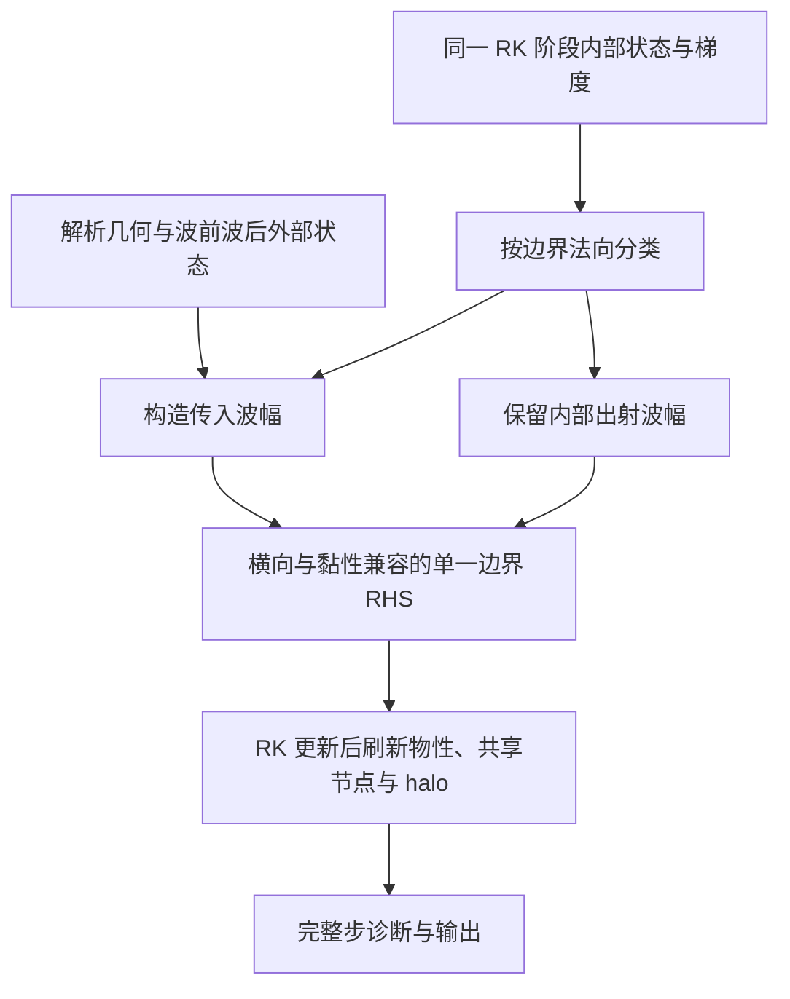

# NSCBC 入射激波顶面设计与 HCW 弱压缩原因分析

日期：2026-10-27。当前状态：高阶整链h1已接入并通过精度、CPU/GPU、MPI、续算及原定Ma2角度/平台门槛；
但细网格顶面邻近层的展向扰动放大仍未收口。用户已决定暂绕过本项、不阻挡本次HCW启动；
新版Catalyst/设备渲染已完成完整网格首帧及精确续算功能验收。
用户随后授权的新顶面HCW 30000步计算已于2026-10-27 22:36:37启动；
见第11节及高阶计划第29.7–29.9节，尚未完成长窗物理验收。
v2均匀起算平台最大误差1.38072%的历史失败保留在第10节，不作为当前h1结果。

用户已确认：采用激波几何与守恒跳跃关系构造外部波前、波后参考状态，按边界法向分类，
在同一套边界 RHS 中耦合传入信息、出射波、切向输运与黏性项。
随后用户选择第5.3节的 A，并批准新模式首轮不施加顶面横向滤波，保留接口，旧模式不变。
v1历史实现见第9节，v2历史修订及斜激波验证见第10节；h1采用已批准的HB1-A整链，见第11节。

## 1. 结论与范围

当前 `bc52 + sbli_shock` 把分段激波状态作为特征波的松弛目标，不是直接保持该状态的激波发生器。
HCW 30000 步结果中，顶面实际压比远低于设计值，并沿 x 缓慢增加。
因此，未见清晰入射激波首先是实际边界驱动没有形成设计跳跃，不能只归因于色标。
弱松弛与强切向输运的平衡是优先检查的机制，尚未通过改变单一因素的对照唯一归因。

已确定把新边界设计为一个统一的特征处理：**解析外部流场供给传入信息，内部流场决定出射信息**。
非反射处理针对相对于入射背景的扰动，不应把需要供给的入射波本身消除。
NSCBC 可以承载这样的设计，但仅使用 NSCBC 名称或保留出射波，并不自动保证斜向、有限强度激波无反射。[^poinsot]

首轮限于当前单组分、量热完全气体、笛卡尔可分离拉伸网格、上 y 面，
保留 MP7-LD 743e/643e、RK3、FP64、GPU 常驻状态和已有通信方式。
不同时扩展 AIR5、任意曲面、湍流入口或新的体内数值格式。

## 2. 已完成算例的直接证据

冻结运行目录为 `tests/gpu_validation/out/hcw_production_20261026_np2/`。
2026-10-26 完成 30000 个完整步，物理时间 154.509 μs，求解器记录正常结束，
总耗时约 4731 s。保留 step27000/30000 精确检查点，8 类 JPEG 各输出 300 张。
这是完整运行与原位功能的证据，不是设计激波形成或稳态 SBLI 的验收。

### 2.1 设计目标与保存场不一致

目标为 Ma∞=7、T∞=240 K、p∞=400 Pa、Tw=300 K，入射点设在顶面
x_s=0.728783652 m。激波角 β=12.6452316°，局部平面波后偏转角为 5.9713392°。
9°是原锥体半锥角，不是本平面激波的偏转角。

| 量 | x>x_s 的波后目标 | step30000，x≈0.74988 | x≈0.84999 | x≈0.95010 |
|---|---:|---:|---:|---:|
| ρ/ρ∞ | 1.917387 | 1.037930 | 1.172112 | 1.244820 |
| u/U∞ | 0.977071 | 0.999300 | 0.994320 | 0.989430 |
| v/U∞ | −0.102200 | +0.010210 | −0.009678 | −0.029744 |
| p/p∞ | 2.572941 | 1.053535 | 1.278605 | 1.430166 |
| T/T∞ | 1.341900 | 1.015035 | 1.090855 | 1.148894 |

表中实际量取保存守恒场重建的中展向顶面节点，位置为最邻近节点。
压力由 p=(γ−1)[ρE−|ρu|²/(2ρ)] 重建；程序压力归一化为 ρ∞U∞²，
转为 p/p∞ 时乘 γMa∞²=68.6。不能把程序原始压力值直接当成压力比。

末步中展向全截面的 p/p∞ 最大值仅约 1.50770，未达到设计入射波后的 2.57294。
底壁 Cf 为 0.00049818～0.00260166，均为正，未检出壁面剪切零点。
没有分离不是单独的失败标准；本次更直接的问题是外流入射激波强度不足。

step27000→30000，x≈0.74988 顶面压比只变化约 −2.24×10⁻⁵，
但仍远离目标。底壁压力、Cf、热流的最大绝对变化分别约为末步各曲线最大绝对值的
1.54%、1.73%、1.90%。这些是时间变化，不是相对于真解的误差或稳态认证。

数据依据：运行目录的 `run.log`、`case_manifest.json`、
`outdat/new/checkpoints/step000000027000/state.h5`、
`step000000030000/state.h5`、`outdat/new/resources/geometry.h5` 及
`outdat/render/*step00030000.csv`。重建公式与私有六阶梯度定义见
`tests/gpu_validation/test_hcw_insitu.py::compare_sbli_diagnostics`、`logical_derivative`。
本轮仅只读分析，未调用测试中的推进器。

### 2.2 出图确有弱化对比，但不是主因

设计波后速度模长为 0.982401 U∞，相对来流仅下降 1.76%。
现有速度图用 0～1.1 固定色标，必然不如压力、密度和法向速度敏感。
数值纹影显示 log10(1+Lx|∇xyρ|/ρ∞)，固定范围 0～4。
同一定义的保存场诊断中，全截面最大值约 3.116，y>10 mm 区域最大值约 0.922，
近壁热边界层密度梯度占据了大部分色阶。

后续主图仍可保留统一色标，同时增加外流区域增强图、顶面 p/v 曲线和横穿预期激波的剖面。
增强图必须标注范围，不把增强后的颜色界面当成激波已经达到设计强度的证据。
本文件不修改现有产品或输出频率。

## 3. 当前实现为什么可能只形成宽缓压缩

### 3.1 实际是波幅松弛，而非状态施加

CPU 对应 `src/bc.F90::nscbc_farfield_y_upper_incoming_lodi`，GPU 对应
`src_gpu/boundary_gpu.cuf::nscbc_farfield_y_upper_rhs_kernel`。
采用当前点的特征基，对 q−q_target 投影，仅替换法向传入波幅：

$$
\mathcal L_i=\sigma_i\,[\mathbf L_n(\mathbf q-\mathbf q_{\mathrm{target}})]_i,
\qquad \lambda_i<0.
$$

随后仍由完整边界 RHS 和 RK 推进得到新状态。设置了 q_target 不等于边界每步达到 q_target。
传入分支系数 σ_in=0.25a/Ly，对应 τ=4Ly/a：上游约 386.36 μs，
按设计波后声速约 333.53 μs。已运行窗口仅为这些系数时间尺度的 0.40～0.46 倍。
τ不是整个多维状态必定按单一指数收敛的时间常数。

### 3.2 沿顶面输运可维持目标偏差

此算例沿顶面的速度接近 U∞。用标量对流松弛模型说明竞争尺度：

$$
u\,\partial_x z=-\sigma(z-z_{\mathrm{target}}),\qquad
\ell_{\mathrm{relax}}=u/\sigma.
$$

冻结上游/波后系数得到的长度约为 0.84/0.71 m，均大于顶面激波入口到出口的 0.2712 m。
这不是完整 NSCBC 的解析解，但解释了为何可能形成沿 x 的宽缓压缩，而非保持分段跳跃。
多维特征边界必须共同处理切向对流与压力梯度，不能只修改法向波幅就假定目标无偏。[^lodato]
顶面起始段实际 v>0，又只允许传入声波接受外部信息，不会立即获得四个入流特征的驱动。

### 3.3 已排除的简单解释与未隔离因素

| 判断 | 证据或边界 |
|---|---|
| 不是程序没读到激波目标 | 激波参数已登记，短测对目标变化有响应，长窗也出现向下偏转和压力上升 |
| 不是因为总 Ma>1 就把所有松弛关掉 | 当前归约使用真实顶面的最大法向 Ma²；传入流分支另用 σ_in |
| 不能归因于主十阶滤波 | 本次 lfilter=f；NSCBC 内部横向滤波仍开启，其影响尚未单独隔离 |
| 不能靠图像增强修复 | 保存场本身缺少设计压比和法向偏转 |
| 延长计算不保证恢复设计波系 | 局部顶面已经变化很小，可能趋于有目标偏差的空间平衡 |
| 尚未唯一归因于某一项代码错误 | 缺少强制两态正对照及横向项/边界滤波的单因素对照 |

因此本次是旧驱动方式在该工况下的物理能力不足证据，尚不是某一行 CPU/GPU 移植错误的证明。
既有 CPU/GPU 短窗一致性、精确续算及 memcheck 通过记录仍有效。

## 4. 原 CPU 激波发生器可借鉴什么

`farfield(ndir=4)` 曾包含局部线性声学匹配：外部波前/波后状态提供传入信息，
内部外推提供出射信息，再代数重建边界 p、v、ρ。冻结阻抗 Z=ρa 时可写成
W_b⁺=W_e⁺、W_b⁻=W_far⁻，其中 W±=p±Zv，上顶面外法向为 +y。
它不是等待全域时间尺度松弛，也不是严格的非线性 Riemann 解。

当前 `src/bc.F90::farfield` 虽仍构造 `rho_far/vel_far/prs_far/tmp_far`，
应用这些目标的顶面块已被注释，活动代码只是外推内部状态后置边界 qrhs=0。
历史提交 `08bd489` 有活动的匹配块，`5f3f5cb` 将其注释；纯 CPU 基线 `47737cf` 已是后者。
不能由提交说明推断作者这样改的原因。

旧实现只按 v 的符号区分、含 w=0 的二维专用处理，不能直接作为一般声速分类边界恢复。
`examples/SWLBI` 的示例还设 xrhjump=1e5，超出其约 2.8 的 x 域。
所以切换到 bc51 或取消注释，并不等于已有可信激波入口。

可复用 `src/fludyna.F90::postshock` 的 Rankine–Hugoniot 状态构造与
现有完美气体状态转换。上 y 入射的角度符号需保持正确；postshock 负责构造两态，
不负责决定边界哪些特征可以施加。

## 5. 新顶面的数学与执行思路

### 5.1 先定义外部入射参考，而非给整面一个压力

对当前平面入射几何，定义实际物理坐标上的分界：

$$
\phi(x,y)=x-x_s+(y-L_y)\cot\beta,\qquad
\mathbf q^I(x,y)=
\begin{cases}
\mathbf q_1,&\phi\le0,\\
\mathbf q_2,&\phi>0.
\end{cases}
$$

此处 q₂ 必须由给定气体模型的守恒跳跃关系得到，不能独立随意指定 p、ρ、T、偏转角。
在顶面有 φ=x−x_s，名义壁面交点 x=x_s+Ly cotβ=0.8625 m。
外部 ghost 点也按各自真实坐标计算 φ，不能把顶面的 x 分界机械复制到每层 ghost。
φ=0 的归属全局一致，不引入未经决定的平滑宽度。

参考只负责外部入射信息，不能覆盖整域黏性边界层。
无激波 Blasius 初场与包含解析斜激波的验证初场应分开设置，避免把初值注入误当成边界生成能力。

### 5.2 按边界法向决定自由度

以外法向 n_b 定义 u_n=u·n_b，五个 Euler 特征速度为
u_n、u_n、u_n、u_n+a、u_n−a。使用边界法向，不是激波法向，也不是总 Mach 数。[^poinsot]

| 当前边界状态 | 传入波数 | 处理原则 |
|---|---:|---|
| u_n<−a | 5 | 外部参考供给全部传入信息 |
| −a<u_n<0 | 4 | 外部供给四个传入信息，保留内部出射声波 |
| 0<u_n<a | 1 | 只约束传入声波，其他由内部决定 |
| u_n>a | 0 | 不强制外部激波目标 |

目标波后在顶面 Ma_n≈−0.618，属于法向亚声速入流，而非五变量全指定的超声速入口。
擦边及声速临界点另处理零速特征，可沿用已有舍入级分类约定，不能把它变成可调物理阈值。
上游边界层连续性导致的外向 v 不是自动应删除的错误。

### 5.3 已选 A：外部参考驱动的 GRCBC 思路

Pirozzoli & Colonius 的 GRCBC 利用第一外部 ghost 点的参考状态估计传入波幅，
不依赖任意选取的全域慢松弛时间。[^grcbc]
首版使用原始变量 v=(ρ,u,v,w,p) 的差，而不是直接把有限幅值守恒量差当成线性原始变量差。
定义 P_b=∂q/∂v|_b，在局部冻结特征基、法向距离 h_n>0 下，项目组件计算

$$
\delta\mathbf q^{\mathrm{prim}}=\mathbf P_b(\mathbf v_b-\mathbf v_g^I),
\qquad
b_i^I=b_i^{\mathrm{ref}}-\frac{|\lambda_i|}{h_n}
\left[\mathbf L_n\delta\mathbf q^{\mathrm{prim}}\right]_i,
\qquad\lambda_i<0.
$$

把 bᴵ 代入第5.5节的完整 RHS 投影。这是 GRCBC 式原始变量外部参考驱动与项目源项兼容框架的组合，
不是宣称逐式复现该论文全部算法，也不等价于精确非线性 Riemann 边界迹。
当前参考静止，外部参考变化率为零；组件接口允许传入明确的参考变化率，但尚未开放动态参考配置。
v1曾将全部传入方向的兼容率都置零。第10节记录其擦边缺陷及已批准修订：
v2对三个对流特征另加同阶段G的投影，传入声学分支不变。
间断参考与有限幅值波系是否正确传播仍由解析斜激波测试判断，不能靠局部公式或同态测试代替。

首轮 h_n=(x_b−x_inside)·n_b，以 x_g=x_b+h_n n_b 定义虚拟第一外部参考点，
在这个物理坐标上选择波前/波后状态。不读取未定义的外部网格数据，也不修改求解器 halo。
第一外点估计为一阶，不能把体内 MP7-LD/六阶黏性解释成六阶顶面闭合。
耦合尺度为 |λ_i|/h_n，不新增任意松弛常数或自动改步长；仍须检查边界稳定性和网格收敛。

备选是非线性特征状态匹配或法向 Riemann 边界迹。它适合审查有限强度跳跃，
但不能把旧线性 p±Zv 公式称为精确非线性匹配。
`src/riemann.F90` 现有 Steger–Warming 分裂也不等于已具备这样的边界迹求解器。
建议先推导与小算例比较，再决定是否需要这条备选，避免一次新增两套生产算法。

### 5.4 横向项、黏性与出射扰动必须在同一 RHS 中闭合

在物理法向特征表达中统一记为

$$
\dot{\mathbf q}_b=-\mathbf R_n\boldsymbol{\mathcal L}_n+\mathbf G_b,
$$

其中 G_b 包含切向输运、黏性和所需几何项，符号与实际 qrhs=-qrhs 流程逐项对应。
传出波幅保留内部估计；传入波幅由外部参考和经过推导的多维兼容条件确定。
现有零传入波/源项平衡辅助函数可以参考，但不能直接抹掉参考入射波，
也不能把 G_b 在波幅与最终 RHS 中重复加入或抵消两次。
多维边界及交线处理参考 Lodato 等，不把一维 ghost 原型直接宣称为完整斜向非反射边界。[^lodato]

平滑的两态常值区应保持相应常值解；激波交线处按守恒跳跃和网格收敛验收，
不要求点值光滑，也不把不连续参考的导数按普通光滑场处理。
用户已批准首轮新模式不施加顶面横向滤波，保留接口；旧模式和出口自身的横向滤波不变。
后续若需要滤波，单独验证只处理相对解析背景的扰动，不直接套用总状态滤波。
x+/y+ 交线还涉及出口参考 p₃ 与顶面入射背景 q₂，必须有唯一兼容规则，不能靠最后写入者决定。

### 5.5 完整 RHS 的特征替换框架

以下是已批准原则对应的局部代数框架，不是尚待选择的传入闭合公式。
在同一阶段、同一边界状态上使用互逆矩阵 L_n、R_n，令 D₋ 为传入特征的对角掩码，
D₊=I−D₋。零速特征保留原始离散兼容关系，不额外强制目标。
尚未施加新边界约束的完整物理状态导数记为

$$
\mathbf f_b^{(0)}=-\mathbf R_n\boldsymbol{\mathcal L}_n^{\mathrm{int}}+\mathbf G_b.
$$

若外部闭合给定传入特征方向的时间变化率 bᴵ，则统一边界导数为

$$
\dot{\mathbf q}_b=\mathbf f_b^{(0)}+
\mathbf R_n\mathbf D_-\left(\mathbf b^I-\mathbf L_n\mathbf f_b^{(0)}\right).
$$

由 L_nR_n=I 可直接检查

$$
\mathbf D_-\mathbf L_n\dot{\mathbf q}_b=\mathbf D_-\mathbf b^I,
\qquad
\mathbf D_+\mathbf L_n\dot{\mathbf q}_b=
\mathbf D_+\mathbf L_n\mathbf f_b^{(0)}.
$$

即传入方向满足所选外部闭合，出射方向保留完整内部 RHS 的投影。
bᴵ 是局部基下 L_n q̇ 的规定值，不是把随状态变化的 L_nq 当成具有常系数的全局特征变量。
当前从第5.3节的外部参考构造；v2在三个传入对流特征上保留同阶段切向/黏性贡献，见第10.3节。

等价的法向波幅表达为

$$
\boldsymbol{\mathcal L}_n^{\mathrm{new}}=
\mathbf D_+\boldsymbol{\mathcal L}_n^{\mathrm{int}}+
\mathbf D_-\left(\mathbf L_n\mathbf G_b-\mathbf b^I\right).
$$

这明确了横向/黏性项进入传入兼容关系的位置。它不是把这些物理项全部删除，
也不允许在最后再无条件追加一份黏性项，否则先前闭合会被改变。
若后续改成直接规定法向波幅，则必须同时给出其对应的
bᴵ=L_nG_b−ℒ_nᵉˣᵗ，并检查目标保持。当前实现采用第5.3节规定总传入变化率的扩展，
不是只把旧全域 σ 换成网格尺度系数后照旧追加横向/黏性项。
有限强度激波、黏性边界的额外数值条件及交线兼容性仍需单独推导，局部投影恒等式不代替这些工作。

### 5.6 已核对的代码符号与执行位置

CPU `src/solver.F90::rhscal` 先在对流完成后执行 qrhs=-qrhs，再加入黏性与源项。
GPU `nscbc_farfield_y_upper_rhs_kernel` 直接向 qrhs_d 加负对流导数，随后扩散核加入黏性。
两端 RK 均按 qrhs/J 更新物理守恒量，因此新闭合应统一在最终符号下处理：

$$
\mathbf r_b^{\mathrm{new}}=\mathbf r_b^{(0)}+
J\mathbf R_n\mathbf D_-\left(\mathbf b^I-
\mathbf L_n\frac{\mathbf r_b^{(0)}}{J}\right),
\qquad \mathbf r_b=\mathrm{qrhs}_b.
$$

执行点为当前阶段全部相关对流、黏性和源项完成之后、RK 更新之前。
只在新模式下保留未替换传入波的原始顶面 RHS，并由此处作一次最终闭合；
不先运行旧 sbli_shock 松弛再重复施加新策略。若从直接法向波幅闭合构造 bᴵ，
仅在需要时暂存 O(NxNz) 的顶面分量，不增加整域参考场或全体积 RHS 副本。

已有黏性投影辅助路径不能直接视为当前组合已经实现：CPU 的
`nscbc_farfield_viscous_source_enabled` 限定非反射模式、643e/643e，平板出口为21；
GPU 由 `gpu_curvilinear_nscbc52_viscous_nonreflecting_supported` 选择。
当前 HCW 的743e/643e、出口22、sbli_shock不属于该路径。
这是新实现需要覆盖的差异，不据此单独断言旧松弛模式存在黏性符号错误。

## 6. 代码落点与续算边界

| 责任 | 现有落点及拟修改范围 |
|---|---|
| 参考状态、策略与 CPU 实现 | `src/bc.F90`，复用 `src/fludyna.F90::postshock`；CPU 数值改动先获批准 |
| GPU 分类与顶面 RHS | `src_gpu/boundary_gpu.cuf`、`src_gpu/nscbc_characteristic_policy_gpu.cuf` |
| RK 相位、交线、缓存与 halo | CPU最终RHS在`src/solver.F90`闭合，生命周期位于`src/mainloop.F90`；GPU为`src_gpu/mainloop_gpu.cuf`，每阶段只有一个顶面处理所有者 |
| 准入与参数 | `src/readwrite.F90`、`src_gpu/gpu_runtime.cuf`、`src_gpu/case_capability_gpu.cuf`，只扩大已验证组合 |
| 精确续算身份 | `src/output_runtime.F90`，复用现有控制信息而非新增旁文件 |
| 数值与物理检查 | 复用 `test_sbli_joint_nscbc.py`；拟新增专项测试，不重写已有通用验证框架 |

不同时叠加旧 bc51 状态覆盖、旧 sbli_shock 松弛和新闭合。
顶面只由拥有物理上边界的 rank 更新，需要的集体通信仍由对应全体参与。
目标、物性、梯度和 RHS 必须使用同阶段状态，物性与 halo 在约定更新点重建。

现有检查点以 `driver_config` 中 `sbli-top-v1` 记录目标与几何参数。
新算法须有独立的模式/版本身份，保留旧模式供历史比较。
不能从旧 30000 步检查点切换边界后仍声称精确续算；首轮从头运行，或明确标为非精确分叉。
本设计不修改旧检查点、当前默认策略或现有完整步输出语义。

## 7. 最小推进顺序

| 步骤 | 工作与判据 | 当前状态 |
|---|---|---|
| S0 | 记录本次实际顶面、场压比、时间窗及 CPU 历史行为 | 本文完成证据整理 |
| S1 | 传入闭合、横向/黏性项、临界分类、交线和滤波顺序，明确 Δt 限制 | v2已实现并短测：原始变量外部参考、完整RHS投影，三个对流特征保留同阶段源项，顶面横向滤波关；交线范围见第9–10节 |
| S2 | 无边界层的解析斜激波小算例，给定两态顶面正对照及新特征边界；比较角度、跳跃和守恒残差及网格收敛 | v2解析两态初场三档网格完成，最细网格通过角度/平台量门槛；均匀起算t=2的平台误差1.38072%，未通过；强制两态顶面正对照未实现 |
| S3 | 常值、法向亚/超声速进出流、擦边、小幅正/斜向声波；分别测目标保持和反射，不能以看见激波替代反射测试 | 组件分类及真实擦边熵波复现通过；小扰动声学反射和动态跨声速尚未完成 |
| S4 | CPU/GPU 同相位、NP=1/2、精确续算及受影响内存检查；只在必要时增加拓扑 | v2黏性/无黏NP=1/2 x/y同态、NP=2 x精确状态续算及memcheck、黏性CUDA-aware MPI通过；不是全矩阵验收 |
| S5 | 缩小的黏性平板，先检查顶面入射强度与外流波线，再检查壁面响应和出口交线 | 未执行 |
| S6 | 小算例通过后才重跑原 HCW 网格与窗口，沿用100步图片/3000步检查点节奏 | 未批准启动 |

S2 可复用现有 `perfect_gas_boundary` 分段状态能力构造正对照，但属于测试夹具扩展，
不能未经准入直接配置即认为已支持。强制两态参考边界有助于判断体内格式能否捕获激波，
并非新的非反射生产默认。

场差继续参考既有 max|GPU−CPU|/(1+|CPU|)≤2e-10 的短测口径。
解析斜激波角度、平台量误差和取样区已获批准，见第10.1节；
反射率的门槛及频率/角度范围仍待确定。不得把“无崩溃”“CPU/GPU 一致”当作物理通过。
二维 HCW 的最小展向网格仍不分解 z；其他拓扑使用独立、足够展向节点的夹具。
壁面是否分离由工况决定，不强制要求出现分离泡；黏性激波弯曲也不要求壁面交点严格等于无黏名义位置。

## 8. 待决定与建议

用户已选 GRCBC 式外部参考法，并批准首轮顶面横向滤波关闭。
新模式保留为显式选择，旧松弛模式仍可对照。S2已有第10节中的网格证据及均匀起算失败，
下一步先定位该失败，再补齐S2剩余对照及S3小扰动反射测试，之后才进入原HCW窗口；
本轮没有重跑原生产目录。
若该闭合不能在小算例保持正确入射波，再审查非线性边界迹备选，不先扩展新工况掩盖问题。

当前待定的是反射率门槛、扰动滤波的后续方案，以及一般亚声速出口/顶面交线。
本轮一阶外点驱动不宣称高阶边界收敛；有限强度激波的证据限于第10节的明确工况和时间窗。
长期窗口可在边界供给可信后再讨论，避免用更多计算时间掩盖不正确的目标保持。

## 9. v1首轮实现与历史证据

### 9.1 调用方式与实际范围

新增显式选项 `ASTR_NSCBC_FARFIELD_MODE=sbli_grcbc`，读取与旧 `sbli_shock` 相同的
五个上游目标、`ASTR_NSCBC_FARFIELD_SHOCK_X` 和 `ASTR_NSCBC_FARFIELD_SHOCK_ANGLE_DEG`。
旧模式和默认值不变。当前组合为非反应五变量、无量纲三维 `bl`、
`11,prof / 22,pout / 41,Tw / 52 / 1 / 1`，主滤波关闭。
新模式顶面 x/z 横向滤波关闭，出口滤波不变。

- `src/nscbc_incident.F90` 与 `src_gpu/nscbc_incident_gpu.cuf` 分别导出主机和设备符号，
  共用 `src/nscbc_incident_body.inc` 的两态构造、斜向几何、原始变量投影和完整 RHS 代数。
- CPU `apply_nscbc_incident_complete_rhs` 与 GPU 同名后缀过程在对流/黏性/相关源项完成后闭合。
  GPU 两态仅首次上传10个实数，逐阶段只回读一个状态码，无流场回读或新增整域缓冲。
- 上入口交线由原完整状态剖面负责，RHS固定为零；上出口交线首轮要求流向超声速出流，
  因而 x 方向没有待施加的传入特征。若该交线变成流向亚声速，返回 status=4，
  不能静默用最后一个面的覆盖替代尚未实现的双面兼容条件。
- 新检查点模式身份为 `sbli-grcbc-v1`，仍保存在原有 driver_config 中，未新增附属文件。
  旧 `sbli-top-v1` 不能作为新模式精确续算；新模式自身精确续算已检查。

### 9.2 已通过检查

| 检查 | 观察结果 |
|---|---|
| CPU独立组件与无CUDA构建组件 | HCW Ma7两态、守恒法向通量、切向速度、外部y坐标选择、界面归属及非法非压缩激波拒绝均通过 |
| 特征代数 | 九种亚/超声速进出流、声速临界和擦边状态通过；真实Euler左右基、完整RHS出射投影保持、后加源项先纳入闭合均通过 |
| GPU组件与memcheck | 最大CPU/GPU绝对差6.7502e-14，零memcheck错误 |
| 实际743e/643e积分，同相位场/缓存及原有统计 | 64×48×16区间，Ma2，dt=2.5e-4，12完整步；NP=1、NP=2 x/y均通过；最大缩放字段差1.7758e-15，统计最大绝对差7.6162e-14 |
| 精确续算 | CPU/GPU各NP=2 x，连续12步与5+7步，state.h5逐值/逐字节一致，control.bin逐字节一致 |
| 模式身份 | 旧sbli_shock检查点切到sbli_grcbc的精确恢复被拒绝 |
| CUDA-aware MPI与旧模式回归 | 新模式NP=2 x同态对照通过；旧sbli_shock的CPU/GPU对照及既有特征策略组件通过 |
| 实际双rank memcheck | 新模式6完整步，每rank零错误 |
| 构建与解耦 | 根CMake的BUILD_TESTING=OFF主程序构建通过；CPU/GPU×AIR5开/关四种无tests目录配置通过 |

12步观察中，x∈(2,5) 顶面平均压比从旧模式的1.00006775提高到1.00251847，
平均 v/U∞ 从+0.00068840变为−0.00018589。这只说明短窗驱动响应更强。
另在同一小网格上以NP=2 x推进2000步至t=0.5，仅末步保存一次检查点：
顶面该区平均压比1.161928，v/U∞=−0.0534471，最大CFL=0.1693185，所有检查字段有限且正密度/正内能。
该工况参考压比为1.187945，参考v/U∞=−0.0524789，不能把尚有偏差的驱动窗口叫作目标保持或稳态通过。

运行测试为 `tests/gpu_validation/test_sbli_grcbc.py`，分三次无重复执行共11项通过：
`integration_first.xml`三项、`integration_extended.xml`七项、`driving_window.xml`一项。
组件、构建及原策略输出位于 `tests/gpu_validation/out/nscbc_incident_components_20261027/`。
实际场分别位于 `out/sbli_grcbc_20261027_first/`、`out/sbli_grcbc_20261027_extended/`、
`out/sbli_grcbc_20261027_driving/`，均相对于 `tests/gpu_validation/`。

未复核543e、NP=2 z、更多rank、FP32、CURVE、AIR5、原位产品组合及真实HCW长窗。
S2解析无黏斜激波与S3反射测试仍未执行，不把上述积分短测或2000步有限性检查替代它们。

## 10. 无黏斜激波与v2修订

### 10.1 已批准的解析规格与门槛

这是自设平面斜激波基准，不是边界层或SBLI物理算例。
`flowtype=bl`只复用已有外部网格/入口剖面框架，实际关闭黏性且下壁采用已有421滑移绝热核。
不存在Blasius初场或无滑移边界层。守恒跳跃依据完全气体斜激波关系。[^oblique]

| 参数 | 值 |
|---|---|
| Ma∞、γ | 2、1.4 |
| 物理坐标域 | x,y∈[0,1]，z∈[0,0.125] |
| 入射激波角、顶面进入点 | β=40°，x_s=0.25 |
| 理论两态 | ρ₂/ρ∞=1.49055518，p₂/p∞=1.76148759，T₂/T∞=1.18176610 |
| 理论波后速度 | u₂/U∞=0.86402007，v₂/U∞=−0.16205457，w₂=0 |
| 理论激波与下壁交点 | x≈1.44175，在出口之后；基准中没有壁面激波反射 |
| 边界 | 11,prof / 22,p₂/p∞ / 421,xslip / 52 / 1 / 1 |
| 离散 | 743e MP7-LD、特征重构、RK3、FP64；643e黏性格式标签保留但diffterm=f |
| 主滤波、顶面横向滤波、海绵层、自动状态修复 | 均关闭；出口原有横向滤波不变 |
| 网格 | 64²×8、128²×8、192²×8区间，均匀网格，NP=2 x用于物理窗口 |
| 时间步 | 固定dt=2.5e-4；解析初场保持窗口t=1，从均匀初场生成窗口t=2 |

门槛由用户于2026-10-27批准：最细网格角误差≤1°，远离激波核心的状态最大误差≤1%，
CPU/GPU短步场差沿用最大缩放差≤2e-10。报告网格收敛，不用“正常结束”代替物理门槛。
密度、压力和温度除以各侧解析值，速度误差除以U∞，不对零速度分量作相对除法。

固定平台取样区为0.35<x<0.85、0.2<y<0.9，离解析激波的法向距离>6h，h=1/N。
状态门槛取所有展向节点的最大值，不用展向平均隐藏局部状态误差。
角度由展向平均压力的半跳跃位置拟合，y∈[0.55,0.8]；报告不唯一交点行数和展向场差。
位置误差与全域梯形求积L1误差独立记录，不从1°门槛推出位置逐点精确。

输入及后处理为`tests/gpu_validation/test_grcbc_oblique_shock.py`，每一步由ASTR推进。
421输入仍提供读取器要求的xslip字段；当前CPU421的该分段判断已被注释，实际是全滑移，
GPU复用全滑移核，本基准不把它解释为可调的局部无滑移带。
Euler基准不使用框架中仍按黏度/Re构造的壁面统计量作黏性物理结论。

### 10.2 v1结果及不能放行的原因

v1在t=0.25时最细网格的平台最大误差为2.14268%，未过1%门槛。
保持步长、算法、取样区与门槛不变，精确状态续算至t=1后，得到：

| N | 角误差/度 | 激波位置平均绝对差 | 波后平台最大缩放差 | 压力比L1误差 |
|---:|---:|---:|---:|---:|
| 64 | 1.04816 | 0.0193731 | 1.74520% | 0.0106751 |
| 128 | 0.495368 | 0.00988936 | 1.24685% | 0.00561864 |
| 192 | 0.321120 | 0.00662208 | 0.883692% | 0.00389974 |

这显示约一阶的位置和L1收敛，符合该首版边界闭合的限制，不宣称体内七阶格式在间断处仍为七阶。
续算显式override输出调度，权威状态仍按exact_restart=t恢复；不是改变数值模型的分叉。
从均匀初场推进192²×8至t=2，角误差0.001220°，平台最大缩放差0.637616%。

然而全场检查发现，v1在顶面入口上游x≈0.203125、y=1处的ρu展向差达到0.151853，
全场最大|w|≈0.002846 U∞。内部激波位置的展向差仅约2.52e-9，
不能据此把顶面差异当成激波位置抖动或机器噪声。
因此v1虽通过这两个局部物理指标，整体顶面稳健性仍不通过，未向HCW生产计算推广。

证据为`out/grcbc_oblique_20261027_{seeded,uniform}/`和
`out/grcbc_oblique_20261027_transient_{128,192}/`，
64网格续算为`out/grcbc_oblique_20261027_transient_64_restart_fixed/`，均相对于`tests/gpu_validation/`。
早期准备错误（剖面首列整数未被旧读取器识别、缺少输出根目录）及修正后证据保留，
它们发生在数值推进前，不作为物理失败归因。

### 10.3 已复现的擦边缺陷及批准修订

两步真实ASTR复现采用无激波的纯熵扰动ρ=1+0.01sin(2πx)，p恒定、u=1，
v_n分别为±1e-6，入口激波分界移到域外x=2，法向场初始无梯度。
x=0.5顶面两步后的结果为：

| 状态 | v1 CPU/GPU均观察到 |
|---|---:|
| 离散切向输运期望密度 | 1.000031365433477 |
| v_n=+1e-6 | 1.000031365433560 |
| v_n=−1e-6 | 1.000000000051123 |
| 两侧差 | 3.13654e-5 |

问题在新增闭合的调用者：将全部参考兼容率置零，导致v_n稍微变负时，
三个对流特征上有限的切向/黏性源项被一并取消，而正侧仍保留该项。
原始变量外部驱动本身趋于零，并不能消除这个RHS的不连续。
CPU和GPU均复现，不能归咎于GPU舍入或移植差异。

用户已批准只修这三个对流特征，声学分支、传出波、MP7-LD、步长、滤波和旧模式均不变。
在f⁰=−Rℒ_n+G的同阶段分解中，v2对传入对流波使用：

$$
b_m^{\mathrm{bc}}=(\mathbf L_n\mathbf G)_m-
\frac{|u_n|}{h_n}\Delta W_m,\qquad m=1,2,3,
\qquad \Delta\mathbf W=\mathbf L_n\mathbf P_b(\mathbf v_b-\mathbf v_g^I).
$$

其中L_nG=L_nf⁰+ℒ_n；法向ℒ_n按现有三点通量导数并扣除几何rest项，
从当前q、原始变量缓存和几何重新计算，不读取上一阶段快照。
声学传入率仍保持既有实现，动态跨法向声速临界的相容性留待S3，不由本修订外推。
新过程为`incident_normal_characteristics`和`incident_convective_compatibility`，CPU/GPU共用纯代数。

v2两步复现已转绿，正负法向速度之间的密度差约1.00e-12，
CPU/GPU新源项组件最大绝对差4.55e-13，组件memcheck零错误。
新身份为`sbli-grcbc-v2`；旧v1字段保持历史证据，不用旧v1检查点冒充v2精确续算。
新验证从头启动，不与v1网格收敛数据混合。

### 10.4 v2复核状态

已通过擦边复现CPU/GPU两项、无黏短步/精确状态续算/双rank memcheck等八项，
以及原黏性平板GRCBC与旧模式回归十项。无黏12步场/缓存最大缩放差为9.36828e-11，
原有统计最大绝对差4.88277e-13。同后端、同拓扑连续12步与5+7步续算的
state.h5字段逐值、逐字节一致；v2身份在control.bin中核对。

从解析两态初场重新运行4000步至t=1，结果为：

| N | 角误差/度 | 激波位置平均绝对差 | 波后平台最大缩放差 | 压力比L1误差 | 全场最大展向守恒量差 |
|---:|---:|---:|---:|---:|---:|
| 64 | 1.13841 | 0.0188205 | 2.06140% | 0.0108591 | 0 |
| 128 | 0.499039 | 0.00945171 | 1.52149% | 0.00567466 | 0 |
| 192 | 0.321168 | 0.00630332 | 0.983503% | 0.00395015 | 4.59832e-12 |

1%与1°门槛只要求最细网格，192网格通过；不把64/128网格的平台量称为通过1%门槛。
位置误差的相邻网格阶约0.994/0.999，压力比L1误差约0.936/0.893，
最大CFL分别为0.0448476/0.0808011/0.1168135。所有量按第10.1节固定取样和归一化计算。

均匀来流起算的8000步/t=2正常完成，但物理检查未通过，见第10.5节。
证据位于
`tests/gpu_validation/out/grcbc_oblique_v2_20261027_{grazing,short,viscous,seeded,uniform}/`，
对应JUnit汇总为`out/nscbc_incident_components_20261027/oblique_v2_*.xml`。

### 10.5 均匀起算未通过及下一步定位

192²×8、NP=2 x从均匀来流起算8000步至t=2，正常结束，最大报告CFL为0.1196046。
同一固定取样区、归一化方式和1%门槛未改变：

| 量 | 结果 |
|---|---:|
| 拟合激波角 | 40.0303613° |
| 角误差 | 0.0303613°，通过1°门槛 |
| 波后密度最大相对差 | 1.380719%，未通过1%门槛 |
| 波后温度最大相对差 | 1.315948%，未通过1%门槛 |
| 波后压力最大相对差 | 0.630553% |
| 激波位置平均绝对差 | 0.00785043 |
| 全场最大展向守恒量差 | 4.01628e-9 |
| 全场最大\|w\|/U∞ | 6.69006e-11 |

密度误差峰值位于(x,y,z)=(0.8177083,0.8958333,0.0625)，
ρ=1.46997480，理论ρ₂=1.49055518。该点距解析激波的法向距离约0.28512，
远大于6h=0.03125，不能把这一失败解释为平台区误采了激波核心。
该点(p/p₂)/(ρ/ρ₂)^γ≈1.01841，偏差以密度/温度的熵变化为主，不只是压力跳跃不准。

v1的大幅展向异常显著减少，但顶面状态仍有偏移。x=0.203125、y=1处，
v2均匀起算得到ρ=0.89293126、u/U∞=0.96220369、T/T∞=1.12062043、p/p∞=1.00063701；
解析初场t=1在同点也有ρ=0.90348158、T/T∞=1.10748068。
因此不把它简单归咎于均匀初场，更不能把展向差缩小等同于顶面物理正确。
压力比拟合的顶面进入点为0.24256679，而设定值为0.25，位置偏差另行报告。

只读代码核查表明，`src/bc.F90::farfield_nscbc`的顶面切向通量仍由`ddfc(...,'222e',...)`
计算，GPU对应为中心两点通量差。体内MP7-LD不等于这个物理边界已使用MP7-LD耗散。
本次v2重建法向项沿用该边界原有三点导数和几何rest项，未更换横向格式。
同一保存场的只读RHS探针取s/c_v=ln(p)−γln(ρ)，以
∂(s/c_v)/∂q投影法向/横向未闭合Euler通量导数。在z=0、x=0.203125、y=1处，
法向贡献为+0.00878973，横向贡献为+0.575164，合计+0.583954（每无量纲时间）。
横向离散的链式法则差
∂(s/c_v)/∂q·(−D_xF)+uD_x(s/c_v)=+0.0828408。
该点u_n>0，三个对流特征为传出方向；仅替换声学方向不能在冻结基下直接消除熵方向的该项。
这是定位横向离散的证据，不是完整时间收敛或替代格式对照。
探针复用已保存场和当前二阶中心/三点差分公式，没有运行Python流动推进器；
定义、采样值和范围保存在uniform目录的`frozen_top_entropy_rhs.json`。
当前优先排查顺序为：

1. 在冻结的同一状态上分解顶面法向、横向和特征替换RHS，检查二阶中心切向离散在分段参考附近产生的熵/剪切响应。
2. 核对一阶外点参考闭合及其激波进入点偏移对定常目标的影响，不能靠更改取样区规避。
3. 用已有解析初场/均匀初场对照区分启动残留和边界持续偏差；没有时间收敛证据前不宣称单纯延长即可通过。

若需要把新GRCBC顶面的横向对流改为MP7-LD或其他迎风离散，属于新的数值修订，
应先提交同状态对照和修改范围供用户决定，不自动修改旧bc52或声学闭合。
S3反射和S5/S6黏性HCW运行未继续。未调整门槛、步长、滤波或主算法以隐藏本次失败。
实际场、原始失败JUnit和`full_field_diagnostics.json`保存在上述uniform证据目录。

## 11. 已批准高阶整链h1及未收口的三维稳健性

用户批准`ASTR_HIGH_ORDER_BOUNDARY_REDESIGN_PLAN.md`第28节HB1-A，
CPU/GPU的11/22/41/52已实际接入D6梯度/散度、配套近端FD通量、Neumann壁面状态、
出口六阶内部滤波及七点外部参考；全部传入模式保留同阶段切向/黏性源项。
顶面切向使用MP7-LD，不再采用v2的222e；主滤波与顶面横向滤波仍关闭。
边界身份为`sbli-grcbc-h1`，不能从v2检查点精确续算。

根CMake、原生FP64实测，x向实际完整RHS观测阶5.63/5.82，y向5.90/5.91。
NP1/NP2 x/y/z及NP4 2×2×1同相位检查、CPU/GPU同后端精确续算、memcheck通过。
64×48×5真实HCW参数12步窗口最大CPU/GPU缩放场差约5.07e-14，统计差约6.54e-14。

| Ma2窗口，dt=2.5e-4 | 激波角误差 | 固定平台最大缩放误差 | 原门槛 |
|---|---:|---:|---|
| 64²×8解析初场，4000步/t=1 | 0.159078° | 1.02838% | 仅报告；1%门槛施加于最细网格 |
| 128²×8解析初场，4000步/t=1 | 0.0490744° | 0.987650% | 仅报告 |
| 192²×8解析初场，4000步/t=1 | 0.0344813° | 0.690913% | 角误差≤1°、平台≤1%，通过 |
| 192²×8均匀起算，8000步/t=2 | 0.00273958° | 0.488538% | 同一门槛，通过 |

这些结果改善了v2的平台误差，但不构成整链生产放行：完整保存场的最大展向q差在最细
解析初场达到5.50e-3，均匀起算达到9.99e-3，集中于顶面下方第一、二层。
相同状态两步回放的CPU/GPU场差约3.2e-15、完整加权RHS差约1.63e-18；
双rank initcheck零错误。暂未发现GPU单独的RHS差异或未初始化读证据。
均匀光滑基态的实际Steger-Warming分裂Jacobian三维冻结谱未检出正实部，
但非均匀保存背景上的缩小扰动128步回放仍有幅值相关放大，故不能由该谱声称非线性稳健。
首步传感器掩码无展向分歧，原因尚不能唯一归于其切换。

详细证据及下一轮HB1-B提案边界见高阶计划第29.6节。
数据根目录`tests/gpu_validation/out/hcw_high_order_h1_20261027/`，原始长窗与失败记录不覆盖。
不以正常结束、CPU/GPU一致或有限平台取样替代完整三维稳定性检查。
用户随后决定暂绕过本次扰动，不再作为本次HCW启动阻挡；这不是修复或稳定性通过。
求解器与渲染可执行文件均已更新，完整1024×256×5、NP2 x的100步窗口已按原频率输出8类高清JPEG，
CUDA-aware MPI、完整检查点及小网格配对续算均通过。详细范围见高阶计划第29.8节。
实际新长算例随后已获用户授权，于2026-10-27 22:36:37在独立冻结目录启动，目标30000完整步。
服务和启动观测见高阶计划第29.9节，不将原位功能或早期推进通过当作充分发展物理验收。

## 参考文献

[^poinsot]: Poinsot, T. J. & Lele, S. K. (1992). Boundary conditions for direct simulations of compressible viscous flows. *Journal of Computational Physics*, 101, 104–129. [DOI: 10.1016/0021-9991(92)90046-2](https://www.sciencedirect.com/science/article/pii/0021999192900462).
[^lodato]: Lodato, G., Domingo, P. & Vervisch, L. (2008). Three-dimensional boundary conditions for direct and large-eddy simulation of compressible viscous flows. *Journal of Computational Physics*, 227, 5105–5143. [DOI: 10.1016/j.jcp.2008.01.038](https://doi.org/10.1016/j.jcp.2008.01.038).
[^grcbc]: Pirozzoli, S. & Colonius, T. (2013). Generalized characteristic relaxation boundary conditions for unsteady compressible flow simulations. *Journal of Computational Physics*, 248, 109–126. [DOI: 10.1016/j.jcp.2013.04.021](https://www.sciencedirect.com/science/article/abs/pii/S0021999113002866). 本次核对公开摘要和方法片段，未取得完整推导；第5.3节原型是项目线性化说明，不能代替全文算法审查。
[^oblique]: NASA Glenn Research Center. [Oblique Shock Waves](https://www.grc.nasa.gov/www/k-12/airplane/oblique.html). 完全气体无黏斜激波的质量、动量与能量关系，以及法向/切向速度分解。
